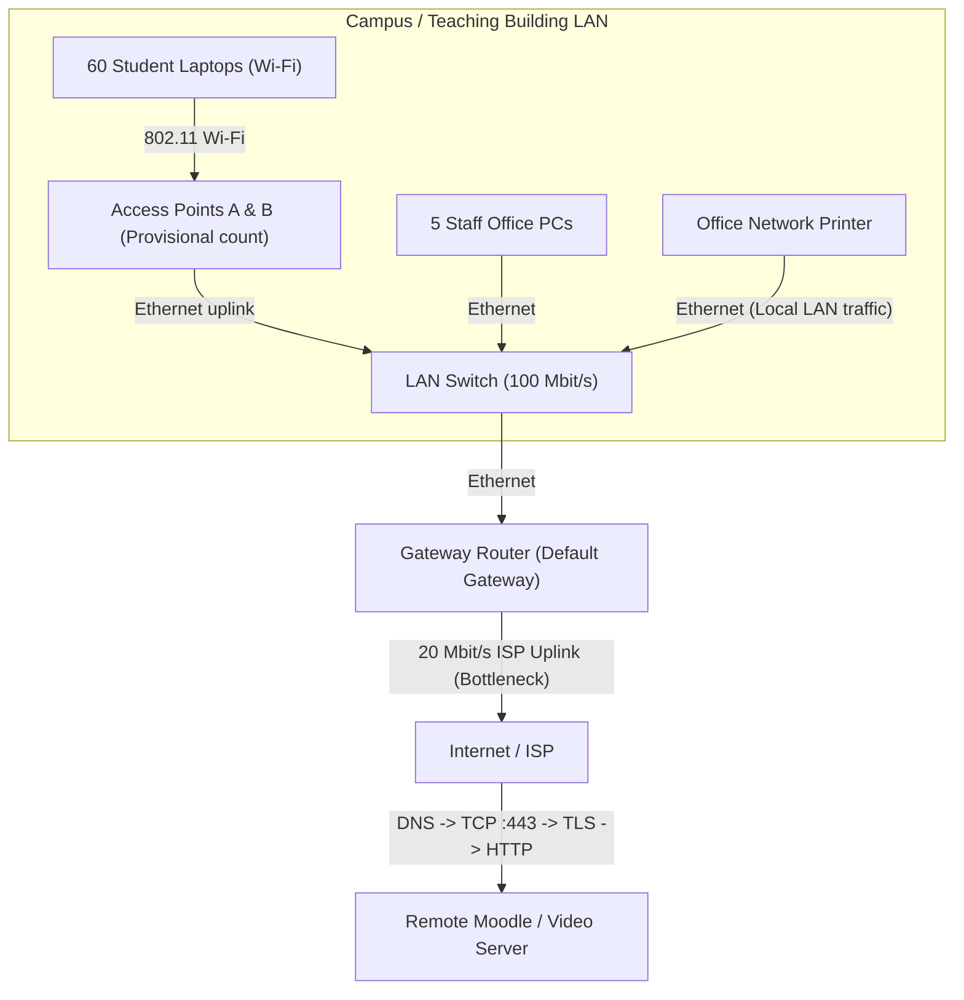

# Network System Design (SE026) — Course Overview

## What Is Network System Design?

Network System Design (`SE026`) is about connecting endpoints, switches, access points, routers, and application services so that real user tasks work reliably, fast enough, and securely—and proving with **evidence** (packet captures, commands, and calculations) rather than guesses that the design meets its requirements.

> [!NOTE]
> **The Core Dilemma:** Making two computers exchange a message on `127.0.0.1` is easy. Designing a network for 60 students and office staff means knowing where bottlenecks live, why ping alone never proves an app works, how packets are encapsulated across links, why reliable transfer needs sequence numbers and timers, and how to separate DNS, TCP, TLS, and HTTP failures.

---

## 6 Core Ideas Behind the Subject (Plain English)

1. **Start from user requirements, not equipment brands:** Separate **Requirements** (what users need), **Constraints** (fixed limits), **Assumptions** (claims needing confirmation), and **Open questions** (missing facts)—never invent capacities or budgets.
2. **Every hop adds delay and a single bottleneck sets throughput:** Packet delay is the sum of processing, queueing, transmission ($L/R$), and propagation ($d/s$). Ideal file transfer time is governed by the **slowest link** along the path.
3. **Layering isolates responsibilities and router hops rewrite frames:** Applications talk over sockets/ports; TCP/UDP handle process-to-process transport; IP handles host-to-host routing; Ethernet/Wi-Fi handle link-by-link frames. A router strips the incoming frame and builds a new frame for the next link while keeping IP addresses intact (without NAT/tunnels).
4. **Separate dependencies when troubleshooting:** Name lookup (**DNS**), transport reachability (**TCP**), encryption (**TLS**), and **HTTP** responses are independent layers. A `200 OK` with `text/html` can still be a login page instead of a PDF, and a `ping` reply never proves application login or capacity.
5. **Unreliable channels need labels, ACKs, timers, and framing:** TCP is an ordered **byte stream** (the app must frame messages, e.g., with `\n`), whereas UDP preserves **datagram boundaries** without delivery or order guarantees. Reliable transfer (`rdt3.0` → TCP) uses sequence numbers, cumulative ACKs, timeouts, and duplicate suppression.
6. **Pipelines, windows, and tests must be bounded and reproducible:** Stop-and-wait wastes most of each RTT waiting; pipelining keeps multiple segments in flight up to $\min(\text{rwnd}, \text{cwnd})$. Performance tests must fix workload, path, timer boundaries, and file-hash verification.

---

## 7-Week Course Map & Assessment

| Category | Weight | Notes (`Lecture 1, Slide 30` & `Quiz`) |
| :--- | :--- | :--- |
| **Attendance** | 10% | Class participation |
| **Class activities & quizzes** | 10% | In-class checkpoints & Moodle practice quizzes |
| **Assignments, reports & presentations** | 10% | Labs 1–6 evidence reports |
| **Midterm examination** | **30%** | **90-minute paper exam** requiring written answers and working (Weeks 1–6 + Week 7 Review) |
| **Final examination** | 40% | End-of-semester exam |

| Week | Lecture & Lab | Core Topics Covered |
| :--- | :--- | :--- |
| **Week 1** | Lecture 1 + Lab 1 | LANs, switches, APs, routers, default gateway, `ipconfig`/`ip`, ICMP `ping`/RTT & limits, requirements vs assumptions, labeled topology |
| **Week 2** | Lecture 2 + Lab 2 | 4 packet delays ($L/R$, $d/s$, $La/R$), buffer loss, bottleneck throughput, sniffing/spoofing/DoS & defenses, 5-layer stack, encapsulation, Wireshark & trust boundaries |
| **Week 3** | Lecture 3 + Lab 3 | Client-server vs P2P, sockets & ports, open vs proprietary protocols, HTTP requests/status codes, HTTP/2 vs HTTP/3 (QUIC), DNS hierarchy/TTL/records, `nslookup` vs `http.server` |
| **Week 4** | Lecture 4 + Lab 4 | TCP (`SOCK_STREAM`) vs UDP (`SOCK_DGRAM`) echo sockets, `127.0.0.1:12000` & ephemeral ports, newline framing & `recv` loops, absent-server timeouts/errors |
| **Week 5** | Lecture 5 + Lab 5 | Multiplexing/demultiplexing, UDP header, `rdt1.0` → `rdt3.0` (checksums, 0/1 labels, timers, ACK loss), stop-and-wait utilisation $U = T_{tx}/(T_{tx}+\text{RTT})$, pipelining |
| **Week 6** | Lecture 6 + Lab 6 | TCP segment header (RFC 9293), byte numbering & cumulative ACKs, `EstimatedRTT` & `TimeoutInterval`, `rwnd` vs `cwnd`, AIMD/CUBIC/Slow Start, 3-way handshake, ideal transfer time & reproducible tests |
| **Week 7** | Lecture 7 | **Midterm Review:** Campus network example, acceptance criteria, diagnostic chains, upgrade bottlenecks, printer access control & design validation |

---

## Recurring Case Study: Teaching Building / Campus Network

Across Lectures 1–7 and Labs 1–3, designs center on a small teaching building:
- **Users & Endpoints:** Two teaching rooms (**60 student laptops** total; or **30 students** in one room), a **staff office** (**5 fixed PCs** + **1 local network printer**), and **remote Moodle** + **video meetings**. (Lab 2 adds a **finance office** + **payroll service** trust boundary.)
- **Links & Assumptions:** Student laptops connect via **Wi-Fi (Access Points)**; fixed office PCs and printer connect via **Ethernet (Switch)**; **Gateway router** connects the LAN to the **ISP** (`20 Mbit/s` Internet link, `100 Mbit/s` local switch). AP count, cable routes, and simultaneous load remain **assumptions** until tested.

---

## Core Exam Formulas & Reference Tables

### Packet Delay, Throughput & Utilisation Formulas

| Formula | Equation | Units & Trap to Watch |
| :--- | :--- | :--- |
| **Transmission Delay** | $d_{trans} = \frac{L}{R}$ | Convert $L$ to **bits** ($\times 8$ if bytes) and $R$ to **bit/s** ($1\text{ Mbit/s} = 10^6\text{ bit/s}$). |
| **Propagation Delay** | $d_{prop} = \frac{d}{s}$ | Distance $d$ in **metres** ($1\text{ km} = 1,000\text{ m}$), speed $s \approx 2 \times 10^8\text{ m/s}$. |
| **Total Nodal Delay** | $d_{nodal} = d_{proc} + d_{queue} + d_{trans} + d_{prop}$ | Traffic intensity $La/R \to 1$ makes queueing delay blow up; $> 1$ makes delay infinite. |
| **Ideal File Transfer Time** | $T_{ideal} = \frac{\text{File bits}}{R_{bottleneck}}$ | Use **decimal units** ($1\text{ MB} = 10^6\text{ bytes} = 8 \times 10^6\text{ bits}$); slowest link $R_{min}$ sets rate. |
| **Useful Throughput** | $\text{Throughput} = \frac{\text{Verified file bits}}{\text{Elapsed seconds}}$ | Invalid/corrupted hash trials cannot count as successful throughput. |
| **Stop-and-Wait Utilisation** | $U = \frac{T_{tx}}{T_{tx} + \text{RTT}}$ | $T_{tx} = L/R$; cycle excludes loss and ACK tx/processing in ideal model. |
| **TCP Byte Numbering** | $\text{Last byte} = \text{Seq} + \text{Bytes} - 1$; $\text{ACK} = \text{Seq} + \text{Bytes}$ | **SYN** and **FIN** each consume **1** sequence number; a pure **ACK** consumes **0**. |
| **TCP Window & Rate** | $\text{Sendable} = \min(\text{rwnd}, \text{cwnd}) - \text{Outstanding}$ | Window-limited rate $\approx \text{Window (bytes)} / \text{RTT (s)} \times 8$. |
| **TCP Timeout** | $\text{TimeoutInterval} = \text{EstimatedRTT} + 4 \times \text{DevRTT}$ | $\text{DevRTT} = (1-\beta)\text{DevRTT} + \beta\lvert\text{SampleRTT} - \text{EstimatedRTT}\rvert$ ($\beta = 0.25$). |

### HTTP Status Codes & DNS Record Types

| Code / Record | Meaning | Key Exam Distinction |
| :--- | :--- | :--- |
| **`200 OK`** | Request succeeded, body returned | Does **not** prove the body is the intended PDF (e.g., could be an HTML login form). |
| **`301 Moved Permanently`** | Resource moved | New URL appears in the `Location:` response header. |
| **`400 Bad Request`** | Request not understood | Client syntax error. |
| **`404 Not Found`** | Document missing on server | Proves DNS, TCP, and HTTP server **all worked**—only the path is missing. |
| **`503 Service Unavailable`** | HTTP responder unavailable | Proves DNS and TCP succeeded; failure is at the HTTP server/application layer. |
| **`A` / `AAAA` Record** | Hostname → IPv4 / IPv6 address | `A` = 32-bit IPv4; `AAAA` = 128-bit IPv6. |
| **`NS` / `CNAME` / `MX`** | Authoritative NS / Alias / Mail server | `CNAME` maps an alias to a canonical (real) hostname. |

---

## Hard Vocabulary Decoder

| Term | Plain-English Meaning | Course Example |
| :--- | :--- | :--- |
| **Bottleneck Link** | The slowest link along an end-to-end path that caps ideal sustained throughput. | Upgrading a `100 Mbit/s` switch to `1 Gbit/s` does **not** speed up a `20 Mbit/s` Internet bottleneck. |
| **Encapsulation** | Wrapping payload with transport ($H_t$), network ($H_n$), and link ($H_l$) headers down the stack. | Router removes incoming $H_l$ frame and creates a new $H_l$ frame for the next link; IP $H_n$ stays intact. |
| **Ephemeral Port** | Temporary client port assigned by the OS for one connection/socket. | Client connects from a dynamic OS port to server `127.0.0.1:12000`. |
| **Message Framing** | Rules an application uses to mark where one message ends inside a TCP byte stream. | `echo.py` appends `\n` and loops `recv()` until `\n`, close, or `4096` bytes. |
| **Alternating-Bit (`rdt3.0`)** | Stop-and-wait model using `0/1` whole-packet labels + timer to survive bit errors and loss. | `DATA0`/`ACK0` are toy teaching labels—**never** confuse them with TCP byte numbers. |
| **Cumulative ACK** | TCP ACK number naming the **next contiguous byte expected** (pointing to the first gap). | Receiver has `1000–1199` and buffered `1400–1599` → keeps sending `ACK 1200` until `1200–1399` arrives. |
| **AIMD & Slow Start** | Slow Start doubles `cwnd` (`4→8→16 MSS`) up to `ssthresh`; AIMD adds `+1 MSS/RTT` and halves on loss. | Loss at `10 MSS` drops `cwnd` to `5 MSS`; CUBIC grows slowly near old peak, faster past it. |
| **0-RTT (QUIC)** | Returning client sends early application data immediately on reconnect. | Early data can be **replayed**, so apps restrict what is sent in 0-RTT. |
