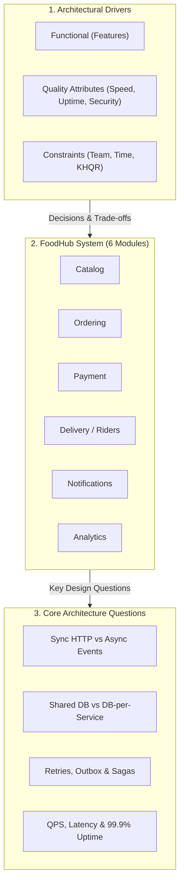

# Software System Architecture — Course Overview

## What Is Software Architecture?

> “The software architecture of a system is the set of structures needed to reason about the system. These structures comprise software elements, relations among them, and properties of both.”
> — *Bass, Clements and Kazman, Software Architecture in Practice* (Week 1, Slide 6)

> “A shorter version: architecture is **the important stuff**, the decisions that are hard to change later.”
> — *After Ralph Johnson, as quoted by Martin Fowler* (Week 1, Slide 6)

> [!NOTE]
> **Why It Matters:** Almost any structure can deliver the features. Software architecture is about structuring the system so it delivers the required **speed, uptime, security, and ease of change**—without breaking when traffic grows or a server fails.

---

## 6 Core Ideas Behind the Subject (Plain English)

1. **Structure decides how well the app runs:** Features work in almost any layout, but only the right structure gives you good speed, uptime, security, and easy maintenance.
2. **Focus on hard-to-change decisions and trade-offs:** Architecture is about big choices that take weeks or months to undo. You can't maximize everything—every decision gives something up, so choose on purpose based on your team, deadline, budget, and traffic.
3. **Keep parts cleanly separated:** Put things that change together in the same module, and make parts talk through small interfaces so you can change one piece (or swap a database) without breaking the rest.
4. **Start simple, split only when needed:** Systems tend to copy how teams communicate (*Conway's law*). Start a small team with a clean modular monolith, and split into microservices only when many teams or very different workloads actually need it.
5. **Plan for networks and servers to fail:** Every network call can be slow, dropped, or retried. Use stateless servers, idempotency keys, queues/events, dead-letter queues, sagas, and the transactional outbox so crashes don't lose or duplicate data.
6. **Write it down with real numbers:** Replace vague wishes (*"fast"*, *"reliable"*) with measurable numbers (quality scenarios and QPS estimates), simple diagrams (C4 and sequence), and short Architecture Decision Records (ADRs) stored in Git.

---

## 16-Week Course Map (Week 1, Slide 3)

| Weeks | Phase | Topics Covered |
| :--- | :--- | :--- |
| **Weeks 1–2** | **Foundations** *(Midterm)* | Drivers, quality attributes, C4, ADRs, estimates |
| **Weeks 3–4** | **Communication** *(Midterm)* | Networking, DNS, HTTP, CDN, web concepts, APIs |
| **Weeks 5–7** | **Styles** *(Midterm)* | Monolith, modular, microservices, DDD, events |
| **Week 8** | **Midterm exam** | Covers weeks 1–7 |
| **Weeks 9–12** | **Scale and data** | Load balancing, databases, distributed data, caching |
| **Weeks 13–14** | **Operate** | Reliability, disaster recovery, observability, security |
| **Week 15** | **Evolve** | Deployment, migration, AI-era systems, presentations |
| **Week 16** | **Final exam** | Whole course |

### Midterm Breakdown (Weeks 1–7)

| Week | Topic | Subtitle |
| :--- | :--- | :--- |
| **Week 1** | Introduction to Software Architecture | What architecture is, why it matters, and how to describe what a system must do well |
| **Week 2** | Designing and Documenting Architecture | Draw it, decide it, write it down, and size it with numbers |
| **Week 3** | Networking and Communication | What really happens between typing a URL and seeing the page |
| **Week 4** | Web Concepts and API Design | Sessions, tokens, good APIs, gateways, data formats and CORS |
| **Week 5** | Architectural Styles I: Monolith, Layered, Modular | How to structure one application so it stays easy to change |
| **Week 6** | Architectural Styles II: Microservices and DDD | Where to draw service boundaries, and whether to split at all |
| **Week 7** | Event-Driven Architecture and Messaging | Queues, streams, delivery guarantees, sagas and the outbox |

---

## Our Case Study All Semester: FoodHub (Phnom Penh)

Customers order from restaurants, riders deliver, and people pay by card, KHQR or cash.

### FoodHub Numbers & Constraints (Weeks 1–2 Slides & Handouts)

| Category | Exact Figures & Constraints |
| :--- | :--- |
| **Scale** | `200,000` registered users · `20,000` orders per day · `1,500` restaurants (~50 menu items each) · `800` riders |
| **Multipliers** | **5×** the average load at lunch and dinner peaks · **10×** growth expected within two years |
| **Constraints** | Launch in **6 months** · **8 developers** who know TypeScript (NestJS and Vue) · **no dedicated operations staff** · must integrate **KHQR and bank payment APIs** · riders use **low-cost Android phones on mobile data** |
| **Traffic (QPS)** | `20,000 ÷ 86,400 = 0.23` orders/s avg (`1.16`/s peak, `11.6`/s in 2 yrs) · 30 API calls/order → `600,000/day → 7 QPS` avg → **35 QPS** at peak → **350 QPS** in 2 yrs *(mental maths: `~100,000 s/day`)* |
| **Storage** | Order data: `20,000 × 2 KB ≈ 40 MB per day ≈ 15 GB per year` · Menu photos: `1,500 × 50 × 200 KB ≈ 15 GB` |
| **Rider GPS** | `400` active riders (50% at peak), one update every 5 s → **≈ 80 writes per second** (more than orders!) |
| **Useful Latencies** | Read from memory `≈ 100 ns` · Round trip in a data centre `≈ 0.5 ms` · Read 1 MB from SSD `≈ 1 ms` · Phnom Penh ↔ Singapore `≈ 30–50 ms` · Mobile 4G round trip `≈ 50–100 ms` (first HTTPS page `300–500 ms`) |
| **Availability** | `99.9%` of a 30-day month = **≈ 43 min** downtime (`30 × 24 × 60 × 0.001`) · 3 services at `99.9%` in sequence = `0.999³ ≈ 99.7%` |

---

## Quick Reference: HTTP Status Codes & Hard Vocabulary

### HTTP Status Codes

| Code | Meaning | When Used |
| :--- | :--- | :--- |
| **`200 OK`** | Standard success | `GET` / `PATCH` / `PUT` (or cached `Idempotency-Key` retry) |
| **`201 Created`** | Resource created | Successful `POST` creating a new resource (e.g., `POST /v1/orders` + `Location`) |
| **`204 No Content`** | Success, empty body | Successful `DELETE` removing a resource |
| **`400 Bad Request`** | Client validation error | Wrong field type, missing field, bad query |
| **`401 Unauthorized`** | Not logged in | Missing, expired, or invalid session/token |
| **`403 Forbidden`** | Not allowed | Logged in, but lacks permission (e.g., deleting someone else's review) |
| **`404 Not Found`** | Missing resource | Unknown ID or route |
| **`409 Conflict`** | State / uniqueness conflict | Duplicate review or illegal order status change (`PLACED → DELIVERED`) |
| **`500 Internal Server Error`** | Server crash | Unhandled backend error |
| **`502 Bad Gateway`** | Upstream unreachable | Reverse proxy (nginx) cannot reach a stopped/crashed backend |

### Hard Vocabulary Decoder

| Term | Plain-English Meaning | FoodHub Example |
| :--- | :--- | :--- |
| **Idempotent** | Repeating the same operation gives the **same final result** as doing it once. | `POST /v1/orders` with `Idempotency-Key` returns the first order on retry; consumer skips already-seen `eventId`. |
| **Stateless vs Stateful** | **Stateless:** every request carries what the server needs (any server can answer). **Stateful:** server remembers the client in memory. | Stateless replicas scale out easily; an in-memory `SESSIONS` Map breaks on restart or behind 3 servers. |
| **High Cohesion / Loose Coupling** | **High cohesion:** things that change together stay together. **Loose coupling:** parts depend on each other through small, stable interfaces. | All order rules live in `OrderingModule`; it calls `CatalogService` instead of `CatalogRepository`. |
| **Temporal Coupling** | If the callee is down right now, the caller fails too. | 3 sync REST calls at `99.9%` drop availability to `0.999³ ≈ 99.7%`. |
| **Eventual Consistency** | Data across separate services isn't updated at the exact same instant, but catches up via events. | Ordering updates its local copy shortly after Catalog publishes `RestaurantRenamed`. |
| **Reverse Proxy & Upstream** | **Reverse proxy** sits in front of servers (TLS, routing, hiding internal ports); **upstream** is the backend server behind it. | nginx on `:443` proxies to NestJS `:3000`; stopped backend → `502 Bad Gateway`. |
| **Bounded Context** | A boundary inside which a model and its words have one meaning. | `"Order"` in Ordering = items, prices, rules; `"Order"` in Delivery = pickup, drop-off, rider, ETA. |
| **Ubiquitous Language** | Developers and business use the same words in talk and code. | Everyone says `OrderPlaced` and `OrderAccepted`. |
| **Anti-Corruption Layer (ACL)** | A translator that protects our model from a messy external one. | Payment adapter maps bank codes into FoodHub's own payment statuses. |
| **Conformist** | Downstream simply accepts the upstream's model as it is. | FoodHub uses the KHQR provider's API as it is. |
| **Dual-Write Problem** | "Save to DB" and "publish to broker" cannot be one transaction, so one may happen without the other. | Order commits to Postgres, then the process crashes before RabbitMQ gets `OrderPlaced`. |
| **Transactional Outbox & CDC** | INSERT domain row + outbox row in **one local transaction**, then a relay job or **CDC** (like Debezium) publishes it. | Guarantees events are published without slow two-phase commit locks. |
| **Compensating Action (Saga)** | An undo step run when a later step in a multi-service flow fails. | Restaurant rejects after payment → Payment issues `RefundIssued`, order marked `REJECTED`. |
| **CQRS & Event Sourcing** | **CQRS:** separate models for writes (commands) and reads (queries). **Event sourcing:** store the events, not the current state; replay to compute state. | Fast "restaurant dashboard" read table; payment ledger with full audit history. |
| **DLQ & Prefetch** | **DLQ:** dead-letter queue where messages go after they fail too often, for a human to inspect. **Prefetch:** limit on unacknowledged messages a consumer holds. | `ch.nack(msg, false, false)` sends bad messages to `kitchen.dlq`; `prefetch(1)` protects workers. |
