# Software Architecture Midterm — Quiz-Only Study Guide

> [!IMPORTANT]
> **Exam Blueprint (`TeachersNode.md`):** Friday **27 November 2026** · Paper-based · **~10 open questions** · **NO QCM** · Worth **30%** · **60% Theory & Concept** (*"Explain…"* only, no *"What is…"*, e.g., Transactional Outbox) · **40% Practical** (e.g., Week 5/6 Event Storming) · Lectures **1 to 7**.
> Every multiple-choice item from Quizzes 1–7 below has been converted into an open **"Explain why / how…"** question using the exact instructor explanations and rubrics.

---

## Course Overview — What is Software System Architecture?

Software System Architecture (Bass, Clements & Kazman) is **"the set of structures needed to reason about the system: elements, their relations, and the properties of both."** Think of it as the **blueprint of a skyscraper**—showing steel beams, elevators, and weight limits rather than the colour of paint on the wall.

> [!NOTE]
> **The Core Dilemma:** Any junior programmer can write code that delivers a feature. Software architecture is about how the system is structured so it does not crash under 100,000 users, does not leak payment data, does not take three weeks to change one button, and can survive a server catching fire.

### 6 Core Ideas Behind the Subject

1. **Structure Drives Quality Attributes:** Almost any structure can deliver features, but *only specific structures* achieve target speed, availability, security, and maintainability.
2. **Hard-to-Change Decisions & Context-Driven Trade-offs:** Architecture covers system-wide choices that are expensive to reverse (events vs direct calls, monolith vs microservices). Every gain trades off against another quality or cost, guided by team size, deadline, budget, and scale.
3. **Boundaries & Decoupling:** Keep related rules cohesive inside clear boundaries (Ports & Adapters, DDD Bounded Contexts) with small interfaces and Anti-Corruption Layers isolating external systems.
4. **Organization Mirrors System (Conway's Law):** Systems mirror the communication structure of the teams building them. Small teams start cleanly with a **Modular Monolith** and split only when coordination or uneven load demands it.
5. **Design for Failure Over Unreliable Networks:** Packets drop, servers crash, and retries duplicate requests—so resilient systems rely on **stateless replicas**, **idempotency keys**, timeouts/circuit breakers, **async events**, **Sagas**, **Dead-Letter Queues**, and the **Transactional Outbox**.
6. **Make Architecture Visible & Measurable:** Replace vague adjectives (*"fast, available"*) with 6-part **Quality Attribute Scenarios**, back-of-the-envelope math, **C4 & Sequence diagrams**, and **immutable ADRs**.

### 7-Week Course Arc

| Week | Topic | Core Question Answered |
| :--- | :--- | :--- |
| **Week 1** | Intro to Software Architecture | What qualities and constraints drive the structure, and what trade-offs must we accept? |
| **Week 2** | Designing & Documenting | How do we estimate scale (QPS, storage) and document structures (C4, Sequence, ADRs)? |
| **Week 3** | Networking & Communication | How do DNS, TCP/QUIC, TLS 1.3, HTTP/2–3, reverse proxies, and CDNs move traffic safely? |
| **Week 4** | Web Concepts & API Design | How do we design REST/gRPC/GraphQL APIs, auth (Sessions vs JWT), CORS, and idempotent retries? |
| **Week 5** | Monolith, Layered & Modular | How do we keep one deployable clean using Modular Monoliths and Hexagonal Ports & Adapters? |
| **Week 6** | Microservices & DDD | How do we discover Bounded Contexts (Event Storming) and decide when to split services? |
| **Week 7** | Event-Driven & Messaging | How do RabbitMQ, Kafka, Sagas, DLQs, CQRS/Event Sourcing, and Outbox keep async flows reliable? |

### The FoodHub Case Study (Used Across All Quizzes)

- **Actors:** **Customers** (browse dishes, order, pay with KHQR), **Restaurants** (accept/reject, cook), **Riders** (pick up, deliver), and **Admin/Support**.
- **6 Subsystems / Modules:** `Catalog` (menus), `Ordering`, `Payment`, `Delivery / Riders`, `Notifications` (SMS), and `Analytics`.
- **4 Recurring Exam Lenses:** Every quiz tests how parts **talk** (sync HTTP vs async events), where **data lives** (one DB vs DB-per-service), how **failure is handled** (retries, DLQs, Sagas), and how we measure **speed and uptime**.

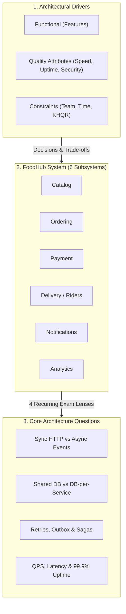

---

## Quick-Reference Formula & Comparison Sheet

### Back-of-the-Envelope & Availability Numbers

| Metric | Formula / Calculation | Result |
| :--- | :--- | :--- |
| **99.9% ("Three Nines") Downtime** | `30 × 24 × 60 = 43,200 min` → `0.1% × 43,200` | **≈ 43 min/month** |
| **99.99% ("Four Nines") Downtime** | `0.01% × 43,200 min` | **≈ 4.3 min/month** |
| **Serial Chain Availability** | 3 services in sequence at `99.9%`: `0.999³` | **≈ 0.997 (99.7%)** |
| **Average & Peak QPS** | `1,000,000 req/day ÷ 86,400 s/day` *(mental math: `~100,000 s/day`)* | **≈ 11.6 → ~12 req/s** |
| **Ride-Hailing Sizing (W2 Q11)** | `500,000 rides/day ÷ 86,400` · Peak `×4` · Storage `× 1 KB × 365` | **5.8 rides/s avg · 23/s peak · 180 GB/yr** |
| **Latency Hierarchy** | Fastest → Slowest (W2 Q8 key) | **RAM ~100 ns < In-DC RTT ~0.5 ms < SSD 1 MB ~1 ms < PNH–SIN ~30–50 ms** |

### 1. Functional Requirement vs Quality Attribute vs Constraint (Week 1)

| Category | What It Captures | Quiz Examples |
| :--- | :--- | :--- |
| **Functional (F)** | What the system does (features/behaviours), with no "how well". | "A customer can cancel an order before the restaurant accepts it." / "Customers can rate a restaurant after delivery." |
| **Quality Attribute (Q)** | How well the system works (availability, performance, security, consistency). | "95% of menu pages load within 1 s during lunch peak." / "Riders see customer address only after accepting delivery" (security/confidentiality). |
| **Constraint (C)** | A decision already fixed for the architect (team, deadline, standard). | "Built by existing team of 8 developers within 6 months." / "Payments must go through the KHQR standard." |

### 2. Session vs Self-Contained JWT & Cookie Flags (Week 4)

| Mechanism / Flag | How It Works | Key Strength / Weakness from Quiz Keys |
| :--- | :--- | :--- |
| **Server-Side Session + Cookie** | Session ID stored in cookie; state looked up on server. | Easy to revoke immediately; requires server/shared session lookup per request. |
| **Self-Contained JWT** | Signed (integrity), **NOT encrypted** (anyone can read payload — never put secrets in it). | No DB lookup per request, but **hard to revoke before expiry** (mitigate with short TTL + refresh tokens or revocation list). |
| **Cookie Flag: `HttpOnly`** | Hides cookie from `document.cookie` in browser JS. | Limits XSS damage (vs `Secure`, `SameSite`, `Max-Age`). |

### 3. Logical Layer vs Physical Tier & Monolith Styles (Weeks 5–6)

| Style / Concept | Definition & Structure | FoodHub Example / Trade-off |
| :--- | :--- | :--- |
| **Logical Layer** | Code organization by responsibility inside one program (strict: call only layer directly below). | Controllers → Services → Repositories inside the NestJS API. |
| **Physical Tier** | Separately running unit/process, often on its own machine. | 3-tier: Vue/Customer App ↔ NestJS API server ↔ PostgreSQL server. |
| **Monolith** | Single deployment; in-process calls; one database. | Simple ACID transactions and fast calls; cannot scale/deploy features independently. |
| **Modular Monolith** | One deployable split by business area; each owns its data and exposes a public interface (e.g., NestJS `exports: [CatalogService]` only). | Keeps single-DB simplicity while isolating modules for a future split. |
| **Distributed Monolith** | Multiple services that must always deploy together and share one database. | Worst of both worlds: all costs of distribution with none of the independence. |
| **Microservices** | Independently deployable services, each owning its data (database per service). | Independent deploy/scale & fault isolation, at the cost of network failures & eventual consistency (no cross-service ACID). |

### 4. RabbitMQ vs Kafka Comparison (Week 7 Q12)

| Dimension | RabbitMQ | Kafka |
| :--- | :--- | :--- |
| **Model** | Smart Broker / Dumb Consumer (exchanges → queues). | Append-Only Distributed Commit Log (topics + partitions). |
| **Message Lifetime** | Deletes message upon consumer acknowledgement. | Appends to log; keeps messages until retention period ends (consumers commit offsets). |
| **Ordering** | Per-queue ordering. | Guaranteed **within a partition** (use a key such as `orderId`). |
| **Replay** | Not designed for replay once acked. | Consumers/groups can reset offsets and replay historical events. |
| **Typical Use & FoodHub Fit** | Task queues (competing consumers) and flexible routing; simple to operate at low volume. | Event streaming, multiple independent consumer groups, and analytics replay. |

### 5. HTTP Status Codes Cheat Sheet

| Code | Meaning | When Used |
| :--- | :--- | :--- |
| **`200 OK`** | Standard success | `GET` / `PATCH` / `PUT` (or cached `Idempotency-Key` replay) |
| **`201 Created`** | Resource created | Successful `POST` creating a new entity (e.g., `POST /v1/orders`) |
| **`204 No Content`** | Success, empty body | Successful `DELETE` removing a resource |
| **`400 Bad Request`** | Client validation error | Wrong field type, missing field, malformed JSON |
| **`401 Unauthorized`** | Unauthenticated | Missing, expired, or invalid token/session |
| **`403 Forbidden`** | Unauthorized | Valid login, but user lacks permission |
| **`404 Not Found`** | Missing resource | Unknown ID or route |
| **`409 Conflict`** | State / uniqueness conflict | Duplicate review or illegal order state transition |
| **`500 Internal Server Error`** | Server crash | Unhandled backend exception |

---

## Hard Vocabulary & Software Engineering Decoder

| Term | Plain-English Meaning | FoodHub Example |
| :--- | :--- | :--- |
| **Idempotent / Idempotency** | Running the same request or event 2+ times gives the **exact same final result** as running it once (no duplicate orders or double charges). | `POST /v1/orders` with `Idempotency-Key` returns the existing order on retry; consumer checks `eventId` in DB before acting. |
| **Stateless vs Stateful** | **Stateless:** server forgets you after each request (you send a token every time). **Stateful:** server remembers you in memory/session. | Stateless API replicas scale easily behind a load balancer; an in-memory `SESSIONS` Map breaks on restart or across 3 servers. |
| **Cohesion vs Coupling** | **High cohesion:** things that change together live together. **Loose coupling:** modules depend only on small, stable interfaces. | All order rules live in `OrderingModule` (high cohesion), which talks to `CatalogService` instead of `CatalogRepository` (loose coupling). |
| **Temporal Coupling** | Two services are tied in time: if Service B is slow or down right now, Service A fails too. | Sync REST chain `Ordering → Payment → Delivery` fails if any one service goes down (`0.999³ ≈ 99.7%`). |
| **Eventual Consistency** | Data across services isn't updated in the same millisecond, but catches up shortly after via events. | Ordering updates its local read model a moment after Catalog emits `RestaurantRenamed`. |
| **Head-of-Line (HoL) Blocking** | One delayed/lost packet in a single TCP connection freezes all other requests sharing that connection. | HTTP/2 over TCP stalls all streams on 4G packet loss; HTTP/3 (QUIC/UDP) stalls only the one lost stream. |
| **Reverse Proxy & Upstream** | **Reverse proxy** sits in front of servers (TLS, routing, hiding ports); **upstream** is the backend app behind it. | nginx on `:443` forwards to upstream NestJS on `:3000`; if NestJS crashes, nginx returns `502 Bad Gateway`. |
| **Bounded Context** | A business boundary where words and models have one clear meaning. | `"Order"` in Ordering = items/prices/discounts; `"Order"` in Delivery = pickup/drop-off/rider/ETA. |
| **Ubiquitous Language** | One shared vocabulary used by both business people and developers in meetings, diagrams, and code. | Everyone says `OrderPlaced` and `OrderAccepted` rather than mixing "ticket", "cart", and "job". |
| **Anti-Corruption Layer (ACL)** | A translator/adapter that converts messy external API formats into your own clean domain model. | Payment adapter maps bank/KHQR numeric error codes into FoodHub's `PaymentAuthorised` / `PaymentFailed`. |
| **Dual-Write Problem** | Writing to a DB and publishing to a message broker are two separate actions—if one succeeds and the other crashes, data goes out of sync. | Order is saved in Postgres, then process crashes before RabbitMQ receives `OrderPlaced`. |
| **Transactional Outbox & CDC** | Save the domain row + an `outbox` event row in **one local DB transaction**, then a relay or **CDC** (Change Data Capture, e.g., Debezium reading DB logs) publishes it. | Guarantees `OrderPlaced` is never lost without needing 2PC. |
| **Compensating Action (Saga)** | An "undo" business action run when a later step in a multi-service flow fails (since you can't roll back another service's DB). | Restaurant rejects after payment → Payment emits `RefundIssued` to undo the charge. |
| **CQRS & Event Sourcing** | **CQRS:** separate write model from fast read models. **Event Sourcing:** store every change as an immutable event and replay to get current state (+ snapshots for speed). | Payment ledger stores every charge/refund event; a projection builds a fast Restaurant Dashboard table. |
| **DLX / DLQ & Prefetch** | **DLX/DLQ:** Dead-Letter Exchange/Queue where poison messages go for inspection. **Prefetch:** max unacked messages a worker holds (backpressure). | `ch.nack(msg, false, false)` sends bad JSON to `orders.dlx → kitchen.dlq`; `prefetch=1` stops 1 worker from hoarding all jobs. |

---

## Section 1 — Week 1: Introduction to Software Architecture

Covers: week 1 learning outcomes: what architecture is and why it matters; requirements vs quality attributes vs constraints; measurable quality attribute scenarios.

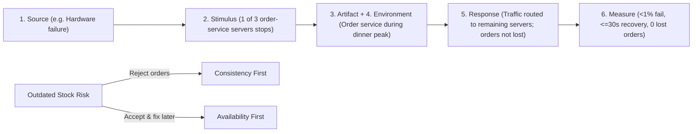

### Theory & Concept Questions (Part A)

<strong>Question 1.1: Explain what software architecture is, and why a list of features, a class diagram, or the choice of programming language is not enough.</strong>

**Answer:** Software architecture is **the set of structures needed to reason about the system: elements, their relations, and the properties of both**.

- **Explanation (Key):** The Bass, Clements and Kazman definition. A list of features is functionality, a class diagram is one design view, and the choice of programming language is a single (often minor) decision.

<strong>Question 1.2: Explain why deciding that ordering and delivery communicate through events instead of direct calls is an architectural decision for FoodHub, whereas variable naming, a sorting algorithm, or button colour is not.</strong>

**Answer:** Deciding that ordering and delivery communicate through events instead of direct calls is an architectural decision.

- **Explanation (Key):** It is expensive to change and affects many parts and several qualities. Naming a variable, choosing a sorting algorithm, and choosing the colour of the “Order now” button are local and cheap to change.

<strong>Question 1.3: Explain why “A customer can cancel an order before the restaurant accepts it.” is a functional requirement rather than a quality attribute, constraint, or scenario.</strong>

**Answer:** It is a **functional requirement**.

- **Explanation (Key):** It describes what the system does, with no “how well”.

<strong>Question 1.4: Explain why “The system must be built by the existing team of 8 developers and launch within 6 months.” is a constraint.</strong>

**Answer:** It is a **constraint**.

- **Explanation (Key):** A decision already made for the architect (team and deadline).

<strong>Question 1.5: Explain why “95% of menu pages load within 1 second during the lunch peak.” is written in a measurable way compared with “fast”, “highly available”, or “secure against hackers”.</strong>

**Answer:** Only “95% of menu pages load within 1 second during the lunch peak” is measurable.

- **Explanation (Key):** Only it has a measure (`95%`, `1 s`) and an environment (`lunch peak`).

<strong>Question 1.6: Explain what the environment describes in a quality attribute scenario.</strong>

**Answer:** The environment describes **the conditions when the stimulus happens (for example normal operation, peak load, or during a deployment)**.

- **Explanation (Key):** Environment = the conditions under which the stimulus arrives (not the cloud provider, users, or developer programming environment).

<strong>Question 1.7: Explain how to calculate how much downtime is allowed when a service must be available 99.9% of a 30-day month.</strong>

**Answer:** About **43 minutes** of downtime is allowed.

- **Explanation (Key):** `30 × 24 × 60 = 43,200 min`; `0.1% ≈ 43 min`.

<strong>Question 1.8: Explain why architects pay most attention to quality attributes rather than features.</strong>

**Answer:** **Almost any structure can deliver the features, but only some structures deliver the required speed, availability and security.**

- **Explanation (Key):** Features can be delivered by many structures; qualities depend on the structure.

<strong>Question 1.9: Explain what Conway’s law says, and distinguish it from Moore’s law and Brooks’s law.</strong>

**Answer:** Conway’s law says that **systems tend to mirror the communication structure of the organisation that builds them**.

- **Explanation (Key):** Transistor doubling every two years is **Moore’s law**, and adding developers to a late project makes it later is **Brooks’s law**.

<strong>Question 1.10: Explain the trade-off when FoodHub can either reject orders when the restaurant’s stock data might be out of date, or accept them and fix problems later.</strong>

**Answer:** This is a trade-off between **consistency and availability**.

- **Explanation (Key):** Rejecting = consistency first; accepting = availability first. (Comes back in week 11.)

### Practical Questions (Part B)

<strong>Question 1.11: Classify each statement as a functional requirement (F), quality attribute (Q) or constraint (C), and give a one-line reason: (a) Riders see the customer’s address only after accepting the delivery; (b) Customers can rate a restaurant after delivery; (c) Payments must go through the KHQR standard.</strong>

- **a) Q** (security/confidentiality: it limits who sees personal data; the feature is “show address”, the restriction is a quality). *(Also accept “F” if explained as an access-control feature that identifies the security concern.)*
- **b) F** (describes what the system does).
- **c) C** (the payment standard is fixed, not chosen by the team).

**Rubric (3 pts):** 1 point per correct classification; the reason is required for full marks on that item.

<strong>Question 1.12: Rewrite this vague requirement as a complete quality attribute scenario with all six parts: “FoodHub should keep working when a server fails.”</strong>

- **Source & Stimulus:** Hardware failure / one of the three order-service servers stops.
- **Artifact & Environment:** Order service / during dinner peak.
- **Response:** Traffic is routed to the remaining servers; orders in progress are not lost.
- **Measure:** Fewer than 1% of requests fail, for no more than 30 seconds; no confirmed orders lost.

**Rubric (4 pts):** 1 pt concrete source & stimulus; 1 pt artifact & environment; 1 pt response describes system behaviour; 1 pt measure is a number with a unit.

<strong>Question 1.13: Name one trade-off FoodHub faces that is not on the slides. Say which side you would choose, and why.</strong>

- **Valid examples (Rubric):** Performance vs data freshness of rider location, cost vs availability of a second data centre, usability vs security of one-tap reorder, or time to market vs maintainability.
- **Model choice (Cost vs Availability):** Choose single-region with backups over a second active data centre for launch, because FoodHub has 8 developers, a 6-month deadline, and a fixed monthly budget.

**Rubric (3 pts):** 1 pt real conflict between two qualities; 1 pt choosing a side; 1 pt reason tied to FoodHub (its users, numbers or constraints).

---

## Section 2 — Week 2: Designing and Documenting Architecture

Covers: C4 diagrams, sequence diagrams, ADRs, system-level design principles, the design process and back-of-the-envelope estimates.

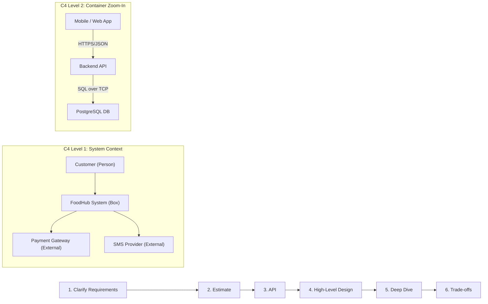

### Theory & Concept Questions (Part A)

<strong>Question 2.1: Explain what a “container” is in the C4 model, and why it does not mean a Docker container.</strong>

**Answer:** Something that runs or stores data separately, such as a mobile app, an API or a database.

- **Explanation (Key):** A C4 container is a separately running or data-storing unit. It may run in Docker, but that is not what the word means.

<strong>Question 2.2: Explain which diagram shows the payment gateway and the SMS provider as boxes outside FoodHub.</strong>

**Answer:** The **system context diagram** (C4 Level 1).

- **Explanation (Key):** External systems and people are the focus of the context diagram.

<strong>Question 2.3: Explain why the PostgreSQL database belongs on a container diagram but not on the system context diagram.</strong>

**Answer:** **The PostgreSQL database** belongs on the container diagram (Level 2), not the system context diagram.

- **Explanation (Key):** The database is inside FoodHub, so it appears only when we zoom in (level 2).

<strong>Question 2.4: Explain which part of an ADR records the facts and forces at the time the decision was made.</strong>

**Answer:** **Context** (vs Status, Decision, Consequences).

- **Explanation (Key):** Context records the forces; consequences record the results.

<strong>Question 2.5: Explain what a team should do when an accepted ADR turns out to be wrong a year later.</strong>

**Answer:** **Write a new ADR that supersedes the old one** (never edit or delete it).

- **Explanation (Key):** ADRs are immutable; the history of decisions is valuable.

<strong>Question 2.6: Explain how to estimate average requests per second for a system with 1,000,000 requests per day.</strong>

**Answer:** About **12** requests per second on average.

- **Explanation (Key):** `1,000,000 ÷ 86,400 ≈ 11.6`, so about 12 per second.

<strong>Question 2.7: Explain why we design for the peak rather than the average load.</strong>

**Answer:** **The system must still work when the most users are active, such as at lunch time.**

- **Explanation (Key):** A system sized for the average fails at the peak, when it matters most.

<strong>Question 2.8: Explain the speed ordering between reading from memory (RAM), an in-data-centre round trip, reading 1 MB from an SSD, and a Phnom Penh–Singapore round trip.</strong>

**Answer:** **Reading a value from memory (RAM)** is fastest.

- **Explanation (Key):** Memory `≈ 100 ns`; in-DC round trip `≈ 0.5 ms`; SSD 1 MB `≈ 1 ms`; Phnom Penh–Singapore `≈ 30–50 ms`.

<strong>Question 2.9: Explain why a system with three main parts matching its three teams (mobile, backend and payments) illustrates Conway’s law.</strong>

**Answer:** This is an example of **Conway’s law**.

- **Explanation (Key):** Systems mirror the communication structure of the organisation.

<strong>Question 2.10: Explain what comes directly after “clarify requirements” in the six-step design process.</strong>

**Answer:** **Estimate** comes directly after “clarify requirements”.

- **Explanation (Key):** `Clarify → estimate → API → high-level design → deep dive → trade-offs`.

### Practical Questions (Part B)

<strong>Question 2.11: A ride-hailing app has 500,000 rides per day. Each ride produces one 1 KB record, and the peak is 4× the average. Estimate (a) average rides per second, (b) peak rides per second and (c) storage per year. Show your working and units.</strong>

- **(a) Average:** `500,000 ÷ 86,400 ≈ 5.8 rides/s` (1 pt).
- **(b) Peak:** `5.8 × 4 ≈ 23 rides/s` (1 pt).
- **(c) Storage/year:** `500,000 × 1 KB = 500 MB/day`; `× 365 ≈ 180 GB/year` (1 pt).
- *(Accept 100,000 s/day → `5 /s`, `20 /s`.)*

**Rubric (4 pts):** 1 pt each for (a), (b), (c); 1 pt for units on every result and visible working.

<strong>Question 2.12: List three containers you would draw on a container diagram for a simple online bookshop, with the technology and the protocol between two of them.</strong>

- **Containers + Technology:** Web front end in `Vue`, backend API in `NestJS`, `PostgreSQL` database *(also accept search engine, object storage for book covers)*.
- **Protocols:** `HTTPS/JSON` between front end and API; `SQL over TCP` between API and database.

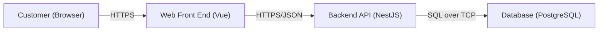

**Rubric (3 pts):** 1 pt three sensible containers; 1 pt technology on each; 1 pt correct protocol.

<strong>Question 2.13: Write the Context and Consequences (one good, one bad) of a short ADR: “Use one PostgreSQL database for all FoodHub data.”</strong>

- **Context:** One team (8 devs), transactions needed between orders and payments, about `15 GB/year`, `35 QPS` peak.
- **Good consequence:** ACID transactions, one thing to operate and back up, simple joins.
- **Bad consequence:** Single point of failure until replicated; write scaling limit at much larger scale; all modules share one schema so coupling must be controlled.

**Rubric (3 pts):** 1 pt context with real forces; 1 pt good consequence; 1 pt bad consequence.

---

## Section 3 — Week 3: Networking and Communication

Covers: IP addressing and NAT, TCP and UDP, HTTP versions, TLS, DNS, client-server styles, proxies and CDNs.

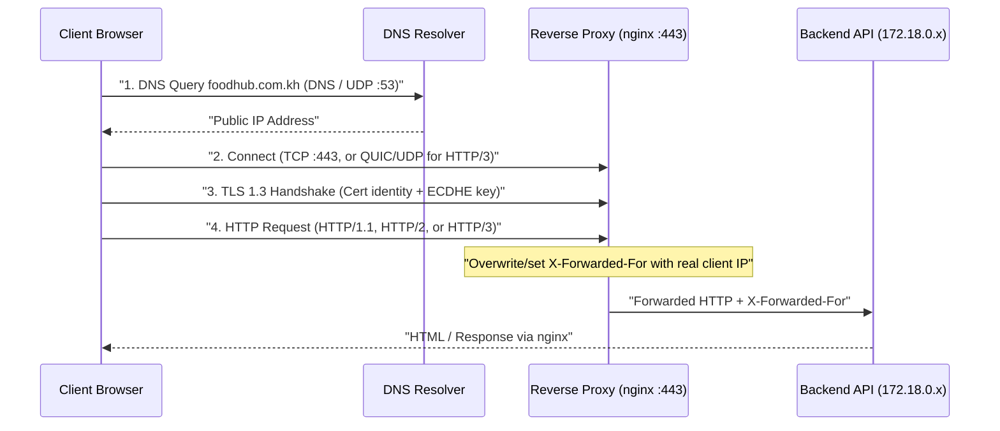

### Theory & Concept Questions (Part A)

<strong>Question 3.1: Explain why 192.168.1.20 is a private IPv4 address while 8.8.8.8, 203.0.113.10, and 1.1.1.1 are public.</strong>

**Answer:** `192.168.1.20` is a private IPv4 address.

- **Explanation (Key):** `192.168.0.0/16` is a private range; the others are public.

<strong>Question 3.2: Explain how UDP handles connection setup, delivery guarantees, and ordering compared with TCP.</strong>

**Answer:** UDP **sends packets without a connection and does not guarantee delivery or order**.

- **Explanation (Key):** UDP is connectionless and best effort; reliability is TCP's job.

<strong>Question 3.3: Explain the main improvement of HTTP/2 over HTTP/1.1.</strong>

**Answer:** **Many requests can share one connection at the same time (multiplexing).**

- **Explanation (Key):** Multiplexing over one connection; HTTP semantics are unchanged.

<strong>Question 3.4: Explain what HTTP/3 runs on top of and how it improves on TCP.</strong>

**Answer:** HTTP/3 runs on top of **QUIC, which uses UDP**.

- **Explanation (Key):** QUIC is a transport built on UDP with its own reliability and built-in TLS.

<strong>Question 3.5: Explain what the server’s certificate is mainly used for in TLS 1.3, as distinct from session key creation.</strong>

**Answer:** **Proving the server's identity.**

- **Explanation (Key):** Key agreement (ECDHE) creates the session key; the certificate proves identity.

<strong>Question 3.6: Explain what a DNS record TTL of 3,600 means.</strong>

**Answer:** **Resolvers may cache the answer for up to one hour.**

- **Explanation (Key):** TTL is the cache lifetime in seconds.

<strong>Question 3.7: Explain what a CNAME record is used for (versus A, MX, and TXT).</strong>

**Answer:** **CNAME** points one name to another name, for example to a CDN host.

- **Explanation (Key):** CNAME maps a name to another name.

<strong>Question 3.8: Explain why nginx in front of FoodHub’s API servers is a reverse proxy (versus a forward proxy).</strong>

**Answer:** **nginx in front of FoodHub's API servers, handling TLS and forwarding requests**, is a reverse proxy.

- **Explanation (Key):** A reverse proxy works for the servers; a company proxy filtering employee browsing or a browser extension hiding your IP are forward proxies.

<strong>Question 3.9: Explain why a stateless server is easier to scale.</strong>

**Answer:** **Any copy of the server can answer any request, so more copies can be added behind a load balancer.**

- **Explanation (Key):** No per-client memory on the server, so requests can go to any instance.

<strong>Question 3.10: Explain why restaurant menu photos are the best fit for a CDN (versus current order status, payment confirmations, or the admin dashboard).</strong>

**Answer:** **Restaurant menu photos** fit a CDN best.

- **Explanation (Key):** Public, large and rarely changing. Order status, payment confirmations, and admin dashboards are personal or changing.

### Practical Questions (Part B)

<strong>Question 3.11: List, in order, the four main steps between a customer typing foodhub.com.kh and receiving the HTML. For each step, name the protocol.</strong>

1. **DNS lookup** of the name to get an IP (**DNS**, usually UDP port 53).
2. **Open a connection** to the IP on port 443 (**TCP**, or **QUIC over UDP** for HTTP/3).
3. **TLS handshake**: key agreement and certificate check (**TLS 1.3**).
4. **Send the HTTP request** and receive the HTML (**HTTP/1.1, HTTP/2 or HTTP/3**).

**Rubric (4 pts):** 1 point per step.

<strong>Question 3.12: FoodHub will move its API to a new server next week. Its DNS record has a TTL of 86,400 seconds. What problem could this cause, and what should the team do before the move?</strong>

- **Problem:** Resolvers and devices may keep the old IP for up to 24 hours, so some users still reach the old server.
- **Procedure:** Lower the TTL (e.g., to 300 s) at least one TTL (a day) before the move; keep the old server running (or forwarding) until the old TTL has passed; raise the TTL again afterwards.

**Rubric (3 pts):** 1 pt stale cache up to 24 h; 1 pt lower TTL at least one TTL ahead; 1 pt keep old server running/forwarding then raise TTL.

<strong>Question 3.13: A backend behind nginx logs every request as coming from 172.18.0.3. Why? How can the backend learn the real client IP, and what is the security risk of that method?</strong>

- **Why:** The TCP connection to the backend comes from the proxy, so the backend sees the proxy's IP.
- **How:** The proxy adds `X-Forwarded-For` (or `X-Real-IP` / `Forwarded`) with the client IP, and the backend reads it.
- **Security risk:** The header can be forged by clients, so the backend must only trust it when the request comes from its own proxy (and the proxy must overwrite, not append, untrusted values).

**Rubric (3 pts):** 1 pt proxy TCP connection; 1 pt forwarded header; 1 pt spoofing risk + trust own proxy / overwrite untrusted values.

---

## Section 4 — Week 4: Web Concepts and API Design

Covers: sessions and tokens, cookie flags, JWT, API styles, REST design, API gateways, serialization and CORS.

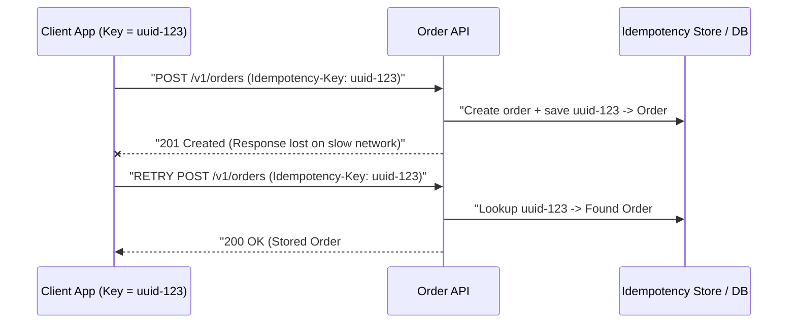

### Theory & Concept Questions (Part A)

<strong>Question 4.1: Explain which cookie flag stops JavaScript on the page from reading the session cookie.</strong>

**Answer:** **HttpOnly** (vs Secure, SameSite, Max-Age).

- **Explanation (Key):** `HttpOnly` hides the cookie from `document.cookie`, limiting XSS damage.

<strong>Question 4.2: Explain the main weakness of a self-contained JWT compared with a server-side session.</strong>

**Answer:** **It is hard to revoke before it expires.**

- **Explanation (Key):** Any server accepts it until expiry; fix with short TTL + refresh tokens or a revocation list.

<strong>Question 4.3: Explain why a JWT payload is not confidential even though it is signed.</strong>

**Answer:** A JWT payload is **signed, so it cannot be changed without detection, but anyone can read it**.

- **Explanation (Key):** Signed (integrity), not encrypted (confidentiality). Never put secrets in it.

<strong>Question 4.4: Explain the correct HTTP request and success status code when a client creates a new order.</strong>

**Answer:** **`POST /v1/orders → 201`**.

- **Explanation (Key):** Create = `POST` to the collection; `201 Created`.

<strong>Question 4.5: Explain which status code fits when the client sends {"restaurantId": "abc"} where a number is required.</strong>

**Answer:** **`400`** (Bad Request).

- **Explanation (Key):** Invalid input is a client error.

<strong>Question 4.6: Explain why POST is not idempotent whereas GET, PUT, and DELETE are.</strong>

**Answer:** **POST** is not idempotent.

- **Explanation (Key):** Repeating `POST` creates another resource, unless an idempotency key is used.

<strong>Question 4.7: Explain why a webhook fits best when a payment provider must tell FoodHub the moment a payment succeeds.</strong>

**Answer:** **A webhook: the provider sends an HTTP POST to FoodHub.**

- **Explanation (Key):** The provider pushes the event; polling wastes requests and adds delay.

<strong>Question 4.8: Explain which tasks belong in an API gateway and why calculating the delivery fee for an order does not.</strong>

**Answer:** **Calculating the delivery fee for an order** does not belong in an API gateway (routing, rate limiting, and checking the access token do).

- **Explanation (Key):** Business rules belong in services, not the gateway.

<strong>Question 4.9: Explain how CORS works, who enforces it, and why it does not stop attackers using curl.</strong>

**Answer:** **It is enforced by browsers, which only give a cross-origin response to the page if the server allows that origin.**

- **Explanation (Key):** CORS protects users' browsers, not the API.

<strong>Question 4.10: Explain why Protobuf and Avro are good for long-lived event data.</strong>

**Answer:** **They support schema evolution, so fields can be added without breaking old readers.**

- **Explanation (Key):** Both were designed for schema evolution with typed schemas.

### Practical Questions (Part B)

<strong>Question 4.11: Design three REST endpoints for FoodHub restaurant reviews (list a restaurant’s reviews, add a review, delete your own review). For each give the method, path, success code and one error code.</strong>

- **List:** `GET /v1/restaurants/{id}/reviews?limit=20&offset=0 → 200` (`404` unknown restaurant).
- **Add:** `POST /v1/restaurants/{id}/reviews → 201` (`400` invalid rating, `401` not logged in, `409` already reviewed).
- **Delete own:** `DELETE /v1/reviews/{reviewId} → 204` (`403` or `404` not the author, `404` missing).

**Rubric (4 pts):** 1 pt per correct endpoint (method + noun path + success code); 1 pt for sensible error codes and pagination.

<strong>Question 4.12: A customer taps “Order” on a slow network. The order is created but the response never arrives, and the app retries. What goes wrong without protection, and how does an idempotency key fix it?</strong>

- **Without protection:** The retry creates a second order (and may charge twice).
- **Idempotency key:** The client generates a unique key per order attempt and sends it in an `Idempotency-Key` header, reusing it on retries. The server stores `key → result`; a repeated key returns the stored result (e.g., `200` with the same order) instead of creating a new one.

**Rubric (3 pts):** 1 pt duplicate order/charge; 1 pt client unique key reused on retries; 1 pt server stores key → result and returns stored response.

<strong>Question 4.13: A Vue app on http://localhost:5173 calls an API on http://localhost:3000 and gets “blocked by CORS policy”, but the same request works with curl. Explain why, and give the fix on the server.</strong>

- **Why:** The origins differ (port `5173` vs `3000`), so the same-origin policy applies. CORS is enforced by the browser only; `curl` ignores it.
- **Server fix:** Return `Access-Control-Allow-Origin: http://localhost:5173` (in NestJS: `app.enableCors({ origin: 'http://localhost:5173', credentials: true })`), not `*` when cookies are used.

**Rubric (3 pts):** 1 pt different origins (port); 1 pt browser-only vs curl; 1 pt explicit allow-origin header / NestJS config without `*` for credentials.

---

## Section 5 — Week 5: Monolith, Layered and Modular Styles

Covers: monolith, layered and N-tier, modular monolith, hexagonal architecture, pipe-and-filter, microkernel and SOA.

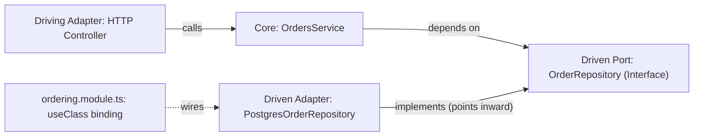

### Theory & Concept Questions (Part A)

<strong>Question 5.1: Explain what is a real strength of a monolith (and why independent scaling or deploy independence are not).</strong>

**Answer:** **Calls between parts are in-process function calls, and one database makes transactions simple.**

- **Explanation (Key):** In-process calls and one database are simple and fast. Scaling features separately and independent team deploys are microservice strengths, and a monolith can still become tangled.

<strong>Question 5.2: Explain what the presentation layer may call in a strict layered architecture.</strong>

**Answer:** **Only the layer directly below it.**

- **Explanation (Key):** Strict layering: only the next layer down.

<strong>Question 5.3: Explain why a Vue app, a NestJS API and a PostgreSQL database running separately form a 3-tier system.</strong>

**Answer:** **A 3-tier system.**

- **Explanation (Key):** Client, application server, database: three separately running tiers.

<strong>Question 5.4: Explain the main idea of a modular monolith.</strong>

**Answer:** **One deployable split into modules by business area, each owning its data and exposing a public interface.**

- **Explanation (Key):** Modules by business capability with owned data and public interfaces, in one deployment.

<strong>Question 5.5: Explain how CatalogModule in a NestJS modular monolith stops other modules from using its repository.</strong>

**Answer:** **By listing only CatalogService in exports.**

- **Explanation (Key):** Only exported providers are visible to importing modules.

<strong>Question 5.6: Explain which way dependencies point in hexagonal architecture.</strong>

**Answer:** **From adapters inwards to the core.**

- **Explanation (Key):** Adapters depend on the core; the core defines ports.

<strong>Question 5.7: Explain why OrderRepository (an interface used by the ordering logic) is a port in hexagonal architecture.</strong>

**Answer:** It is a **Port**.

- **Explanation (Key):** An interface the core needs is an outgoing (driven) port; the PostgreSQL class is the adapter.

<strong>Question 5.8: Explain why processing an uploaded photo through scan → resize → compress → store is pipe-and-filter.</strong>

**Answer:** **Pipe-and-filter.**

- **Explanation (Key):** Independent steps connected in a pipeline.

<strong>Question 5.9: Explain why an editor where a small core is extended by many independently written extensions follows the microkernel (plug-in) style.</strong>

**Answer:** **Microkernel (plug-in).**

- **Explanation (Key):** Small core + plug-ins (VS Code, browsers).

<strong>Question 5.10: Explain what to do when ordering calls payment and payment calls ordering.</strong>

**Answer:** **Break the cycle, for example with an event or by moving the responsibility, or treat them as one module.**

- **Explanation (Key):** Cycles mean the boundary is wrong; break them or merge.

### Practical Questions (Part B)

<strong>Question 5.11: Explain the difference between a logical layer and a physical tier. Give one FoodHub example of each.</strong>

- **Logical layer:** A way of organising code by responsibility inside one program (FoodHub example: controllers / services / repositories inside the NestJS API).
- **Physical tier:** A separately running part, often on its own machine (FoodHub example: customer app, API server, PostgreSQL server).

**Rubric (4 pts):** 1 pt layer definition; 1 pt tier definition; 1 pt layer example; 1 pt tier example.

<strong>Question 5.12: FoodHub will move order storage from memory to PostgreSQL in week 10. Explain how a port and adapter make this change small. Which file(s) change?</strong>

- **How:** The ordering logic depends only on the `OrderRepository` interface (port), not on a `Map` or SQL. A new `PostgresOrderRepository` adapter implements the same interface.
- **Files changed:** Only the new adapter file and the one `useClass` line in `ordering.module.ts` change; `OrdersService` and controllers stay the same.

**Rubric (3 pts):** 1 pt core depends only on port; 1 pt Postgres adapter implements interface; 1 pt only new adapter + one `useClass` line change.

<strong>Question 5.13: A startup with 4 developers is building an online clinic booking system. Recommend a style from this week and justify it with two reasons tied to their context.</strong>

- **Recommendation:** **Modular monolith**, or a simple layered monolith.
- **Context reasons:** Small team (one codebase and one deployment are easiest to run); early product with unclear requirements (easy to refactor); modest load; booking and payment need transactions (one database); clean modules allow a later split. *(Choosing microservices earns at most 1 pt unless costs are clearly weighed.)*

**Rubric (3 pts):** 1 pt sensible style; 1 pt each for two context-based reasons.

---

## Section 6 — Week 6: Microservices and Domain-Driven Design

Covers: microservice characteristics, benefits and costs, DDD, bounded contexts, context maps, sync vs async, database per service, serverless and the decision framework.

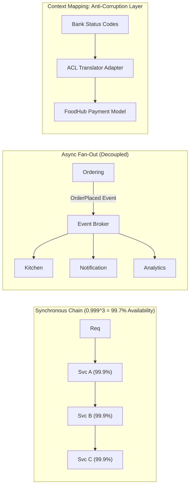

### Theory & Concept Questions (Part A)

<strong>Question 6.1: Explain which properties are essential for microservices (vs language choice, line count, or shared DB).</strong>

**Answer:** **Each service can be deployed independently and owns its data.**

- **Explanation (Key):** Independent deployment and data ownership are the defining properties.

<strong>Question 6.2: Explain what ten services that must always be deployed together and share one database are called.</strong>

**Answer:** **A distributed monolith.**

- **Explanation (Key):** All the costs of distribution with none of the independence.

<strong>Question 6.3: Explain why losing ACID transactions across services and eventual consistency is a cost of microservices.</strong>

**Answer:** **No ACID transactions across services; data becomes eventually consistent.**

- **Explanation (Key):** Independent deploys, scaling only busy parts, and smaller codebases are benefits; cross-service eventual consistency is a cost.

<strong>Question 6.4: Explain what a bounded context is in DDD.</strong>

**Answer:** **A boundary within which a model and its words have one clear meaning.**

- **Explanation (Key):** Inside the boundary, words and models are consistent.

<strong>Question 6.5: Explain why sending SMS notifications is a generic subdomain for FoodHub (vs matching riders, ETA prediction, or ranking).</strong>

**Answer:** **Sending SMS notifications** is a generic subdomain.

- **Explanation (Key):** Everyone needs SMS; buy it. Matching riders, delivery time prediction, and restaurant ranking could be core.

<strong>Question 6.6: Explain why translating the bank’s payment status codes into FoodHub’s own statuses in one adapter is an anti-corruption layer.</strong>

**Answer:** **An anti-corruption layer.**

- **Explanation (Key):** A translator protecting our model from an external one.

<strong>Question 6.7: Explain what the chain’s availability is when three services, each 99.9% available, are called one after another for every request.</strong>

**Answer:** About **99.7%**.

- **Explanation (Key):** `0.999³ ≈ 0.997`.

<strong>Question 6.8: Explain which communication suits “an order was placed; kitchen, notification and analytics should react”.</strong>

**Answer:** **Publishing an asynchronous OrderPlaced event.**

- **Explanation (Key):** One event, many independent consumers (pub/sub, week 7).

<strong>Question 6.9: Explain why resizing a menu photo whenever a restaurant uploads one fits serverless functions best.</strong>

**Answer:** **Resizing a menu photo whenever a restaurant uploads one** fits serverless best (vs steady high-traffic APIs, 10-hour encoders, or databases).

- **Explanation (Key):** Event-triggered, short and spiky.

<strong>Question 6.10: Explain the best starting style for a company with 2 developers and an idea that is still changing every week.</strong>

**Answer:** **A simple or modular monolith.**

- **Explanation (Key):** Small team, changing domain: keep it simple.

### Practical Questions (Part B)

<strong>Question 6.11: Give two benefits and two costs of microservices. For each cost, name one technique or tool that reduces it.</strong>

- **Benefits:** Independent deploys, independent scaling (plus fault isolation, technology choice, team autonomy).
- **Costs + Mitigations:**
  - *Network failures* → timeouts, retries, circuit breakers.
  - *Data consistency* → sagas, outbox.
  - *(Other valid pairs: Operations → CI/CD, containers, Kubernetes; Debugging → distributed tracing, central logging; Testing → contract tests.)*

**Rubric (4 pts):** 1 pt two valid benefits; 1 pt two valid costs; 2 pts matching mitigations.

<strong>Question 6.12: Explain why “database per service” matters. Ordering needs restaurant names for the order history: give one way to get them without reading Catalog’s database.</strong>

- **Why it matters:** Each service owns its data so teams can change schemas and deploy independently; a shared database couples services (hidden coupling).
- **How Ordering gets names:** Call Catalog's API, copy the name onto the order when placed (denormalise), or keep a local read model updated by `RestaurantRenamed` events.

**Rubric (3 pts):** 1 pt own data/schema independence; 1 pt shared DB = hidden coupling; 1 pt valid way to get names.

<strong>Question 6.13: Using at least two factors from the decision framework, argue whether a bank’s mobile app team of 120 developers should use microservices.</strong>

- **Recommendation:** **Microservices** (or a few large domain services) is reasonable.
- **Factors:** Many teams (≈15 teams of 8) that block each other in one codebase; parts with different release needs (payments vs marketing pages); parts with different scale; strong operations skills likely at a bank; regulation may require isolating sensitive parts.

**Rubric (3 pts):** 1 pt recommendation; 2 pts for two factors applied.

---

## Section 7 — Week 7: Event-Driven Architecture and Messaging

Covers: commands and events, messaging models, brokers, RabbitMQ and Kafka, delivery guarantees, event versioning, sagas, outbox, CQRS and event sourcing.

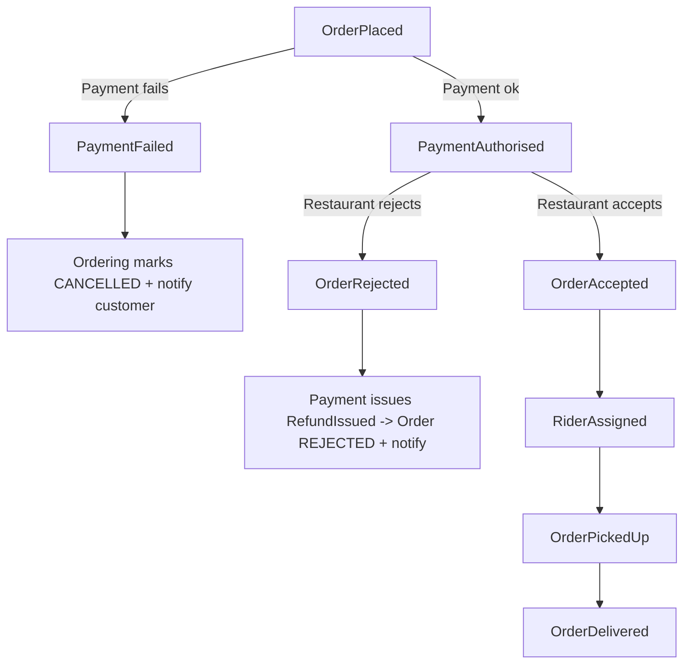

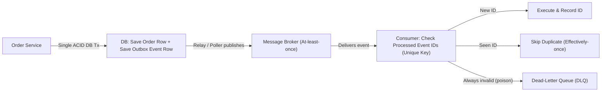

### Theory & Concept Questions (Part A)

<strong>Question 7.1: Explain why OrderPlaced is an event while SendSms, ChargePayment, and AssignRider are commands.</strong>

**Answer:** **OrderPlaced** is an event.

- **Explanation (Key):** Past tense, a fact. The others are commands.

<strong>Question 7.2: Explain the pattern when three kitchen workers read from one queue so that each order is handled by only one of them.</strong>

**Answer:** **Competing consumers.**

- **Explanation (Key):** Several consumers on one queue share the work.

<strong>Question 7.3: Explain what a Kafka consumer does after reading a message.</strong>

**Answer:** **Commits its offset; the message stays until the retention period ends.**

- **Explanation (Key):** The log keeps messages; each group tracks its offset.

<strong>Question 7.4: Explain how message order is guaranteed in Kafka.</strong>

**Answer:** **Within a partition.**

- **Explanation (Key):** Only within a partition; use a key such as `orderId`.

<strong>Question 7.5: Explain what happens under at-least-once delivery when a consumer finishes its work, then crashes before acknowledging.</strong>

**Answer:** **The message is delivered again, so the work may run twice.**

- **Explanation (Key):** No ack means redelivery; hence idempotent consumers.

<strong>Question 7.6: Explain how to make a consumer idempotent.</strong>

**Answer:** **Record processed event IDs (e.g., with a unique key) and skip ones already seen.**

- **Explanation (Key):** Deduplicate by event ID, stored durably.

<strong>Question 7.7: Explain where a message that always fails because its data is invalid should go.</strong>

**Answer:** **A dead-letter queue.**

- **Explanation (Key):** A DLQ stops a poison message from looping.

<strong>Question 7.8: Explain which change to an event schema is safest (adding an optional field vs renaming, removing, or changing types).</strong>

**Answer:** **Adding a new optional field totalCents** is safest.

- **Explanation (Key):** Additive, optional changes keep old consumers working.

<strong>Question 7.9: Explain what happens in a saga when a restaurant rejects an order after payment.</strong>

**Answer:** **A compensating action runs, such as issuing a refund.**

- **Explanation (Key):** Sagas undo with compensating actions, not rollbacks.

<strong>Question 7.10: Explain what problem the transactional outbox solves.</strong>

**Answer:** **Saving data and publishing an event cannot be one transaction, so one may happen without the other.**

- **Explanation (Key):** The dual-write problem.

### Practical Questions (Part B)

<strong>Question 7.11: Draw or describe a choreographed saga for FoodHub’s order: list the events in order for the happy path, and the compensation when payment fails and when the restaurant rejects the order.</strong>

- **Happy path:** `OrderPlaced → PaymentAuthorised → OrderAccepted → RiderAssigned → OrderPickedUp → OrderDelivered` (2 pts for a correct order with at least 4 events).
- **Payment fails:** `PaymentFailed` → Ordering marks the order `CANCELLED` and notifies the customer (1 pt).
- **Restaurant rejects:** `OrderRejected` → Payment issues a refund (`RefundIssued`) → order `REJECTED`, customer notified (1 pt).

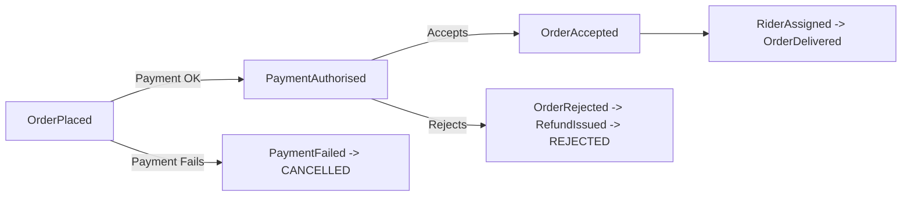

**Rubric (4 pts):** 2 pts happy path; 1 pt payment failure compensation; 1 pt restaurant rejection refund compensation.

<strong>Question 7.12: Compare RabbitMQ and Kafka on two of: message lifetime, ordering, replay, typical use. Which would you pick for FoodHub today, and why?</strong>

- **Comparisons (any two):** RabbitMQ deletes on ack vs Kafka keeps for retention; RabbitMQ per-queue order vs Kafka per-partition order; Kafka can replay, RabbitMQ not by design; RabbitMQ for task queues and routing vs Kafka for streaming and analytics.
- **FoodHub choice:** `RabbitMQ` (low volume and simple to operate) — or `Kafka` (replay for analytics).

**Rubric (3 pts):** 2 pts two correct comparisons; 1 pt justified choice.

<strong>Question 7.13: Explain why “exactly-once delivery” is hard over a network, and what systems do instead.</strong>

- **Why hard:** The sender cannot know whether a lost acknowledgement means the message was lost or only the ack was lost, so it must either risk loss or resend.
- **What systems do instead:** Systems use **at-least-once delivery** (resend), and consumers **deduplicate** (idempotency keys / processed-ID table), giving **effectively-once** results.

**Rubric (3 pts):** 1 pt lost ack ambiguity; 1 pt at-least-once resend; 1 pt consumer deduplication giving effectively-once results.

