# Software Architecture Midterm — Quiz-Only Study Guide

> [!IMPORTANT]
> **Exam Blueprint (`TeachersNode.md`):** Friday **27 November 2026** · Paper-based · **~10 open questions** · **NO QCM** · Worth **30%** · **60% Theory & Concept** (*"Explain…"* only, no *"What is…"*, e.g., Transactional Outbox) · **40% Practical** (e.g., Week 5/6 Event Storming) · Lectures **1 to 7**.
> Every multiple-choice item from Quizzes 1–7 below has been converted into an open **"Explain why / how…"** question using the exact instructor explanations and rubrics.

---

## Course Overview — What is Software System Architecture?

Software System Architecture (Bass, Clements & Kazman) is **"the set of structures needed to reason about the system: elements, their relations, and the properties of both."** Think of it as the **blueprint of a skyscraper**—showing steel beams, elevators, and weight limits rather than the colour of paint on the wall.

> [!NOTE]
> **The Core Dilemma:** Any junior programmer can write code that delivers a feature. Software architecture is about how the system is structured so it does not crash under 100,000 users, does not leak payment data, does not take three weeks to change one button, and can survive a server catching fire.

### 6 Core Ideas Behind the Subject

1. **Structure Drives Quality Attributes:** Almost any structure can deliver features, but *only specific structures* achieve target speed, availability, security, and maintainability.
2. **Hard-to-Change Decisions & Context-Driven Trade-offs:** Architecture covers system-wide choices that are expensive to reverse (events vs direct calls, monolith vs microservices). Every gain trades off against another quality or cost, guided by team size, deadline, budget, and scale.
3. **Boundaries & Decoupling:** Keep related rules cohesive inside clear boundaries (Ports & Adapters, DDD Bounded Contexts) with small interfaces and Anti-Corruption Layers isolating external systems.
4. **Organization Mirrors System (Conway's Law):** Systems mirror the communication structure of the teams building them. Small teams start cleanly with a **Modular Monolith** and split only when coordination or uneven load demands it.
5. **Design for Failure Over Unreliable Networks:** Packets drop, servers crash, and retries duplicate requests—so resilient systems rely on **stateless replicas**, **idempotency keys**, timeouts/circuit breakers, **async events**, **Sagas**, **Dead-Letter Queues**, and the **Transactional Outbox**.
6. **Make Architecture Visible & Measurable:** Replace vague adjectives (*"fast, available"*) with 6-part **Quality Attribute Scenarios**, back-of-the-envelope math, **C4 & Sequence diagrams**, and **immutable ADRs**.

### 7-Week Course Arc

| Week | Topic | Core Question Answered |
| :--- | :--- | :--- |
| **Week 1** | Intro to Software Architecture | What qualities and constraints drive the structure, and what trade-offs must we accept? |
| **Week 2** | Designing & Documenting | How do we estimate scale (QPS, storage) and document structures (C4, Sequence, ADRs)? |
| **Week 3** | Networking & Communication | How do DNS, TCP/QUIC, TLS 1.3, HTTP/2–3, reverse proxies, and CDNs move traffic safely? |
| **Week 4** | Web Concepts & API Design | How do we design REST/gRPC/GraphQL APIs, auth (Sessions vs JWT), CORS, and idempotent retries? |
| **Week 5** | Monolith, Layered & Modular | How do we keep one deployable clean using Modular Monoliths and Hexagonal Ports & Adapters? |
| **Week 6** | Microservices & DDD | How do we discover Bounded Contexts (Event Storming) and decide when to split services? |
| **Week 7** | Event-Driven & Messaging | How do RabbitMQ, Kafka, Sagas, DLQs, CQRS/Event Sourcing, and Outbox keep async flows reliable? |

### The FoodHub Case Study (Used Across All Quizzes)

- **Actors:** **Customers** (browse dishes, order, pay with KHQR), **Restaurants** (accept/reject, cook), **Riders** (pick up, deliver), and **Admin/Support**.
- **6 Subsystems / Modules:** `Catalog` (menus), `Ordering`, `Payment`, `Delivery / Riders`, `Notifications` (SMS), and `Analytics`.
- **4 Recurring Exam Lenses:** Every quiz tests how parts **talk** (sync HTTP vs async events), where **data lives** (one DB vs DB-per-service), how **failure is handled** (retries, DLQs, Sagas), and how we measure **speed and uptime**.

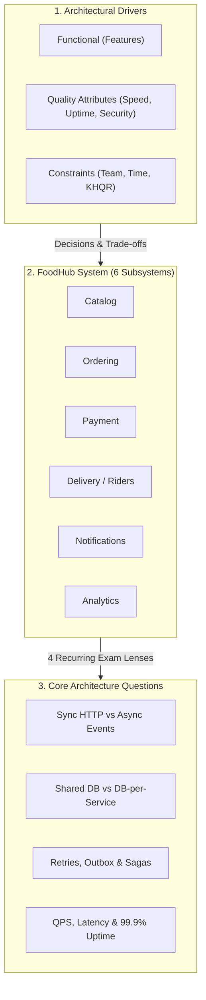

---

## Quick-Reference Formula & Comparison Sheet

### Back-of-the-Envelope & Availability Numbers

| Metric | Formula / Calculation | Result |
| :--- | :--- | :--- |
| **99.9% ("Three Nines") Downtime** | `30 × 24 × 60 = 43,200 min` → `0.1% × 43,200` | **≈ 43 min/month** |
| **99.99% ("Four Nines") Downtime** | `0.01% × 43,200 min` | **≈ 4.3 min/month** |
| **Serial Chain Availability** | 3 services in sequence at `99.9%`: `0.999³` | **≈ 0.997 (99.7%)** |
| **Average & Peak QPS** | `1,000,000 req/day ÷ 86,400 s/day` *(mental math: `~100,000 s/day`)* | **≈ 11.6 → ~12 req/s** |
| **Ride-Hailing Sizing (W2 Q11)** | `500,000 rides/day ÷ 86,400` · Peak `×4` · Storage `× 1 KB × 365` | **5.8 rides/s avg · 23/s peak · 180 GB/yr** |
| **Latency Hierarchy** | Fastest → Slowest (W2 Q8 key) | **RAM ~100 ns < In-DC RTT ~0.5 ms < SSD 1 MB ~1 ms < PNH–SIN ~30–50 ms** |

### 1. Functional Requirement vs Quality Attribute vs Constraint (Week 1)

| Category | What It Captures | Quiz Examples |
| :--- | :--- | :--- |
| **Functional (F)** | What the system does (features/behaviours), with no "how well". | "A customer can cancel an order before the restaurant accepts it." / "Customers can rate a restaurant after delivery." |
| **Quality Attribute (Q)** | How well the system works (availability, performance, security, consistency). | "95% of menu pages load within 1 s during lunch peak." / "Riders see customer address only after accepting delivery" (security/confidentiality). |
| **Constraint (C)** | A decision already fixed for the architect (team, deadline, standard). | "Built by existing team of 8 developers within 6 months." / "Payments must go through the KHQR standard." |

### 2. Session vs Self-Contained JWT & Cookie Flags (Week 4)

| Mechanism / Flag | How It Works | Key Strength / Weakness from Quiz Keys |
| :--- | :--- | :--- |
| **Server-Side Session + Cookie** | Session ID stored in cookie; state looked up on server. | Easy to revoke immediately; requires server/shared session lookup per request. |
| **Self-Contained JWT** | Signed (integrity), **NOT encrypted** (anyone can read payload — never put secrets in it). | No DB lookup per request, but **hard to revoke before expiry** (mitigate with short TTL + refresh tokens or revocation list). |
| **Cookie Flag: `HttpOnly`** | Hides cookie from `document.cookie` in browser JS. | Limits XSS damage (vs `Secure`, `SameSite`, `Max-Age`). |

### 3. Logical Layer vs Physical Tier & Monolith Styles (Weeks 5–6)

| Style / Concept | Definition & Structure | FoodHub Example / Trade-off |
| :--- | :--- | :--- |
| **Logical Layer** | Code organization by responsibility inside one program (strict: call only layer directly below). | Controllers → Services → Repositories inside the NestJS API. |
| **Physical Tier** | Separately running unit/process, often on its own machine. | 3-tier: Vue/Customer App ↔ NestJS API server ↔ PostgreSQL server. |
| **Monolith** | Single deployment; in-process calls; one database. | Simple ACID transactions and fast calls; cannot scale/deploy features independently. |
| **Modular Monolith** | One deployable split by business area; each owns its data and exposes a public interface (e.g., NestJS `exports: [CatalogService]` only). | Keeps single-DB simplicity while isolating modules for a future split. |
| **Distributed Monolith** | Multiple services that must always deploy together and share one database. | Worst of both worlds: all costs of distribution with none of the independence. |
| **Microservices** | Independently deployable services, each owning its data (database per service). | Independent deploy/scale & fault isolation, at the cost of network failures & eventual consistency (no cross-service ACID). |

### 4. RabbitMQ vs Kafka Comparison (Week 7 Q12)

| Dimension | RabbitMQ | Kafka |
| :--- | :--- | :--- |
| **Model** | Smart Broker / Dumb Consumer (exchanges → queues). | Append-Only Distributed Commit Log (topics + partitions). |
| **Message Lifetime** | Deletes message upon consumer acknowledgement. | Appends to log; keeps messages until retention period ends (consumers commit offsets). |
| **Ordering** | Per-queue ordering. | Guaranteed **within a partition** (use a key such as `orderId`). |
| **Replay** | Not designed for replay once acked. | Consumers/groups can reset offsets and replay historical events. |
| **Typical Use & FoodHub Fit** | Task queues (competing consumers) and flexible routing; simple to operate at low volume. | Event streaming, multiple independent consumer groups, and analytics replay. |

### 5. HTTP Status Codes Cheat Sheet

| Code | Meaning | When Used |
| :--- | :--- | :--- |
| **`200 OK`** | Standard success | `GET` / `PATCH` / `PUT` (or cached `Idempotency-Key` replay) |
| **`201 Created`** | Resource created | Successful `POST` creating a new entity (e.g., `POST /v1/orders`) |
| **`204 No Content`** | Success, empty body | Successful `DELETE` removing a resource |
| **`400 Bad Request`** | Client validation error | Wrong field type, missing field, malformed JSON |
| **`401 Unauthorized`** | Unauthenticated | Missing, expired, or invalid token/session |
| **`403 Forbidden`** | Unauthorized | Valid login, but user lacks permission |
| **`404 Not Found`** | Missing resource | Unknown ID or route |
| **`409 Conflict`** | State / uniqueness conflict | Duplicate review or illegal order state transition |
| **`500 Internal Server Error`** | Server crash | Unhandled backend exception |

---

## Hard Vocabulary & Software Engineering Decoder

| Term | Plain-English Meaning | FoodHub Example |
| :--- | :--- | :--- |
| **Idempotent / Idempotency** | Running the same request or event 2+ times gives the **exact same final result** as running it once (no duplicate orders or double charges). | `POST /v1/orders` with `Idempotency-Key` returns the existing order on retry; consumer checks `eventId` in DB before acting. |
| **Stateless vs Stateful** | **Stateless:** server forgets you after each request (you send a token every time). **Stateful:** server remembers you in memory/session. | Stateless API replicas scale easily behind a load balancer; an in-memory `SESSIONS` Map breaks on restart or across 3 servers. |
| **Cohesion vs Coupling** | **High cohesion:** things that change together live together. **Loose coupling:** modules depend only on small, stable interfaces. | All order rules live in `OrderingModule` (high cohesion), which talks to `CatalogService` instead of `CatalogRepository` (loose coupling). |
| **Temporal Coupling** | Two services are tied in time: if Service B is slow or down right now, Service A fails too. | Sync REST chain `Ordering → Payment → Delivery` fails if any one service goes down (`0.999³ ≈ 99.7%`). |
| **Eventual Consistency** | Data across services isn't updated in the same millisecond, but catches up shortly after via events. | Ordering updates its local read model a moment after Catalog emits `RestaurantRenamed`. |
| **Head-of-Line (HoL) Blocking** | One delayed/lost packet in a single TCP connection freezes all other requests sharing that connection. | HTTP/2 over TCP stalls all streams on 4G packet loss; HTTP/3 (QUIC/UDP) stalls only the one lost stream. |
| **Reverse Proxy & Upstream** | **Reverse proxy** sits in front of servers (TLS, routing, hiding ports); **upstream** is the backend app behind it. | nginx on `:443` forwards to upstream NestJS on `:3000`; if NestJS crashes, nginx returns `502 Bad Gateway`. |
| **Bounded Context** | A business boundary where words and models have one clear meaning. | `"Order"` in Ordering = items/prices/discounts; `"Order"` in Delivery = pickup/drop-off/rider/ETA. |
| **Ubiquitous Language** | One shared vocabulary used by both business people and developers in meetings, diagrams, and code. | Everyone says `OrderPlaced` and `OrderAccepted` rather than mixing "ticket", "cart", and "job". |
| **Anti-Corruption Layer (ACL)** | A translator/adapter that converts messy external API formats into your own clean domain model. | Payment adapter maps bank/KHQR numeric error codes into FoodHub's `PaymentAuthorised` / `PaymentFailed`. |
| **Dual-Write Problem** | Writing to a DB and publishing to a message broker are two separate actions—if one succeeds and the other crashes, data goes out of sync. | Order is saved in Postgres, then process crashes before RabbitMQ receives `OrderPlaced`. |
| **Transactional Outbox & CDC** | Save the domain row + an `outbox` event row in **one local DB transaction**, then a relay or **CDC** (Change Data Capture, e.g., Debezium reading DB logs) publishes it. | Guarantees `OrderPlaced` is never lost without needing 2PC. |
| **Compensating Action (Saga)** | An "undo" business action run when a later step in a multi-service flow fails (since you can't roll back another service's DB). | Restaurant rejects after payment → Payment emits `RefundIssued` to undo the charge. |
| **CQRS & Event Sourcing** | **CQRS:** separate write model from fast read models. **Event Sourcing:** store every change as an immutable event and replay to get current state (+ snapshots for speed). | Payment ledger stores every charge/refund event; a projection builds a fast Restaurant Dashboard table. |
| **DLX / DLQ & Prefetch** | **DLX/DLQ:** Dead-Letter Exchange/Queue where poison messages go for inspection. **Prefetch:** max unacked messages a worker holds (backpressure). | `ch.nack(msg, false, false)` sends bad JSON to `orders.dlx → kitchen.dlq`; `prefetch=1` stops 1 worker from hoarding all jobs. |

---

## Section 1 — Week 1: Introduction to Software Architecture

Covers: what architecture is and why it matters; requirements vs quality attributes vs constraints; measurable quality attribute scenarios; trade-offs.

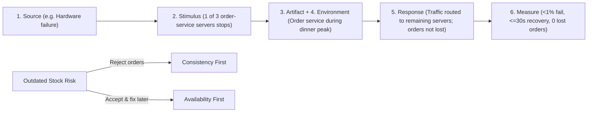

### Theory & Concept Questions ("Explain…")

<strong>Question 1.1:</strong> Explain what software architecture is (Bass, Clements &amp; Kazman) and why a feature list, a class diagram, or a language choice alone is not the architecture.

Software architecture is the **set of structures needed to reason about the system**: its elements, their relations, and the properties of both.

A feature list only describes functionality; a class diagram is just one design view; and a programming language is a single (often minor) decision rather than the system-wide structures.

<strong>Question 1.2:</strong> Explain why deciding that FoodHub's ordering and delivery communicate through events instead of direct calls is an architectural decision, whereas variable naming, a local sort algorithm, or button colour is not.

Event-based communication between ordering and delivery is **expensive to change** later, affects many parts of the system, and directly drives multiple quality attributes (coupling, availability, scalability).

Variable names, sorting algorithms, and UI button colours are local and cheap to change.

<strong>Question 1.3:</strong> Explain the difference between a functional requirement and a constraint using FoodHub's order cancellation rule and its "8 developers in 6 months" mandate.

*"A customer can cancel an order before the restaurant accepts it"* is a **functional requirement** because it describes what the system does, with no specification of "how well."

*"Built by the existing team of 8 developers and launch within 6 months"* is a **constraint** because it is a fixed decision already made for the architect (team size and deadline).

<strong>Question 1.4:</strong> Explain why "The app must be fast" fails as an architectural requirement compared with "95% of menu pages load within 1 second during the lunch peak."

Vague adjectives ("fast", "highly available", "secure against hackers") cannot be tested or used to guide design decisions.

A measurable requirement pairs a concrete **measure** (`95% within 1 second`) with a specific **environment** (`during the lunch peak`).

<strong>Question 1.5:</strong> Explain what the "environment" part of a quality attribute scenario represents.

The **environment** describes the system's operating conditions when the stimulus arrives—for example, normal operation, lunch/dinner peak load, or during a deployment (not the cloud provider or developer IDE).

<strong>Question 1.6:</strong> Explain how to calculate the allowed monthly downtime for a service with 99.9% availability over a 30-day month.

Total minutes in a 30-day month: `30 × 24 × 60 = 43,200 minutes`.

Allowed downtime = `0.1% (0.001) × 43,200 ≈ 43 minutes`.

<strong>Question 1.7:</strong> Explain why software architects focus primarily on quality attributes rather than functional features.

Almost any software structure can deliver the required functional features, but **only specific structures** can deliver the required speed, availability, and security.

<strong>Question 1.8:</strong> Explain Conway's Law and distinguish it from Moore's Law and Brooks's Law.

**Conway's Law:** Systems tend to mirror the communication structure of the organisation that builds them.

By contrast, Moore's Law is transistor doubling every two years, and Brooks's Law is that adding developers to a late project makes it later.

<strong>Question 1.9:</strong> Explain the architectural trade-off FoodHub faces when deciding whether to reject orders when restaurant stock data might be stale or accept them and fix problems later.

This is a trade-off between **consistency and availability** (CAP Theorem): rejecting uncertain orders prioritises consistency first, whereas accepting orders and resolving issues later prioritises availability first.

### Practical Questions (Part B)

<strong>Question 1.10:</strong> Classify each statement as Functional (F), Quality Attribute (Q), or Constraint (C), and give a one-line reason: (a) Riders see customer address only after accepting delivery; (b) Customers can rate a restaurant after delivery; (c) Payments must go through the KHQR standard.

- **a) Q (Security / Confidentiality):** It restricts who sees personal data; the feature is "show address," while the restriction is a quality. *(Also acceptable as F if explained as an access-control feature tied to security.)*
- **b) F (Functional):** Describes a user-facing feature (what the system does).
- **c) C (Constraint):** The payment standard is fixed externally, not chosen by the team.

**Rubric (3 pts):** 1 pt per correct classification; the one-line reason is required for full marks.

<strong>Question 1.11:</strong> Rewrite this vague requirement as a complete quality attribute scenario with all six parts: "FoodHub should keep working when a server fails."

- **Source:** Hardware failure (internal/infrastructure).
- **Stimulus:** One of the three order-service servers stops responding.
- **Artifact:** Order service.
- **Environment:** During dinner peak load.
- **Response:** Traffic is routed to the remaining servers; orders in progress are not lost.
- **Measure:** Fewer than 1% of requests fail, recovery takes no more than 30 seconds, and zero confirmed orders are lost.

**Rubric (4 pts):** 1 pt concrete source & stimulus; 1 pt artifact & environment; 1 pt system response behaviour; 1 pt numeric measure with units.

<strong>Question 1.12:</strong> Name one trade-off FoodHub faces (e.g., performance vs freshness, cost vs availability, usability vs security, or time-to-market vs maintainability). State which side you choose and why.

**Example 1 (Cost vs Availability):** Running a second active data centre improves availability but doubles infrastructure cost and operational complexity. For FoodHub's early stage in one region, choose **lower cost with single-region multi-AZ backups** because budget and an 8-developer team cannot sustain multi-region active-active operations yet.

**Example 2 (Rider GPS Freshness vs Battery & Bandwidth):** Reporting GPS every 1 s gives ultra-fresh tracking but drains budget Android rider batteries over 8-hour shifts and spikes ingress; every 30 s feels jerky. Choose **dynamic 5–10 s updates while moving (paused when stopped)**.

**Rubric (3 pts):** 1 pt real conflict between two qualities; 1 pt choosing a side; 1 pt reason tied to FoodHub's users, numbers, or constraints.

---

## Section 2 — Week 2: Designing and Documenting Architecture

Covers: C4 diagrams, sequence diagrams, ADRs, system-level design principles, the 6-step design process, and back-of-the-envelope estimates.

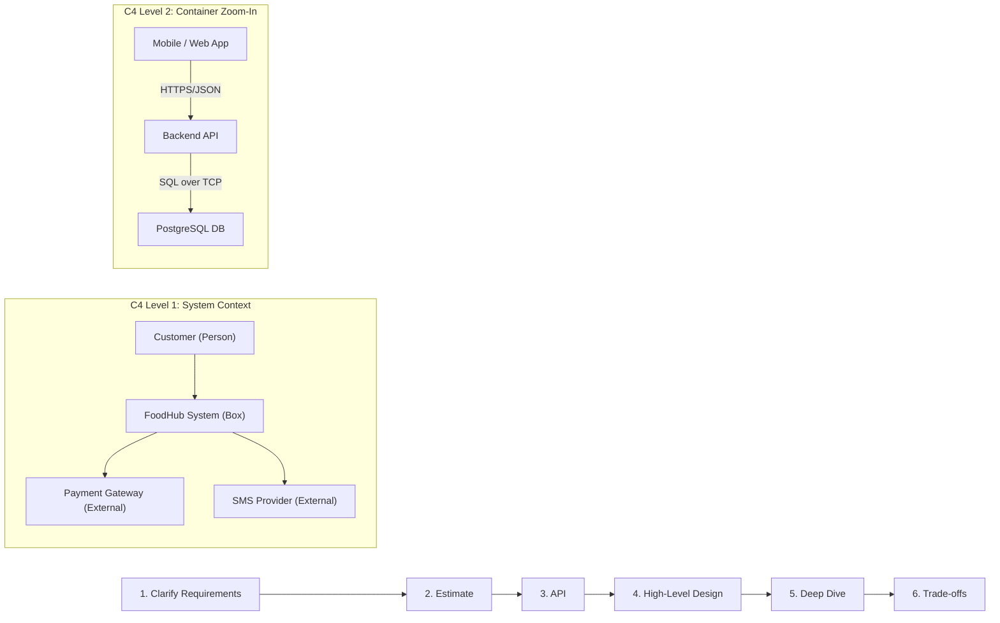

### Theory & Concept Questions ("Explain…")

<strong>Question 2.1:</strong> Explain what a "container" means in the C4 model and why it does not mean a Docker container.

In C4, a **container** is any separately running process or data store—such as a mobile app, a backend API, or a database. It may happen to run inside Docker, but the C4 term refers to runtime/deployment boundaries, not Docker technology.

<strong>Question 2.2:</strong> Explain which elements appear on a C4 System Context diagram versus a C4 Container diagram (using Customer, Payment Gateway, SMS Provider, FoodHub box, and PostgreSQL).

**System Context (Level 1)** treats FoodHub as a single box and focuses on the people (Customer) and external systems (Payment Gateway, SMS Provider) around it.

**Container Diagram (Level 2)** zooms inside FoodHub, so internal containers like the **PostgreSQL database** appear at Level 2, not Level 1.

<strong>Question 2.3:</strong> Explain the roles of "Context" and "Consequences" in an ADR, and explain why an outdated accepted ADR should be superseded rather than edited or deleted.

**Context** records the facts and forces at the time the decision was made; **Consequences** record the resulting trade-offs (good and bad).

ADRs are **immutable**: when a decision changes a year later, you write a **new ADR that supersedes the old one** so the historical reasoning remains intact.

<strong>Question 2.4:</strong> Explain how to convert 1,000,000 requests/day into average QPS, and why we design for peak load rather than average load.

Average QPS = `1,000,000 ÷ 86,400 seconds/day ≈ 11.6 ≈ 12 requests/second`.

We design for the **peak** (e.g., lunch peak) because a system sized only for the daily average will fail during busy hours when the most users are active.

<strong>Question 2.5:</strong> Explain the relative speed ordering of RAM access, an in-data-centre network round trip, reading 1 MB from SSD, and a Phnom Penh–Singapore round trip.

From fastest to slowest: **Reading from RAM (~100 ns)** → **In-DC round trip (~0.5 ms)** → **Reading 1 MB from SSD (~1 ms)** → **Phnom Penh–Singapore round trip (~30–50 ms)**.

<strong>Question 2.6:</strong> Explain why a system with three parts matching three teams (mobile, backend, payments) illustrates Conway's Law.

Conway's Law states that software structures mirror the communication paths of the organisation that builds them—three distinct teams naturally produce three corresponding architectural boundaries.

<strong>Question 2.7:</strong> Explain the six-step system design process and why "Estimate" comes directly after "Clarify requirements."

Order: **Clarify → Estimate → API → High-level design → Deep dive → Trade-offs**.

Estimating QPS and storage right after clarifying requirements tells you the scale constraints before you design APIs or pick storage/architecture.

### Practical Questions (Part B)

<strong>Question 2.8:</strong> A ride-hailing app has 500,000 rides/day. Each ride produces one 1 KB record, and peak is 4× average. Estimate (a) average rides/s, (b) peak rides/s, and (c) storage/year with working and units.

- **(a) Average:** `500,000 ÷ 86,400 ≈ 5.8 rides/s` (or using 100,000 s/day: `5 rides/s`).
- **(b) Peak:** `5.8 × 4 ≈ 23 rides/s` (or `20 rides/s`).
- **(c) Storage/year:** `500,000 × 1 KB = 500 MB/day`; `500 MB/day × 365 ≈ 182.5 GB ≈ 180 GB/year`.

**Rubric (4 pts):** 1 pt each for (a), (b), (c); 1 pt for units on every result and visible working.

<strong>Question 2.9:</strong> List three containers you would draw on a C4 container diagram for a simple online bookshop, with the technology on each and the protocol between two of them.

- **Containers + Tech:** (1) Web Front End (`Vue`), (2) Backend API (`NestJS`), (3) Relational Database (`PostgreSQL`) — or Search Engine / Object Storage for book covers.
- **Protocols:** Front End → Backend API via `HTTPS / JSON`; Backend API → PostgreSQL via `SQL over TCP`.

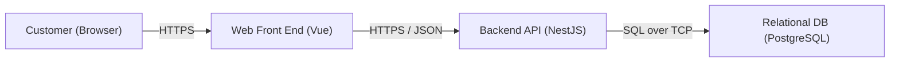

**Rubric (3 pts):** 1 pt for 3 sensible containers; 1 pt for technology on each; 1 pt for a correct protocol between two containers.

<strong>Question 2.10:</strong> Write the Context and Consequences (one good, one bad) of a short ADR: "Use one PostgreSQL database for all FoodHub data."

- **Context:** FoodHub is built by one small team (8 devs), needs ACID transactions across orders and payments, and has modest initial scale (~15 GB/year, ~35 QPS peak).
- **Good Consequence:** Full ACID transactions, simple joins, and only one database to operate and back up.
- **Bad Consequence:** Single point of failure until replicated, write-scaling limits at much larger scale, and shared schema coupling across modules must be disciplined.

**Rubric (3 pts):** 1 pt context with real forces; 1 pt good consequence; 1 pt bad consequence.

---

## Section 3 — Week 3: Networking and Communication

Covers: IP addressing and NAT, TCP and UDP, HTTP/1.1 vs HTTP/2 vs HTTP/3, TLS 1.3, DNS, stateless servers, proxies, and CDNs.

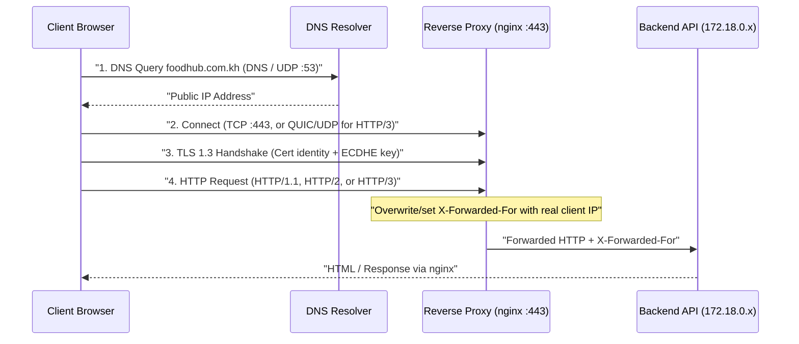

### Theory & Concept Questions ("Explain…")

<strong>Question 3.1:</strong> Explain why <code>192.168.1.20</code> is a private IPv4 address while <code>8.8.8.8</code>, <code>203.0.113.10</code>, and <code>1.1.1.1</code> are public.

`192.168.0.0/16` is one of the three RFC 1918 reserved private IPv4 ranges (`10.0.0.0/8`, `172.16.0.0/12` i.e. `172.16–31.x`, and `192.168.0.0/16`) used inside local networks (requiring NAT to reach the internet), whereas the others are globally routable public addresses.

<strong>Question 3.2:</strong> Explain how UDP differs from TCP in connection setup, delivery guarantees, and ordering.

**UDP** sends packets without a connection (no 3-way `SYN → SYN-ACK → ACK` handshake) and provides best-effort delivery with no automatic retransmission or ordering guarantees. Reliability and ordering are **TCP's** job.

<strong>Question 3.3:</strong> Explain how HTTP/2 improves on HTTP/1.1, and how HTTP/3 changes the underlying transport.

**HTTP/2** introduces **multiplexing** and **HPACK** header compression so many requests and responses share one TCP connection simultaneously without changing HTTP semantics.

**HTTP/3** runs on top of **QUIC (which uses UDP)**, providing built-in reliability and TLS 1.3 while avoiding TCP head-of-line blocking.

<strong>Question 3.4:</strong> Explain the main role of the server's certificate in TLS 1.3, as distinct from session key creation.

The server's certificate **proves the server's identity** (authentication), whereas ephemeral key agreement (**ECDHE**) creates the symmetric session keys used to encrypt traffic.

<strong>Question 3.5:</strong> Explain what a DNS TTL of 3,600 means and what a CNAME record is used for.

- **TTL = 3,600:** Cache lifetime in seconds—DNS resolvers may cache the record for up to 1 hour (3,600 s) before querying again.
- **A vs CNAME record:** An **`A` record** maps a domain name directly to an IPv4 address (`foodhub.com.kh → 203.0.113.5`), whereas a **`CNAME` record** maps one domain name to another domain name (for example, pointing a subdomain to a CDN host).

<strong>Question 3.6:</strong> Explain the difference between a reverse proxy (like nginx in front of FoodHub's API) and a forward proxy.

A **reverse proxy** acts on behalf of the servers (handling TLS termination, routing, and forwarding requests to backend instances), while a **forward proxy** acts on behalf of clients (e.g., filtering employee browsing or hiding a user's IP).

<strong>Question 3.7:</strong> Explain why a stateless server is easier to scale than a stateful server.

Because a stateless server holds no per-client session memory locally, **any copy of the server can answer any request**, letting you add more copies behind a load balancer horizontally.

<strong>Question 3.8:</strong> Explain why restaurant menu photos fit a CDN whereas current order status, payment confirmations, or admin dashboards do not.

Menu photos are **public, large, and rarely changing**, making them ideal for edge caching. Order status, payment confirmations, and admin pages are private/personalised or change frequently.

### Practical Questions (Part B)

<strong>Question 3.9:</strong> List, in order, the four main steps between a customer typing <code>foodhub.com.kh</code> and receiving the HTML. Name the protocol for each step.

1. **DNS lookup** of `foodhub.com.kh` to obtain its IP address (**DNS**, usually UDP port 53).
2. **Open transport connection** to the IP on port 443 (**TCP** 3-way `SYN → SYN-ACK → ACK` handshake, or **QUIC over UDP** for HTTP/3).
3. **TLS handshake** for ECDHE key agreement and certificate verification (**TLS 1.3**).
4. **Send HTTP request and receive HTML** (**HTTP/1.1, HTTP/2, or HTTP/3**).

**Rubric (4 pts):** 1 pt per step in correct order with protocol named.

<strong>Question 3.10:</strong> FoodHub will move its API to a new server next week, and its DNS record currently has TTL = 86,400 seconds. Explain the problem this causes and the exact procedure the team should follow before/during/after the move.

**Problem:** Resolvers and client devices may cache the old IP for up to 24 hours (86,400 s), so users will keep hitting the old server after cutover.

**Procedure:** Lower the TTL (e.g., to 300 s) **at least one full old TTL (1 day) before** the move; keep the old server running (or forwarding) until the old TTL expires; raise the TTL again once traffic has shifted cleanly.

**Rubric (3 pts):** 1 pt stale cache up to 24h; 1 pt lower TTL at least 1 TTL ahead; 1 pt keep old server running/forwarding then raise TTL afterward.

<strong>Question 3.11:</strong> A backend behind nginx logs every request as coming from <code>172.18.0.3</code>. Explain why, how the backend can learn the real client IP, and the security risk of that mechanism.

- **Why:** The TCP connection to the backend originates from the reverse proxy (`172.18.0.3`), so the backend sees the proxy's IP.
- **Fix:** The proxy attaches `X-Forwarded-For` (or `X-Real-IP` / `Forwarded`) with the client IP, and the backend reads that header.
- **Security risk:** Clients can forge HTTP headers to spoof their IP and bypass IP bans or rate limits, so the backend must **only trust the header when the request comes from its own proxy** (and the proxy must overwrite, not blindly append, untrusted incoming values).

**Rubric (3 pts):** 1 pt proxy TCP IP; 1 pt forwarded header; 1 pt spoofing risk + trusting only own proxy / overwriting untrusted values.

---

## Section 4 — Week 4: Web Concepts and API Design

Covers: sessions and tokens, cookie flags, JWT, API styles, REST design, API gateways, idempotency, serialization, and CORS.

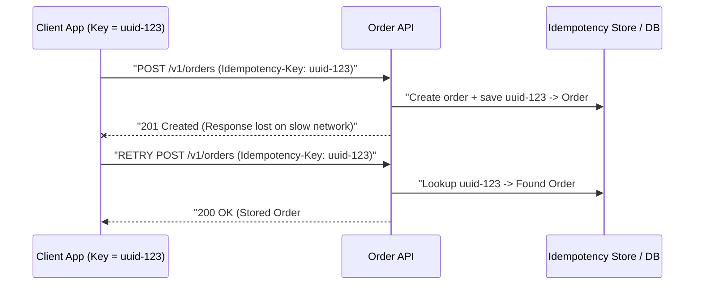

### Theory & Concept Questions ("Explain…")

<strong>Question 4.1:</strong> Explain how the <code>HttpOnly</code> cookie flag limits XSS damage compared with <code>Secure</code>, <code>SameSite</code>, or <code>Max-Age</code>.

`HttpOnly` prevents browser JavaScript from reading the cookie via `document.cookie`, so an XSS script cannot exfiltrate the session token directly. By contrast, `Secure` sends cookies only over HTTPS, and `SameSite` controls cross-site sending (`Strict`/`Lax` block most CSRF; `None` sends cross-site and requires `Secure`).

<strong>Question 4.2:</strong> Explain the main weakness of a self-contained JWT compared with a server-side session, why you must never put secrets in a JWT payload, and how to mitigate revocation.

- **Revocation weakness:** Any service validating the signature will accept a JWT until it expires, making immediate revocation hard. Mitigate with **short TTL + refresh tokens** or a revocation list.
- **Payload visibility:** A JWT has three Base64URL parts (`Header.Payload.Signature`) and is **signed (integrity), not encrypted (confidentiality)**—anyone can decode and read the payload, so never store secrets inside it.

<strong>Question 4.3:</strong> Explain why creating an order uses <code>POST /v1/orders → 201</code> and invalid input like <code>{"restaurantId": "abc"}</code> returns <code>400</code>.

REST creates a resource by sending `POST` to the noun collection (`/v1/orders`) and returns `201 Created` (not an RPC verb like `/createOrder`).

Type/validation errors are client errors (`400 Bad Request`), not server crashes (`500`) or missing routes (`404`).

<strong>Question 4.4:</strong> Explain why <code>POST</code> is not idempotent by default whereas <code>GET</code>, <code>PUT</code>, and <code>DELETE</code> are.

Repeating `GET`, `PUT` (full replace), or `DELETE` leaves the server in the same state after the first call, whereas `PATCH` (partial update) is not necessarily idempotent and repeating a `POST` creates another new resource each time unless guarded by an idempotency key.

<strong>Question 4.5:</strong> Explain why a webhook fits immediate payment-provider notifications better than polling.

With a **webhook**, the payment provider pushes an HTTP `POST` to FoodHub the moment payment succeeds, avoiding wasted polling requests and polling delay.

<strong>Question 4.6:</strong> Explain what belongs in an API gateway (routing, rate limiting, token checks) and why calculating a delivery fee does not.

API gateways handle cross-cutting edge concerns (routing, rate limiting, access token validation). Domain/business rules such as delivery fee calculation belong inside the backend services.

<strong>Question 4.7:</strong> Explain what CORS protects, who enforces it, and why it does not stop attackers using <code>curl</code>.

CORS is **enforced by web browsers**, which only pass a cross-origin response to page JavaScript if the server explicitly allows that origin. It protects users' browsers—not the API itself—so non-browser clients like `curl` ignore CORS.

<strong>Question 4.8:</strong> Explain why Protobuf and Avro are well-suited for long-lived event data compared with plain JSON.

Both Protobuf and Avro use typed schemas built for **schema evolution**, allowing fields to be added safely without breaking older event readers, while also being more compact than JSON.

### Practical Questions (Part B)

<strong>Question 4.9:</strong> Design three REST endpoints for FoodHub restaurant reviews (list reviews, add review, delete your own review). Give method, path, success code, and one error code for each.

1. **List:** `GET /v1/restaurants/{id}/reviews?limit=20&offset=0` → `200` (Error: `404` unknown restaurant).
2. **Add:** `POST /v1/restaurants/{id}/reviews` → `201` (Errors: `400` invalid rating, `401` not logged in, `409` already reviewed).
3. **Delete own:** `DELETE /v1/reviews/{reviewId}` → `204` (Errors: `403` or `404` not author, `404` missing).

**Rubric (4 pts):** 1 pt per correct endpoint (method + noun path + success code); 1 pt for sensible error codes and pagination.

<strong>Question 4.10:</strong> A customer taps "Order" on a slow network; the order is created, the response is lost, and the app retries. Explain what fails without protection and how an idempotency key solves it.

- **Without protection:** The retried `POST` creates a second duplicate order (and may charge the customer twice).
- **Idempotency key fix:** The client generates a unique key per order attempt, sends it in an `Idempotency-Key` header, and reuses the same key on retries. The server stores `key → result`; when it sees a repeated key, it returns the stored result (e.g., `200` with the original order) instead of creating a new one.

**Rubric (3 pts):** 1 pt duplicate order/charge; 1 pt client unique key reused across retries; 1 pt server stores key → result and returns stored response.

<strong>Question 4.11:</strong> A Vue app on <code>http://localhost:5173</code> calls an API on <code>http://localhost:3000</code> and gets "blocked by CORS policy," while <code>curl</code> succeeds. Explain why and give the server fix.

- **Why:** `Origin = Protocol + Domain + Port`, so `5173` vs `3000` are different origins, triggering the browser's Same-Origin Policy; `curl` ignores CORS because only browsers enforce it.
- **Server Fix:** Return `Access-Control-Allow-Origin: http://localhost:5173` (in NestJS: `app.enableCors({ origin: 'http://localhost:5173', credentials: true })`), and never use `*` when cookies/credentials are sent.

**Rubric (3 pts):** 1 pt different origins (port); 1 pt browser-only enforcement vs curl; 1 pt explicit allow-origin header / NestJS config without `*` for credentials.

---

## Section 5 — Week 5: Monolith, Layered, and Modular Styles

Covers: monolith, layered and N-tier, modular monolith, hexagonal architecture, pipe-and-filter, microkernel, and breaking dependency cycles.

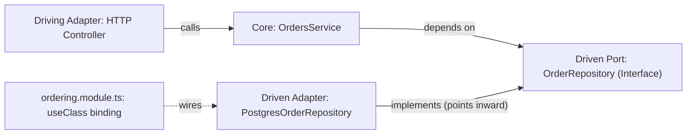

### Theory & Concept Questions ("Explain…")

<strong>Question 5.1:</strong> Explain the real architectural strengths of a monolith (and why independent scaling or team deploy independence are not among them).

Calls between parts are fast, reliable **in-process function calls**, and a **single database makes ACID transactions simple**. Independent scaling and independent team deployments belong to microservices, and a monolith can still become tangled without discipline.

<strong>Question 5.2:</strong> Explain the strict layered architecture call rule and why a Vue app + NestJS API + PostgreSQL DB is a 3-tier system.

- **Strict vs Open Layering:** In **strict layering**, each logical layer (e.g., presentation) may call **only the layer directly below it** (never skipping down to the database directly), whereas **open layering** allows a layer to bypass lower layers to call any layer beneath it.
- **3-tier:** Client (Vue), application server (NestJS), and database (PostgreSQL) are three separately running physical processes/tiers.

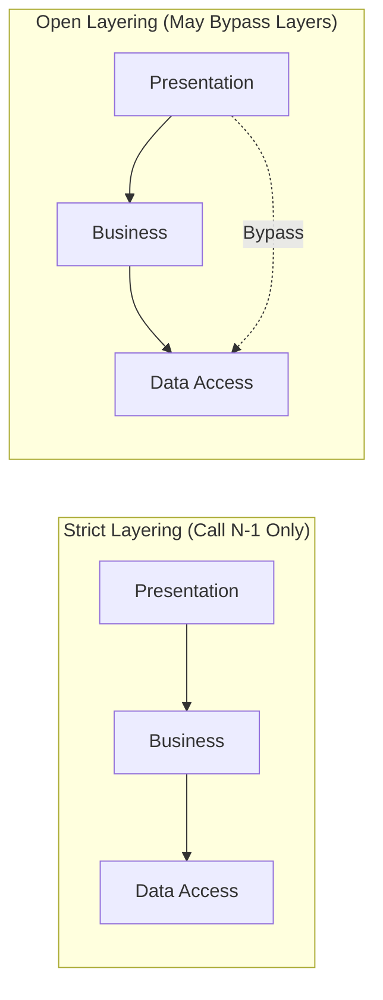

<strong>Question 5.3:</strong> Explain what a modular monolith is, and how NestJS's <code>CatalogModule</code> stops other modules from touching its repository.

A **modular monolith** is a single deployable split into modules by business capability, where each module owns its own data and exposes only a public interface.

In NestJS, listing only `CatalogService` in `exports` enforces this boundary because only exported providers are visible to importing modules.

<strong>Question 5.4:</strong> Explain which way dependencies point in Hexagonal Architecture and why <code>OrderRepository</code> is a "port" rather than an adapter.

Dependencies always point **inwards from adapters to the core**.

**Driving (incoming) ports** define how the core is triggered (e.g., `CreateOrderUseCase` called by `OrdersController`). `OrderRepository` is an interface defined/used by the ordering core—so it is an outgoing (**driven**) **port**, while `PostgresOrderRepository` is the driven **adapter** implementing it.

<strong>Question 5.5:</strong> Explain why "scan → resize → compress → store" is Pipe-and-Filter whereas an extensible editor with plugins is Microkernel.

- **Pipe-and-filter** chains independent transformation steps in a sequential data pipeline.
- **Microkernel (plug-in)** pairs a minimal core with independently written extensions (such as VS Code or browsers).

<strong>Question 5.6:</strong> Explain why cyclic calls between Ordering and Payment are an architectural smell and how to fix them.

Dependency cycles indicate the module boundary is wrong. Break the cycle by introducing an **asynchronous event**, moving the shared responsibility, or merging them into one module.

### Practical Questions (Part B)

<strong>Question 5.7:</strong> Explain the difference between a logical layer and a physical tier. Give one FoodHub example of each.

- **Logical layer:** A way of organising code by responsibility inside one program (FoodHub example: controllers / services / repositories inside the NestJS API).
- **Physical tier:** A separately running process, often on its own machine (FoodHub example: customer app, NestJS API server, PostgreSQL database server).

**Rubric (4 pts):** 1 pt layer definition; 1 pt tier definition; 1 pt FoodHub layer example; 1 pt FoodHub tier example.

<strong>Question 5.8:</strong> FoodHub moves order storage from in-memory to PostgreSQL in Week 10. Explain how a port and adapter keep this change small, and name which file(s) change.

Because the ordering core depends only on the `OrderRepository` interface (port) and not on an in-memory `Map` or SQL, you write a new `PostgresOrderRepository` adapter implementing that same interface.

**Files changed:** Only the new adapter file and the single `useClass` binding line in `ordering.module.ts` change; `OrdersService` and controllers remain untouched.

**Rubric (3 pts):** 1 pt core depends only on port interface; 1 pt new Postgres adapter implements interface; 1 pt only new adapter + one `useClass` line in `ordering.module.ts` change.

<strong>Question 5.9:</strong> A startup with 4 developers is building an online clinic booking system. Recommend an architectural style from Week 5 and justify it with two reasons tied to their context.

- **Recommendation:** **Modular monolith** (or a simple layered monolith).
- **Context reasons:** (1) Small 4-person team—one codebase and one deployment are easiest to operate and fast to refactor while early requirements evolve; (2) Booking and payment need ACID transactions in one database at modest load, while clean modules allow a later split if needed.

**Rubric (3 pts):** 1 pt sensible style (modular/layered monolith; microservices earns at most 1 pt unless costs are explicitly weighed); 1 pt each for two context-based reasons.

---

## Section 6 — Week 6: Microservices and Domain-Driven Design

Covers: microservice properties, distributed monolith, benefits & costs, DDD bounded contexts & subdomains, context maps (ACL), sync vs async, database per service, serverless, and decision framework.

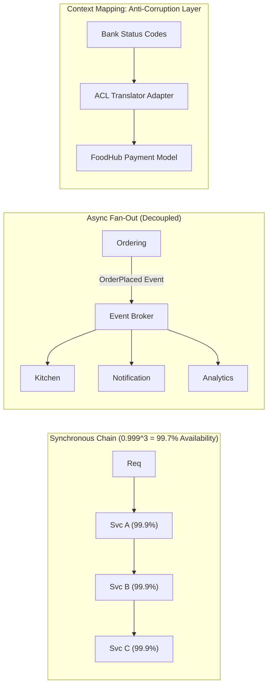

### Theory & Concept Questions ("Explain…")

<strong>Question 6.1:</strong> Explain the two defining properties of microservices, and why ten services that share one database and deploy together form a "distributed monolith."

Microservices are defined by **independent deployability** and **data ownership** (not service line count or using different languages).

If ten services share a database and must deploy together, you get a **distributed monolith**: all the network/operational costs of distribution with none of the independence.

<strong>Question 6.2:</strong> Explain why microservices lose cross-service ACID transactions and must accept eventual consistency.

Because each microservice owns its own separate database, a single local database transaction cannot span multiple services; data updates across services propagate asynchronously and become **eventually consistent**.

<strong>Question 6.3:</strong> Explain what a DDD Bounded Context is, and why sending SMS notifications is a Generic Subdomain for FoodHub rather than Core.

A **bounded context** is an explicit boundary within which a domain model and its vocabulary (ubiquitous language) have one consistent meaning.

SMS delivery is a **generic subdomain** because every company needs it and it gives FoodHub no competitive edge (buy/integrate it), unlike rider matching, delivery ETA prediction, or restaurant ranking (core).

<strong>Question 6.4:</strong> Explain why translating a bank's payment status codes inside a single FoodHub adapter is an Anti-Corruption Layer (ACL).

An **ACL** acts as a translator boundary that protects FoodHub's internal domain model and vocabulary from leaking or being distorted by an external system's model.

<strong>Question 6.5:</strong> Explain why calling three 99.9%-available services sequentially drops the overall chain availability to ~99.7%.

Serial dependencies multiply: `0.999 × 0.999 × 0.999 = 0.999³ ≈ 0.997 (99.7%)`. Any one of the three failing breaks the request.

<strong>Question 6.6:</strong> Explain why publishing an asynchronous <code>OrderPlaced</code> event fits notifying kitchen, notification, and analytics better than sequential synchronous REST calls.

One event can fan out to many independent consumers via pub/sub without Ordering knowing about them or blocking on each service's availability and latency.

<strong>Question 6.7:</strong> Explain why resizing uploaded menu photos fits serverless functions, and why a 2-developer startup with weekly-changing ideas should start with a monolith.

**Serverless** shines on event-triggered, short-lived, spiky workloads like resizing a photo on upload (unlike steady high-connection APIs, 10-hour jobs, or databases).

A **2-developer startup** with rapidly changing domain boundaries needs simplicity and fast refactoring—30 microservices on Kubernetes would overwhelm them.

### Practical Questions (Part B)

<strong>Question 6.8:</strong> Give two benefits and two costs of microservices. For each cost, name one technique or tool that reduces it.

- **Benefits:** Independent deployments, independent scaling (plus fault isolation, tech choice, team autonomy).
- **Cost 1 — Network failures / cascading latency:** Mitigate with *timeouts, retries with exponential backoff, and circuit breakers* (e.g., Resilience4j).
- **Cost 2 — Cross-service data consistency:** Mitigate with *sagas and transactional outbox*. *(Other valid pairs: Operations → CI/CD, containers, Kubernetes; Debugging → distributed tracing, central logging; Testing → contract tests.)*

**Rubric (4 pts):** 1 pt two benefits; 1 pt two costs; 2 pts matching mitigations.

<strong>Question 6.9:</strong> Explain why "database per service" matters. Ordering needs restaurant names for order history: give a valid way to obtain them without reading Catalog's database directly.

- **Why it matters:** Each service owns its data so teams can evolve schemas and deploy independently; a shared database creates hidden coupling across services.
- **How Ordering gets restaurant names:** (1) Copy/denormalise the restaurant name onto the order when placed, (2) maintain a local read model in Ordering updated by `RestaurantRenamed` events, or (3) call Catalog's public API.

**Rubric (3 pts):** 1 pt independent schema/deploy ownership; 1 pt shared DB hidden coupling; 1 pt valid decoupled read pattern.

<strong>Question 6.10:</strong> Using at least two factors from the decision framework, argue whether a bank's mobile app team of 120 developers should use microservices.

- **Recommendation:** Yes — microservices (or a few large domain services).
- **Factors:** (1) *Team size:* ~120 developers (~15 teams of 8) would constantly block each other in one codebase; (2) *Different release & scale needs + Ops maturity/regulation:* payments vs marketing pages release at different cadences, banks typically have strong operations teams, and regulation may require isolating sensitive components.

**Rubric (3 pts):** 1 pt sensible recommendation; 2 pts for two decision-framework factors applied to the bank's context.

---

## Section 7 — Week 7: Event-Driven Architecture and Messaging

Covers: commands vs events, messaging models, brokers (RabbitMQ vs Kafka), delivery guarantees, idempotency, DLQs, event versioning, sagas, and transactional outbox.

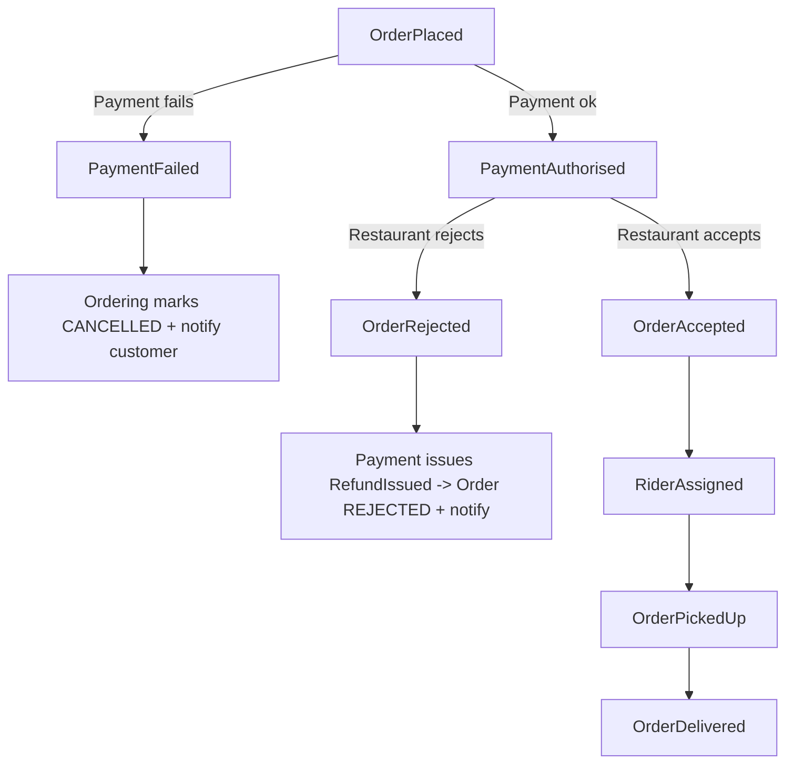

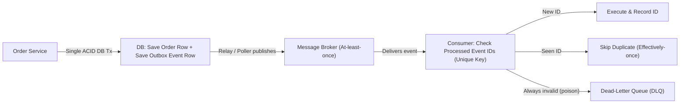

### Theory & Concept Questions ("Explain…")

<strong>Question 7.1:</strong> Explain how to tell an event (<code>OrderPlaced</code>) apart from commands (<code>SendSms</code>, <code>ChargePayment</code>, <code>AssignRider</code>).

An **event** is named in the **past tense** because it states an immutable fact that already happened (`OrderPlaced`), whereas imperative verb phrases (`SendSms`) are commands asking a target to do work.

<strong>Question 7.2:</strong> Explain the "competing consumers" pattern when three kitchen workers read from one queue.

Multiple consumers share a single queue so each incoming message/order is delivered to and processed by **only one** worker, distributing load across the pool.

<strong>Question 7.3:</strong> Explain what a Kafka consumer does after reading a message and how ordering is guaranteed in Kafka.

The consumer **commits its offset** while the message stays in the log until the retention period expires (allowing other consumer groups or replays to read it).

Ordering is guaranteed **only within a partition**, so producers set a partition key such as `orderId` to keep related events ordered.

<strong>Question 7.4:</strong> Explain what happens under at-least-once delivery if a consumer crashes after doing its work but before acknowledging, and how idempotency prevents duplicate side effects.

Without an acknowledgement, the broker assumes delivery may have failed and **redelivers the message**, so the work could run twice.

To make a consumer **idempotent**, durably record processed event IDs (e.g., via a unique key in the DB) and skip any event ID already seen.

<strong>Question 7.5:</strong> Explain why a message with invalid data that always fails should be routed to a Dead-Letter Queue (DLQ).

A poison message would otherwise loop forever on retries and block healthy messages. Moving it to a **DLQ** isolates the failure for inspection without halting the queue.

<strong>Question 7.6:</strong> Explain why adding a new optional field (<code>totalCents</code>) is safe for event schemas, whereas renaming, removing, or changing types breaks consumers.

Additive, optional changes allow older consumers to ignore unknown fields and keep working, whereas renaming `orderId`, removing `items`, or changing `restaurantId` from number to string breaks existing readers.

<strong>Question 7.7:</strong> Explain how a Saga undoes a previous step (such as payment after a restaurant rejects an order) without two-phase commit.

Sagas do not lock databases across services with two-phase commit; instead, each local transaction commits immediately and failures trigger explicit **compensating actions** (such as issuing a refund).

<strong>Question 7.8:</strong> Explain the dual-write problem and how the Transactional Outbox pattern solves it.

- **Problem (Dual-Write):** Saving domain data to a database and publishing an event to a message broker cannot share one distributed transaction, so one can succeed while the other fails (leaving DB and events out of sync).
- **Solution (Transactional Outbox):** Write the domain row and the event record to an **outbox table inside the same local ACID database transaction**. A separate relay/poller reads the outbox table and publishes to the broker (paired with idempotent consumers), guaranteeing both happen together.

### Practical Questions (Part B)

<strong>Question 7.9:</strong> Draw or describe a choreographed saga for FoodHub's order: list the events in order for the happy path, and the compensations when payment fails and when the restaurant rejects the order.

- **Happy path:** `OrderPlaced → PaymentAuthorised → OrderAccepted → RiderAssigned → OrderPickedUp → OrderDelivered`.
- **Payment fails:** `PaymentFailed` → Ordering marks the order `CANCELLED` and notifies the customer.
- **Restaurant rejects:** `OrderRejected` → Payment issues a refund (`RefundIssued`) → Ordering marks the order `REJECTED` and notifies the customer.

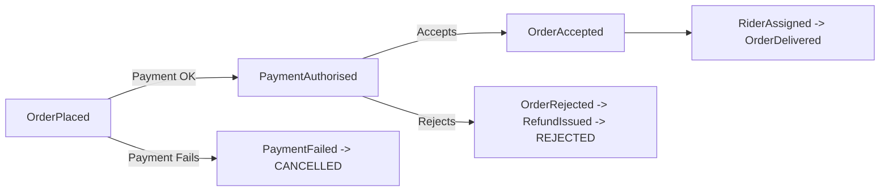

**Rubric (4 pts):** 2 pts happy path (correct order, ≥4 events); 1 pt payment failure compensation; 1 pt restaurant rejection refund compensation.

<strong>Question 7.10:</strong> Compare RabbitMQ and Kafka on two of: message lifetime, ordering, replay, or typical use. State which you would pick for FoodHub today and why.

- **Comparisons (any two):** (1) *Lifetime:* RabbitMQ deletes on ack vs Kafka retains messages until retention ends; (2) *Ordering:* RabbitMQ per-queue vs Kafka per-partition; (3) *Replay:* Kafka supports offset replay, RabbitMQ does not by design; (4) *Use:* RabbitMQ for task queues & routing vs Kafka for streaming & analytics.
- **FoodHub choice:** *RabbitMQ* today because FoodHub has modest volume and a small team that benefits from simpler operations (or *Kafka* if event replay for analytics is a priority).

**Rubric (3 pts):** 2 pts for two accurate comparisons; 1 pt for a justified FoodHub choice.

<strong>Question 7.11:</strong> Explain why "exactly-once delivery" is hard over a network, and what real systems do instead.

- **Why it is hard (Two Generals' Problem):** When an acknowledgement is lost over an unreliable network, the sender cannot distinguish between "the message was lost" and "only the ack was lost," so it must either risk losing the message or resend it.
- **What systems do instead:** Use **at-least-once delivery** (retry until acknowledged) combined with **idempotent consumers** (deduplicating via event IDs / durable processed-ID tables), achieving *effectively-once processing*.

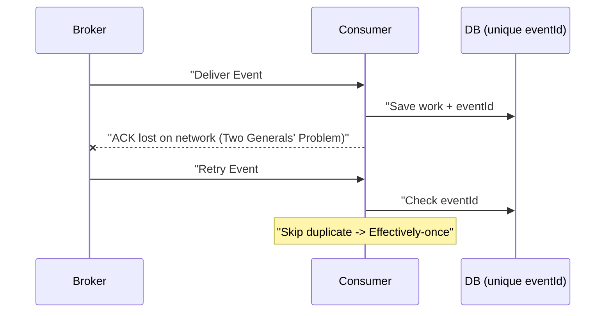

**Rubric (3 pts):** 1 pt ambiguous lost-ack problem; 1 pt at-least-once resend; 1 pt idempotent consumer deduplication for effectively-once results.

---

## Final 10-Minute Rapid Review Traps

1. **"Architecture" vs "Design":** Architecture covers high-level structures that are hard to change and drive quality attributes; variable names, button colors, and local loops are detailed design.
2. **C4 "Container" is NOT Docker:** A C4 container is any separately running or data-storing unit (SPA, API, DB).
3. **ADRs are Immutable:** Never edit or delete an accepted ADR—write a new ADR that supersedes the old one.
4. **JWT is NOT Encrypted:** Its three Base64URL parts (`Header.Payload.Signature`) are only signed for integrity; anyone can decode and read the payload.
5. **CORS is for Browsers:** `Origin = Protocol + Domain + Port`; `curl` and native mobile apps ignore CORS, which only stops cross-origin JS in browsers.
6. **Command vs Event:** A command is an imperative verb (`ChargeCard`); an event is a past-tense immutable fact (`CardCharged`).
7. **RabbitMQ vs Kafka:** RabbitMQ is a smart broker that deletes messages after ACK; Kafka is a permanent append-only commit log with consumer offsets and replayability.
8. **Exactly-Once Myth:** Because of the Two Generals' Problem, true exactly-once delivery over unreliable networks is impossible—use **at-least-once delivery + idempotent consumers** for *effectively-once* processing.
9. **Hexagonal Dependencies Point INWARD:** The domain core defines interfaces (**Ports**); outer technology implements them (**Adapters**).
10. **Database-Per-Service:** Shared databases create hidden coupling and destroy microservice independence; share foreign data via API calls, creation-time denormalization, or async event read caches.
