# Software Architecture Midterm — Master Study Guide (Weeks 1–7)

> [!IMPORTANT]
> **Exam Blueprint (`TeachersNode.md`):** Friday **27 November 2026** · Paper-based · **~10 open questions** · **NO QCM** · Worth **30%** · **60% Theory & Concept** (*"Explain…"* only, no *"What is…"*, e.g., Transactional Outbox) · **40% Practical** (e.g., Event Storming — taught in Week 6 slides/handout alongside Week 5 modular boundaries) · Lectures **1 to 7**.

> **Course Overview & Vocabulary:** See [Course Overview](#Software%20Architecture/Midterm/overview.md).

---

## Section 1 — Suggested Practice Questions (Based on Quizzes)

> [!WARNING]
> **5 Habits Observed Across Quizzes 1–7:**
> 1. **Never pure definitions:** Even MCQs tested *consequences & distinctions* (e.g., why JWT is hard to revoke). Expect pure **"Explain why / how…"** prompts.
> 2. **Failure & edge-case diagnosis:** Retry without `Idempotency-Key`, stale DNS TTL `86,400 s`, nginx logging `172.18.0.3`, consumer crash before ack.
> 3. **Context-tied trade-offs:** Full marks require citing concrete forces (8 devs, 35 QPS, 6 months, ACID needs, no ops staff).
> 4. **Practical code & lab literacy:** Quiz keys cite `ordering.module.ts` `useClass`, NestJS `enableCors`, `X-Forwarded-For`, `OrderPlaced → RefundIssued`.
> 5. **Explicit slide & note clues:** Week 2 Slide 11 marks the **6-step design process** as *"used in the midterm"*; `TeachersNode.md` names **Transactional Outbox** & **Event Storming**.

### Quiz-vs-Lecture Gap Matrix

| Week | Already Tested on Quizzes | Taught in Slides / Handouts (Untested or MCQ-Only) | Predicted Midterm Angle |
| :--- | :--- | :--- | :--- |
| **W1** | F/Q/C classification, 6-part QAS, 99.9% downtime, consistency vs availability | 3 structures (Module, Runtime, Deployment), ISO/IEC 25010 (5 dark qualities), Security vs Usability & Performance vs Cost, 6 Eras | Explain why one system needs 3 structures, or diagnose a vague requirement + FoodHub trade-off. |
| **W2** | C4 L1/L2, ADR Context/Consequences, 500K/day QPS math, latency hierarchy | **6-step design process** (marked "midterm"), Sequence diagram ("who waits for whom"), **Rider GPS 80 writes/s**, Separation of concerns/Cohesion/Coupling | Walk through the 6-step process or explain why Rider GPS writes exceed order QPS in ADR-001. |
| **W3** | 4-step URL load, TTL 86,400 move, nginx `172.18.0.3` + `X-Forwarded-For` | **HTTP/2 TCP HoL blocking vs HTTP/3 QUIC**, TLS 1.3 1-RTT steps, `dig +trace`, **nginx `502 Bad Gateway`**, CDN headers (`Cache-Control`, `Age`, `X-Cache`) | Explain why HTTP/3 helps 4G riders (stream isolation + Wi-Fi→4G survival), or diagnose nginx 502. |
| **W4** | 3 REST endpoints, Idempotency-Key retry, CORS `5173→3000`, `HttpOnly` | **JWT `alg: none` & `localStorage` vs `HttpOnly`**, API restart wiping `SESSIONS` + **3 servers behind LB**, **gRPC/GraphQL**, **BFF** & Gateway SPOF, RFC 9457, cursor pagination, `origin: '*'` + credentials | Explain what happens to in-memory sessions on restart or behind 3 servers, compare Sessions vs JWT revocation, or explain why `origin: '*'` fails with cookies. |
| **W5** | Layers vs Tiers, Port/Adapter Postgres swap, 4-dev clinic recommendation | **Strict Layered weakness**, **NestJS startup crash when injecting unexported `CatalogRepository`**, `import type`, SOA vs Microservices | Explain why strict layered architecture couples logic to DB and how Hexagonal + NestJS `exports` enforces boundaries at startup. |
| **W6** | Database-per-service, 0.999³ availability, benefits/costs, 120-dev bank | **Event Storming (4 sticky colors, 5 steps)**, **all 5 Context Map relationships**, **Serverless vs Cell-based**, **5 Case Studies** (Prime Video, Uber DOMA, Shopify), Scoring table | **40% Practical:** Run Event Storming → Bounded Contexts & Context Map (`S`/`A`). **Theory:** Context Map patterns or Prime Video/Uber lessons. |
| **W7** | Choreographed saga, RabbitMQ vs Kafka, why exactly-once is hard | **Transactional Outbox + CDC (Debezium)** (only 1 MCQ!), **Saga Orchestration vs Choreography**, **Why 2PC fails**, **CQRS & Event Sourcing** (0 quiz Qs!), `ch.nack(msg,false,true)` loop vs DLX/DLQ | **60% Theory:** Explain Dual-Write & Transactional Outbox (+ CDC); explain CQRS + Event Sourcing; explain Choreography vs Orchestration & why 2PC fails. |

### 12 Suggested Questions

<details data-tag="radar theory" data-meta="Teacher Note">
<summary><strong>Question 1.1:</strong> Explain the dual-write problem when saving an order and publishing <code>OrderPlaced</code>, and explain step-by-step how the Transactional Outbox (with Relay or CDC like Debezium) and an idempotent consumer solve it.</summary>

<p data-no-audio><em>Why likely:</em> Named explicitly in <code>TeachersNode.md</code> as a 60% theory example, yet Week 7 Quiz only touched it in one MCQ (Q10).</p>

- **Dual-write problem:** Writing to PostgreSQL and publishing to RabbitMQ/Kafka are two separate systems that cannot share a single local ACID transaction. If the DB commits and the broker call fails (or process crashes), the order exists with no event; if you publish first and DB rolls back, downstream services act on a phantom order.
- **4-step Transactional Outbox solution:** (1) Inside *one local DB transaction*, INSERT the domain row (e.g., order) and INSERT an outbox event row (`eventId, type, payload, sent=false`). (2) A background relay job polls unsent outbox rows—or a **CDC tool like Debezium** tails the database transaction log. (3) The relay publishes the event to the broker and marks the row sent. (4) Because a crash between publishing and marking sent causes a duplicate publish, delivery is **at-least-once**, so consumers must be **idempotent** (recording `eventId` in a DB table with a unique constraint).

</details>

<details data-tag="radar practical" data-meta="Teacher Note">
<summary><strong>Question 1.2:</strong> Perform an Event Storming workshop for a scenario (e.g., FoodHub checkout-to-delivery): list the 4 sticky-note colors, timeline of events/commands/actors, 2 hot spots, group into Bounded Contexts, name "one word with two meanings," and draw a Context Map marking Sync (S) vs Async (A).</summary>

<p data-no-audio><em>Why likely:</em> Named explicitly in <code>TeachersNode.md</code> as the 40% practical example; taught in Week 6 Practice Handout with zero quiz questions.</p>

- **4 Sticky Colors:** **Orange** = Domain Event (past tense, e.g., `OrderPlaced`); **Blue** = Command (`PlaceOrder`); **Yellow** = Actor (`Customer`); **Pink** = Hot Spot (*"What if the restaurant never accepts?"*, *"What if payment settles after timeout?"*).
- **Bounded Contexts & One Word, Two Meanings:** Group into *Catalog* (`MenuUpdated`), *Ordering* (`OrderPlaced, OrderAccepted, OrderCancelled`), *Payment* (`PaymentAuthorised, RefundIssued`), *Delivery* (`RiderAssigned, OrderPickedUp, OrderDelivered`). Word **"Order"** in Ordering = items, prices, discounts, status; in Delivery = pickup address, drop-off address, rider, ETA.
- **Context Map (S/A):** Ordering → Catalog (**S**, verify menu/prices or local read model); Ordering ↔ Payment (**A**, `OrderPlaced / PaymentAuthorised`; Payment → KHQR/Bank via **S** + **ACL**); Ordering → Delivery (**A**, `OrderAccepted`).

```event-storming
context: 1. Catalog
actor: Restaurant Staff
command: UpdateMenu
event: MenuUpdated

context: 2. Ordering
actor: Customer
command: PlaceOrder
event: OrderPlaced / OrderAccepted
hotspot: "Restaurant never accepts?"

context: 3. Payment
actor: KHQR / Bank
command: AuthorisePayment / IssueRefund
event: PaymentAuthorised / RefundIssued
hotspot: "Payment settles after timeout?"

context: 4. Delivery
actor: Rider
command: AssignRider / DeliverOrder
event: RiderAssigned -> OrderDelivered
```


</details>

<details data-tag="radar theory">
<summary><strong>Question 1.3:</strong> Explain CQRS and Event Sourcing, how they complement each other (e.g., FoodHub's restaurant dashboard or payment ledger), and their operational costs.</summary>

<p data-no-audio><em>Why likely:</em> Taught on Week 7 Slide 12, completely untested in Week 7 Quiz.</p>

- **CQRS (Command Query Responsibility Segregation):** Separates the write model (handling commands and business rules) from one or more read models (tailored for specific screens, like a fast "restaurant dashboard" table updated asynchronously from order events). Lets reads and writes scale independently, at the cost of eventual consistency for the read view.
- **Event Sourcing:** Instead of overwriting current state in a row, append every state change as an immutable event; current state is computed by replaying all events for that entity. Gives full audit history and time travel for free (ideal for payments/ledgers), but incurs costs: harder ad-hoc queries, event schema evolution complexity, and needing periodic **snapshots** so replays stay fast.

</details>

<details data-tag="radar theory">
<summary><strong>Question 1.4:</strong> Explain why Two-Phase Commit (2PC) is avoided across microservices, and compare Choreography vs Orchestration Sagas (benefits, drawbacks, and when to choose each).</summary>

<p data-no-audio><em>Why likely:</em> Week 7 Slides 9–10 emphasize 2PC vs Sagas and Orchestration (Temporal / Step Functions), whereas Quiz 7 only tested Choreography.</p>

- **Why avoid 2PC:** 2PC locks rows across multiple databases during prepare/commit, hurting latency, blocking everything if the coordinator crashes, and most message brokers/cloud APIs do not support it.
- **Choreography vs Orchestration:** In *choreography*, services react to each other's events with no central controller (loosest coupling, easy to start, but hard to trace as flows grow). In *orchestration*, a central coordinator (e.g., Temporal, AWS Step Functions, or state machine) commands each step (explicit flow, easy to monitor and debug retries/compensations, at the cost of extra orchestrator infrastructure and coupling to the orchestrator).

</details>

<details data-tag="radar theory">
<summary><strong>Question 1.5:</strong> Explain what happens in FoodHub's Week 4 lab when (a) the API server restarts, and (b) you scale to 3 API servers behind a load balancer using an in-memory <code>SESSIONS</code> Map—and compare fixing this with a shared Redis session store vs a short-lived JWT.</summary>

<p data-no-audio><em>Why likely:</em> Asked verbatim in Week 4 Handout Part D and covers JWT <code>alg: none</code> / <code>localStorage</code> trade-offs.</p>

- **Restart & 3 Servers:** On restart, the in-memory `Map` is wiped, logging every user out (`401`). With 3 servers behind a load balancer, a user logs into Server 1, then the next request lands on Server 2 which has an empty `SESSIONS` map and rejects them.
- **Redis Sessions vs JWT:** Putting sessions in a shared store (Redis/DB) keeps *instant revocation* (delete session = logged out everywhere) at the cost of a network lookup per request. Self-contained **JWTs** avoid the per-request DB lookup (any server verifies the signature using a pinned algorithm, never `alg: none`), but cannot be revoked before expiry—mitigated by short TTLs (5–15 min) + revocable refresh tokens stored safely (prefer `HttpOnly` cookies over XSS-readable `localStorage`).

</details>

<details data-tag="radar theory">
<summary><strong>Question 1.6:</strong> Explain why HTTP/3 (QUIC over UDP) improves mobile experience on 4G/Wi-Fi compared with HTTP/2 over TCP, and explain why nginx returns <code>502 Bad Gateway</code> when the backend container stops.</summary>

<p data-no-audio><em>Why likely:</em> HTTP/2 TCP head-of-line blocking & Wi-Fi→4G survival are highlighted on Week 3 Slide 6; <code>502 Bad Gateway</code> is a direct Week 3 Handout Part C question.</p>

- **HTTP/2 vs HTTP/3:** HTTP/2 multiplexes many streams over *one TCP connection*, so one lost packet stalls all streams at the TCP layer (head-of-line blocking). HTTP/3 runs on **QUIC over UDP**: (1) a lost packet stalls only its own stream, (2) transport + TLS 1.3 complete in 1 round trip (cutting 300–500 ms 4G startup delay), and (3) connection IDs let sessions survive a Wi-Fi → 4G network switch.
- **nginx 502:** When the upstream Node app stops, nginx (as reverse proxy) is still alive listening on port 80/443, tries to open a connection to `app:3000`, gets connection refused/timeout, and returns `502 Bad Gateway` to the client.

</details>

<details data-tag="radar theory">
<summary><strong>Question 1.7:</strong> Explain the five DDD Context Map relationships (Customer-Supplier, Conformist, ACL, Published Language, Shared Kernel) with FoodHub examples, and explain what real-world case studies (Amazon Prime Video, Uber DOMA, Shopify) teach about splitting.</summary>

<p data-no-audio><em>Why likely:</em> Week 6 Slides 7 & 12 dedicate full tables to Context Map types and Case Studies; only ACL appeared in Quiz 6.</p>

- **5 Relationships:** (1) *Customer-Supplier:* Delivery needs Ordering's `OrderAccepted` event and Ordering plans for it; (2) *Conformist:* FoodHub adopts KHQR's API model as-is; (3) *Anti-Corruption Layer (ACL):* Payment adapter translates messy bank status codes into FoodHub statuses; (4) *Published Language:* documented event schemas published by Ordering; (5) *Shared Kernel:* two contexts share a small model like `Money` (use sparingly to avoid coupling).
- **Case study lessons:** Splitting is driven by team coordination (Amazon two-pizza teams) or extreme resilience (Netflix). Too many tiny services hurt manageability (Uber grouped into DOMA domains), serverless pipelines can be ~90% more expensive than one service for steady workloads (Amazon Prime Video), and well-structured modular monoliths scale very far (Shopify, Stack Overflow).

</details>

<details data-tag="radar theory">
<summary><strong>Question 1.8:</strong> Explain when to use a Backend for Frontend (BFF) instead of a single API Gateway, why APIs use cursor pagination and RFC 9457 error shapes, and why <code>origin: '*'</code> with <code>credentials: true</code> is rejected/dangerous.</summary>

<p data-no-audio><em>Why likely:</em> Covers Week 4 Slides 8–9 and Handout Part C Q5, none of which were directly asked on Quiz 4.</p>

- **API Gateway vs BFF:** One gateway centralises TLS, auth, routing, and rate limiting, but can become a SPOF/bottleneck if business logic creeps in. A **BFF** adds one tailored gateway per client type (e.g., mobile vs web) when they need different payload shapes or aggregations.
- **Pagination & Errors:** `limit+offset` drifts or slows on large, rapidly changing lists, so use **cursor pagination**; RFC 9457 ("problem details") gives every endpoint one consistent error JSON shape (`status, code, message, details`).
- **CORS + Credentials:** Sending `Access-Control-Allow-Origin: *` with cookies (`credentials: true`) is forbidden by browsers because any malicious site could make authenticated cross-origin requests and read the response.

</details>

<details data-tag="radar theory">
<summary><strong>Question 1.9:</strong> Explain why NestJS refuses to start if <code>OrdersService</code> injects <code>CatalogRepository</code> in FoodHub's modular monolith, and explain how Hexagonal Architecture fixes the main weakness of Layered Architecture.</summary>

<p data-no-audio><em>Why likely:</em> Week 5 Handout Part B Q6 explicitly asks: "Why does Nest refuse to start?" paired with Week 5 Slides 4 & 7–9.</p>

- **NestJS Boundary Enforcement:** `CatalogModule` lists only `CatalogService` in `exports`, keeping `CatalogRepository` private. Even if `OrderingModule` imports `CatalogModule`, NestJS's DI container throws a dependency-resolution error at startup—enforcing module boundaries automatically instead of relying on programmer willpower.
- **Layered vs Hexagonal:** Classic layered architecture forces business logic to depend directly on the data/ORM layer, and features cut across all layers. Hexagonal (Ports & Adapters) flips the dependency arrow: the domain core defines interfaces (**ports** like `OrderRepository`) and adapters implement them at the edges, so SQL/ORM/HTTP never leak into business rules and tests can swap in a fake repository cleanly.

</details>

<details data-tag="radar theory">
<summary><strong>Question 1.10:</strong> Explain why calling <code>ch.nack(msg, false, true)</code> (requeue) on a bad message is dangerous in RabbitMQ, how a Dead-Letter Exchange (<code>orders.dlx</code>) fixes it, and why an in-memory <code>Set</code> is insufficient for consumer idempotency in production.</summary>

<p data-no-audio><em>Why likely:</em> Directly from Week 7 Practice Handout Parts C & D.</p>

- **Requeue loop vs DLX:** A message with invalid data (a "poison message") will fail every single time. Calling `ch.nack(msg, false, true)` puts it straight back onto the queue, causing an infinite CPU/log spin that blocks valid messages. Calling `ch.nack(msg, false, false)` rejects without requeueing, routing it to `orders.dlx → kitchen.dlq` for human inspection.
- **In-memory Set vs DB table:** An in-memory `Set<string>` is wiped on worker restart and is not shared across competing worker instances. Production stores `eventId` in a durable database table with a **unique constraint** (ideally inside the same DB transaction as the consumer's business update).

</details>

<details data-tag="radar practical">
<summary><strong>Question 1.11:</strong> Walk through the 6-Step System Design Process for a new FoodHub capability (or ride/booking system): Clarify → Estimate (including hidden write loads like GPS) → API → High-Level Design → Deep Dive → Trade-offs at 10×.</summary>

<p data-no-audio><em>Why likely:</em> Week 2 Slide 11 explicitly states: <em>"Used in design interviews, design reviews, the midterm and the final exam."</em></p>

1. **Clarify:** Users, features, top quality attributes (latency/availability), and constraints (8 TS devs, 6 months, KHQR).
2. **Estimate:** 20k orders/day → 0.23 orders/s, 35 QPS peak (350 in 2 yrs), 15 GB/yr orders; **hidden load:** 400 active riders × 1 ping/5s = **80 GPS writes/s**.
3. **API:** `POST /v1/orders` (with `Idempotency-Key`), `PATCH /v1/orders/:id`, `POST /v1/riders/location`.
4. **High-Level Design:** Client apps → nginx/API Gateway → NestJS Modular Monolith → PostgreSQL + Object Storage + RabbitMQ.
5. **Deep Dive:** Handle payment + order consistency via Transactional Outbox + Saga, and protect DB from 80 writes/s GPS churn (batch/in-memory or separate store).
6. **Trade-offs:** Chose modular monolith now for 8-dev speed and ACID; at 10× (350 QPS, 800 GPS writes/s), extract **Rider Tracking** first into its own service.

</details>

<details data-tag="radar theory">
<summary><strong>Question 1.12:</strong> Explain Cell-Based Architecture and Serverless (FaaS): what problems each solves, their limits (cold starts, time limits, vendor lock-in), and why FoodHub should or should not use them at launch.</summary>

<p data-no-audio><em>Why likely:</em> Week 6 Slide 11 covers both Serverless and Cell-Based, and Cell-Based was only a distractor in Quiz 6.</p>

- **Serverless (FaaS):** Scales event-triggered code to zero and back (pay per call, no servers to manage). Great for spiky/rare tasks like menu photo resizing or webhooks, but suffers cold starts, execution time limits, vendor lock-in, and harder local testing (and can cost more for steady traffic).
- **Cell-Based Architecture:** Runs many identical full-stack copies ("cells"), each serving a slice of users (e.g., by city) for **blast-radius control**—a bad deploy or outage hits only one cell. Overkill for FoodHub's 35 QPS single-city launch with 8 devs and no ops team.

</details>

---

## Section 2 — Week 1: Introduction to Software Architecture

Sources: Week 1 Slides (19 pages), Practice Handout, Quiz 1.

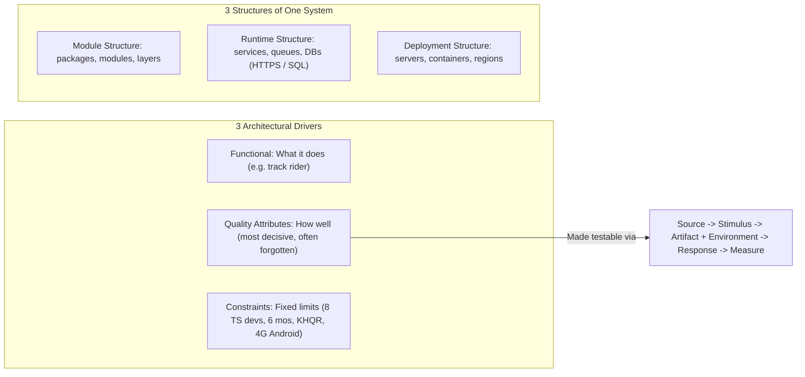

<details data-tag="theory">
<summary><strong>Question 2.1: Explain what software architecture is (Bass, Clements & Kazman / Fowler) and how it differs from detailed design by cost of change.</strong></summary>

**Key takeaway:** “The software architecture of a system is the set of structures needed to reason about the system. These structures comprise software elements, relations among them, and properties of both.” (*Bass, Clements and Kazman, Software Architecture in Practice*, Slide 6)

- **Shorter version (After Ralph Johnson, quoted by Martin Fowler):** Architecture is **the important stuff**, the decisions that are hard to change later.
- **Rule of thumb (Slide 8):** If getting it wrong means rewriting many parts of the system, treat it as an architectural decision and write it down.

| Question | Architecture | Detailed design |
| :--- | :--- | :--- |
| **Scope** | The whole system and how the parts fit | The inside of one part |
| **Cost to change** | High: weeks or months of rework | Low: hours or days |
| **Examples** | One service or many; SQL or NoSQL; sync calls or events | Class names; an algorithm inside a function; a screen layout |
| **Driven by** | Quality attributes and constraints | Mostly functional requirements |

</details>

<details data-tag="theory">
<summary><strong>Question 2.2: Explain why one diagram or structure is not enough, and why architects focus on quality attributes rather than features.</strong></summary>

**Key takeaway:** Boxes are elements, labelled arrows are relations (connectors), and one system needs three structures—because features are easy while qualities are hard.

- **3 Structures (Slide 7):**
  - **Module structure:** How the code is split (packages, modules, layers).
  - **Runtime structure:** What runs and talks (services, queues, databases).
  - **Deployment structure:** Where it lives (servers, containers, cloud regions).
- **4 Reasons Why Architecture Matters (Slide 9):**
  1. **It decides the qualities:** Speed, uptime, security and ease of change come from structure, not from features.
  2. **It is expensive to change:** Early decisions lock in later options. Fixing them late costs the most.
  3. **It shapes the teams:** Conway's law—systems tend to copy the communication structure of the organisation that builds them.
  4. **It is a shared language:** Developers, testers, operations and managers can discuss the same picture.

</details>

<details data-tag="theory">
<summary><strong>Question 2.3: Explain what an architect actually does, including how architecture works in agile teams.</strong></summary>

**Key takeaway:** An architect understands drivers, makes and records decisions, communicates, guides the build, and keeps the system evolving.

- **5 Jobs (Slide 10):** (1) **Understand the drivers** (requirements, qualities, constraints); (2) **Make and record decisions** (compare options, explain trade-offs); (3) **Communicate** (diagrams and documents that people read); (4) **Guide the build** (code reviews, prototypes, coaching); (5) **Keep it evolving** (measure, learn, adjust as the system grows).
- **In agile teams:** Architecture is often a shared job, not one person's title. Decide early only what is expensive to change, and leave the rest open until you know more.

</details>

<details data-tag="practical">
<summary><strong>Question 2.4: Explain the three inputs that shape an architecture (Functional, Quality Attributes, Constraints) and list FoodHub's constraints.</strong></summary>

**Key takeaway:** Functional = what the system does, Quality attributes = how well it does it, Constraints = decisions already made for you.

- **Three Inputs (Slide 11):**
  - **Functional requirements** (*What the system does*): “A customer can track the rider on a map.”
  - **Quality attributes** (*How well it does it*): “The rider position on the map is at most 10 s old.” *(Usually drive the architecture most, and are the ones teams forget to write down.)*
  - **Constraints** (*Decisions already made for you*): “Must accept KHQR. Team of 8. Launch in 6 months.”
- **4 Constraint Types (Slide 16):** **Business** (Launch in 6 months; fixed monthly cloud budget); **Team** (8 developers who know TypeScript — NestJS and Vue; no dedicated operations staff); **Technical** (Must integrate KHQR and bank payment APIs; riders use low-cost Android phones on mobile data); **Legal** (Personal and payment data rules from regulators and payment providers).
- **Rule:** A constraint removes options before you start. Write it down so nobody wastes time on options that were never allowed.

</details>

<details data-tag="theory">
<summary><strong>Question 2.5: Explain the ISO/IEC 25010 qualities, why "fast" is not a requirement, and how six parts make a quality testable.</strong></summary>

**Key takeaway:** If you cannot test it, you cannot design for it, and you cannot tell whether you succeeded—every quality scenario needs a numeric measure.

- **ISO/IEC 25010 (2023) Product Qualities (Slide 12):** Focus qualities: **Performance efficiency** (speed and resource use), **Reliability** (availability and recovery), **Security** (protects data and access), **Maintainability** (easy to change and test), **Flexibility** (scalability, adaptability). Also: *Functional suitability, Compatibility, Interaction capability, Safety*.

| Vague (Slide 13) | Measurable |
| :--- | :--- |
| “The app should be fast” | At lunch peak, 95% of menu pages load within 1 s |
| “Highly available” | Ordering is available 99.9% of each month (about 43 min of downtime) |
| “Secure” | After 5 failed logins in 10 min the account is locked and the owner is notified |
| “Easy to change” | Adding a new payment method takes one developer at most 5 days and touches only the payment module |

- **6-Part Quality Attribute Scenario (Slide 14):** **1. Source** (*5,000 customers*) → **2. Stimulus** (*place orders*) → **3. Artifact** (*order service*) → **4. Environment** (*lunch peak, normal operation*) → **5. Response** (*orders are accepted and confirmed*) → **6. Measure** (*99% within 2 s*).
- **More Scenarios (Slide 15):** *Availability:* Hardware → One order server crashes → Order service → Dinner peak → Traffic moves to healthy servers → No orders lost; under 30 s of errors. *Security:* Attacker → Tries 1,000 passwords on one account → Login endpoint → Normal operation → Account locked, owner notified → Locked after 5 tries in 10 min. *Modifiability:* Product owner → Asks for a new payment method → Payment module → Design time → Added without changing other modules → At most 5 developer-days.

</details>

<details data-tag="theory">
<summary><strong>Question 2.6: Explain the three classic trade-offs, how the six eras evolved, and the 5 takeaways from Week 1.</strong></summary>

**Key takeaway:** You can't maximise everything; every decision gives something up, and new styles did not replace old ones.

- **3 Trade-Offs (Slide 17):** **Security vs usability** (extra checks at checkout stop fraud but slow down honest customers); **Consistency vs availability** (refuse orders when stock data may be stale, or accept them and fix later?); **Performance vs cost** (more servers cut wait times at peak but sit idle at 3 a.m.).
- **6 Eras (Slide 18):** 1990s Monolithic web apps (LAMP) → 2000s Multi-tier and SOA → 2006+ Cloud → 2013+ Containers and microservices → 2014+ Serverless and edge → 2022+ LLM-powered systems. Most companies today still run monoliths next to cloud services, and that is often the right choice.
- **What to remember from week 1 (Slide 19):** (1) Architecture is the set of structures and the decisions that are hard to change. (2) Its main job is to deliver the quality attributes. (3) Drivers: functional requirements, quality attributes, constraints. (4) A quality attribute needs a scenario with a number. (5) Every decision is a trade-off. Make it on purpose.

</details>

---

## Section 3 — Week 2: Designing and Documenting Architecture

Sources: Week 2 Slides (15 pages), Practice Handout, Quiz 2.

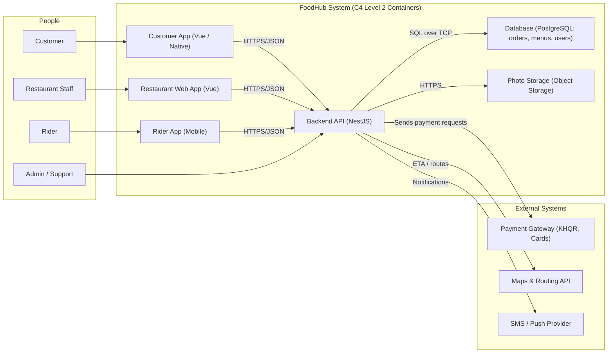

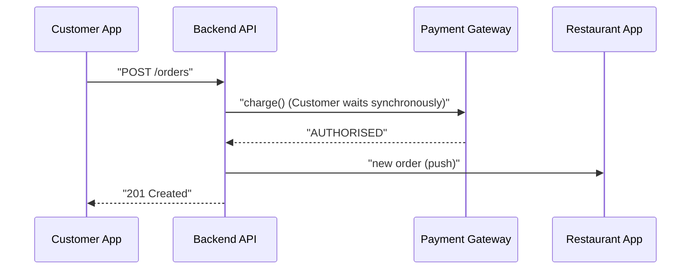

<details data-tag="theory">
<summary><strong>Question 3.1: Explain why architecture must be written down, what the four views show, and what a sequence diagram shows.</strong></summary>

**Key takeaway:** An architecture in one head is a risk; document just enough in Git, using four views where sequence diagrams show who waits for whom.

- **Why It Matters (Slide 3):** New team members take weeks to understand the system; the same debate happens again because nobody remembers why; reviewers cannot check a design they cannot see; decisions drift (code slowly stops matching the intended design). Good documentation is **just enough** (not 100 pages), **close to the code** (in the repository, reviewed like code), and **for a reader**.
- **4 Views (Slide 4):** **Structure** (what are the parts and how do they connect? — C4 diagrams); **Behaviour** (what happens, in what order, when a user places an order? — sequence diagrams); **Deployment** (which machines, containers and networks run each part?); **Decisions** (why is it built this way? — ADRs).
- **Sequence Diagrams (Slide 8):** Read top to bottom; each vertical line is a participant; arrows are messages in time order; shows **who waits for whom** (here the customer waits for the payment). Use it for the 2–3 most important or risky flows.

</details>

<details data-tag="theory">
<summary><strong>Question 3.2: Explain the four C4 levels of zoom and what belongs on System Context (Level 1) versus Containers (Level 2).</strong></summary>

**Key takeaway:** Most teams only maintain levels 1 and 2; Level 1 shows FoodHub as one box with people and external systems, while Level 2 opens the box into apps and data stores.

- **4 Levels of Zoom (Slide 5):** **1 · System context** (the system as one box, with the people and external systems around it); **2 · Containers** (apps and data stores that run separately: mobile app, API, database, queue — NOT Docker!); **3 · Components** (the main parts inside one container, draw only for containers that are hard to understand); **4 · Code** (classes and functions, usually generated by tools).
- **Level 1 & Level 2 Rules (Slides 6–7 & Handout 2):** Every arrow on Context gets a label (*what flows and why*, e.g., *"sends payment requests"* — no databases or servers on Level 1). On Containers, label each box with name, technology and purpose (e.g., NestJS, PostgreSQL, Vue), and each arrow with protocol (e.g., *"HTTPS/JSON"*, *"SQL over TCP"*).

</details>

<details data-tag="theory">
<summary><strong>Question 3.3: Explain the four parts of an Architecture Decision Record (ADR) and why accepted ADRs are never edited.</strong></summary>

**Key takeaway:** An ADR records Status, Context, Decision, and both good and bad Consequences—short (one page), numbered, stored in Git, and superseded rather than edited.

- **4 Parts (Slide 9):** **Status** (proposed, accepted, superseded); **Context** (the forces and facts at the time); **Decision** (what we chose, in one or two sentences); **Consequences** (**good and bad** results).
- **Example (`ADR-003: Use PostgreSQL for orders`):** *Context:* Orders need transactions (payment + order must both succeed), team knows SQL, ~15 GB/year. *Decision:* Use one managed PostgreSQL database. *Consequences:* `+` ACID transactions, mature tooling, managed service (no DBA needed); `-` One database limits write scaling (revisit at 10×). Never edit after acceptance: write a new ADR that supersedes it.

</details>

<details data-tag="theory">
<summary><strong>Question 3.4: Explain the four system-level design principles and walk through the six steps from question to design.</strong></summary>

**Key takeaway:** Good designs separate concerns, keep related rules together, depend through small interfaces, and follow the 6-step process used in the midterm and final exam.

- **4 Principles (Slide 10):** **Separation of concerns** (each part has one job; payment logic does not live in the menu code); **High cohesion** (things that change together stay together — all order rules in one module); **Loose coupling** (parts depend on each other through small, stable interfaces); **Conway's law** (systems mirror the communication structure of the teams that build them — design teams and architecture together).
- **6 Steps (Slide 11 — *"Used in design interviews, design reviews, the midterm and the final exam."*):** `1. Clarify` (users, features, quality attributes, constraints; ask questions) → `2. Estimate` (users → requests per second, storage, bandwidth) → `3. API` (main endpoints or events between parts) → `4. High-level design` (container diagram for main flows) → `5. Deep dive` (the 1–2 hardest parts: data, scaling, failure) → `6. Trade-offs` (what you chose, what you gave up, and what you would change at 10×).

</details>

<details data-tag="practical">
<summary><strong>Question 3.5: Explain the useful estimate numbers, how to calculate FoodHub's QPS, storage, and Rider GPS load, and Week 2 takeaways.</strong></summary>

**Key takeaway:** Estimate first—the right architecture for 35 requests per second is very different from one for 35,000; show every step and every unit.

| Fact (Slide 12) | Approximate value | Why it matters |
| :--- | :--- | :--- |
| **Seconds in a day** | 86,400 (≈ 100,000 for quick maths) | Per-day → per-second |
| **Peak factor** | 2–10× the average (FoodHub: 5×) | Design for the peak, not the average |
| **Read from memory** | ≈ 100 ns | Caches are very fast |
| **Read 1 MB from SSD** | ≈ 1 ms | Disk is fast, but not memory-fast |
| **Round trip in a data centre** | ≈ 0.5 ms | Calls between services add up |
| **Round trip Phnom Penh ↔ Singapore** | ≈ 30–50 ms | Where you host matters |
| **Mobile 4G round trip** | ≈ 50–100 ms | Fewer, bigger requests on mobile |

- **FoodHub Worked Example (Slide 13):** `20,000 ÷ 86,400 = 0.23` orders/s avg; 30 calls/order → `7 QPS` avg → `5 × 7 = 35 QPS` peak → `10 × = 350 QPS` in two years. Order data: `20,000 × 2 KB ≈ 40 MB/day ≈ 15 GB/year` (menu photos: `1,500 × 50 × 200 KB ≈ 15 GB`). **Rider GPS:** `400` active riders (50% of 800), 1 update every 5 s ≈ **80 writes per second** (more than orders!).
- **Slide 13–14 Rules:** FoodHub is **not** huge—one good server and one database can handle today's load (design for growth, not for Google). A wrong assumption that is written down can be fixed; a hidden one cannot.
- **What to remember from week 2 (Slide 15):** (1) Document just enough: diagrams and decisions, kept in Git. (2) C4: context for everyone, containers for engineers. (3) Sequence diagrams show who waits for whom. (4) An ADR records context, decision and both kinds of consequences. (5) Estimate before you design: QPS, storage, peak and growth.

</details>

---

## Section 4 — Week 3: Networking and Communication

Sources: Week 3 Slides (14 pages), Practice Handout, Quiz 3.

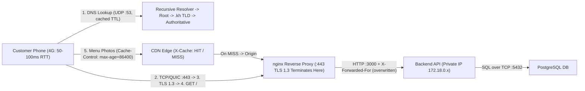

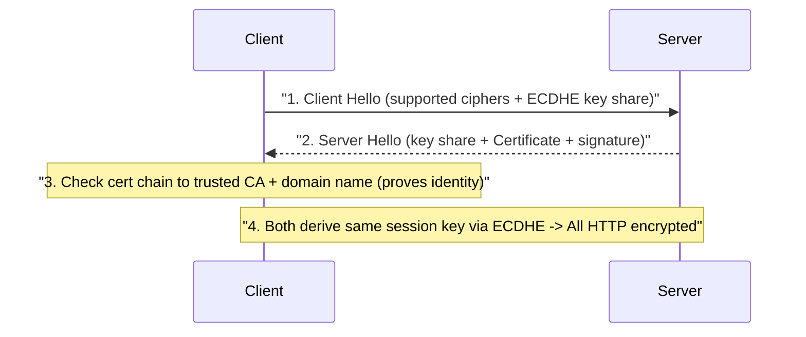

<details data-tag="theory">
<summary><strong>Question 4.1: Trace the five steps when opening foodhub.com.kh and explain why every arrow in a diagram matters.</strong></summary>

**Key takeaway:** Opening a URL runs DNS → TCP/QUIC → TLS → HTTP → More requests; each step costs round trips (300–500 ms before HTML on 4G).

- **5 Steps (Slide 3):** (1) **DNS** (find the IP address of `foodhub.com.kh`); (2) **TCP / QUIC** (open a connection to that IP and port `443`); (3) **TLS** (agree on keys, check the certificate); (4) **HTTP** (send `GET /`, receive HTML); (5) **More requests** (CSS, JS, images: often from a CDN).
- **Key Idea (Slide 13):** Every arrow in your diagram is DNS, a connection, TLS and HTTP. Each one can be slow and each one can fail. Good architectures remove round trips (keep-alive, HTTP/2–3, CDN) and plan for failure of every hop.

</details>

<details data-tag="theory">
<summary><strong>Question 4.2: Explain IPv4/IPv6/NAT, TCP vs UDP, and how TLS 1.3 secures HTTPS in one round trip.</strong></summary>

**Key takeaway:** Key agreement (ECDHE) creates the session key while the certificate only proves who the server is; IP = the building, port = the room.

- **IP Addresses & NAT (Slide 4):** IPv4 is 32 bits (~4.3 billion, not enough); IPv6 is 128 bits (effectively unlimited); most systems run both ("dual stack"). Private ranges (`10.x`, `172.16–31.x`, `192.168.x`) are not reachable from the internet; NAT shares one public IP among many private devices. Servers in a cloud network get private IPs; only the load balancer or proxy is public.

| Dimension (Slide 5) | TCP | UDP |
| :--- | :--- | :--- |
| **Connection** | Handshake first (SYN, SYN-ACK, ACK) | No connection: just send |
| **Delivery** | Reliable, in order; lost packets are re-sent | Best effort: packets may be lost or reordered |
| **Speed** | Extra round trip; waits for lost packets | Low overhead, no waiting |
| **Used for** | Web (HTTP/1.1, HTTP/2), databases, email | DNS queries, video calls, games, QUIC (HTTP/3) |
| **Ports** | e.g. 443 HTTPS, 5432 PostgreSQL, 6379 Redis | e.g. 53 DNS, 443 QUIC |

- **TLS 1.3 in 1 RTT (Slide 7):** (1) **Client hello** (supported ciphers + key share); (2) **Server hello** (its key share, certificate, and signature proving it owns the certificate); (3) **Check** (client checks certificate chain up to a trusted authority and the domain name); (4) **Encrypt** (both sides derive the same session key via ECDHE).

</details>

<details data-tag="practical">
<summary><strong>Question 4.3: Explain how DNS resolution and TTL caching work, DNS record types, and why TTL 86,400 causes problems when moving servers.</strong></summary>

**Key takeaway:** DNS is a cached tree where TTL trades speed against change—lower TTL at least one old TTL ahead before moving servers.

- **Resolution Chain (Slide 8 & Handout 3 Part A):** Phone asks **Recursive resolver** (ISP or `1.1.1.1` / `8.8.8.8`, checks cache first) → **Root server** → **`.kh` TLD server** → **Authoritative** (`203.0.113.10, TTL 300`). On a repeat query, the resolver answers from cache so the TTL counts down.

| Record (Slide 9) | Maps | Example |
| :--- | :--- | :--- |
| **A / AAAA** | Name → IPv4 / IPv6 address | `api.foodhub.com.kh → 203.0.113.10` |
| **CNAME** | Name → another name | `img.foodhub.com.kh → foodhub.cdn-provider.net` |
| **MX** | Domain → mail servers | `foodhub.com.kh → mail.provider.com` |
| **TXT** | Name → text | Domain ownership checks, SPF email rules |
| **NS** | Domain → its authoritative name servers | `foodhub.com.kh → ns1.dns-host.com` |

- **DNS Failover & Migration:** Returning several `A` records gives DNS load balancing (limited by TTL/caching). With `TTL = 86,400` (24 h), lower TTL (e.g., 300 s) at least 1 day ahead, keep the old server forwarding during overlap, then raise TTL afterward.

</details>

<details data-tag="theory">
<summary><strong>Question 4.4: Compare HTTP/1.1, HTTP/2, and HTTP/3, and explain why HTTP/3 helps mobile users on 4G.</strong></summary>

**Key takeaway:** HTTP/3 runs over QUIC (UDP), so a lost packet only stalls its own stream and the connection survives a Wi-Fi → 4G switch.

| Version (Slide 6) | Transport | Multiplexing & Loss Behaviour | Key Advantage / Trade-off |
| :--- | :--- | :--- | :--- |
| **HTTP/1.1 (1997)** | Text protocol over TCP | One request at a time per connection | Browsers open ~6 connections to work around it |
| **HTTP/2 (2015)** | Binary, over TCP | Multiplexing (many requests on one connection) + header compression | One lost packet still stalls **all** streams (TCP head-of-line blocking) |
| **HTTP/3 (2022)** | Over **QUIC (UDP)** | Lost packet only stalls **its own stream** | Faster setup (transport + TLS in 1 RTT); connection survives **Wi-Fi → 4G switch** |

</details>

<details data-tag="theory">
<summary><strong>Question 4.5: Compare forward proxy vs reverse proxy, and explain X-Forwarded-For and 502 Bad Gateway in the nginx lab.</strong></summary>

**Key takeaway:** A forward proxy sits in front of clients; a reverse proxy sits in front of servers—so the backend sees the proxy's IP unless X-Forwarded-For is set.

- **Forward vs Reverse Proxy (Slide 11):** **Forward proxy** sits in front of *clients* (server sees proxy, not user; used for company web filtering, caching, hiding client IPs, VPN-like access; client is configured to use it). **Reverse proxy** sits in front of *servers* (client sees proxy, not servers; used for TLS termination, load balancing, caching, compression, rate limiting, hiding internal servers; e.g., nginx, HAProxy, Envoy).
- **nginx Lab (Handout 3 Part C):** Port `3000` is not exposed—only nginx (`8080`) is. The backend sees `172.18.0.3` (the proxy) as the TCP remote IP; nginx sets `X-Forwarded-For $remote_addr` (overwrite, and trust only your own proxy). Stopping the app container causes nginx to return **`502 Bad Gateway`**.

</details>

<details data-tag="theory">
<summary><strong>Question 4.6: Explain sync vs async, stateless vs stateful, what belongs on a CDN, and the 5 takeaways from Week 3.</strong></summary>

**Key takeaway:** Stateless servers scale out easily, and CDNs cache public static assets near users—never personal or changing data without care.

- **Client-Server Choices (Slide 10):** **Sync** (caller waits for answer: HTTP request/response; simpler) vs **Async** (caller sends and continues: message queue, webhook, push; survives slow or offline receivers). **Stateless** (every request carries what the server needs, e.g., token; any server can answer and scale out easily) vs **Stateful** (server remembers client in memory / open WebSocket).
- **CDNs (Slide 12):** Keeps copies in **edge servers** close to users (on a miss, fetches from **origin**). **Put on CDN:** menu photos, app JS and CSS, public pages, video/downloads. **How it decides:** `Cache-Control: max-age=86400`, `Age`, `X-Cache: HIT / MISS`, versioned filenames (`app.3f9a.js`). **Never** cache personal or changing data (order status, payments) at a shared CDN without care.
- **What to remember from week 3 (Slide 14):** (1) Opening a URL: DNS → TCP/QUIC → TLS → HTTP. (2) TCP is reliable and ordered; UDP is fast; HTTP/3 uses QUIC over UDP. (3) TLS 1.3: key agreement for secrecy, certificate for identity. (4) DNS is a cached tree; TTL trades speed against change. (5) Reverse proxies protect servers; CDNs bring content close to users.

</details>

---

## Section 5 — Week 4: Web Concepts and API Design

Sources: Week 4 Slides (13 pages), Practice Handout, Quiz 4.

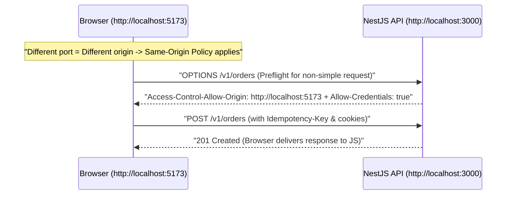

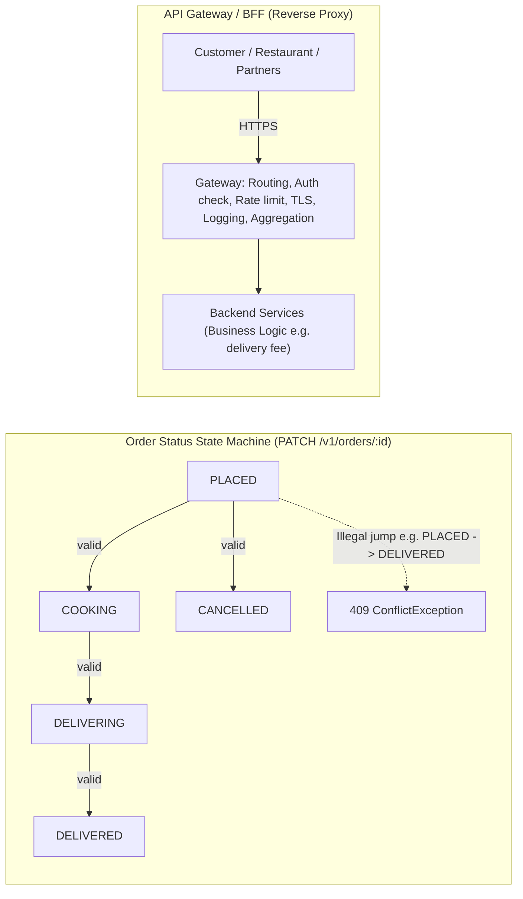

<details data-tag="theory">
<summary><strong>Question 5.1: Compare server-side sessions vs self-contained tokens, and explain what happens to an in-memory SESSIONS Map on restart or behind 3 servers.</strong></summary>

**Key takeaway:** HTTP has no memory; server sessions need a shared store (Redis/DB) across multiple servers so restarts and load balancers don't log users out.

- **Server-Side Session vs Token (Slide 3):** **Session:** server creates a random session ID, stores the user in a session store, browser keeps ID in a cookie, logout = delete session (immediate); needs a shared store (Redis, DB) when there are several servers. **Self-contained token (JWT):** server signs a token containing user ID + expiry, client sends `Authorization: Bearer …`, any server verifies with key (no lookup), hard to revoke before expiry.
- **In-Memory `SESSIONS` Map Failure (Handout 4 Part D):** Restarting the API wipes RAM so `req.cookies.sid` is missing and returns `401 Unauthorized`. With 3 API servers behind a load balancer, a login on server 1 fails on server 2/3 unless sessions live in shared Redis/DB.

</details>

<details data-tag="theory">
<summary><strong>Question 5.2: Explain the real JWT trade-off, why secrets must never go in the payload, and how to store and verify JWTs safely.</strong></summary>

**Key takeaway:** Both sessions and JWTs are secure if used correctly—they trade instant revocation (sessions) against no lookup per request (tokens).

- **JWT Rules (Slide 5):**
  - A JWT is **signed, not encrypted**: anyone can read the payload, so no secrets inside.
  - Main weakness: **revocation**. A stolen token works until it expires. Fix: **short access token** (5–15 min) + **refresh token** stored safely, revocable on the server.
  - Always verify the signature, expiry, and a **pinned algorithm** (never accept `alg: none`).
  - Where to store in a browser: an **`HttpOnly` cookie** is safest; `localStorage` is readable by any XSS.

</details>

<details data-tag="theory">
<summary><strong>Question 5.3: Explain the five cookie flags that matter and how session IDs should be issued.</strong></summary>

**Key takeaway:** Session IDs should be long and random (≥ 128 bits), rotated after login, and protected with HttpOnly, Secure, and SameSite.

| Flag (Slide 4) | What it does | Protects against |
| :--- | :--- | :--- |
| **HttpOnly** | JavaScript cannot read the cookie (`document.cookie`) | Token theft through XSS |
| **Secure** | Only sent over HTTPS | Sniffing on public Wi-Fi |
| **SameSite=Lax / Strict** | Not sent on most cross-site requests | CSRF (cross-site request forgery) |
| **Max-Age / Expires** | Cookie lifetime | Old sessions living forever |
| **Domain / Path** | Which hosts and paths receive it | Leaking to other subdomains |

- **Example:** `Set-Cookie: sid=…; HttpOnly; Secure; SameSite=Lax` (rotated on login, expired server-side).

</details>

<details data-tag="practical">
<summary><strong>Question 5.4: Explain REST resources, methods, status codes, versioning, pagination, idempotency keys, and RFC 9457 error format.</strong></summary>

**Key takeaway:** An API is a contract—use nouns in URLs, verbs in methods, Idempotency-Key on POST retries, cursor pagination, and one RFC 9457 error shape.

| Request (Slide 7) | Meaning | Success | Typical errors |
| :--- | :--- | :--- | :--- |
| `GET /v1/restaurants?limit=20` | List restaurants | 200 | 400 bad query |
| `GET /v1/orders/{id}` | Read one order | 200 | 404 not found, 401/403 |
| `POST /v1/orders` | Create an order | 201 + Location | 400 invalid, 409 conflict |
| `PATCH /v1/orders/{id}` | Change part of an order | 200 | 409 illegal status change |
| `DELETE /v1/orders/{id}` | Cancel / remove | 204 | 404, 409 |

- **Idempotency & Contract Rules (Slides 7–8, 12 & Handout 4):** `GET` is safe; `GET`, `PUT` and `DELETE` are **idempotent**; `POST` is not. **Versioning:** `/v1/orders` (breaking changes → `/v2`). **Pagination:** `limit + offset`, or a **cursor** for large, changing lists. **Idempotency key:** client sends `Idempotency-Key: <uuid>` with `POST`; a retry returns the first result (`200`) instead of a second order. **Error format:** `status, error code, message, details` (**RFC 9457 "problem details"**). In NestJS: `ValidationPipe({ whitelist: true })` (`400`) and `ConflictException` (`409`) for illegal state jumps.

</details>

<details data-tag="theory">
<summary><strong>Question 5.5: Explain how CORS works in four steps, why curl ignores it, and why origin: '*' with credentials is unsafe.</strong></summary>

**Key takeaway:** CORS is enforced by browsers only—different ports (5173 vs 3000) are different origins, and you must never combine * with credentials.

- **4 Steps (Slide 11):** (1) **Same-origin policy:** scripts on `localhost:5173` may not read responses from `localhost:3000` (different origin: scheme + host + port); (2) **Preflight:** for non-simple requests the browser first sends `OPTIONS`; (3) **Server answers:** `Access-Control-Allow-Origin`, allowed methods, headers, credentials; (4) **Browser decides:** delivers response if headers match, else *"blocked by CORS policy"*.
- **Lab Fix (Handout 4):** `app.enableCors({ origin: 'http://localhost:5173', credentials: true })`. `curl` and servers ignore CORS; never use `*` together with `credentials: true`.

</details>

<details data-tag="theory">
<summary><strong>Question 5.6: Compare the 4 API styles, API gateway vs BFF, serialization formats (JSON, XML, Protobuf, Avro), and Week 4 takeaways.</strong></summary>

**Key takeaway:** Pick REST for public APIs, gRPC/Protobuf for internal services, GraphQL for varied UIs, Webhooks for partner events, and keep business logic out of the gateway.

- **4 API Styles (Slide 6):** **REST** (resources + HTTP methods, JSON over HTTP, cacheable, default for public/mobile APIs); **gRPC** (RPC over HTTP/2, Protobuf, service-to-service inside a system); **GraphQL** (client asks for exact fields, 1 endpoint/schema, many different clients/screens); **Webhooks** (server calls you via HTTP `POST` on partner events).
- **API Gateway & BFF (Slide 9):** Specialised reverse proxy (Kong, AWS API Gateway, nginx, Envoy) doing routing, auth check, rate limiting, TLS, logging, aggregation. **BFF (Backend for frontend):** one gateway per client type when mobile and web need different shapes. Risk: SPOF & bottleneck—keep business logic **out** of the gateway.

| Format (Slide 10) | Readable | Size / speed | Schema | Typical use |
| :--- | :--- | :--- | :--- | :--- |
| **JSON** | Yes | Medium | Optional (JSON Schema, OpenAPI) | Web and mobile APIs |
| **XML** | Yes | Large, slow | XSD | Older enterprise and banking systems |
| **Protobuf** | No (binary) | Small, fast | Required (`.proto`); fields numbered | gRPC, service-to-service |
| **Avro** | No (binary) | Small, fast | Required; schema travels with data or registry | Kafka events, data pipelines |

- **Schema evolution** (adding fields without breaking old readers) is a strength of Protobuf and Avro, not a weakness.
- **What to remember from week 4 (Slide 13):** (1) Sessions keep state on the server; tokens carry it signed. (2) Cookies: HttpOnly, Secure, SameSite. (3) JWT: short-lived, verified, pinned algorithm, refresh tokens. (4) REST: nouns, methods, status codes, versions, pagination, idempotency keys. (5) Gateways route and protect; CORS is the browser's rule.

</details>

---

## Section 6 — Week 5: Monolith, Layered, and Modular Styles

Sources: Week 5 Slides (13 pages), Practice Handout, Quiz 5.

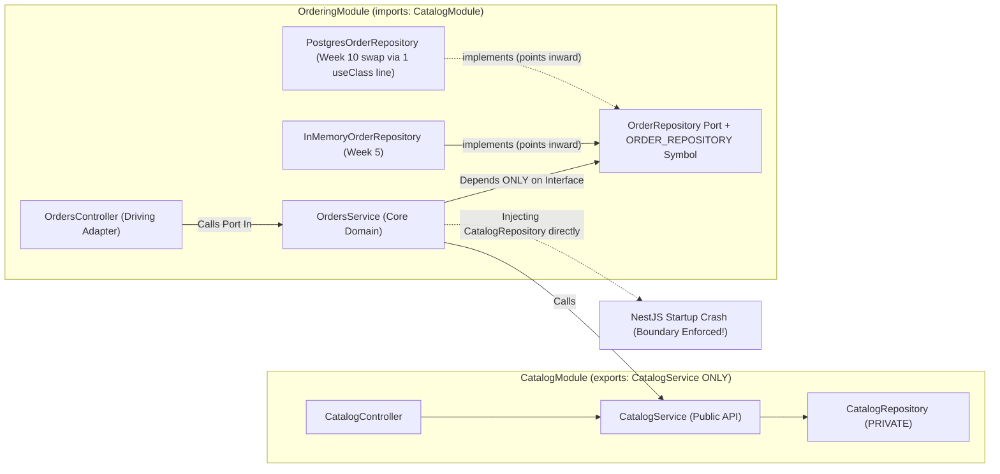

<details data-tag="theory">
<summary><strong>Question 6.1: Explain the difference between logical layers and physical tiers with FoodHub examples.</strong></summary>

**Key takeaway:** Layers organise code inside one process; tiers are separately running parts, often on their own machines.

- **Layer (logical, Slide 5):** A way to organise code; several layers can run in one process (e.g., controllers, services and repositories inside one NestJS app).
- **Tier (physical):** A separately running part, often on its own machine (**2-tier:** client + database; **3-tier:** client + application server + database; **N-tier:** CDN, gateway, cache). **FoodHub today:** 3 tiers (apps, NestJS API, PostgreSQL), and the API has 3 layers inside.

</details>

<details data-tag="theory">
<summary><strong>Question 6.2: Compare Monolith, Layered, Modular Monolith, and Hexagonal styles, and explain why we structure inside the monolith first.</strong></summary>

**Key takeaway:** Structure inside the monolith first—you can always split a well-modularised monolith, but you cannot easily untangle a distributed big ball of mud.

- **Monolith (Slide 3):** *Strengths:* simple to build, run, test and debug; function calls instead of network calls (fast and reliable); one database (easy transactions and joins); one thing to deploy/monitor. *Limits:* tangled ("big ball of mud"), every change redeploys all, scales as a whole, many teams slow each other down.
- **Layered (Slide 4):** Each layer only calls the one below (Presentation → Application/business → Data access → Database). *Weakness:* business logic **depends on** the data layer, and each feature cuts across all layers.
- **Modular Monolith (Slide 6):** Modules by business capability; each module **owns its data** and hides internals; talks only through a **public interface** (service or events); **no cycles**; boundaries **enforced** by framework or test.

| Style (Slide 11) | Good when | Watch out for |
| :--- | :--- | :--- |
| **Monolith (simple)** | Small team, early product, simple domain | Turning into a big ball of mud |
| **Layered** | Business apps with clear CRUD flows | Logic depending on the database; changes across all layers |
| **Modular monolith** | One or a few teams, growing domain, need clear ownership | Boundaries must be enforced |
| **Hexagonal** | Rich business rules, many integrations, strong testing needs | Extra interfaces for simple features |
| **Microservices (week 6)** | Many teams, parts with very different scale or release needs | Network, data and operations costs |

</details>

<details data-tag="theory">
<summary><strong>Question 6.3: Explain Pipe-and-filter, Microkernel (plug-in), and SOA styles with examples.</strong></summary>

**Key takeaway:** Pipe-and-filter chains independent steps, Microkernel extends a small core with plug-ins, and SOA shares enterprise services via an ESB.

- **Pipe-and-filter (Slide 10):** Data flows through independent steps (each filter: `input → transform → output`; e.g., Unix pipes, image processing `scan → resize → compress → store`, ETL, CI pipelines).
- **Microkernel (plug-in):** Small core + plug-ins that add features following a contract (e.g., VS Code, browsers, Eclipse; payment methods as plug-ins).
- **SOA:** Enterprise services shared across the company, often an **enterprise service bus (ESB)** with central rules; ancestor of microservices, heavier with more central control.

</details>

<details data-tag="theory">
<summary><strong>Question 6.4: Explain how NestJS enforces module boundaries at startup (CatalogModule vs OrderingModule).</strong></summary>

**Key takeaway:** Listing only CatalogService in exports makes CatalogRepository private—injecting CatalogRepository into Ordering fails at startup.

```typescript
// src/catalog/catalog.module.ts
@Module({
  controllers: [CatalogController],
  providers:   [CatalogService, CatalogRepository],
  exports:     [CatalogService],   // public interface
})
export class CatalogModule {}

// src/ordering/ordering.module.ts
@Module({
  imports:   [CatalogModule],      // uses its service
  providers: [OrdersService, ...],
})
export class OrderingModule {}
```

- **What this gives you (Slide 7 & Handout 5):** `exports` is the module's public API; injecting `CatalogRepository` into `OrdersService` fails at startup; `imports` makes dependencies visible so you can check there are no cycles (break cycles with events, moving responsibility, or merging).

</details>

<details data-tag="practical">
<summary><strong>Question 6.5: Explain Hexagonal Architecture (Ports & Adapters), how useClass swaps In-Memory for Postgres, and Week 5 takeaways.</strong></summary>

**Key takeaway:** Dependencies point inwards—adapters depend on the core, never the reverse—so swapping InMemoryOrderRepository for PostgresOrderRepository takes one useClass line.

- **5 Boxes (Slide 8):** **Driving adapters** (REST controller, CLI, message consumer, tests) → **Ports (in)** (use cases: `placeOrder()`, `changeStatus()`) → **Core domain** (order rules; no NestJS, no SQL, no HTTP) → **Ports (out)** (interfaces it needs: `OrderRepository`, `PaymentGateway`) → **Driven adapters** (PostgreSQL repo, in-memory repo, KHQR client). Clean and onion architecture are the same idea with more rings.

```typescript
// The PORT (no technology inside)
export interface OrderRepository {
  save(order: Order): Promise<void>;
  get(id: string): Promise<Order | undefined>;
}
export const ORDER_REPOSITORY = Symbol('ORDER_REPOSITORY');

// The core depends only on the port (import type erased at runtime)
constructor(@Inject(ORDER_REPOSITORY) private readonly orders: OrderRepository) {}

// One line chooses the ADAPTER (Week 10: swap to PostgresOrderRepository)
providers: [OrdersService, { provide: ORDER_REPOSITORY, useClass: InMemoryOrderRepository }]
```

- **What to remember from week 5 (Slide 13):** (1) A monolith is a valid, often the best, starting point. (2) Layers organise code; tiers are separate running parts. (3) Modular monolith: modules by business area, own data, public interfaces, no cycles. (4) Hexagonal: the core defines ports; adapters plug in technology. (5) Choose and combine styles based on team, domain and qualities.

</details>

---

## Section 7 — Week 6: Microservices, DDD, and Event Storming

Sources: Week 6 Slides (14 pages), Practice Handout, Quiz 6, `TeachersNode.md`.

### FoodHub Event Storming Workshop Board

```event-storming
context: 1. Catalog Context
actor: Restaurant Staff
command: UpdateMenu
event: MenuUpdated

context: 2. Ordering Context
actor: Customer
command: PlaceOrder
event: OrderPlaced
event: OrderAccepted / OrderCancelled
hotspot: "What if restaurant never accepts?"

context: 3. Payment Context
actor: KHQR / Bank System
command: AuthorisePayment / IssueRefund
event: PaymentAuthorised / RefundIssued
hotspot: "Payment settles after order timeout?"

context: 4. Delivery Context
actor: Rider & Kitchen
command: MarkFoodReady / AssignRider
event: FoodReady -> RiderAssigned -> OrderPickedUp -> OrderDelivered
hotspot: "Rider cancels after pickup?"

context: 5. Notification / Reviews
actor: SMS Provider / Customer
command: SendAlert / RateOrder
event: CustomerNotified / OrderRated
```

### FoodHub Context Map (Sync vs Async + DDD Relationships)

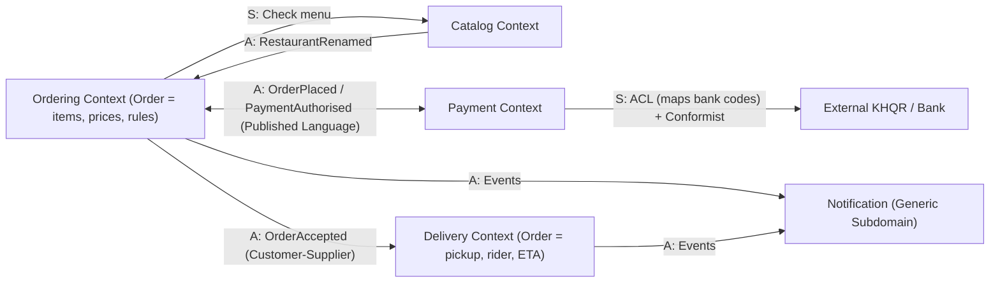

<details data-tag="theory">
<summary><strong>Question 7.1: Explain DDD subdomains, ubiquitous language, and bounded contexts ("one word, different meanings").</strong></summary>

**Key takeaway:** Build the core subdomain yourself with your best people, buy/reuse generic ones, and keep each bounded context's model separate.

- **DDD Concepts (Slide 5):** **Domain:** the business area the software serves (food delivery). **Subdomains:** *core* (what makes FoodHub special: matching orders and riders), *supporting* (menus), *generic* (payments, email/SMS). **Ubiquitous language:** developers and business use the same words in talk and code. **Bounded context:** a boundary inside which a model and its words have one meaning (a good candidate for a module or a service).
- **One Word, Different Meanings (Slide 6):** `Order in Ordering` = items, quantities, prices, discounts, customer, restaurant, status (placed, accepted, cancelled), rules. `"Order" in Delivery` = pickup point, drop-off address, assigned rider, route, ETA, status (waiting, picked up, delivered) — does not care about prices or dishes. Forcing one shared `Order` model on everyone creates a huge class that every team must change.

</details>

<details data-tag="practical">
<summary><strong>Question 7.2: Explain how to run an Event Storming workshop (4 sticky colours, 5 steps) and draw a Context Map marking S vs A.</strong></summary>

**Key takeaway:** Invented by Alberto Brandolini—fast, visual, and gets business people and developers in one room using four sticky-note colours.

- **4 Sticky Colours (Handout 6):** **Orange** = Domain event, past tense (`OrderPlaced`); **Blue** = Command that causes it (`PlaceOrder`); **Yellow** = Actor, person or system (`Customer`); **Pink** = Hot spot: question or disagreement (*"What if the restaurant never accepts?"*).
- **5 Steps (Slide 8 & Handout 6):** (1) **Events** (orange notes, past tense); (2) **Timeline** (arrange left to right in order); (3) **Commands and actors** (blue + yellow); (4) **Hot spots** (pink: where the risk is); (5) **Boundaries** (group into 4–6 bounded contexts, name one word with two meanings, draw Context Map marking **S** sync API vs **A** async event, and score 1–3 on change frequency, scaling need, team ownership, data sensitivity).

```event-storming
context: Ordering
actor: Customer
command: PlaceOrder
event: OrderPlaced
hotspot: "Restaurant timeout?"

context: Payment
actor: KHQR
command: AuthorisePayment
event: PaymentAuthorised

context: Delivery
actor: Rider
command: AssignRider
event: RiderAssigned -> OrderDelivered
```

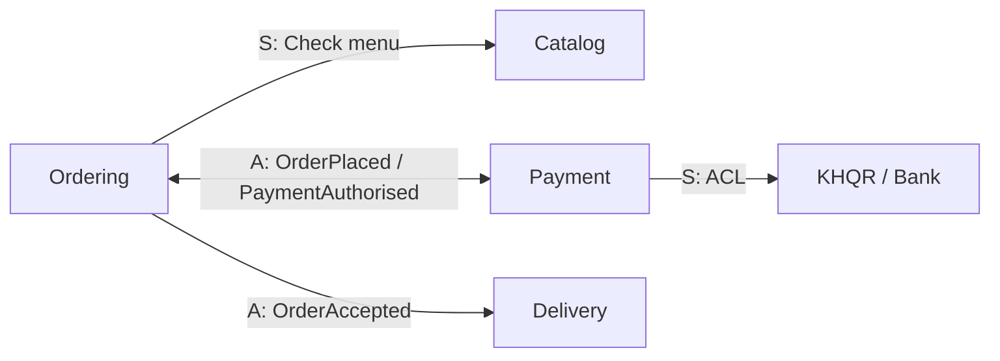

</details>

<details data-tag="theory">
<summary><strong>Question 7.3: Explain the five DDD Context Map relationships with FoodHub examples.</strong></summary>

**Key takeaway:** Context maps define how bounded contexts relate—especially using an Anti-Corruption Layer (ACL) to protect your model from messy external APIs.

| Relationship (Slide 7) | Meaning | FoodHub example |
| :--- | :--- | :--- |
| **Customer–supplier** | Downstream needs something; upstream plans for it | Delivery depends on Ordering's `OrderAccepted` event |
| **Conformist** | Downstream simply accepts upstream's model | FoodHub uses the KHQR provider's API as it is |
| **Anti-corruption layer** | A translator protects our model from a messy external one | Payment adapter maps bank codes into FoodHub's own payment statuses |
| **Published language** | A shared, documented format | Event schemas published by Ordering |
| **Shared kernel** | Two contexts share a small piece of model (use rarely) | A shared `Money` type |

</details>

<details data-tag="theory">
<summary><strong>Question 7.4: Explain the 6 traits, benefits, and costs of microservices, and compare sync calls vs async messages (0.999³).</strong></summary>

**Key takeaway:** Microservices solve team and scale problems and cost network, data, and operations effort; avoid long synchronous chains.

- **6 Microservice Traits (Slide 3):** **Business capability** (ordering, payment, delivery); **Independent deploy**; **Own data** (own DB, nobody else reads its tables); **Smart endpoints, dumb pipes** (plain HTTP or messages); **Owned by one team** (*"You build it, you run it."*, ≈ 5–9 people); **Designed for failure**. *(10 services deploying together on 1 DB = **distributed monolith**.)*
- **Benefits vs Costs (Slide 4):** *Benefits:* independent team work/deploy, scale only busy parts (rider tracking), failure contained to one service, best tech per job, smaller codebases. *Costs:* Network (latency, timeouts, partial failures), Data (no cross-service transactions, eventual consistency), Operations (many deploys, logs, dashboards, alerts), Testing (E2E hard/slow), Skills (CI/CD, containers, observability from day one).
- **Sync vs Async (Slide 9):** **Sync (REST/gRPC)** has temporal coupling (chains multiply latency & failure: 3 services at 99.9% in sequence ≈ **99.7%**). **Async (messages/events)** lets receiver catch up later and gives eventual consistency.

</details>

<details data-tag="theory">
<summary><strong>Question 7.5: Explain "database per service" and how Ordering gets restaurant names without joining Catalog's table.</strong></summary>

**Key takeaway:** Shared database = hidden coupling (the most common microservice mistake); each service owns its data and exposes APIs or events.

- **Database per Service (Slide 10):** (1) Each service owns its data; others ask through its API or listen to its events. (2) Teams can change schemas without breaking others. (3) **No joins across services:** compose data in the API or keep a local copy (read model). (4) **No ACID transaction across services:** use a **saga**.
- **FoodHub Example:** Order history needs restaurant names. Instead of joining Catalog's table, Ordering **copies the name** onto the order when it is placed (denormalisation), or listens to `RestaurantRenamed` events (or calls Catalog's API).

</details>

<details data-tag="theory">
<summary><strong>Question 7.6: Explain Serverless vs Cell-Based, the 5 industry case studies, the Decision Framework, and Week 6 takeaways.</strong></summary>

**Key takeaway:** FoodHub (8 developers, 35 QPS, 6-month deadline) should start modular and extract rider tracking first if needed—decide with explicit factors and write it in an ADR.

- **Serverless & Cell-Based (Slide 11):** **Serverless (FaaS)** scales to zero, pay per call, good for image resizing, webhooks, spiky/rare jobs; limits = cold starts, time limits, vendor lock-in, harder local testing. **Cell-based** runs identical copies (*cells*) per customer slice (e.g., by city) for **blast-radius control** (AWS, Slack, DoorDash).

| Company (Slide 12) | What happened | Lesson |
| :--- | :--- | :--- |
| **Amazon (early 2000s)** | Split a large monolith into services owned by "two-pizza teams" | Driven by hundreds of teams blocking each other |
| **Netflix (2009–2016)** | Moved to cloud microservices after a database outage | Needed huge scale and resilience; built many tools to cope |
| **Uber (2014–2020)** | Grew to thousands of services, then grouped them into larger "domains" (DOMA) | Too many tiny services become hard to manage |
| **Amazon Prime Video (2023)** | Merged a monitoring pipeline of serverless steps back into one service: ~90% cheaper | Pick the style per workload; splitting is not always cheaper |
| **Shopify, Stack Overflow** | Stayed with a (modular) monolith at large scale | Good structure can take a monolith very far |

| Factor (Slide 13) | Points to modular monolith | Points to microservices |
| :--- | :--- | :--- |
| **Team size** | 1–3 teams | Many teams that block each other |
| **Domain** | Still being discovered | Well understood, stable boundaries |
| **Scale** | Even load, modest QPS | Parts with very different load |
| **Time to market** | Must launch fast | Platform and tooling already exist |
| **Operations skill** | Limited DevOps | Strong CI/CD, containers, observability |
| **Release needs** | One release cadence is fine | Parts must release independently |

- **What to remember from week 6 (Slide 14):** (1) Microservices: independent deploy, own data, one team each. (2) They solve team and scale problems and cost network, data and operations effort. (3) DDD finds boundaries: subdomains, bounded contexts, context maps. (4) Prefer async for "something happened"; avoid long sync chains. (5) Decide with explicit factors and write it in an ADR.

</details>

---

## Section 8 — Week 7: Event-Driven Architecture and Messaging

Sources: Week 7 Slides (13 pages), Practice Handout, Quiz 7, `TeachersNode.md`.

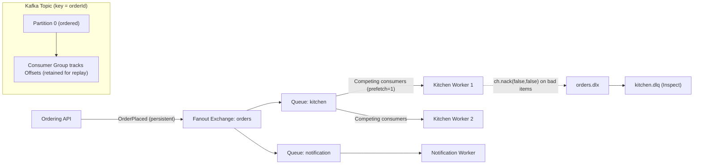

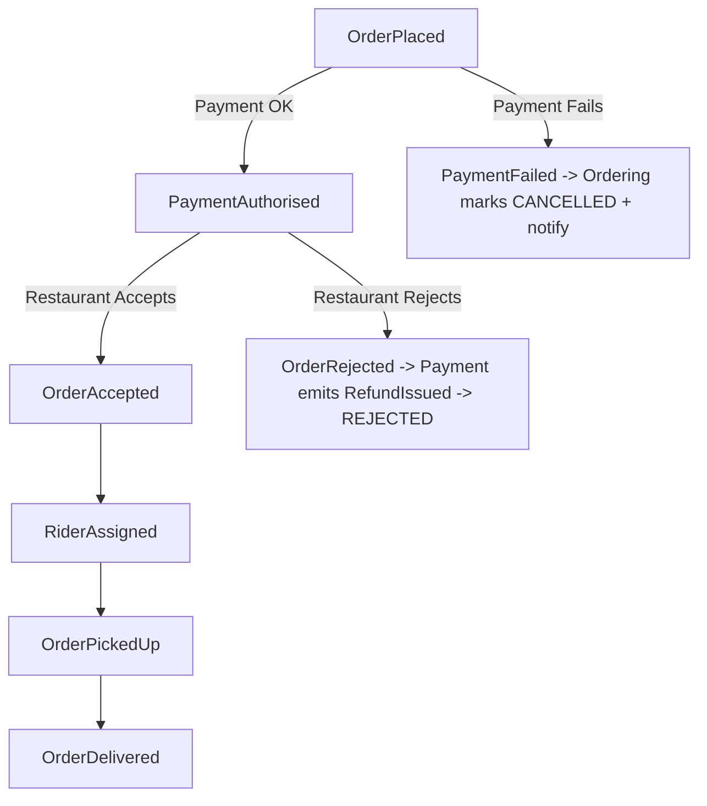

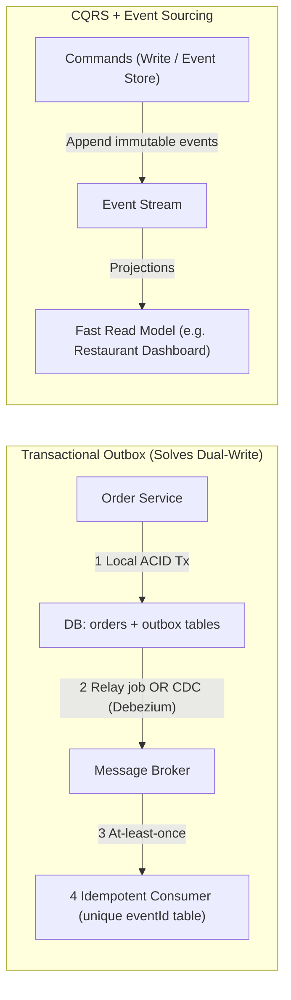

<details data-tag="theory">
<summary><strong>Question 8.1: Explain commands vs events, the three messaging models, and broker vocabulary (ack, DLQ, prefetch).</strong></summary>

**Key takeaway:** Commands ask ("Do this") and events announce ("This happened")—events give the loosest coupling because Ordering does not even know Notification exists.

- **Commands vs Events (Slide 3):** **Command:** *"Do this"* (`ChargePayment`, `SendSms`), has **one** intended receiver, sender expects it to be done, can be rejected. **Event:** *"This happened"* (`OrderPlaced`, `PaymentAuthorised`), past tense, a fact, cannot be rejected, **any number** of listeners unknown to the sender.
- **3 Messaging Models (Slide 4):** **Point-to-point queue** (each message goes to *one* consumer; competing consumers share work; removed when acked; e.g., photo resize jobs); **Publish / subscribe** (each subscriber gets its own copy; fanout exchange + one queue per subscriber; e.g., `OrderPlaced` to kitchen and notification); **Event stream (log)** (append-only log kept for days/forever; consumers track offset and can replay history).
- **Vocabulary (Slide 5):** **Producer** → **Exchange / topic** → **Queue / partition** → **Consumer (group)**. **Ack:** consumer confirms success before removal/offset commit. **DLQ:** dead-letter queue where messages go after failing too often, for a human to inspect. **Prefetch / backpressure:** limit how many unacknowledged messages a consumer holds.

</details>

<details data-tag="practical">
<summary><strong>Question 8.2: Explain what happens in the RabbitMQ lab when a worker stops, two workers compete, or a bad message arrives (ch.nack & DLQ).</strong></summary>

**Key takeaway:** Queues buffer work while a consumer is down, competing consumers share messages, and ch.nack(msg, false, false) routes poison messages to the DLQ instead of looping forever.

- **Stopped Worker vs HTTP (Handout 7 Part B):** If the kitchen worker stops and 5 orders are placed, RabbitMQ holds the persistent messages in the `kitchen` queue and delivers all 5 when it restarts (unlike synchronous HTTP, which would fail immediately).
- **Competing Consumers & `prefetch(1)`:** Starting 2 kitchen workers splits 10 orders across them; `ch.prefetch(1)` stops one slow worker from hoarding unacked jobs.
- **Poison Messages & DLQ (Part D):** `ch.nack(msg, false, true)` (requeue) puts an always-failing message right back on the queue in an infinite crash loop. Calling `ch.nack(msg, false, false)` rejects without requeue, routing it via `orders.dlx` to `kitchen.dlq`.

</details>

<details data-tag="theory">
<summary><strong>Question 8.3: Compare RabbitMQ and Kafka across model, retention, ordering, replay, strengths, and typical use.</strong></summary>

**Key takeaway:** RabbitMQ deletes messages when acked and excels at routing/task queues; Kafka retains an ordered partitioned log for high throughput and replay.

| Dimension (Slide 6) | RabbitMQ | Kafka |
| :--- | :--- | :--- |
| **Model** | Message broker: exchanges route to queues | Distributed append-only log: topics with partitions |
| **After consumption** | Message deleted when acked | Kept for the retention period; consumers move an offset |
| **Ordering** | Per queue (with one consumer) | Only **within a partition**; choose the key (e.g., `orderId`) |
| **Replay** | Not by design | Yes: reset the offset |
| **Strengths** | Flexible routing, per-message acks, simple to run | Very high throughput, history, stream processing |
| **Typical use** | Task queues, commands, moderate event volumes | Event streaming, analytics, CDC, logs |

</details>

<details data-tag="theory">
<summary><strong>Question 8.4: Explain delivery guarantees, idempotent consumers, and event design & schema evolution rules.</strong></summary>

**Key takeaway:** "Exactly-once delivery" over a network is not possible in general—use at-least-once delivery plus an idempotent consumer (unique eventId in DB) for effectively-once results.

- **Delivery Guarantees (Slide 7):** **At-most-once** (ack before processing; crash loses message; OK for metrics, GPS pings); **At-least-once** (ack after processing; crash causes redelivery/duplicates; the normal choice + idempotent consumer); **Effectively-once** (at-least-once + deduplication in a durable DB table with unique `eventId`, never an in-memory `Set` which disappears on restart).
- **Event Design & Evolution Rules (Slide 8):** Every event has an **ID, type, version and time** (plus partition key like `orderId`). **Only add optional fields**; never rename or remove in place. Breaking change → new version or new event type, supporting both for a while. Use a schema (JSON Schema, Avro, Protobuf) and a **registry** when events are shared widely.

</details>

<details data-tag="theory">
<summary><strong>Question 8.5: Explain why two-phase commit (2PC) is avoided across services and compare Choreography vs Orchestration Sagas.</strong></summary>

**Key takeaway:** 2PC blocks on coordinator failure and isn't supported by most brokers—accept eventual consistency and use a Saga (chain of local transactions with compensations).

- **Why Avoid 2PC (Slide 9):** Placing an order touches Ordering, Payment and Delivery (each with its own DB). **2PC** locks several databases together, blocks when the coordinator fails, is slow, and most brokers and cloud services do not support it.
- **Sagas (Slide 10):** Each step commits locally; if a later step fails, earlier steps are undone by **compensating actions** (e.g., restaurant rejects after payment → `RefundIssued`, order marked `Rejected`, customer notified).
  - **Choreography:** Services react to each other's events (`OrderPlaced → Payment charges → PaymentAuthorised → Restaurant accepts…`). No central controller, very loose coupling, but hard to see the whole flow when it grows.
  - **Orchestration:** An orchestrator tells each service what to do next (Temporal, AWS Step Functions, or your own state machine). Flow is explicit and easy to monitor, but extra code to build and run.

</details>

<details data-tag="theory">
<summary><strong>Question 8.6: Explain the Transactional Outbox (+ CDC), CQRS & Event Sourcing, and Week 7 takeaways.</strong></summary>

**Key takeaway:** Save the data and the event together in one local DB transaction (Transactional Outbox + Relay/CDC), and use CQRS/Event Sourcing only where history matters.

- **Transactional Outbox & CDC (Slide 11):** Solves the **dual-write problem** (*"save to DB"* and *"publish to broker"* cannot be one transaction): **1 · One local transaction** (INSERT order + INSERT into outbox table) → **2 · Relay** (background job or **CDC** like Debezium reading the DB log) → **3 · Publish** (sends event, marks row sent) → **4 · Consumers** (receive at least once: must be idempotent).
- **CQRS & Event Sourcing (Slide 12):** **CQRS** separates models for writes (commands) and reads (queries; e.g., a fast *"restaurant dashboard"* table updated from events). **Event sourcing** stores events instead of current state (replay computes state; free audit/time travel, but harder queries, schema evolution, snapshots needed). *Powerful but complex—use where history matters (payments, ledgers), not everywhere.*
- **What to remember from week 7 (Slide 13):** (1) Commands ask; events announce. Events decouple the most. (2) Queues share work; pub/sub copies; streams keep history. (3) Kafka orders within a partition; choose the key. (4) At-least-once + idempotent consumers + a DLQ. (5) No 2PC: use sagas with compensations and the outbox.

</details>

---

## Practical Exam Paper Templates (40%)

- **Template 1 — 6-Part QAS (Week 1):** Always list all 6 explicitly: **Source** (who/what) · **Stimulus** (event) · **Artifact** (which service/endpoint) · **Environment** (peak/normal/deploy) · **Response** (system action) · **Measure** (number + unit, e.g., `99% ≤ 2 s`, `0 orders lost`).
- **Template 2 — Sizing & 4-Part ADR (Week 2):** Show formula + units (`÷ 86,400` for /s, `× peak`, `× 365` for /yr). **ADR:** Title + Status + **Context** (team/deadline/QPS/qualities) + **Decision** (1–2 sentences) + **Consequences** (at least 1 good `+` and 1 bad `-`).
- **Template 3 — C4 & Request Flow (Weeks 2–3):** **C4 Context:** System = 1 box + People + External systems (NO DBs!). **C4 Container:** Tech on every box + Protocol on every arrow (`HTTPS/JSON`, `SQL/TCP`). **Request Flow:** Mark where TLS terminates and where caching happens.
- **Template 4 — REST + Hexagonal (Weeks 4–5):** **REST:** Noun paths (`/v1/...`), pagination, success code (`200/201/204`) + error codes (`400/401/403/404/409`). **Hexagonal:** Arrows point *inward*; core imports only Port interface; Module `useClass` binds Adapter.
- **Template 5 — Event Storming + Context Map (40% Practical Highlight):** (1) State 4 colors (`Orange`=past-tense Event, `Blue`=Command, `Yellow`=Actor, `Pink`=Hot Spot); (2) Order left-to-right timeline; (3) Group into 4–6 Bounded Contexts + name *"one word, two meanings"*; (4) Draw Context Map marking every arrow **S** (sync API) or **A** (async event) + DDD type (`Customer-Supplier`, `ACL`, `Conformist`, `Published Language`); (5) If asked to score for extraction: rate 1–3 on Change Frequency, Scaling Need, Team Ownership, Data Sensitivity.

---

## Final 10-Minute Rapid Review Traps

1. **"Architecture" vs "Design":** Architecture covers high-level structures that are hard to change and drive quality attributes; variable names, button colors, and local loops are detailed design.
2. **C4 "Container" is NOT Docker:** A C4 container is any separately running or data-storing unit (SPA, API, DB).
3. **ADRs are Immutable:** Never edit or delete an accepted ADR—write a new ADR that supersedes the old one.
4. **JWT is NOT Encrypted:** Its three Base64URL parts (`Header.Payload.Signature`) are only signed for integrity; anyone can decode and read the payload.
5. **CORS is for Browsers:** `Origin = Protocol + Domain + Port`; `curl` and native mobile apps ignore CORS, which only stops cross-origin JS in browsers.
6. **Command vs Event:** A command is an imperative verb (`ChargeCard`); an event is a past-tense immutable fact (`CardCharged`).
7. **RabbitMQ vs Kafka:** RabbitMQ is a smart broker that deletes messages after ACK; Kafka is a permanent append-only commit log with consumer offsets and replayability.
8. **Exactly-Once Myth:** Because of the Two Generals' Problem, true exactly-once delivery over unreliable networks is impossible—use **at-least-once delivery + idempotent consumers** for *effectively-once* processing.
9. **Hexagonal Dependencies Point INWARD:** The domain core defines interfaces (**Ports**); outer technology implements them (**Adapters**).
10. **Database-Per-Service:** Shared databases create hidden coupling and destroy microservice independence; share foreign data via API calls, creation-time denormalization, or async event read caches.

---

## Section 9 — Mock Midterm Paper (60% Theory / 40% Practical)

### Part I — Theory & Concepts: 60% ("Explain…" Only — 6 × 10 pts)

<details data-tag="theory" data-meta="10 pts · W1–2">
<summary><strong>Question 9.1:</strong> Explain why software architects focus on quality attributes rather than features, and explain why an outdated accepted ADR should be superseded rather than edited.</summary>

Many different structures can deliver the same functional features, whereas qualities (latency, availability, security, modifiability) depend directly on structural choices that are expensive to change later. An accepted ADR is immutable because teams need the historical record of what forces existed at that time to prevent repeating old debates; writing a new ADR that supersedes the old one updates the decision while preserving context.

**Rubric (10 pts):** 5 pts quality attributes vs structure/cost-of-change; 5 pts ADR immutability + supersede mechanism.

</details>

<details data-tag="theory" data-meta="10 pts · W3">
<summary><strong>Question 9.2:</strong> Explain why HTTP/3 (QUIC over UDP) reduces page load and stall problems on 4G mobile networks compared with HTTP/2 over TCP, and explain why nginx returns <code>502 Bad Gateway</code> if the backend process crashes.</summary>

HTTP/2 multiplexes streams inside one TCP connection, so losing a single packet stalls all streams (TCP head-of-line blocking) and switching Wi-Fi → 4G breaks the TCP socket. HTTP/3 uses QUIC over UDP: packet loss stalls only the affected stream, transport + TLS 1.3 finish in 1 round trip, and connection IDs survive network switches. In nginx, the proxy itself remains up on port 80/443, fails to connect to the stopped upstream backend, and returns `502 Bad Gateway`.

**Rubric (10 pts):** 6 pts HTTP/2 TCP HoL + HTTP/3 QUIC 1-RTT & migration; 4 pts nginx upstream failure → 502.

</details>

<details data-tag="theory" data-meta="10 pts · W4">
<summary><strong>Question 9.3:</strong> Explain the trade-off between server-side sessions and self-contained JWTs (including revocation, payload confidentiality, and browser storage), and explain what happens to an in-memory session store behind 3 load-balanced servers.</summary>

Server-side sessions allow instant logout/revocation by deleting the server record, but require a shared store (Redis/DB) lookup per request. Self-contained JWTs need no lookup across servers, but are *signed, not encrypted* (no secrets inside) and cannot be revoked until expiry—mitigated by short TTLs (5–15 min) + revocable refresh tokens, pinning the signing algorithm, and storing tokens in `HttpOnly; Secure; SameSite` cookies instead of XSS-readable `localStorage`. An in-memory `Map` behind 3 servers fails whenever a user's next request hits a different server that lacks their session.

**Rubric (10 pts):** 4 pts revocation vs lookup; 3 pts signed-not-encrypted + HttpOnly/short TTL; 3 pts 3-server state mismatch.

</details>

<details data-tag="theory" data-meta="10 pts · W5">
<summary><strong>Question 9.4:</strong> Explain how a modular monolith combined with Hexagonal Architecture (Ports &amp; Adapters) keeps NestJS modules decoupled, and explain why injecting an unexported repository fails at startup.</summary>

A modular monolith splits code by business capability with owned data and public interfaces, avoiding network/distributed costs. Hexagonal architecture ensures the domain core depends only on abstract interfaces (ports like `OrderRepository`), while adapters implement them at the edges and are wired via one `useClass` line in the module. In NestJS, omitting `CatalogRepository` from `CatalogModule.exports` hides it from DI, so injecting it into `OrdersService` crashes at startup—enforcing architectural boundaries mechanically.

**Rubric (10 pts):** 4 pts modular monolith + data ownership; 4 pts inward dependency + port/adapter; 2 pts NestJS `exports` enforcement.

</details>

<details data-tag="theory" data-meta="10 pts · W6">
<summary><strong>Question 9.5:</strong> Explain why calling three 99.9%-available microservices synchronously lowers chain availability and increases coupling, and explain three ways Ordering can display restaurant names without querying Catalog's database directly.</summary>

Serial sync calls create temporal coupling and multiply failure: `0.999³ ≈ 99.7%` availability, and latency accumulates across hops. Microservices must own private databases to avoid hidden schema coupling. Ordering can obtain restaurant names by: (1) calling Catalog's API at read time, (2) copying/denormalising the restaurant name onto the order when placed, or (3) maintaining a local read model updated asynchronously by `RestaurantRenamed` events.

**Rubric (10 pts):** 4 pts serial availability math + temporal coupling; 2 pts DB-per-service rationale; 4 pts three valid read patterns.

</details>

<details data-tag="theory" data-meta="10 pts · Teacher Note">
<summary><strong>Question 9.6:</strong> Explain the dual-write problem, explain how the Transactional Outbox (with Relay or CDC) solves it, and explain why consumers still require idempotency.</summary>

Saving a domain record to a DB and publishing an event to a broker cannot share a single ACID transaction, so a crash or network error can leave one committed without the other (dual-write inconsistency). The Transactional Outbox writes the domain row and an outbox event row inside *one local DB transaction*. A background relay or CDC tool (e.g., Debezium reading the DB log) publishes outbox rows to the broker and marks them sent. If the relay crashes after publishing before marking sent, it replays the row—producing at-least-once delivery—so consumers must deduplicate using a durable `eventId` table with a unique constraint.

**Rubric (10 pts):** 3 pts dual-write problem; 4 pts single local tx + relay/CDC; 3 pts at-least-once replay → durable `eventId` idempotency.

</details>

### Part II — Practical Design & Workshops: 40% (4 × 10 pts)

<details data-tag="practical" data-meta="10 pts · W1–2">
<summary><strong>Question 9.7:</strong> A telemedicine app has 300,000 appointments/day (each 2 KB record, 20 API calls/appointment, 5× peak) and 2,000 doctors sending online-status heartbeats every 10 s (50% active at peak). Calculate avg/peak API QPS, annual storage, and peak heartbeat writes/s (with units). Then write a 6-part QAS for: "Doctors' booking API must survive a server crash during morning peak."</summary>

- **Math:** API calls/day = `300,000 × 20 = 6,000,000 calls/day`. Avg QPS = `6,000,000 ÷ 86,400 ≈ 69.4 QPS`. Peak QPS = `69.4 × 5 ≈ 347 QPS`. Storage = `300,000 × 2 KB = 600 MB/day × 365 ≈ 219 GB/yr`. Heartbeats = `1,000 active doctors ÷ 10 s = 100 writes/s`.
- **6-Part QAS:** Source: Infrastructure/hardware; Stimulus: 1 booking API server crashes; Artifact: Booking service; Environment: Morning peak; Response: LB routes traffic to healthy instances without dropping confirmed bookings; Measure: &lt; 1% failed requests, recovery ≤ 30 s, 0 lost bookings.

**Rubric (10 pts):** 5 pts calculations with units & working; 5 pts all 6 QAS parts with numeric measure.

</details>

<details data-tag="practical" data-meta="10 pts · W3–4">
<summary><strong>Question 9.8:</strong> Trace the 4 steps + protocols from a browser typing <code>app.clinic.kh</code> to receiving HTML behind nginx, then fix a Vue app on <code>http://localhost:5173</code> getting CORS-blocked by <code>http://localhost:3000</code> and design <code>POST /v1/appointments</code> with retry protection.</summary>

- **4 Steps:** (1) DNS lookup (UDP :53) → IP; (2) TCP :443 (or QUIC/UDP for HTTP/3); (3) TLS 1.3 handshake (cert + ECDHE) terminating at nginx; (4) HTTP GET/response forwarded to internal backend (with `X-Forwarded-For`).
- **CORS Fix:** Different ports = different origins; enable `Access-Control-Allow-Origin: http://localhost:5173` and `credentials: true` (never `*` with cookies).
- **Idempotent POST:** `POST /v1/appointments` returns `201 Created` (or `400`/`409` on invalid/slot conflict); client sends `Idempotency-Key: <uuid>`, server stores key→result and returns `200` with the original appointment on retry.

**Rubric (10 pts):** 4 pts 4-step trace + protocols; 3 pts CORS cause & server fix; 3 pts REST endpoint + Idempotency-Key flow.

</details>

<details data-tag="practical" data-meta="10 pts · Teacher Note">
<summary><strong>Question 9.9:</strong> Conduct a mini Event Storming &amp; Context Mapping on FoodHub (from customer checkout through delivery &amp; cancellation/refund): list events, commands, actors, and 2 hot spots using the 4 sticky colors; group into 4 Bounded Contexts; give 1 word with 2 meanings; and draw a Context Map with <code>S</code>/<code>A</code> arrows.</summary>

- **Timeline (Orange Events ← Blue Commands ← Yellow Actors):** Customer → `PlaceOrder` → `OrderPlaced`; Payment → `AuthorisePayment` → `PaymentAuthorised`; Restaurant → `AcceptOrder/RejectOrder` → `OrderAccepted` / (`OrderRejected` → `IssueRefund` → `RefundIssued`); Rider → `AssignRider/PickUp/Deliver` → `RiderAssigned → OrderPickedUp → OrderDelivered`.
- **2 Hot Spots (Pink):** "What if restaurant never accepts within 5 min?" and "What if rider cancels after food pickup?"
- **4 Contexts & 1 Word:** *Catalog, Ordering, Payment, Delivery*. "Order" in Ordering = items/prices/discounts; in Delivery = pickup/drop-off/rider/ETA.
- **Context Map:** Ordering → Catalog (**S**), Ordering ↔ Payment (**A**), Payment → KHQR (**S**, ACL), Ordering → Delivery (**A**).

```event-storming
context: Ordering
actor: Customer
command: PlaceOrder
event: OrderPlaced / OrderAccepted
hotspot: "No accept in 5 min?"

context: Payment
actor: KHQR
command: AuthorisePayment / IssueRefund
event: PaymentAuthorised / RefundIssued

context: Delivery
actor: Rider
command: AssignRider / Deliver
event: RiderAssigned -> OrderPickedUp -> OrderDelivered
hotspot: "Rider cancels after pickup?"
```

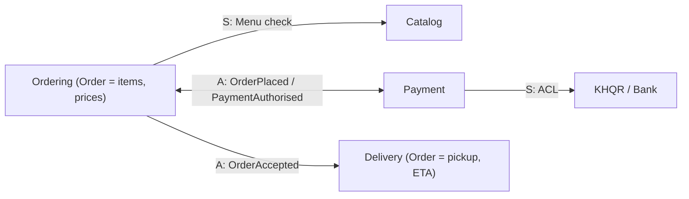

**Rubric (10 pts):** 3 pts 4-color timeline + past-tense events; 2 pts 2 valid hot spots; 2 pts bounded contexts + 1 word/2 meanings; 3 pts Context Map with S/A + ACL.

</details>

<details data-tag="practical" data-meta="10 pts · W6–7">
<summary><strong>Question 9.10:</strong> Write an ADR deciding Modular Monolith vs Microservices for a 6-developer logistics startup launching in 4 months (modest 20 QPS, strong ACID needs on billing), and sketch the choreographed Saga events for order happy path + two failure compensations.</summary>

- **ADR:** *Decision:* Start with a Modular Monolith (with clean module boundaries and repository ports). *Context:* 6 devs, 4-month deadline, 20 QPS, billing needs ACID, no dedicated ops. *Consequences:* (+) Single deployment, in-process calls, single-DB ACID, ready to split later; (−) Single failure domain and shared scaling until modules are extracted.
- **Saga Events:** Happy path: `OrderPlaced → PaymentAuthorised → OrderAccepted → RiderAssigned → OrderPickedUp → OrderDelivered`. Failure 1: `PaymentFailed → OrderCancelled` + notify. Failure 2: `OrderRejected → RefundIssued → OrderRejected/Cancelled` + notify.

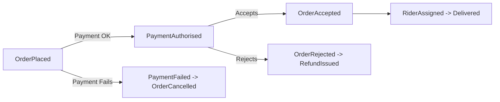

**Rubric (10 pts):** 5 pts ADR (all 4 parts + context forces + good/bad consequences); 5 pts Saga happy path + both failure compensations.

</details>
