# Software Architecture Midterm — Master Study Guide (Weeks 1–7)

> [!IMPORTANT]
> **Exam Blueprint (`TeachersNode.md`):** Friday **27 November 2026** · Paper-based · **~10 open questions** · **NO QCM** · Worth **30%** · **60% Theory & Concept** (*"Explain…"* only, no *"What is…"*, e.g., Transactional Outbox) · **40% Practical** (e.g., Event Storming — taught in Week 6 slides/handout alongside Week 5 modular boundaries) · Lectures **1 to 7**.

### FoodHub Master Brief & Worked Sizing Reference (Weeks 1–2)

| Category | Exact Figures & Constraints |
| :--- | :--- |
| **Scale** | `200,000` registered users · `20,000` orders/day · `1,500` restaurants (~50 menu items each) · `800` riders |
| **Multipliers** | **5×** lunch/dinner peak · **10×** growth expected in 2 years |
| **Constraints** | Launch in **6 months** · **8 TypeScript devs** (NestJS & Vue), **no dedicated ops staff** · integrate **KHQR & bank APIs** · low-cost Android phones on 4G |
| **Orders/s & QPS** | `20k ÷ 86,400 = 0.23 orders/s` avg (`1.16/s` peak, `11.6/s` 2-yr) · 30 API calls/order → `600k/day → 7 QPS` avg → **35 QPS peak** → **350 QPS** in 2 yrs |
| **Storage** | Orders: `20k × 2 KB = 40 MB/day ≈ 15 GB/yr` · Menu photos: `1,500 × 50 × 200 KB ≈ 15 GB` |
| **Rider GPS Surprise** | `50% × 800 = 400` active riders ÷ 5 s = **80 writes/sec** (more writes than orders → first candidate to extract!) |
| **Latencies** | RAM `~100 ns` · In-DC RTT `~0.5 ms` · SSD 1 MB `~1 ms` · PNH–SIN `~30–50 ms` · Mobile 4G `~50–100 ms` (first HTTPS page `300–500 ms`) |
| **Availability** | `99.9%`/30 days = **43 min** downtime · 3 serial services = `0.999³ ≈ 99.7%` |

---

## Section 1 — Suggested Practice Questions (Based on Quizzes)

> [!WARNING]
> **5 Habits Observed Across Quizzes 1–7:**
> 1. **Never pure definitions:** Even MCQs tested *consequences & distinctions* (e.g., why JWT is hard to revoke). Expect pure **"Explain why / how…"** prompts.
> 2. **Failure & edge-case diagnosis:** Retry without `Idempotency-Key`, stale DNS TTL `86,400 s`, nginx logging `172.18.0.3`, consumer crash before ack.
> 3. **Context-tied trade-offs:** Full marks require citing concrete forces (8 devs, 35 QPS, 6 months, ACID needs, no ops staff).
> 4. **Practical code & lab literacy:** Quiz keys cite `ordering.module.ts` `useClass`, NestJS `enableCors`, `X-Forwarded-For`, `OrderPlaced → RefundIssued`.
> 5. **Explicit slide & note clues:** Week 2 Slide 11 marks the **6-step design process** as *"used in the midterm"*; `TeachersNode.md` names **Transactional Outbox** & **Event Storming**.

### Quiz-vs-Lecture Gap Matrix

| Week | Already Tested on Quizzes | Taught in Slides / Handouts (Untested or MCQ-Only) | Predicted Midterm Angle |
| :--- | :--- | :--- | :--- |
| **W1** | F/Q/C classification, 6-part QAS, 99.9% downtime, consistency vs availability | 3 structures (Module, Runtime, Deployment), ISO/IEC 25010 (5 dark qualities), Security vs Usability & Performance vs Cost, 6 Eras | Explain why one system needs 3 structures, or diagnose a vague requirement + FoodHub trade-off. |
| **W2** | C4 L1/L2, ADR Context/Consequences, 500K/day QPS math, latency hierarchy | **6-step design process** (marked "midterm"), Sequence diagram ("who waits for whom"), **Rider GPS 80 writes/s**, Separation of concerns/Cohesion/Coupling | Walk through the 6-step process or explain why Rider GPS writes exceed order QPS in ADR-001. |
| **W3** | 4-step URL load, TTL 86,400 move, nginx `172.18.0.3` + `X-Forwarded-For` | **HTTP/2 TCP HoL blocking vs HTTP/3 QUIC**, TLS 1.3 1-RTT steps, `dig +trace`, **nginx `502 Bad Gateway`**, CDN headers (`Cache-Control`, `Age`, `X-Cache`) | Explain why HTTP/3 helps 4G riders (stream isolation + Wi-Fi→4G survival), or diagnose nginx 502. |
| **W4** | 3 REST endpoints, Idempotency-Key retry, CORS `5173→3000`, `HttpOnly` | **JWT `alg: none` & `localStorage` vs `HttpOnly`**, API restart wiping `SESSIONS` + **3 servers behind LB**, **gRPC/GraphQL**, **BFF** & Gateway SPOF, RFC 9457, cursor pagination, `origin: '*'` + credentials | Explain what happens to in-memory sessions on restart or behind 3 servers, compare Sessions vs JWT revocation, or explain why `origin: '*'` fails with cookies. |
| **W5** | Layers vs Tiers, Port/Adapter Postgres swap, 4-dev clinic recommendation | **Strict Layered weakness**, **NestJS startup crash when injecting unexported `CatalogRepository`**, `import type`, SOA vs Microservices | Explain why strict layered architecture couples logic to DB and how Hexagonal + NestJS `exports` enforces boundaries at startup. |
| **W6** | Database-per-service, 0.999³ availability, benefits/costs, 120-dev bank | **Event Storming (4 sticky colors, 5 steps)**, **all 5 Context Map relationships**, **Serverless vs Cell-based**, **5 Case Studies** (Prime Video, Uber DOMA, Shopify), Scoring table | **40% Practical:** Run Event Storming → Bounded Contexts & Context Map (`S`/`A`). **Theory:** Context Map patterns or Prime Video/Uber lessons. |
| **W7** | Choreographed saga, RabbitMQ vs Kafka, why exactly-once is hard | **Transactional Outbox + CDC (Debezium)** (only 1 MCQ!), **Saga Orchestration vs Choreography**, **Why 2PC fails**, **CQRS & Event Sourcing** (0 quiz Qs!), `ch.nack(msg,false,true)` loop vs DLX/DLQ | **60% Theory:** Explain Dual-Write & Transactional Outbox (+ CDC); explain CQRS + Event Sourcing; explain Choreography vs Orchestration & why 2PC fails. |

### 12 Suggested Questions

<details data-tag="radar theory" data-meta="Teacher Note">
<summary><strong>Question 1.1:</strong> Explain the dual-write problem when saving an order and publishing <code>OrderPlaced</code>, and explain step-by-step how the Transactional Outbox (with Relay or CDC like Debezium) and an idempotent consumer solve it.</summary>

<p data-no-audio><em>Why likely:</em> Named explicitly in <code>TeachersNode.md</code> as a 60% theory example, yet Week 7 Quiz only touched it in one MCQ (Q10).</p>

- **Dual-write problem:** Writing to PostgreSQL and publishing to RabbitMQ/Kafka are two separate systems that cannot share a single local ACID transaction. If the DB commits and the broker call fails (or process crashes), the order exists with no event; if you publish first and DB rolls back, downstream services act on a phantom order.
- **4-step Transactional Outbox solution:** (1) Inside *one local DB transaction*, INSERT the domain row (e.g., order) and INSERT an outbox event row (`eventId, type, payload, sent=false`). (2) A background relay job polls unsent outbox rows—or a **CDC tool like Debezium** tails the database transaction log. (3) The relay publishes the event to the broker and marks the row sent. (4) Because a crash between publishing and marking sent causes a duplicate publish, delivery is **at-least-once**, so consumers must be **idempotent** (recording `eventId` in a DB table with a unique constraint).

</details>

<details data-tag="radar practical" data-meta="Teacher Note">
<summary><strong>Question 1.2:</strong> Perform an Event Storming workshop for a scenario (e.g., FoodHub checkout-to-delivery): list the 4 sticky-note colors, timeline of events/commands/actors, 2 hot spots, group into Bounded Contexts, name "one word with two meanings," and draw a Context Map marking Sync (S) vs Async (A).</summary>

<p data-no-audio><em>Why likely:</em> Named explicitly in <code>TeachersNode.md</code> as the 40% practical example; taught in Week 6 Practice Handout with zero quiz questions.</p>

- **4 Sticky Colors:** **Orange** = Domain Event (past tense, e.g., `OrderPlaced`); **Blue** = Command (`PlaceOrder`); **Yellow** = Actor (`Customer`); **Pink** = Hot Spot (*"What if the restaurant never accepts?"*, *"What if payment settles after timeout?"*).
- **Bounded Contexts & One Word, Two Meanings:** Group into *Catalog* (`MenuUpdated`), *Ordering* (`OrderPlaced, OrderAccepted, OrderCancelled`), *Payment* (`PaymentAuthorised, RefundIssued`), *Delivery* (`RiderAssigned, OrderPickedUp, OrderDelivered`). Word **"Order"** in Ordering = items, prices, discounts, status; in Delivery = pickup address, drop-off address, rider, ETA.
- **Context Map (S/A):** Ordering → Catalog (**S**, verify menu/prices or local read model); Ordering ↔ Payment (**A**, `OrderPlaced / PaymentAuthorised`; Payment → KHQR/Bank via **S** + **ACL**); Ordering → Delivery (**A**, `OrderAccepted`).

</details>

<details data-tag="radar theory">
<summary><strong>Question 1.3:</strong> Explain CQRS and Event Sourcing, how they complement each other (e.g., FoodHub's restaurant dashboard or payment ledger), and their operational costs.</summary>

<p data-no-audio><em>Why likely:</em> Taught on Week 7 Slide 12, completely untested in Week 7 Quiz.</p>

- **CQRS (Command Query Responsibility Segregation):** Separates the write model (handling commands and business rules) from one or more read models (tailored for specific screens, like a fast "restaurant dashboard" table updated asynchronously from order events). Lets reads and writes scale independently, at the cost of eventual consistency for the read view.
- **Event Sourcing:** Instead of overwriting current state in a row, append every state change as an immutable event; current state is computed by replaying all events for that entity. Gives full audit history and time travel for free (ideal for payments/ledgers), but incurs costs: harder ad-hoc queries, event schema evolution complexity, and needing periodic **snapshots** so replays stay fast.

</details>

<details data-tag="radar theory">
<summary><strong>Question 1.4:</strong> Explain why Two-Phase Commit (2PC) is avoided across microservices, and compare Choreography vs Orchestration Sagas (benefits, drawbacks, and when to choose each).</summary>

<p data-no-audio><em>Why likely:</em> Week 7 Slides 9–10 emphasize 2PC vs Sagas and Orchestration (Temporal / Step Functions), whereas Quiz 7 only tested Choreography.</p>

- **Why avoid 2PC:** 2PC locks rows across multiple databases during prepare/commit, hurting latency, blocking everything if the coordinator crashes, and most message brokers/cloud APIs do not support it.
- **Choreography vs Orchestration:** In *choreography*, services react to each other's events with no central controller (loosest coupling, easy to start, but hard to trace as flows grow). In *orchestration*, a central coordinator (e.g., Temporal, AWS Step Functions, or state machine) commands each step (explicit flow, easy to monitor and debug retries/compensations, at the cost of extra orchestrator infrastructure and coupling to the orchestrator).

</details>

<details data-tag="radar theory">
<summary><strong>Question 1.5:</strong> Explain what happens in FoodHub's Week 4 lab when (a) the API server restarts, and (b) you scale to 3 API servers behind a load balancer using an in-memory <code>SESSIONS</code> Map—and compare fixing this with a shared Redis session store vs a short-lived JWT.</summary>

<p data-no-audio><em>Why likely:</em> Asked verbatim in Week 4 Handout Part D and covers JWT <code>alg: none</code> / <code>localStorage</code> trade-offs.</p>

- **Restart & 3 Servers:** On restart, the in-memory `Map` is wiped, logging every user out (`401`). With 3 servers behind a load balancer, a user logs into Server 1, then the next request lands on Server 2 which has an empty `SESSIONS` map and rejects them.
- **Redis Sessions vs JWT:** Putting sessions in a shared store (Redis/DB) keeps *instant revocation* (delete session = logged out everywhere) at the cost of a network lookup per request. Self-contained **JWTs** avoid the per-request DB lookup (any server verifies the signature using a pinned algorithm, never `alg: none`), but cannot be revoked before expiry—mitigated by short TTLs (5–15 min) + revocable refresh tokens stored safely (prefer `HttpOnly` cookies over XSS-readable `localStorage`).

</details>

<details data-tag="radar theory">
<summary><strong>Question 1.6:</strong> Explain why HTTP/3 (QUIC over UDP) improves mobile experience on 4G/Wi-Fi compared with HTTP/2 over TCP, and explain why nginx returns <code>502 Bad Gateway</code> when the backend container stops.</summary>

<p data-no-audio><em>Why likely:</em> HTTP/2 TCP head-of-line blocking & Wi-Fi→4G survival are highlighted on Week 3 Slide 6; <code>502 Bad Gateway</code> is a direct Week 3 Handout Part C question.</p>

- **HTTP/2 vs HTTP/3:** HTTP/2 multiplexes many streams over *one TCP connection*, so one lost packet stalls all streams at the TCP layer (head-of-line blocking). HTTP/3 runs on **QUIC over UDP**: (1) a lost packet stalls only its own stream, (2) transport + TLS 1.3 complete in 1 round trip (cutting 300–500 ms 4G startup delay), and (3) connection IDs let sessions survive a Wi-Fi → 4G network switch.
- **nginx 502:** When the upstream Node app stops, nginx (as reverse proxy) is still alive listening on port 80/443, tries to open a connection to `app:3000`, gets connection refused/timeout, and returns `502 Bad Gateway` to the client.

</details>

<details data-tag="radar theory">
<summary><strong>Question 1.7:</strong> Explain the five DDD Context Map relationships (Customer-Supplier, Conformist, ACL, Published Language, Shared Kernel) with FoodHub examples, and explain what real-world case studies (Amazon Prime Video, Uber DOMA, Shopify) teach about splitting.</summary>

<p data-no-audio><em>Why likely:</em> Week 6 Slides 7 & 12 dedicate full tables to Context Map types and Case Studies; only ACL appeared in Quiz 6.</p>

- **5 Relationships:** (1) *Customer-Supplier:* Delivery needs Ordering's `OrderAccepted` event and Ordering plans for it; (2) *Conformist:* FoodHub adopts KHQR's API model as-is; (3) *Anti-Corruption Layer (ACL):* Payment adapter translates messy bank status codes into FoodHub statuses; (4) *Published Language:* documented event schemas published by Ordering; (5) *Shared Kernel:* two contexts share a small model like `Money` (use sparingly to avoid coupling).
- **Case study lessons:** Splitting is driven by team coordination (Amazon two-pizza teams) or extreme resilience (Netflix). Too many tiny services hurt manageability (Uber grouped into DOMA domains), serverless pipelines can be ~90% more expensive than one service for steady workloads (Amazon Prime Video), and well-structured modular monoliths scale very far (Shopify, Stack Overflow).

</details>

<details data-tag="radar theory">
<summary><strong>Question 1.8:</strong> Explain when to use a Backend for Frontend (BFF) instead of a single API Gateway, why APIs use cursor pagination and RFC 9457 error shapes, and why <code>origin: '*'</code> with <code>credentials: true</code> is rejected/dangerous.</summary>

<p data-no-audio><em>Why likely:</em> Covers Week 4 Slides 8–9 and Handout Part C Q5, none of which were directly asked on Quiz 4.</p>

- **API Gateway vs BFF:** One gateway centralises TLS, auth, routing, and rate limiting, but can become a SPOF/bottleneck if business logic creeps in. A **BFF** adds one tailored gateway per client type (e.g., mobile vs web) when they need different payload shapes or aggregations.
- **Pagination & Errors:** `limit+offset` drifts or slows on large, rapidly changing lists, so use **cursor pagination**; RFC 9457 ("problem details") gives every endpoint one consistent error JSON shape (`status, code, message, details`).
- **CORS + Credentials:** Sending `Access-Control-Allow-Origin: *` with cookies (`credentials: true`) is forbidden by browsers because any malicious site could make authenticated cross-origin requests and read the response.

</details>

<details data-tag="radar theory">
<summary><strong>Question 1.9:</strong> Explain why NestJS refuses to start if <code>OrdersService</code> injects <code>CatalogRepository</code> in FoodHub's modular monolith, and explain how Hexagonal Architecture fixes the main weakness of Layered Architecture.</summary>

<p data-no-audio><em>Why likely:</em> Week 5 Handout Part B Q6 explicitly asks: "Why does Nest refuse to start?" paired with Week 5 Slides 4 & 7–9.</p>

- **NestJS Boundary Enforcement:** `CatalogModule` lists only `CatalogService` in `exports`, keeping `CatalogRepository` private. Even if `OrderingModule` imports `CatalogModule`, NestJS's DI container throws a dependency-resolution error at startup—enforcing module boundaries automatically instead of relying on programmer willpower.
- **Layered vs Hexagonal:** Classic layered architecture forces business logic to depend directly on the data/ORM layer, and features cut across all layers. Hexagonal (Ports & Adapters) flips the dependency arrow: the domain core defines interfaces (**ports** like `OrderRepository`) and adapters implement them at the edges, so SQL/ORM/HTTP never leak into business rules and tests can swap in a fake repository cleanly.

</details>

<details data-tag="radar theory">
<summary><strong>Question 1.10:</strong> Explain why calling <code>ch.nack(msg, false, true)</code> (requeue) on a bad message is dangerous in RabbitMQ, how a Dead-Letter Exchange (<code>orders.dlx</code>) fixes it, and why an in-memory <code>Set</code> is insufficient for consumer idempotency in production.</summary>

<p data-no-audio><em>Why likely:</em> Directly from Week 7 Practice Handout Parts C & D.</p>

- **Requeue loop vs DLX:** A message with invalid data (a "poison message") will fail every single time. Calling `ch.nack(msg, false, true)` puts it straight back onto the queue, causing an infinite CPU/log spin that blocks valid messages. Calling `ch.nack(msg, false, false)` rejects without requeueing, routing it to `orders.dlx → kitchen.dlq` for human inspection.
- **In-memory Set vs DB table:** An in-memory `Set<string>` is wiped on worker restart and is not shared across competing worker instances. Production stores `eventId` in a durable database table with a **unique constraint** (ideally inside the same DB transaction as the consumer's business update).

</details>

<details data-tag="radar practical">
<summary><strong>Question 1.11:</strong> Walk through the 6-Step System Design Process for a new FoodHub capability (or ride/booking system): Clarify → Estimate (including hidden write loads like GPS) → API → High-Level Design → Deep Dive → Trade-offs at 10×.</summary>

<p data-no-audio><em>Why likely:</em> Week 2 Slide 11 explicitly states: <em>"Used in design interviews, design reviews, the midterm and the final exam."</em></p>

1. **Clarify:** Users, features, top quality attributes (latency/availability), and constraints (8 TS devs, 6 months, KHQR).
2. **Estimate:** 20k orders/day → 0.23 orders/s, 35 QPS peak (350 in 2 yrs), 15 GB/yr orders; **hidden load:** 400 active riders × 1 ping/5s = **80 GPS writes/s**.
3. **API:** `POST /v1/orders` (with `Idempotency-Key`), `PATCH /v1/orders/:id`, `POST /v1/riders/location`.
4. **High-Level Design:** Client apps → nginx/API Gateway → NestJS Modular Monolith → PostgreSQL + Object Storage + RabbitMQ.
5. **Deep Dive:** Handle payment + order consistency via Transactional Outbox + Saga, and protect DB from 80 writes/s GPS churn (batch/in-memory or separate store).
6. **Trade-offs:** Chose modular monolith now for 8-dev speed and ACID; at 10× (350 QPS, 800 GPS writes/s), extract **Rider Tracking** first into its own service.

</details>

<details data-tag="radar theory">
<summary><strong>Question 1.12:</strong> Explain Cell-Based Architecture and Serverless (FaaS): what problems each solves, their limits (cold starts, time limits, vendor lock-in), and why FoodHub should or should not use them at launch.</summary>

<p data-no-audio><em>Why likely:</em> Week 6 Slide 11 covers both Serverless and Cell-Based, and Cell-Based was only a distractor in Quiz 6.</p>

- **Serverless (FaaS):** Scales event-triggered code to zero and back (pay per call, no servers to manage). Great for spiky/rare tasks like menu photo resizing or webhooks, but suffers cold starts, execution time limits, vendor lock-in, and harder local testing (and can cost more for steady traffic).
- **Cell-Based Architecture:** Runs many identical full-stack copies ("cells"), each serving a slice of users (e.g., by city) for **blast-radius control**—a bad deploy or outage hits only one cell. Overkill for FoodHub's 35 QPS single-city launch with 8 devs and no ops team.

</details>

---

## Week 1 — Introduction to Software Architecture

Sources: Week 1 Slides (19 pages), Practice Handout (Stakeholders, Top 5 Qualities, 6-Part QAS, Constraints & Trade-offs), Quiz 1.

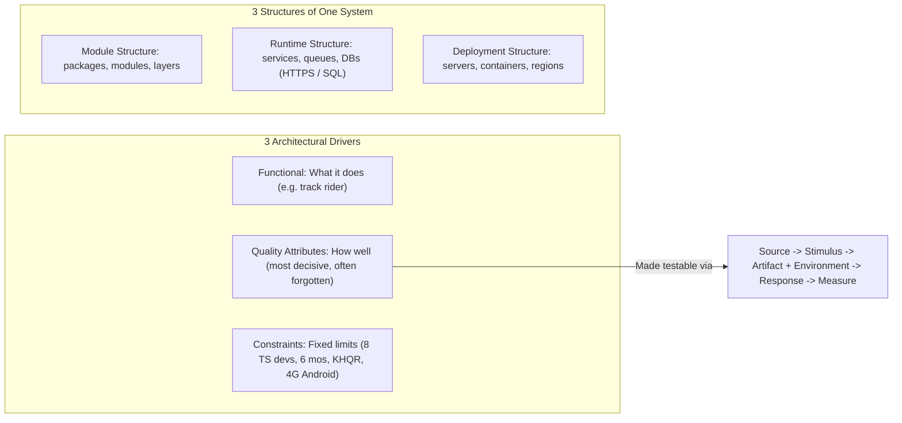

### Core Theory

- **Bass, Clements & Kazman:** Set of structures needed to reason about the system (elements, relations/connectors, properties of both).
- **Ralph Johnson / Fowler:** *"The important stuff—the decisions that are hard to change later."*
- **Architecture vs Detailed Design:** Whole system, weeks/months to change, driven by quality attributes & constraints (sync vs events, SQL vs NoSQL) vs inside one part, hours/days to change, driven by features (class names, local algorithm).
- **Why Architecture Matters:** (1) Decides qualities (features work in many structures; qualities depend on structure), (2) Expensive to fix late, (3) Shapes teams (**Conway's Law**), (4) Shared language for devs/QA/ops/managers.
- **Architect's 5 Jobs:** Understand drivers → Make & record decisions → Communicate → Guide the build → Keep evolving. In agile teams, decide early only what is expensive to change.

### ISO/IEC 25010 (2023) Focus Qualities & Worked 6-Part QAS (Slides 12–15)

| Quality | Source & Stimulus | Artifact & Environment | Response & Numeric Measure |
| :--- | :--- | :--- | :--- |
| **Performance Efficiency** | 5,000 customers place orders | Order service · Lunch peak (normal op) | Orders accepted & confirmed · **99% within 2 s** (or 95% menu loads ≤ 1 s) |
| **Reliability (Availability)** | Hardware crashes 1 order server | Order service · Dinner peak | Traffic moves to healthy servers · **0 orders lost; &lt; 30 s errors** (99.9%/mo ≈ 43 min) |
| **Security** | Attacker tries 1,000 passwords on 1 account | Login endpoint · Normal operation | Account locked, owner notified · **Locked after 5 tries in 10 min** |
| **Maintainability** | Product owner asks for a new payment method | Payment module · Design time | Added without changing other modules · **At most 5 developer-days** |
| **Flexibility** | — | — | Scalability & adaptability (5× daily peaks, 10× 2-year growth without rewriting core) |

### Constraints, Trade-Offs & Six Eras (Slides 16–18)

- **Four Constraint Categories:** **Business** (6 months, fixed cloud budget), **Team** (8 TS devs NestJS/Vue, no ops), **Technical** (KHQR & bank APIs, low-cost Android 4G), **Legal** (personal/payment data rules).
- **Three Classic Trade-Offs:** **Security vs Usability** (extra checkout checks stop fraud but slow honest users); **Consistency vs Availability** (reject stale-stock orders vs accept & fix later); **Performance vs Cost** (peak servers cut latency but sit idle at 3 a.m.).
- **Six Eras:** 1990s LAMP Monolith → 2000s Multi-tier & SOA → 2006+ Cloud → 2013+ Docker/Microservices → 2014+ Serverless/CDNs → 2022+ LLM-powered systems.

---

## Week 2 — Designing and Documenting Architecture

Sources: Week 2 Slides (15 pages), Practice Handout (Estimates, C4 L1/L2, ADR-001), Quiz 2.

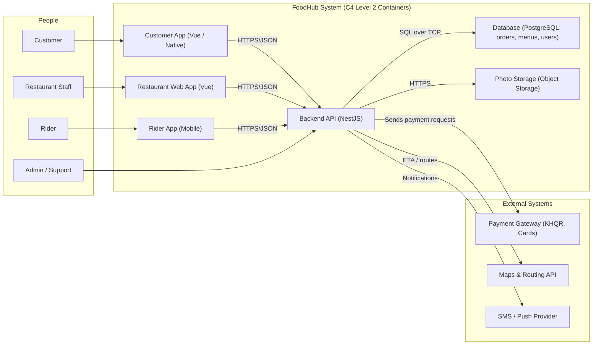

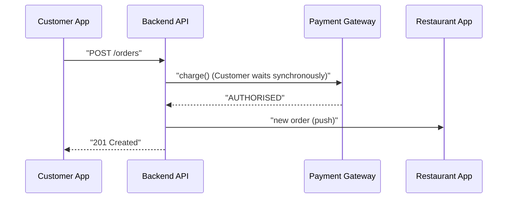

### Core Concepts & Documentation Rules

- **Why Document:** An architecture in one head slows onboarding, repeats debates, blocks reviews, and causes code drift. Good docs are *just enough* (not 100 pages), *close to code* (in Git), and *for a reader*.
- **4 Views:** Structure (C4), Behaviour (Sequence), Deployment (machines/networks), Decisions (ADRs).
- **C4 Levels:** (1) System Context (1 box + people + external), (2) Containers (separately running apps/stores—NOT Docker!), (3) Components (modules inside one container—draw only if complex), (4) Code (classes, auto-generated).
- **ADRs (4 Parts):** **Status** (Proposed / Accepted / Superseded), **Context** (facts & forces), **Decision** (1–2 sentences), **Consequences** (both good **and** bad). Never edit an accepted ADR—write a new ADR that supersedes it.
- **4 Principles:** *Separation of concerns* (payment logic out of menu code), *High cohesion* (order rules together), *Loose coupling* (small stable interfaces), *Conway's law* (design teams & architecture together).

> [!TIP]
> **6-Step Design Process (Week 2 Slide 11 — Marked "Used in Midterm & Final"):**
> `1. Clarify` (users, features, qualities, constraints) → `2. Estimate` (QPS, 5× peak, 10× growth, storage, bandwidth) → `3. API` (endpoints or events) → `4. High-Level Design` (C4 containers for main flows) → `5. Deep Dive` (1–2 hardest parts: data, scaling, failure) → `6. Trade-offs` (what you chose, gave up, and what changes at 10×).

---

## Week 3 — Networking and Communication

Sources: Week 3 Slides (14 pages), Practice Handout (`dig`, `curl`, nginx Docker Compose lab, Request-Flow Diagram), Quiz 3.

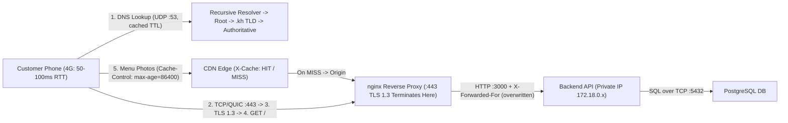

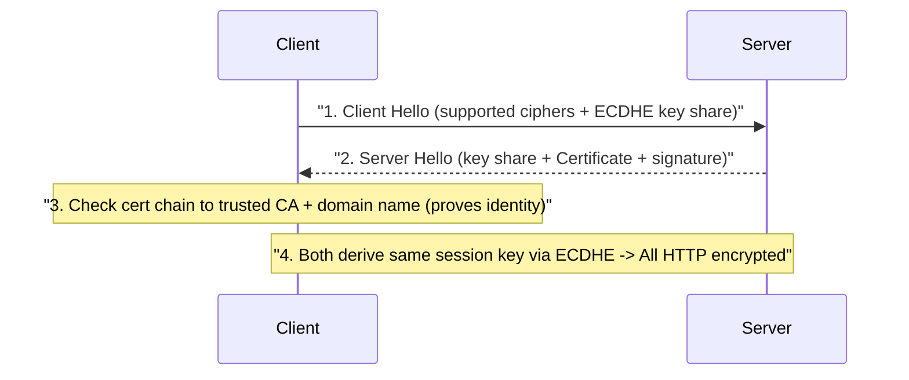

### HTTP Versions Comparison

| HTTP Version | Transport | Multiplexing & Loss Behaviour | Key Advantage / Trade-off |
| :--- | :--- | :--- | :--- |
| **HTTP/1.1 (1997)** | Text over TCP | 1 request at a time per connection; browsers open ~6 connections. | Simple, ubiquitous, high connection overhead. |
| **HTTP/2 (2015)** | Binary over TCP | Many streams on 1 connection + header compression. | **Weakness:** 1 lost TCP packet stalls *all* multiplexed streams (TCP head-of-line blocking). |
| **HTTP/3 (2022)** | Over **QUIC (UDP)** | Lost packet stalls *only its own stream*. | Transport + TLS in 1 round trip; connection survives **Wi-Fi → 4G switch**. |

### Key Concepts & Lab Takeaways

- **IPv4 vs IPv6 & Private Ranges:** IPv4 32-bit (~4.3B) vs IPv6 128-bit; private ranges `10.x`, `172.16–31.x`, `192.168.x` require NAT; cloud servers keep private IPs behind a public proxy/LB.
- **TCP vs UDP:** TCP (`SYN/SYN-ACK/ACK`, reliable, ordered; ports 443 HTTPS, 5432 Postgres, 6379 Redis) vs UDP (connectionless, low overhead; ports 53 DNS, 443 QUIC).
- **DNS (`dig +trace`):** Phone → Recursive resolver (1.1.1.1 / ISP) → Root → `.kh` TLD → Authoritative. TTL counts down on repeat queries; before migrating servers, shrink TTL ≥ 1 old TTL ahead, keep old server forwarding, then raise TTL. Records: `A/AAAA` (multi-A = DNS LB), `CNAME` (alias), `MX`, `TXT`, `NS`.
- **Forward vs Reverse Proxy:** Forward sits in front of *clients*; reverse sits in front of *servers* (TLS termination, caching, hiding port `3000`). Backend sees proxy IP (`172.18.0.3`) unless nginx overwrites `X-Forwarded-For` (trust only own proxy). Stopped upstream → **502 Bad Gateway**.
- **Stateless & CDN:** Stateless servers hold no local session memory so any replica answers. CDNs cache static/public assets (menu photos, versioned `app.3f9a.js`, `Cache-Control: max-age=86400`, check `Age` & `X-Cache: HIT/MISS`)—never personal/changing order or payment data.

---

## Week 4 — Web Concepts and API Design

Sources: Week 4 Slides (13 pages), Practice Handout (NestJS REST API + Idempotency + Vue CORS + Cookie lab), Quiz 4.

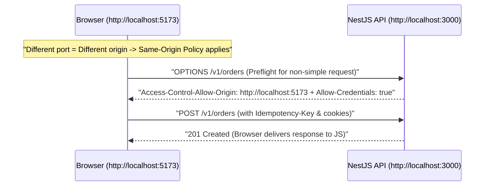

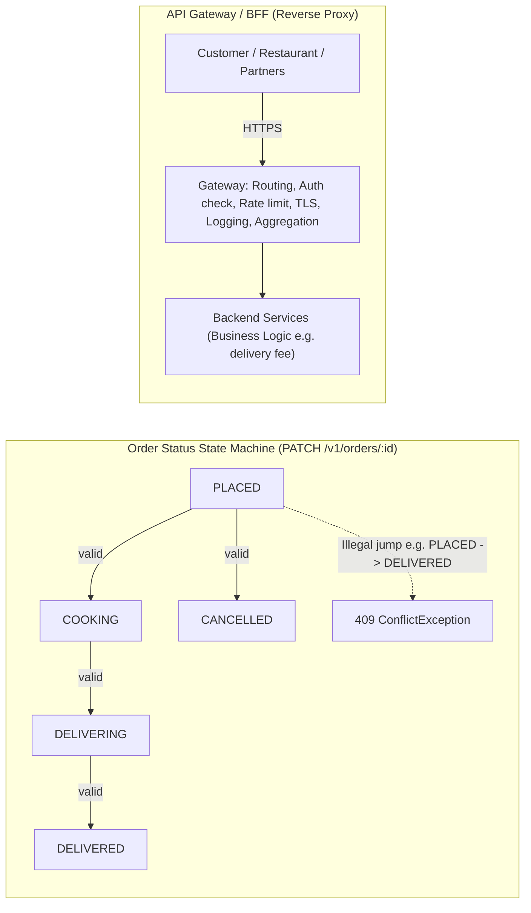

### Cookie Flags

| Cookie Flag | Mechanism | Threat Mitigated |
| :--- | :--- | :--- |
| `HttpOnly` | Blocks `document.cookie` JS access | Token theft via XSS |
| `Secure` | Sent only over HTTPS | Sniffing on public Wi-Fi |
| `SameSite=Lax / Strict` | Withheld on most cross-site requests | CSRF (Cross-Site Request Forgery) |
| `Max-Age / Expires` | Caps cookie lifetime | Old sessions living forever |
| `Domain / Path` | Restricts host & path scope | Leaking to sibling subdomains |

### Auth, API Styles, REST & Serialization

- **Sessions vs JWT:** Sessions (≥128-bit random ID, rotated on login, Redis/DB across servers) give **instant revocation** at 1 lookup/request. JWTs are **signed, NOT encrypted** (never put secrets inside!), need zero DB lookup, but are hard to revoke—fix with short 5–15 min access tokens + server-revocable refresh tokens, pinned algorithm (never `alg: none`), stored in `HttpOnly` cookies instead of XSS-readable `localStorage`.
- **4 API Styles:** **REST** (resources + HTTP verbs, JSON, cacheable), **gRPC** (HTTP/2 + Protobuf, fast internal service-to-service), **GraphQL** (1 endpoint/schema, exact fields for diverse UIs), **Webhooks** (partner pushes `POST` on event).
- **REST & Lab Rules:** Nouns in URLs, verbs in methods (`GET` safe & idempotent; `PUT`/`DELETE` idempotent; `POST` needs `Idempotency-Key` returning `201` first time and `200` with stored order on retry). Version breaking changes (`/v1 → /v2`), paginate (`limit+offset` or `cursor` for large changing lists), standardize errors with RFC 9457, validate with `ValidationPipe({ whitelist: true })` (`400`), and configure `app.enableCors({ origin: 'http://localhost:5173', credentials: true })` (never `*` with credentials; CORS is browser-only, `curl` ignores it).
- **Serialization:** JSON (readable, optional schema), XML (XSD, verbose banking), **Protobuf & Avro** (compact binary, required schemas, **schema evolution**).

---

## Week 5 — Monolith, Layered, and Modular Styles

Sources: Week 5 Slides (13 pages), Practice Handout (Module Map, NestJS Modules + `OrderRepository` Port/Adapter, ADR-002), Quiz 5.

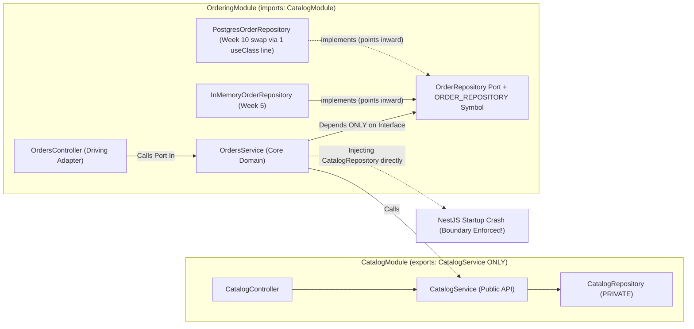

### Style Selection Table

| Style | Good When | Watch Out For |
| :--- | :--- | :--- |
| **Monolith (Simple)** | Small team, early product, simple domain; fast in-process calls & 1-DB ACID transactions. | Turning into a "big ball of mud"; every change redeploys all; scales as a whole. |
| **Layered** | Business apps with clear CRUD flows (Presentation → Business → Data access → DB). | Business logic depends directly on DB layer; each feature cuts across all layers. |
| **Modular Monolith** | 1–3 teams, growing domain, clear ownership; microservice structure without network/ops costs. | Boundaries must be enforced by framework (`exports`) or tests; zero module cycles. |
| **Hexagonal (Ports & Adapters)** | Rich business rules, many integrations (KHQR, DBs), strong unit testing with fake adapters. | Extra interfaces/boilerplate for simple CRUD features. |
| **Pipe-and-Filter / Microkernel / SOA** | **Pipe-and-filter:** scan → resize → compress → store pipelines; **Microkernel:** small core + plug-ins (VS Code, payment plug-ins); **SOA:** shared enterprise services via ESB. | ESB central bottlenecks in SOA; pipeline latency. |

### NestJS Port & Adapter Wiring (Week 5 Handout)

```typescript
// The PORT (no technology inside)
export interface OrderRepository {
  save(order: Order): Promise<void>;
  get(id: string): Promise<Order | undefined>;
}
export const ORDER_REPOSITORY = Symbol('ORDER_REPOSITORY');

// OrdersService depends ONLY on the port (import type erased at runtime)
constructor(@Inject(ORDER_REPOSITORY) private readonly orders: OrderRepository) {}

// ordering.module.ts — swap InMemoryOrderRepository -> PostgresOrderRepository in Week 10:
providers: [OrdersService, { provide: ORDER_REPOSITORY, useClass: InMemoryOrderRepository }]
```

> [!TIP]
> **Key Rules from Week 5:** (1) **Layers** organise code inside one process; **Tiers** are separately running processes (Vue ↔ NestJS ↔ PostgreSQL = 3 tiers). (2) Break cyclic dependencies (Ordering ↔ Payment) with an async event, callback, or merging responsibility. (3) *"Structure inside the monolith first. You can always split a well-modularised monolith; you cannot easily untangle a distributed big ball of mud."*

---

## Week 6 — Microservices, DDD, and Event Storming

Sources: Week 6 Slides (14 pages), Practice Handout (4-Color Event Storming, Bounded Contexts, Context Map S/A, Context Scoring & ADR-003), Quiz 6.

### FoodHub Event Storming Workshop Board (40% Practical Highlight)

```event-storming
context: 1. Catalog Context
actor: Restaurant Staff
command: UpdateMenu
event: MenuUpdated

context: 2. Ordering Context
actor: Customer
command: PlaceOrder
event: OrderPlaced
event: OrderAccepted / OrderCancelled
hotspot: "What if restaurant never accepts?"

context: 3. Payment Context
actor: KHQR / Bank System
command: AuthorisePayment / IssueRefund
event: PaymentAuthorised / RefundIssued
hotspot: "Payment settles after order timeout?"

context: 4. Delivery Context
actor: Rider & Kitchen
command: MarkFoodReady / AssignRider
event: FoodReady -> RiderAssigned -> OrderPickedUp -> OrderDelivered
hotspot: "Rider cancels after pickup?"

context: 5. Notification / Reviews
actor: SMS Provider / Customer
command: SendAlert / RateOrder
event: CustomerNotified / OrderRated
```

### FoodHub Context Map (Sync vs Async + DDD Relationships)

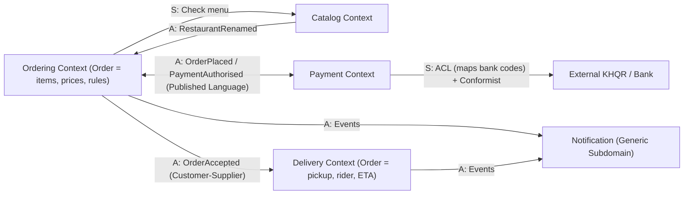

### Microservices, DDD & Decision Framework

- **6 Microservice Traits:** Business capability · Independent deploy · Own DB · Smart endpoints/dumb pipes · Owned by 1 team (5–9 people, *"you build it, you run it"*) · Designed for failure.
- **Distributed Monolith:** Multiple services that must deploy together or share 1 DB = all distribution costs, zero independence.
- **Costs & Mitigations:** Network failures → timeouts/retries/circuit breakers; No cross-service ACID → Sagas + Outbox; Ops → CI/CD/K8s/observability; Testing → contract tests.
- **DDD Subdomains:** *Core* (build with best people: rider matching, ETA, ranking) · *Supporting* (menus) · *Generic* (buy/reuse: payments, SMS).
- **Database per Service (no cross-DB joins):** Ordering gets restaurant names via (a) API composition, (b) copying/denormalising name at order time, or (c) local read model updated by `RestaurantRenamed` events.

| Decision Factor (Slide 13) | Points to Modular Monolith | Points to Microservices | FoodHub Today (8 devs, 35 QPS, 6 mos) |
| :--- | :--- | :--- | :--- |
| **Team size** | 1–3 teams | Many teams blocking each other | 1–2 teams → **Modular Monolith** |
| **Domain** | Still being discovered | Well understood, stable boundaries | Still evolving → **Modular Monolith** |
| **Scale** | Even load, modest QPS | Parts with very different load | Extract **Rider Tracking (80 writes/s)** first if needed |
| **Time to market** | Must launch fast | Platform & tooling already exist | 6 months → **Modular Monolith** |
| **Operations skill** | Limited DevOps | Strong CI/CD, containers, observability | No dedicated ops → **Modular Monolith** |
| **Release needs** | One release cadence is fine | Parts must release independently | Single cadence fine → **Modular Monolith** |

---

## Week 7 — Event-Driven Architecture and Messaging

Sources: Week 7 Slides (13 pages), Practice Handout (RabbitMQ Pub/Sub, Competing Consumers, Idempotency & DLQ Lab, ADR-004), Quiz 7, `TeachersNode.md`.

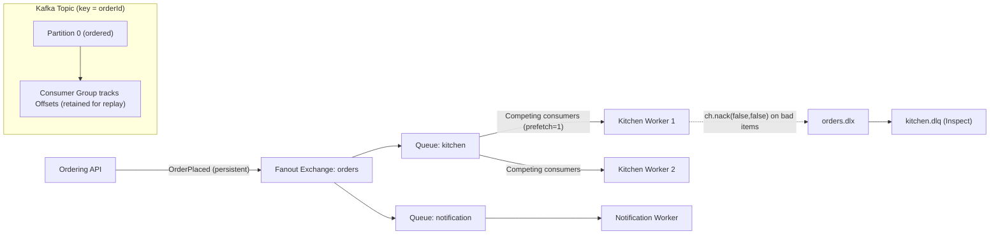

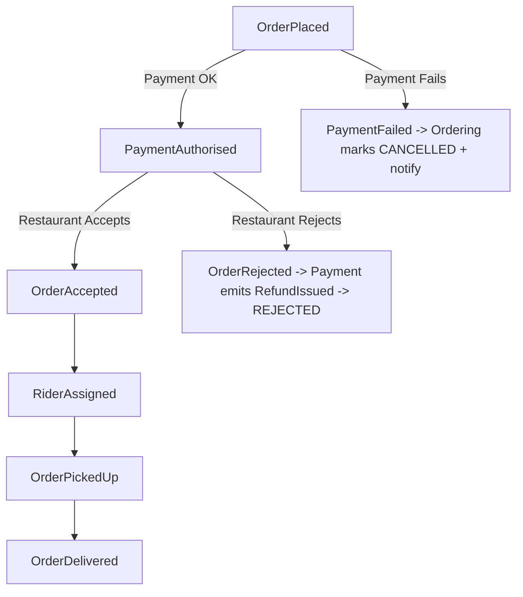

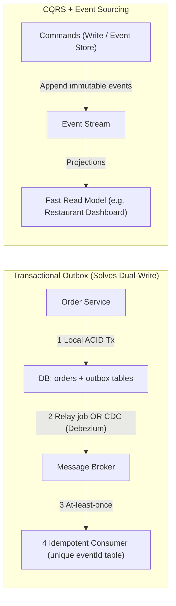

### Messaging, Guarantees, Outbox & CQRS/ES

- **Commands vs Events:** Command = imperative (*"Do this"*: `ChargePayment, SendSms`), 1 receiver, rejectable. Event = past tense (*"This happened"*: `OrderPlaced`), immutable fact, 0..N unknown listeners (loosest coupling).
- **3 Models:** *Point-to-point Queue* (1 consumer gets each msg; competing consumers share work), *Pub/Sub* (fanout exchange + queue/subscriber; each gets a copy), *Event Stream Log* (append-only retained log; consumers track offsets & replay).
- **Delivery Guarantees:** *At-most-once* (ack before work → crash loses msg; OK for metrics/GPS), *At-least-once* (ack after work → duplicates possible), *Effectively-once* (at-least-once + idempotent consumer using unique-key `eventId` DB table).
- **Event Design & Versioning:** Include `eventId, type, version, occurredAt, orderId`. Only add optional fields; never rename/remove in place; breaking change = new version/type supporting both during migration.

| Broker Comparison (Slide 6) | RabbitMQ | Kafka |
| :--- | :--- | :--- |
| **Model** | Exchanges route to queues | Distributed append-only log: topics + partitions |
| **After consumption** | Deleted when acked | Kept until retention expires; consumers commit offsets |
| **Ordering** | Per queue (with 1 consumer) | Only **within a partition** (use key e.g. `orderId`) |
| **Replay** | Not by design | Yes — reset consumer offset |
| **Strengths & Use** | Flexible routing, per-msg acks, simple ops; task queues, moderate events | Very high throughput, history, streaming, analytics, CDC, logs |

---

## Practical Exam Paper Templates (40%)

- **Template 1 — 6-Part QAS (Week 1):** Always list all 6 explicitly: **Source** (who/what) · **Stimulus** (event) · **Artifact** (which service/endpoint) · **Environment** (peak/normal/deploy) · **Response** (system action) · **Measure** (number + unit, e.g., `99% ≤ 2 s`, `0 orders lost`).
- **Template 2 — Sizing & 4-Part ADR (Week 2):** Show formula + units (`÷ 86,400` for /s, `× peak`, `× 365` for /yr). **ADR:** Title + Status + **Context** (team/deadline/QPS/qualities) + **Decision** (1–2 sentences) + **Consequences** (at least 1 good `+` and 1 bad `-`).
- **Template 3 — C4 & Request Flow (Weeks 2–3):** **C4 Context:** System = 1 box + People + External systems (NO DBs!). **C4 Container:** Tech on every box + Protocol on every arrow (`HTTPS/JSON`, `SQL/TCP`). **Request Flow:** Mark where TLS terminates and where caching happens.
- **Template 4 — REST + Hexagonal (Weeks 4–5):** **REST:** Noun paths (`/v1/...`), pagination, success code (`200/201/204`) + error codes (`400/401/403/404/409`). **Hexagonal:** Arrows point *inward*; core imports only Port interface; Module `useClass` binds Adapter.
- **Template 5 — Event Storming + Context Map (40% Practical Highlight):** (1) State 4 colors (`Orange`=past-tense Event, `Blue`=Command, `Yellow`=Actor, `Pink`=Hot Spot); (2) Order left-to-right timeline; (3) Group into 4–6 Bounded Contexts + name *"one word, two meanings"*; (4) Draw Context Map marking every arrow **S** (sync API) or **A** (async event) + DDD type (`Customer-Supplier`, `ACL`, `Conformist`, `Published Language`); (5) If asked to score for extraction: rate 1–3 on Change Frequency, Scaling Need, Team Ownership, Data Sensitivity.

---

## Section 2 — Mock Midterm Paper (60% Theory / 40% Practical)

### Part I — Theory & Concepts: 60% ("Explain…" Only — 6 × 10 pts)

<details data-tag="theory" data-meta="10 pts · W1–2">
<summary><strong>Question 2.1:</strong> Explain why software architects focus on quality attributes rather than features, and explain why an outdated accepted ADR should be superseded rather than edited.</summary>

Many different structures can deliver the same functional features, whereas qualities (latency, availability, security, modifiability) depend directly on structural choices that are expensive to change later. An accepted ADR is immutable because teams need the historical record of what forces existed at that time to prevent repeating old debates; writing a new ADR that supersedes the old one updates the decision while preserving context.

**Rubric (10 pts):** 5 pts quality attributes vs structure/cost-of-change; 5 pts ADR immutability + supersede mechanism.

</details>

<details data-tag="theory" data-meta="10 pts · W3">
<summary><strong>Question 2.2:</strong> Explain why HTTP/3 (QUIC over UDP) reduces page load and stall problems on 4G mobile networks compared with HTTP/2 over TCP, and explain why nginx returns <code>502 Bad Gateway</code> if the backend process crashes.</summary>

HTTP/2 multiplexes streams inside one TCP connection, so losing a single packet stalls all streams (TCP head-of-line blocking) and switching Wi-Fi → 4G breaks the TCP socket. HTTP/3 uses QUIC over UDP: packet loss stalls only the affected stream, transport + TLS 1.3 finish in 1 round trip, and connection IDs survive network switches. In nginx, the proxy itself remains up on port 80/443, fails to connect to the stopped upstream backend, and returns `502 Bad Gateway`.

**Rubric (10 pts):** 6 pts HTTP/2 TCP HoL + HTTP/3 QUIC 1-RTT & migration; 4 pts nginx upstream failure → 502.

</details>

<details data-tag="theory" data-meta="10 pts · W4">
<summary><strong>Question 2.3:</strong> Explain the trade-off between server-side sessions and self-contained JWTs (including revocation, payload confidentiality, and browser storage), and explain what happens to an in-memory session store behind 3 load-balanced servers.</summary>

Server-side sessions allow instant logout/revocation by deleting the server record, but require a shared store (Redis/DB) lookup per request. Self-contained JWTs need no lookup across servers, but are *signed, not encrypted* (no secrets inside) and cannot be revoked until expiry—mitigated by short TTLs (5–15 min) + revocable refresh tokens, pinning the signing algorithm, and storing tokens in `HttpOnly; Secure; SameSite` cookies instead of XSS-readable `localStorage`. An in-memory `Map` behind 3 servers fails whenever a user's next request hits a different server that lacks their session.

**Rubric (10 pts):** 4 pts revocation vs lookup; 3 pts signed-not-encrypted + HttpOnly/short TTL; 3 pts 3-server state mismatch.

</details>

<details data-tag="theory" data-meta="10 pts · W5">
<summary><strong>Question 2.4:</strong> Explain how a modular monolith combined with Hexagonal Architecture (Ports &amp; Adapters) keeps NestJS modules decoupled, and explain why injecting an unexported repository fails at startup.</summary>

A modular monolith splits code by business capability with owned data and public interfaces, avoiding network/distributed costs. Hexagonal architecture ensures the domain core depends only on abstract interfaces (ports like `OrderRepository`), while adapters implement them at the edges and are wired via one `useClass` line in the module. In NestJS, omitting `CatalogRepository` from `CatalogModule.exports` hides it from DI, so injecting it into `OrdersService` crashes at startup—enforcing architectural boundaries mechanically.

**Rubric (10 pts):** 4 pts modular monolith + data ownership; 4 pts inward dependency + port/adapter; 2 pts NestJS `exports` enforcement.

</details>

<details data-tag="theory" data-meta="10 pts · W6">
<summary><strong>Question 2.5:</strong> Explain why calling three 99.9%-available microservices synchronously lowers chain availability and increases coupling, and explain three ways Ordering can display restaurant names without querying Catalog's database directly.</summary>

Serial sync calls create temporal coupling and multiply failure: `0.999³ ≈ 99.7%` availability, and latency accumulates across hops. Microservices must own private databases to avoid hidden schema coupling. Ordering can obtain restaurant names by: (1) calling Catalog's API at read time, (2) copying/denormalising the restaurant name onto the order when placed, or (3) maintaining a local read model updated asynchronously by `RestaurantRenamed` events.

**Rubric (10 pts):** 4 pts serial availability math + temporal coupling; 2 pts DB-per-service rationale; 4 pts three valid read patterns.

</details>

<details data-tag="theory" data-meta="10 pts · Teacher Note">
<summary><strong>Question 2.6:</strong> Explain the dual-write problem, explain how the Transactional Outbox (with Relay or CDC) solves it, and explain why consumers still require idempotency.</summary>

Saving a domain record to a DB and publishing an event to a broker cannot share a single ACID transaction, so a crash or network error can leave one committed without the other (dual-write inconsistency). The Transactional Outbox writes the domain row and an outbox event row inside *one local DB transaction*. A background relay or CDC tool (e.g., Debezium reading the DB log) publishes outbox rows to the broker and marks them sent. If the relay crashes after publishing before marking sent, it replays the row—producing at-least-once delivery—so consumers must deduplicate using a durable `eventId` table with a unique constraint.

**Rubric (10 pts):** 3 pts dual-write problem; 4 pts single local tx + relay/CDC; 3 pts at-least-once replay → durable `eventId` idempotency.

</details>

### Part II — Practical Design & Workshops: 40% (4 × 10 pts)

<details data-tag="practical" data-meta="10 pts · W1–2">
<summary><strong>Question 2.7:</strong> A telemedicine app has 300,000 appointments/day (each 2 KB record, 20 API calls/appointment, 5× peak) and 2,000 doctors sending online-status heartbeats every 10 s (50% active at peak). Calculate avg/peak API QPS, annual storage, and peak heartbeat writes/s (with units). Then write a 6-part QAS for: "Doctors' booking API must survive a server crash during morning peak."</summary>

- **Math:** API calls/day = `300,000 × 20 = 6,000,000 calls/day`. Avg QPS = `6,000,000 ÷ 86,400 ≈ 69.4 QPS`. Peak QPS = `69.4 × 5 ≈ 347 QPS`. Storage = `300,000 × 2 KB = 600 MB/day × 365 ≈ 219 GB/yr`. Heartbeats = `1,000 active doctors ÷ 10 s = 100 writes/s`.
- **6-Part QAS:** Source: Infrastructure/hardware; Stimulus: 1 booking API server crashes; Artifact: Booking service; Environment: Morning peak; Response: LB routes traffic to healthy instances without dropping confirmed bookings; Measure: &lt; 1% failed requests, recovery ≤ 30 s, 0 lost bookings.

**Rubric (10 pts):** 5 pts calculations with units & working; 5 pts all 6 QAS parts with numeric measure.

</details>

<details data-tag="practical" data-meta="10 pts · W3–4">
<summary><strong>Question 2.8:</strong> Trace the 4 steps + protocols from a browser typing <code>app.clinic.kh</code> to receiving HTML behind nginx, then fix a Vue app on <code>http://localhost:5173</code> getting CORS-blocked by <code>http://localhost:3000</code> and design <code>POST /v1/appointments</code> with retry protection.</summary>

- **4 Steps:** (1) DNS lookup (UDP :53) → IP; (2) TCP :443 (or QUIC/UDP for HTTP/3); (3) TLS 1.3 handshake (cert + ECDHE) terminating at nginx; (4) HTTP GET/response forwarded to internal backend (with `X-Forwarded-For`).
- **CORS Fix:** Different ports = different origins; enable `Access-Control-Allow-Origin: http://localhost:5173` and `credentials: true` (never `*` with cookies).
- **Idempotent POST:** `POST /v1/appointments` returns `201 Created` (or `400`/`409` on invalid/slot conflict); client sends `Idempotency-Key: <uuid>`, server stores key→result and returns `200` with the original appointment on retry.

**Rubric (10 pts):** 4 pts 4-step trace + protocols; 3 pts CORS cause & server fix; 3 pts REST endpoint + Idempotency-Key flow.

</details>

<details data-tag="practical" data-meta="10 pts · Teacher Note">
<summary><strong>Question 2.9:</strong> Conduct a mini Event Storming &amp; Context Mapping on FoodHub (from customer checkout through delivery &amp; cancellation/refund): list events, commands, actors, and 2 hot spots using the 4 sticky colors; group into 4 Bounded Contexts; give 1 word with 2 meanings; and draw a Context Map with <code>S</code>/<code>A</code> arrows.</summary>

- **Timeline (Orange Events ← Blue Commands ← Yellow Actors):** Customer → `PlaceOrder` → `OrderPlaced`; Payment → `AuthorisePayment` → `PaymentAuthorised`; Restaurant → `AcceptOrder/RejectOrder` → `OrderAccepted` / (`OrderRejected` → `IssueRefund` → `RefundIssued`); Rider → `AssignRider/PickUp/Deliver` → `RiderAssigned → OrderPickedUp → OrderDelivered`.
- **2 Hot Spots (Pink):** "What if restaurant never accepts within 5 min?" and "What if rider cancels after food pickup?"
- **4 Contexts & 1 Word:** *Catalog, Ordering, Payment, Delivery*. "Order" in Ordering = items/prices/discounts; in Delivery = pickup/drop-off/rider/ETA.
- **Context Map:** Ordering → Catalog (**S**), Ordering ↔ Payment (**A**), Payment → KHQR (**S**, ACL), Ordering → Delivery (**A**).

**Rubric (10 pts):** 3 pts 4-color timeline + past-tense events; 2 pts 2 valid hot spots; 2 pts bounded contexts + 1 word/2 meanings; 3 pts Context Map with S/A + ACL.

</details>

<details data-tag="practical" data-meta="10 pts · W6–7">
<summary><strong>Question 2.10:</strong> Write an ADR deciding Modular Monolith vs Microservices for a 6-developer logistics startup launching in 4 months (modest 20 QPS, strong ACID needs on billing), and sketch the choreographed Saga events for order happy path + two failure compensations.</summary>

- **ADR:** *Decision:* Start with a Modular Monolith (with clean module boundaries and repository ports). *Context:* 6 devs, 4-month deadline, 20 QPS, billing needs ACID, no dedicated ops. *Consequences:* (+) Single deployment, in-process calls, single-DB ACID, ready to split later; (−) Single failure domain and shared scaling until modules are extracted.
- **Saga Events:** Happy path: `OrderPlaced → PaymentAuthorised → OrderAccepted → RiderAssigned → OrderPickedUp → OrderDelivered`. Failure 1: `PaymentFailed → OrderCancelled` + notify. Failure 2: `OrderRejected → RefundIssued → OrderRejected/Cancelled` + notify.

**Rubric (10 pts):** 5 pts ADR (all 4 parts + context forces + good/bad consequences); 5 pts Saga happy path + both failure compensations.

</details>
