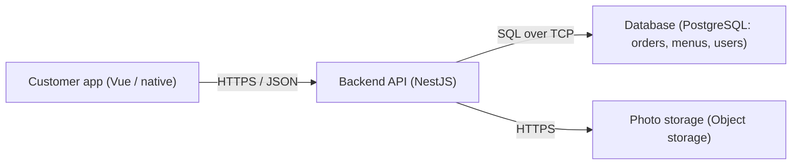
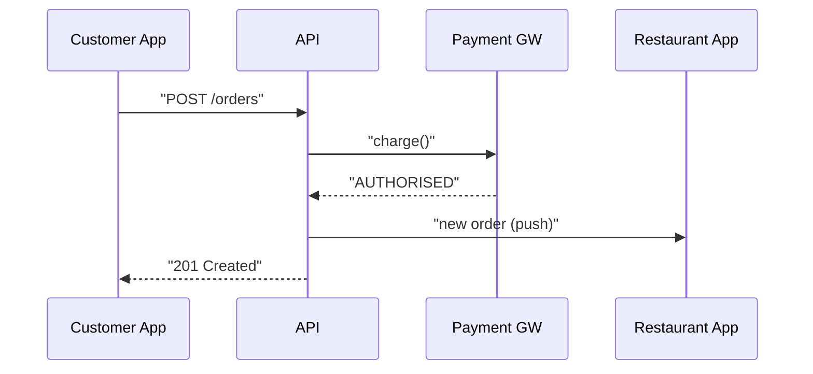
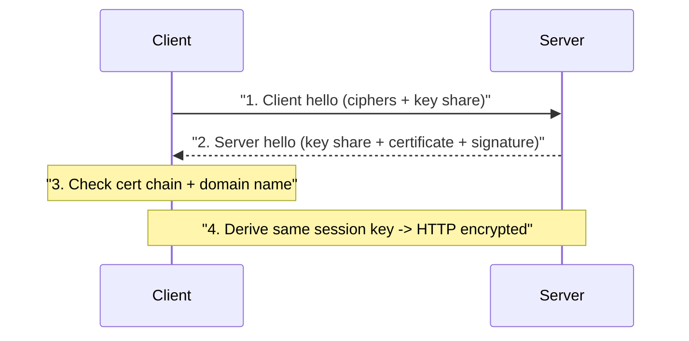
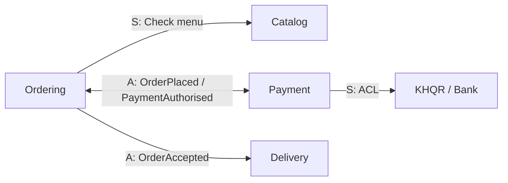
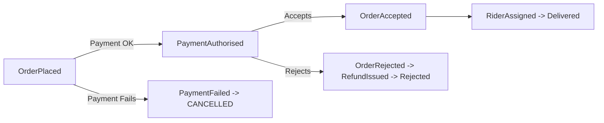
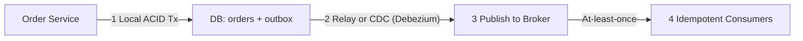

# Software System Architecture — Slide Study Guide (Weeks 1–7)

> [!IMPORTANT]
> **Exam Blueprint (`TeachersNode.md`):** Friday **27 November 2026** · Paper-based · **~10 open questions** · **NO QCM** · Worth **30%** · **60% Theory & Concept** (*"Explain…"* only, no *"What is…"*, e.g., Transactional Outbox) · **40% Practical** (e.g., Event Storming) · Lectures **1 to 7**.

> **Course Overview & Vocabulary:** See [Course Overview](#Software%20Architecture/Midterm/overview.md) · **Past Quizzes (91 Qs):** See [Quiz Guide](#Software%20Architecture/Midterm/quiz.md).

---

## Section 1 — Week 1: Introduction to Software Architecture

<details data-tag="theory" data-meta="Slide 6">
<summary><strong>Question 1.1:</strong> Explain what software architecture is (Bass, Clements & Kazman, and the shorter version).</summary>

- **Bass, Clements and Kazman (*Software Architecture in Practice*):** “The software architecture of a system is the set of structures needed to reason about the system. These structures comprise software elements, relations among them, and properties of both.”
- **Shorter version (After Ralph Johnson, as quoted by Martin Fowler):** Architecture is **the important stuff**, the decisions that are hard to change later.
- **Analogy & FoodHub example:** Think of architecture as the steel beams and elevators of a skyscraper (not wall paint). Choosing PostgreSQL vs microservices is architecture; naming a variable or sorting a list in memory is not.

</details>

<details data-tag="theory" data-meta="Slide 7">
<summary><strong>Question 1.2:</strong> Explain elements, relations, and the three structures of one system.</summary>

- **Elements and relations:** Boxes are **elements**. Labelled arrows are **relations** (connectors), e.g., `Customer app —HTTPS→ Order service —SQL→ Orders database`.
- **Module structure:** How the code is split: packages, modules, layers.
- **Runtime structure:** What runs and talks: services, queues, databases.
- **Deployment structure:** Where it lives: servers, containers, cloud regions.
- **FoodHub example:** Module = `src/ordering/` and `src/catalog/` folders; Runtime = Vue app + NestJS API + RabbitMQ + Postgres; Deployment = Docker containers in a Singapore cloud region + managed database.

</details>

<details data-tag="theory" data-meta="Slide 8">
<summary><strong>Question 1.3:</strong> Explain the difference between architecture and detailed design, and the rule of thumb.</summary>

| Question | Architecture | Detailed design |
| :--- | :--- | :--- |
| **Scope** | The whole system and how the parts fit | The inside of one part |
| **Cost to change** | High: weeks or months of rework | Low: hours or days |
| **Examples** | One service or many; SQL or NoSQL; sync calls or events | Class names; an algorithm inside a function; a screen layout |
| **Driven by** | Quality attributes and constraints | Mostly functional requirements |

- **Rule of thumb:** If getting it wrong means rewriting many parts of the system, treat it as an architectural decision and write it down.
- **Exam litmus test:** Changing a button colour or sorting algorithm takes ~1 hour in one file (detailed design); switching direct REST calls to async events takes weeks across teams (architecture).

</details>

<details data-tag="theory" data-meta="Slide 9">
<summary><strong>Question 1.4:</strong> Explain why software architecture matters (features are easy; qualities are hard).</summary>

- **It decides the qualities:** Speed, uptime, security and ease of change come from structure, not from features.
- **It is expensive to change:** Early decisions lock in later options. Fixing them late costs the most.
- **It shapes the teams:** Conway's law: systems tend to copy the communication structure of the organisation that builds them.
- **It is a shared language:** Developers, testers, operations and managers can discuss the same picture.
- **Example:** Almost any messy script can take one food order, but without the right structure it crashes at 5× lunch peak, leaks KHQR payment data, or stalls 8 developers with constant merge conflicts.

</details>

<details data-tag="theory" data-meta="Concept · Slide 9">
<summary><strong>Question 1.5:</strong> What is Conway's Law?</summary>

- **Plain-English meaning:** Software systems tend to copy the communication structure of the teams that build them (Melvin Conway, 1967).
- **Example:** Three separate teams (mobile, backend, payments) naturally produce a 3-part system because each team builds its own boundary.
- **Why it matters:** Design your team boundaries and software architecture together so teams do not accidentally create a tangled system.

</details>

<details data-tag="theory" data-meta="Slide 10">
<summary><strong>Question 1.6:</strong> Explain what an architect actually does, and how architecture works in agile teams.</summary>

1. **Understand the drivers:** Requirements, qualities, constraints.
2. **Make and record decisions:** Compare options, explain trade-offs.
3. **Communicate:** Diagrams and documents that people read.
4. **Guide the build:** Code reviews, prototypes, coaching.
5. **Keep it evolving:** Measure, learn, adjust as the system grows.
- **Concrete examples:** Prototyping module boundaries early, rejecting cross-module repository imports during code review, and measuring p95 latency after launch before adding Redis caching.

- **In agile teams:** Architecture is often a shared job, not one person's title. Decide early only what is expensive to change, and leave the rest open until you know more.

</details>

<details data-tag="theory" data-meta="Slide 11">
<summary><strong>Question 1.7:</strong> Explain the three inputs (architectural drivers) that shape an architecture.</summary>

- **Functional requirements** (*What the system does*): “A customer can track the rider on a map.”
- **Quality attributes** (*How well it does it*): “The rider position on the map is at most 10 s old.” *(Usually drive the architecture most, and are also the ones teams forget to write down.)*
- **Constraints** (*Decisions already made for you*): “Must accept KHQR. Team of 8. Launch in 6 months.”
- **Exam classification cue:** `"User can do X"` = Functional; `"how fast / reliable / secure / changeable"` = Quality Attribute; `"must use X / team size / deadline / law"` = Constraint.

</details>

<details data-tag="theory" data-meta="Slide 12">
<summary><strong>Question 1.8:</strong> Explain the ISO/IEC 25010 product qualities and which five this course focuses on.</summary>

- **Focus qualities (5 dark cards, 2023 edition):**
  - **Performance efficiency:** Speed and resource use.
  - **Reliability:** Availability and recovery.
  - **Security:** Protects data and access.
  - **Maintainability:** Easy to change and test.
  - **Flexibility:** Scalability, adaptability.
- **Other product qualities:** *Functional suitability* (correct and complete features), *Compatibility* (works with other systems), *Interaction capability* (usability, accessibility), *Safety* (avoids harm to people).
- **FoodHub metrics for the 5 focus qualities:** Performance (`<1s` menus), Reliability (`99.9%` uptime), Security (lock after `5` failed logins), Maintainability (`≤5` days for new payment), Flexibility (`10×` rider tracking).

</details>

<details data-tag="theory" data-meta="Slide 13">
<summary><strong>Question 1.9:</strong> Explain why “fast” is a wish, not a requirement, with measurable examples.</summary>

| Vague | Measurable |
| :--- | :--- |
| “The app should be fast” | At lunch peak, 95% of menu pages load within 1 s |
| “Highly available” | Ordering is available 99.9% of each month (about 43 min of downtime) |
| “Secure” | After 5 failed logins in 10 min the account is locked and the owner is notified |
| “Easy to change” | Adding a new payment method takes one developer at most 5 days and touches only the payment module |

- **Key rule:** If you cannot test it, you cannot design for it, and you cannot tell whether you succeeded.
- **Exam checklist:** Every measurable requirement needs **a number + a unit + the condition** (e.g., `"95% of menu pages load within 1 s during lunch peak"`).

</details>

<details data-tag="theory" data-meta="Concept · Slides 13–14">
<summary><strong>Question 1.10:</strong> What is a Quality Attribute Scenario (QAS), and how do you calculate 99.9% vs 99.99% availability?</summary>

- **Plain-English meaning:** A Quality Attribute Scenario (QAS) is a 6-part template that turns a vague wish (*"fast"*, *"highly available"*) into a concrete, testable requirement with a real number.
- **Availability math (30-day month = `30 × 24 × 60 = 43,200` minutes):**
  - **99.9% ("three nines"):** `0.1%` downtime allowed → `0.001 × 43,200 = 43.2 ≈ 43 minutes/month`.
  - **99.99% ("four nines"):** `0.01%` downtime allowed → `0.0001 × 43,200 = 4.32 ≈ 4.3 minutes/month`.

</details>

<details data-tag="practical" data-meta="Slides 14–15">
<summary><strong>Question 1.11:</strong> Explain the six parts of a Quality Attribute Scenario (QAS) with FoodHub examples.</summary>

- **Six parts:** **1. Source** (`5,000 customers`) → **2. Stimulus** (`place orders`) → **3. Artifact** (`order service`) → **4. Environment** (`lunch peak, normal operation`) → **5. Response** (`orders are accepted and confirmed`) → **6. Measure** (`99% within 2 s`).
- **As one sentence:** During the lunch peak, when 5,000 customers place orders, the order service accepts and confirms them, and 99% are confirmed within 2 seconds.

| Part | Availability | Security | Modifiability |
| :--- | :--- | :--- | :--- |
| **Source** | Hardware | Attacker | Product owner |
| **Stimulus** | One order server crashes | Tries 1,000 passwords on one account | Asks for a new payment method |
| **Artifact** | Order service | Login endpoint | Payment module |
| **Environment** | Dinner peak | Normal operation | Design time |
| **Response** | Traffic moves to healthy servers | Account locked, owner notified | Added without changing other modules |
| **Measure** | No orders lost; under 30 s of errors | Locked after 5 tries in 10 min | At most 5 developer-days |

- **Exam tip:** Never omit **Environment** (e.g., *during dinner peak*) or a **unit** in the Measure (`seconds`, `%`, `developer-days`) — graders deduct points if either is missing.

</details>

<details data-tag="theory" data-meta="Slide 16">
<summary><strong>Question 1.12:</strong> Explain the four types of architectural constraints with FoodHub examples.</summary>

- **Business:** Launch in 6 months. Fixed monthly cloud budget.
- **Team:** 8 developers who know TypeScript (NestJS and Vue). No dedicated operations staff.
- **Technical:** Must integrate KHQR and bank payment APIs. Riders use low-cost Android phones on mobile data.
- **Legal:** Personal and payment data rules from regulators and payment providers.
- **Rule:** A constraint removes options before you start. Write it down so nobody wastes time on options that were never allowed.
- **Why it steers design:** Having 8 TypeScript devs, a 6-month deadline, and no dedicated ops staff immediately rules out 15 Go microservices on Kubernetes and points toward a NestJS modular monolith.

</details>

<details data-tag="theory" data-meta="Slide 17">
<summary><strong>Question 1.13:</strong> Explain the three classic architectural trade-offs.</summary>

- **Core rule:** You can't maximise everything. Every decision gives something up.
- **Security vs usability:** Extra checks at checkout stop fraud but slow down honest customers.
- **Consistency vs availability:** Refuse orders when stock data may be stale, or accept them and fix later?
- **Performance vs cost:** More servers cut wait times at peak but sit idle at 3 a.m.
- **Exam tip (how to justify):** Name both sides of the conflict and tie your choice to context (e.g., Rider GPS every `5–10 s` instead of `1 s` saves budget Android battery life while keeping tracking fresh enough).

</details>

<details data-tag="theory" data-meta="Slide 18">
<summary><strong>Question 1.14:</strong> Explain the six eras of software architecture and why monoliths are still used today.</summary>

- **1990s — Monolithic web apps:** One server, one database (LAMP).
- **2000s — Multi-tier and SOA:** Separate tiers, shared services.
- **2006+ — Cloud:** Rent servers by the hour, scale out.
- **2013+ — Containers and microservices:** Docker, Kubernetes, small teams.
- **2014+ — Serverless and edge:** Functions, managed services, CDNs.
- **2022+ — LLM-powered systems:** Models, retrieval, agents as components.
- **Bottom line:** New styles did not replace old ones. Most companies today still run monoliths next to cloud services, and that is often the right choice.
- **Real-world contrast:** Cloud/EC2 let startups rent servers in minutes; Docker/K8s helped huge orgs like Netflix deploy independently; yet Shopify and Stack Overflow still run monoliths cleanly at massive scale.

</details>

<details data-tag="theory" data-meta="Slide 19">
<summary><strong>Question 1.15:</strong> What are the five things to remember from Week 1?</summary>

1. Architecture is the set of structures and the decisions that are hard to change.
2. Its main job is to deliver the quality attributes.
3. Drivers: functional requirements, quality attributes, constraints.
4. A quality attribute needs a scenario with a number.
5. Every decision is a trade-off. Make it on purpose.

</details>

---

## Section 2 — Week 2: Designing and Documenting Architecture

<details data-tag="theory" data-meta="Slide 3">
<summary><strong>Question 2.1:</strong> Explain why an architecture in one head is a risk, and what makes good documentation.</summary>

- **Risks:** New team members take weeks to understand the system; the same debate happens again because nobody remembers why; reviewers cannot check a design they cannot see; decisions drift (code slowly stops matching the intended design).
- **Good documentation is…** **Just enough** (a few diagrams and decision records, not 100 pages); **Close to the code** (in the repository, reviewed like code); **For a reader** (each diagram answers a question someone has).
- **Failure example:** If only one senior developer knows why FoodHub avoids cross-service joins, the week they leave a new hire may introduce a shared database table and cause hidden coupling.

</details>

<details data-tag="theory" data-meta="Slide 4">
<summary><strong>Question 2.2:</strong> Explain the four architectural views of a system.</summary>

- **Structure:** What are the parts and how do they connect? (C4 diagrams)
- **Behaviour:** What happens, in what order, when a user places an order? (sequence diagrams)
- **Deployment:** Which machines, containers and networks run each part?
- **Decisions:** Why is it built this way? (ADRs)
- **Analogy:** Like house plans — Structure (C4) is the floor plan, Behaviour (Sequence) is the plumbing/water flow, Deployment is the land plot and wiring, and Decisions (ADRs) are the engineer’s signed notes.

</details>

<details data-tag="theory" data-meta="Concept · Slide 5">
<summary><strong>Question 2.3:</strong> What is the C4 model, and what is a "Container" in C4?</summary>

- **Plain-English meaning:** The **C4 model** (Context, Containers, Components, Code — created by Simon Brown) is a way to draw architecture diagrams at 4 zoom levels, like zooming in on Google Maps.
- **Important trap:** A C4 **Container** is **NOT** a Docker container. It means anything that runs or stores data separately so the system works (e.g., mobile app, web SPA, backend API, PostgreSQL database, message queue).

</details>

<details data-tag="theory" data-meta="Slide 5">
<summary><strong>Question 2.4:</strong> Explain the four levels of zoom in the C4 model.</summary>

- **1 · System context:** The system as one box, with the **people** and **external systems** around it.
- **2 · Containers:** Apps and data stores that run separately: mobile app, API, database, queue.
- **3 · Components:** The main parts inside one container, such as the modules of the API.
- **4 · Code:** Classes and functions. Usually generated by tools, rarely drawn by hand.
- **Rule:** Most teams only maintain levels 1 and 2. Draw level 3 for the containers that are hard to understand.
- **FoodHub at each zoom level:** L1 = `Customer → FoodHub → KHQR`; L2 = `Vue App → NestJS API → PostgreSQL`; L3 = `OrdersController → OrdersService → OrderRepository`; L4 = TypeScript `class Order`.

</details>

<details data-tag="practical" data-meta="Slide 6">
<summary><strong>Question 2.5:</strong> Explain what goes on a C4 Level 1 System Context diagram (using FoodHub).</summary>

- **People:** Customer, Restaurant staff, Rider, FoodHub admin / support.
- **FoodHub:** The software system in the centre: one box. Lets customers order food, restaurants manage orders and riders deliver.
- **External systems:** Payment gateway (KHQR, cards), Maps and routing API, SMS and push notification provider.
- **Arrow rule:** Every arrow gets a label: **what** flows and **why** (e.g., `"sends payment requests"`).
- **Common exam mistake:** Do **not** draw PostgreSQL, Redis, or NestJS on a Level 1 Context diagram — internal containers stay hidden inside the single FoodHub box until Level 2.

</details>

<details data-tag="practical" data-meta="Slide 7">
<summary><strong>Question 2.6:</strong> Explain what goes on a C4 Level 2 Container diagram (using FoodHub).</summary>

- **Main containers:** **Customer app** (Mobile app, Vue web or native), **Backend API** (NestJS, HTTPS / JSON), **Database** (PostgreSQL: orders, menus, users), **Photo storage** (Object storage, menu photos).
- **Also containers:** Restaurant web app, rider app, and later a **message queue** (week 7) and **cache** (week 12).
- **Labelling rule:** Label each box with name, technology and purpose; each arrow with protocol, e.g., `"HTTPS/JSON"`, `"SQL over TCP"`.
- **Exam checklist:** Every box needs **3 things** (name, technology, purpose), every arrow needs a **protocol**, and both the frontend SPA and PostgreSQL database count as containers.



</details>

<details data-tag="theory" data-meta="Concept · Slide 8">
<summary><strong>Question 2.7:</strong> What is Event Storming?</summary>

- **Plain-English meaning:** A fast, visual sticky-note workshop (invented by Alberto Brandolini) where business people and developers map out every business event in time order to uncover risks (*hot spots*) and natural bounded contexts before writing code.

</details>

<details data-tag="practical" data-meta="Slide 8">
<summary><strong>Question 2.8:</strong> Explain how to read a sequence diagram and what it shows (using "place an order").</summary>

- Read it top to bottom: each vertical line is a **participant**; arrows are **messages**, in time order.
- Shows **who waits for whom**: here the customer waits for the payment (`POST /orders → charge() → AUTHORISED → new order (push) → 201 Created`).
- Use it for the **2–3 most important or risky flows**.
- **Reading tip:** Solid arrows (`→`) are calls, dashed arrows (`--→`) are responses. Notice how the Customer App waits blocked while `API` calls `Payment GW` — that wait reveals **temporal coupling**.



</details>

<details data-tag="theory" data-meta="Concept · Slide 9">
<summary><strong>Question 2.9:</strong> What is an Architecture Decision Record (ADR), and why do teams write them?</summary>

- **Plain-English meaning:** An **ADR** is a short (one-page) numbered markdown file stored in Git that records one important architectural choice and **why** the team made it.
- **Why it exists:** Stops teams from repeating the same debate a year later, helps new developers understand past trade-offs, and acts as an immutable history log (accepted ADRs are never edited—write a new ADR that supersedes the old one).

</details>

<details data-tag="theory" data-meta="Slide 9">
<summary><strong>Question 2.10:</strong> Explain the four parts of an Architecture Decision Record (ADR) and why accepted ADRs are never edited.</summary>

- **Status:** proposed, accepted, superseded.
- **Context:** the forces and facts at the time (e.g., orders need transactions, team knows SQL, ~15 GB/year).
- **Decision:** what we chose, in one or two sentences (e.g., *"Use one managed PostgreSQL database."*).
- **Consequences:** **good and bad** results (`+` ACID transactions, mature tooling, no DBA needed; `-` one database limits write scaling, revisit at 10×).
- **Rules:** Short (one page), numbered, stored in Git, never edited after acceptance: write a new ADR that **supersedes** it.
- **FoodHub example (`ADR-001`):** *Status:* Accepted · *Context:* 8 devs, ~15 GB/year, orders need ACID · *Decision:* Use one managed PostgreSQL DB · *Consequences:* `+` simple transactions & ops; `-` write bottleneck at 10×.

</details>

<details data-tag="theory" data-meta="Slide 10">
<summary><strong>Question 2.11:</strong> Explain the four design principles that apply at the system level.</summary>

- **Separation of concerns:** Each part has one job. Payment logic does not live in the menu code.
- **High cohesion:** Things that change together stay together (all order rules in one module).
- **Loose coupling:** Parts depend on each other through small, stable interfaces, so one can change without breaking the others.
- **Conway's law:** Systems mirror the communication structure of the teams that build them. Design teams and architecture together.
- **Good vs bad FoodHub code:** Putting KHQR signature checks inside `MenuController` violates separation of concerns; `Ordering` calling `CatalogService` instead of querying `menu_items` directly preserves loose coupling.

</details>

<details data-tag="theory" data-meta="Slide 11">
<summary><strong>Question 2.12:</strong> Explain the six steps from question to design.</summary>

1. **Clarify:** Users, features, quality attributes, constraints. Ask questions.
2. **Estimate:** Users → requests per second, storage, bandwidth.
3. **API:** Main endpoints or events between parts.
4. **High-level design:** Container diagram for the main flows.
5. **Deep dive:** The 1–2 hardest parts: data, scaling, failure.
6. **Trade-offs:** What you chose, what you gave up, and what you would change at 10×.

- **Note:** Used in design interviews, design reviews, the midterm and the final exam.
- **Exam pacing:** Spend ~2 min clarifying drivers/constraints, ~3 min on QPS/storage math, list 3–5 APIs/events, sketch C4 Containers, deep dive 1–2 failure modes (e.g., retries/outbox), and close with trade-offs + 10× plan.

</details>

<details data-tag="theory" data-meta="Concept · Slides 12–13">
<summary><strong>Question 2.13:</strong> What is QPS and back-of-the-envelope estimation?</summary>

- **Plain-English meaning:** **QPS (Queries Per Second)** measures how many requests a system handles each second. Back-of-the-envelope estimation is quick rough math done *before* designing so you size for real traffic instead of guessing.
- **Core formulas:** `Average QPS = Daily requests ÷ 86,400` *(mental math: `÷ 100,000`)* · `Peak QPS = Average QPS × Peak factor` *(e.g., `5×`)* · `Yearly storage = Daily records × Record size × 365`.

</details>

<details data-tag="theory" data-meta="Slide 12">
<summary><strong>Question 2.14:</strong> Explain the useful numbers for back-of-the-envelope estimates and why each matters.</summary>

| Fact | Approximate value | Why it matters |
| :--- | :--- | :--- |
| **Seconds in a day** | 86,400 (≈ 100,000 for quick maths) | Per-day → per-second |
| **Peak factor** | 2–10× the average (FoodHub: 5×) | Design for the peak, not the average |
| **Read from memory** | ≈ 100 ns | Caches are very fast (week 12) |
| **Read 1 MB from SSD** | ≈ 1 ms | Disk is fast, but not memory-fast |
| **Round trip in a data centre** | ≈ 0.5 ms | Calls between services add up (week 6) |
| **Round trip Phnom Penh ↔ Singapore** | ≈ 30–50 ms | Where you host matters (week 3) |
| **Mobile 4G round trip** | ≈ 50–100 ms | Fewer, bigger requests on mobile |

- **Order to memorize:** `RAM (100 ns)` ≪ `Same-DC (0.5 ms)` < `SSD 1 MB (1 ms)` ≪ `PP↔SG WAN (30–50 ms)` < `4G (50–100 ms)` — an overseas call is ~500,000× slower than reading RAM.

</details>

<details data-tag="practical" data-meta="Slides 13–14">
<summary><strong>Question 2.15:</strong> Explain FoodHub's traffic, storage, and Rider GPS estimates, and the "estimate first" rule of thumb.</summary>

- **Traffic (Slide 13):** `20,000 ÷ 86,400 = 0.23` orders per second on average; `30 calls per order` → **7 QPS** API requests on average → **35 QPS** at peak (`5 × 7`) → **350 QPS** peak in two years (`10×` growth).
- **Storage & Rider GPS:** Order data: `20,000 × 2 KB ≈ 40 MB per day ≈ 15 GB per year`. Rider GPS: `400` active riders, one update every 5 s ≈ **80 writes per second**: more than orders!
- **Key insight:** FoodHub is **not** huge. One good server and one database can handle today's load. Design for growth, not for Google.
- **Rule of thumb (Slide 14):** Estimate first. The right architecture for 35 requests per second is very different from one for 35,000. Show every step and every unit. A wrong assumption that is written down can be fixed; a hidden one cannot.
- **Why Rider GPS stands out:** `80 writes/s` from 400 active riders is nearly **70×** FoodHub’s peak order creation rate (`1.16 orders/s`), making Rider Tracking the very first candidate to scale or split later.

</details>

<details data-tag="theory" data-meta="Slide 15">
<summary><strong>Question 2.16:</strong> What are the five things to remember from Week 2?</summary>

1. Document just enough: diagrams and decisions, kept in Git.
2. C4: context for everyone, containers for engineers.
3. Sequence diagrams show who waits for whom.
4. An ADR records context, decision and **both** kinds of consequences.
5. Estimate before you design: QPS, storage, peak and growth.

</details>

---

## Section 3 — Week 3: Networking and Communication

<details data-tag="theory" data-meta="Slides 3 & 13">
<summary><strong>Question 3.1:</strong> Explain the five steps when opening foodhub.com.kh, and why every arrow in a diagram matters.</summary>

1. **DNS:** Find the IP address of `foodhub.com.kh`.
2. **TCP / QUIC:** Open a connection to that IP and port `443`.
3. **TLS:** Agree on keys, check the certificate.
4. **HTTP:** Send `GET /`, receive HTML.
5. **More requests:** CSS, JS, images: often from a CDN.

- **Round trips:** Each step costs round trips. On 4G (50–100 ms each) the first page can take 300–500 ms before any HTML arrives.
- **4G latency math:** DNS cache miss (1 RTT) + TCP handshake (1 RTT) + TLS 1.3 (1 RTT) + HTTP `GET /` (1 RTT) = 3–4 RTTs × 50–100 ms ≈ **300–500 ms** before any HTML renders.
- **Key Idea (Slide 13):** Every arrow in your diagram is DNS, a connection, TLS and HTTP. Each one can be slow and each one can fail. Good architectures **remove round trips** (keep-alive, HTTP/2–3, CDN) and **plan for failure** of every hop.

</details>

<details data-tag="theory" data-meta="Slide 4">
<summary><strong>Question 3.2:</strong> Explain IPv4 vs IPv6, private IP ranges, and what NAT does.</summary>

- **IPv4 and IPv6:** **IPv4** is 32 bits, e.g. `203.0.113.10` (about 4.3 billion addresses: not enough). **IPv6** is 128 bits, e.g. `2001:db8::10` (effectively unlimited). Most systems run both ("dual stack").
- **Private addresses and NAT:** Private ranges (`10.x`, `172.16–31.x`, `192.168.x`) are not reachable from the internet. **NAT:** the router shares one public IP among many private devices.
- **Cloud servers:** Servers in a cloud network get private IPs; only the load balancer or proxy is public.
- **Security reason:** Giving PostgreSQL (`10.0.1.5:5432`) a private RFC 1918 IP ensures no attacker on the public internet can connect directly to your database—only the reverse proxy/LB has a public IP.

</details>

<details data-tag="theory" data-meta="Slide 5">
<summary><strong>Question 3.3:</strong> Compare TCP vs UDP, and explain what a port does.</summary>

| Dimension | TCP | UDP |
| :--- | :--- | :--- |
| **Connection** | Handshake first (SYN, SYN-ACK, ACK) | No connection: just send |
| **Delivery** | Reliable, in order; lost packets are re-sent | Best effort: packets may be lost or reordered |
| **Speed** | Extra round trip; waits for lost packets | Low overhead, no waiting |
| **Used for** | Web (HTTP/1.1, HTTP/2), databases, email | DNS queries, video calls, games, QUIC (HTTP/3) |
| **Ports** | e.g. 443 HTTPS, 5432 PostgreSQL, 6379 Redis | e.g. 53 DNS, 443 QUIC |

- **Rule:** A **port** picks the program on a machine: IP = the building, port = the room.
- **When to pick which:** Use **TCP** when one missing byte corrupts the data (payments, SQL, JSON); use **UDP** when waiting to re-send an old packet is worse than skipping it (live video, voice, gaming, DNS).

</details>

<details data-tag="theory" data-meta="Slide 6">
<summary><strong>Question 3.4:</strong> Compare HTTP/1.1, HTTP/2, and HTTP/3.</summary>

- **HTTP/1.1 (1997):** Text protocol over TCP; one request at a time per connection; browsers open ~6 connections to work around it.
- **HTTP/2 (2015):** Binary, over TCP; **multiplexing** (many requests on one connection); header compression; one lost packet still stalls all streams (TCP).
- **HTTP/3 (2022):** Over **QUIC** (a fast UDP-based transport built for HTTP/3); lost packet only stalls its own stream; faster setup (transport + TLS in one round trip); connection survives **Wi-Fi → 4G switch**.
- **Why Wi-Fi → 4G works in HTTP/3:** TCP ties a connection to `(client IP, port)`, so switching networks breaks the socket; QUIC uses a **Connection ID**, letting the rider app keep streaming smoothly on the move.

</details>

<details data-tag="theory" data-meta="Concept · Slide 7">
<summary><strong>Question 3.5:</strong> What is TLS (and how does it turn HTTP into HTTPS)?</summary>

- **Plain-English meaning:** **TLS (Transport Layer Security)** is the security layer wrapped around HTTP to make **HTTPS**.
- **Two jobs:** (1) **Secrecy / encryption** using a shared session key (agreed via ECDHE) so nobody on public Wi-Fi can read or tamper with data; (2) **Server identity** proved by a signed certificate from a trusted Certificate Authority (CA).

</details>

<details data-tag="theory" data-meta="Slide 7">
<summary><strong>Question 3.6:</strong> Explain how TLS 1.3 secures HTTPS in one round trip (ECDHE vs certificate).</summary>

1. **Client hello:** Supported ciphers and a **key share** for key agreement.
2. **Server hello:** Its key share, its **certificate**, and a signature proving it owns the certificate.
3. **Check:** The client checks the certificate chain up to a trusted authority and the domain name.
4. **Encrypt:** Both sides derive the same session key. All HTTP traffic is now encrypted.

- **Key rule:** Key agreement (ECDHE) creates the session key; the certificate only proves **who** the server is.
- **Exam trap:** Do **not** say *"the certificate encrypts all HTTP traffic."* The certificate verifies the server’s identity; **ECDHE** derives the fast symmetric session key (and gives forward secrecy).



</details>

<details data-tag="theory" data-meta="Concept · Slide 8">
<summary><strong>Question 3.7:</strong> What is DNS (Domain Name System), and what is TTL?</summary>

- **Plain-English meaning:** **DNS** is the internet's phonebook—it translates a human-readable domain name (like `foodhub.com.kh`) into an IP address (like `203.0.113.10`).
- **TTL (Time To Live):** How many seconds resolvers and browsers may cache the answer. Before moving a server to a new IP, lower the TTL in advance (e.g., to `300 s`) at least one old TTL ahead so users don't stay stuck on the old IP.

</details>

<details data-tag="theory" data-meta="Slide 8">
<summary><strong>Question 3.8:</strong> Explain how DNS turns a domain name into an IP address and how TTL caching works.</summary>

- **Chain:** **Phone** (*"foodhub.com.kh?"*) → **Recursive resolver** (*ISP or `1.1.1.1` / `8.8.8.8`; checks cache first*) → **Root server** (*"Ask the .kh servers"*) → **`.kh` TLD server** (*"Ask foodhub's name servers"*) → **Authoritative** (*"`203.0.113.10`, TTL 300"*).
- **TTL caching:** The resolver caches the answer for the **TTL** (here 300 s), so the next customer is answered from cache in a few ms. Phones and browsers cache too, so a DNS change can take up to one TTL to reach everyone.
- **Server migration example:** If `TTL = 86,400 s` (24 hours) and you swap server IPs immediately, users stay stuck hitting the dead IP for up to a day. Lower TTL to `300 s` at least 24 hours *before* moving.

</details>

<details data-tag="theory" data-meta="Slide 9">
<summary><strong>Question 3.9:</strong> Explain the five DNS record types an architect uses and DNS-based failover.</summary>

| Record | Maps | Example |
| :--- | :--- | :--- |
| **A / AAAA** | Name → IPv4 / IPv6 address | `api.foodhub.com.kh → 203.0.113.10` |
| **CNAME** | Name → another name | `img.foodhub.com.kh → foodhub.cdn-provider.net` |
| **MX** | Domain → mail servers | `foodhub.com.kh → mail.provider.com` |
| **TXT** | Name → text | Domain ownership checks, SPF email rules |
| **NS** | Domain → its authoritative name servers | `foodhub.com.kh → ns1.dns-host.com` |

- **DNS-based failover and load balancing:** Return several A records, or a different IP when a health check fails. Limited by TTL and caching.
- **`A` vs `CNAME` rule:** Point an `A` record to a fixed IP address (`203.0.113.10`), and use a `CNAME` when pointing a subdomain (`img.foodhub.com.kh`) to a CDN hostname whose IP changes dynamically.

</details>

<details data-tag="theory" data-meta="Slide 10">
<summary><strong>Question 3.10:</strong> Explain synchronous vs asynchronous and stateless vs stateful client-server choices.</summary>

- **Synchronous vs asynchronous:** **Sync:** the caller waits for the answer (HTTP request/response); simpler. **Async:** the caller sends and continues; the answer comes later or never (message queue, webhook, push); survives slow or offline receivers.
- **Stateless vs stateful:** **Stateless:** every request carries what the server needs (e.g., a token)—any server can answer; stateless servers scale out easily. **Stateful:** the server remembers the client between requests (session in memory, open WebSocket).
- **FoodHub examples:** Send SMS notifications **async** via a queue so checkout stays fast; avoid storing login sessions in a Node.js in-memory `Map` (stateful), or users randomly get logged out behind 2 API replicas.

</details>

<details data-tag="theory" data-meta="Concept · Slide 11">
<summary><strong>Question 3.11:</strong> What is a Proxy, and how does a backend learn the real client IP behind nginx?</summary>

- **Plain-English meaning:** A **proxy** is a middleman server sitting between clients and backend servers that forwards requests on behalf of one side.
- **Real client IP behind a reverse proxy:** nginx opens its own TCP connection to the backend, so the backend only sees nginx's IP (e.g., `172.18.0.3`). nginx passes the client's real IP in the `X-Forwarded-For` header.
- **Security warning:** Attackers can forge `X-Forwarded-For`, so the backend must only trust that header when it comes from its own trusted reverse proxy.

</details>

<details data-tag="theory" data-meta="Slide 11">
<summary><strong>Question 3.12:</strong> Compare a forward proxy vs a reverse proxy.</summary>

- **Forward proxy:** Sits in front of **clients**; the server sees the proxy, not the user; used for company web filtering, caching, hiding client IPs, VPN-like access; the client is configured to use it.
- **Reverse proxy:** Sits in front of **servers**; the client sees the proxy, not the servers; used for TLS termination, load balancing, caching, compression, rate limiting, hiding internal servers (e.g., nginx, HAProxy, Envoy, cloud load balancers).
- **Memory trick & nginx example:** **Forward** = protects/represents *clients*; **Reverse** = protects/represents *servers*. When nginx on `:443` proxies to NestJS `:3000` and NestJS crashes, nginx returns **`502 Bad Gateway`**.

</details>

<details data-tag="theory" data-meta="Slide 12">
<summary><strong>Question 3.13:</strong> Explain what a CDN does, what to put on it, and what not to cache.</summary>

- **How it works:** A **CDN (Content Delivery Network)** keeps copies of content in **edge servers** close to users. On a miss, the edge fetches from your **origin**.
- **What to put on a CDN:** Menu photos, app JS and CSS, public pages, video and downloads.
- **How it decides:** `Cache-Control: max-age=86400`, `Age` and `X-Cache: HIT / MISS`, versioned file names (`app.3f9a.js`).
- **What you gain:** Lower latency for users, less load and bandwidth at the origin, absorbs traffic spikes and DDoS.
- **Rule:** Never cache personal or changing data (order status, payments) at a shared CDN without care.
- **Data-leak trap:** Caching `GET /v1/orders/me` on a public CDN would serve Customer A’s order details to Customer B. Use `Cache-Control: private, no-store` for user APIs and hashed filenames (`app.3f9a.js`) on CDNs.

</details>

<details data-tag="theory" data-meta="Slide 14">
<summary><strong>Question 3.14:</strong> What are the five things to remember from Week 3?</summary>

1. Opening a URL: DNS → TCP/QUIC → TLS → HTTP.
2. TCP is reliable and ordered; UDP is fast; HTTP/3 uses QUIC over UDP.
3. TLS 1.3: key agreement for secrecy, certificate for identity.
4. DNS is a cached tree; TTL trades speed against change.
5. Reverse proxies protect servers; CDNs bring content close to users.

</details>

---

## Section 4 — Week 4: Web Concepts and API Design

<details data-tag="theory" data-meta="Concept · Slides 3–5">
<summary><strong>Question 4.1:</strong> What are Cookies, Sessions, JWTs, XSS, and CSRF?</summary>

- **Cookie:** Small piece of data a server asks the browser to store and automatically send back on future requests.
- **Server-side session:** Browser holds only a random session ID; server stores who is logged in (in Redis or a database).
- **JWT (JSON Web Token):** A self-contained, Base64URL-encoded token with 3 parts (`Header.Payload.Signature`)—**signed** for integrity, **not encrypted** (anyone can read the payload).
- **XSS (Cross-Site Scripting):** Attacker injects malicious JavaScript into a page to steal cookies/tokens (blocked by `HttpOnly`).
- **CSRF (Cross-Site Request Forgery):** A malicious site tricks your browser into sending an authenticated request with your cookie (mitigated by `SameSite=Lax/Strict`).

</details>

<details data-tag="theory" data-meta="Slide 3">
<summary><strong>Question 4.2:</strong> Compare a server-side session vs a self-contained token (JWT).</summary>

- **Server-side session:** Server creates a random **session ID**, stores the user in a session store; browser keeps the ID in a **cookie**; logout = delete the session (immediate); needs a shared store (Redis, DB) when there are several servers.
- **Self-contained token (JWT):** Server signs a token containing the user ID and an **expiry**; client sends it in `Authorization: Bearer …`; any server can verify it with the key (no lookup); **hard to revoke before it expires**.
- **Ban/logout example:** With a server-side session in Redis, deleting the row logs a stolen account out *immediately*. With a 24-hour JWT, every API server keeps accepting the stolen token until it expires.

</details>

<details data-tag="theory" data-meta="Slide 4">
<summary><strong>Question 4.3:</strong> Explain the five cookie flags that matter and how session IDs should be created.</summary>

| Flag | What it does | Protects against |
| :--- | :--- | :--- |
| **HttpOnly** | JavaScript cannot read the cookie (`document.cookie`) | Token theft through XSS |
| **Secure** | Only sent over HTTPS | Sniffing on public Wi-Fi |
| **SameSite=Lax / Strict** | Not sent on most cross-site requests | CSRF (cross-site request forgery) |
| **Max-Age / Expires** | Cookie lifetime | Old sessions living forever |
| **Domain / Path** | Which hosts and paths receive it | Leaking to other subdomains |

- **Session ID:** Long and random (≥ 128 bits), new ID after login, server-side expiry. Example: `Set-Cookie: sid=…; HttpOnly; Secure; SameSite=Lax`.
- **Attack walkthrough:** Without `HttpOnly`, an XSS script runs `document.cookie` and steals the session ID; without `SameSite`, a malicious website’s hidden form submits `POST /orders` using your browser’s cookie (CSRF).

</details>

<details data-tag="theory" data-meta="Slide 5">
<summary><strong>Question 4.4:</strong> Explain the real JWT trade-off, revocation fix, and safest browser storage.</summary>

- A JWT is **signed, not encrypted**: anyone can read the payload, so no secrets inside.
- Main weakness: **revocation**. A stolen token works until it expires.
- Fix: **short access token** (5–15 min) + **refresh token** stored safely, revocable on the server.
- Always verify the signature, expiry and a **pinned algorithm** (never accept `alg: none`).
- Where to store in a browser: an **HttpOnly cookie** is safest; `localStorage` is readable by any XSS.
- **Not "less secure":** Both sessions and JWTs are secure if used correctly. They trade **instant revocation** (sessions) against **no lookup per request** (tokens).
- **Exam trap (`alg: none`):** If a server accepts an unpinned header, an attacker can change `"alg": "none"`, edit `"role": "admin"`, strip the signature, and log in as admin. Always pin the expected algorithm on the server.

</details>

<details data-tag="theory" data-meta="Concept · Slide 6">
<summary><strong>Question 4.5:</strong> What is an API, REST, and a Webhook (vs Polling)?</summary>

- **API (Application Programming Interface):** The agreed contract of endpoints or messages that lets one program talk to another.
- **REST (Representational State Transfer):** The default web API style using resource nouns in URLs (`/v1/orders`) and HTTP verbs (`GET`, `POST`, `PATCH`, `DELETE`).
- **Webhook vs Polling:** **Polling** = client repeatedly asks *"anything new?"* every few seconds (wastes CPU and bandwidth); **Webhook** = server immediately sends an HTTP `POST` to your URL the moment an event happens.

</details>

<details data-tag="theory" data-meta="Slide 6">
<summary><strong>Question 4.6:</strong> Compare the four API styles (REST, gRPC, GraphQL, Webhooks).</summary>

- **REST:** Resources + HTTP methods; JSON over HTTP, cacheable; default for public and mobile APIs.
- **gRPC:** Remote procedure calls over HTTP/2; Protobuf (small and fast, typed contracts); service-to-service inside a system.
- **GraphQL:** Client asks for **exactly the fields it needs**; one endpoint, one schema; many different clients and screens.
- **Webhooks:** The server calls **you** when something happens; HTTP `POST` to your URL; partner events, e.g., payment confirmed.
- **FoodHub fit:** **REST** for customer/restaurant mobile apps, **gRPC** for fast internal service calls, **GraphQL** when mobile and admin need different fields, and a **Webhook** from KHQR the instant payment succeeds.

</details>

<details data-tag="practical" data-meta="Slide 7">
<summary><strong>Question 4.7:</strong> Explain REST resources, methods, status codes, and which methods are safe or idempotent.</summary>

| Request | Meaning | Success | Typical errors |
| :--- | :--- | :--- | :--- |
| `GET /v1/restaurants?limit=20` | List restaurants | 200 | 400 bad query |
| `GET /v1/orders/{id}` | Read one order | 200 | 404 not found, 401/403 |
| `POST /v1/orders` | Create an order | 201 + Location | 400 invalid, 409 conflict |
| `PATCH /v1/orders/{id}` | Change part of an order | 200 | 409 illegal status change |
| `DELETE /v1/orders/{id}` | Cancel / remove | 204 | 404, 409 |

- **Rule:** Nouns in URLs, verbs in methods. `GET` is safe; `GET`, `PUT` and `DELETE` are **idempotent**; `POST` is not.
- **Exam traps:** Never put verbs in URLs (`GET /v1/createOrder` is wrong; use `POST /v1/orders → 201`). Know **`401 Unauthorized`** (not logged in / bad token) vs **`403 Forbidden`** (logged in, not allowed).

</details>

<details data-tag="theory" data-meta="Concept · Slides 7–8">
<summary><strong>Question 4.8:</strong> What is Idempotency, and what is an Idempotency Key?</summary>

- **Idempotent:** Running the same operation multiple times produces the **same final state** as running it once (`GET`, `PUT`, `DELETE` are idempotent; `POST` is not).
- **Why retries break `POST`:** If a customer taps "Order" on a slow network, the order may be created on the server while the response drops—retrying `POST /v1/orders` creates a duplicate order / double charge.
- **Idempotency Key:** Client sends a unique `Idempotency-Key: <uuid>` header; the server saves the key + response and returns the saved result on retries instead of creating a second order.

</details>

<details data-tag="theory" data-meta="Slides 8 & 12">
<summary><strong>Question 4.9:</strong> Explain versioning, pagination, idempotency keys, error format, and why an API is a contract.</summary>

- **Versioning:** `/v1/orders`. Add fields freely; breaking changes go to `/v2`. Old mobile apps stay in use for months.
- **Pagination:** Never return unlimited lists. `limit + offset`, or a **cursor** for large, changing lists.
- **Idempotency key:** Client sends `Idempotency-Key: <uuid>` with `POST`. A retry returns the first result instead of a second order.
- **Error format:** One shape everywhere: status, error code, message, details. Standard: **RFC 9457** "problem details".
- **Key Idea (Slide 12):** An API is a contract. Once mobile apps depend on it, every change has a cost. Design it on purpose before coding.
- **Why cursor pagination & RFC 9457 matter:** `offset=20` skips or duplicates items if new orders arrive while scrolling; a cursor (`?after=ord_99`) stays stable. Consistent errors (`{ status, code, message }`) prevent mobile crashes.

</details>

<details data-tag="theory" data-meta="Slide 9">
<summary><strong>Question 4.10:</strong> Explain what an API gateway does, what a BFF is, and the main risk of a gateway.</summary>

- **Role:** One front door for many clients and services — a specialised **reverse proxy** (Kong, AWS API Gateway, Azure APIM, nginx, Envoy) handling routing, auth check, rate limiting, TLS, logging, and request aggregation.
- **Backend for frontend (BFF):** One gateway per client type when mobile and web need different shapes.
- **Risk:** A single point of failure and a bottleneck. Keep business logic **out** of the gateway.
- **Gateway YES vs NO:** **YES:** route `/v1/orders`, verify JWT, rate-limit `100 req/min`, terminate TLS. **NO (anti-pattern):** calculating delivery fees, discounts, or checking restaurant stock inside the gateway.

</details>

<details data-tag="theory" data-meta="Slide 10">
<summary><strong>Question 4.11:</strong> Compare JSON, XML, Protobuf, and Avro, and explain schema evolution.</summary>

| Format | Readable | Size / speed | Schema | Typical use |
| :--- | :--- | :--- | :--- | :--- |
| **JSON** | Yes | Medium | Optional (JSON Schema, OpenAPI) | Web and mobile APIs |
| **XML** | Yes | Large, slow | XSD | Older enterprise and banking systems |
| **Protobuf** | No (binary) | Small, fast | Required (`.proto`); fields numbered | gRPC, service-to-service |
| **Avro** | No (binary) | Small, fast | Required; schema travels with data or registry | Kafka events, data pipelines |

- **Schema evolution** (adding fields without breaking old readers) is a strength of Protobuf and Avro, not a weakness.
- **Protobuf example:** Numbered fields (`1: orderId`, `2: status`, new optional `3: totalCents`) let old consumers safely skip field `3` during rolling deployments without crashing.

</details>

<details data-tag="theory" data-meta="Concept · Slide 11">
<summary><strong>Question 4.12:</strong> What is CORS (Cross-Origin Resource Sharing), and what is an "Origin"?</summary>

- **Origin:** The exact combination of `scheme + host + port` (e.g., `http://localhost:5173` and `http://localhost:3000` are **different origins** because their ports differ).
- **CORS:** A browser-enforced security rule (Same-Origin Policy) that blocks frontend JavaScript from reading responses from another origin unless the server explicitly allows it via `Access-Control-Allow-Origin`. Command-line tools like `curl` ignore CORS.

</details>

<details data-tag="theory" data-meta="Slide 11">
<summary><strong>Question 4.13:</strong> Explain the four steps of CORS and why the browser blocks cross-origin API calls.</summary>

1. **Same-origin policy:** Scripts on `localhost:5173` may not read responses from `localhost:3000`: different origin (`scheme + host + port`).
2. **Preflight:** For non-simple requests the browser first sends `OPTIONS` asking if the real request is allowed.
3. **Server answers:** An `Access-Control-Allow-Origin` header naming the allowed origin, plus allowed methods, headers and credentials.
4. **Browser decides:** If the headers match, the response reaches your code. Otherwise: *"blocked by CORS policy"*.

- **Rule:** CORS is enforced **by browsers only**. `curl` and servers ignore it. Never use `*` together with credentials.
- **Dev bug & fix:** Vue (`http://localhost:5173`) calling NestJS (`http://localhost:3000`) fails in Chrome because ports differ (`5173 ≠ 3000`), while `curl` works. Fix on the backend: `app.enableCors({ origin: 'http://localhost:5173', credentials: true })`.

</details>

<details data-tag="theory" data-meta="Slide 13">
<summary><strong>Question 4.14:</strong> What are the five things to remember from Week 4?</summary>

1. Sessions keep state on the server; tokens carry it signed.
2. Cookies: HttpOnly, Secure, SameSite.
3. JWT: short-lived, verified, pinned algorithm, refresh tokens.
4. REST: nouns, methods, status codes, versions, pagination, idempotency keys.
5. Gateways route and protect; CORS is the browser's rule.

</details>

---

## Section 5 — Week 5: Architectural Styles I: Monolith, Layered, Modular

<details data-tag="theory" data-meta="Slide 3">
<summary><strong>Question 5.1:</strong> Explain what a monolith is, its strengths, and its limits as it grows.</summary>

- **Definition:** All features are built, tested and deployed as **one unit**, usually with one database.
- **Strengths:** Simple to build, run, test and debug; function calls instead of network calls (fast and reliable); one database (easy transactions and joins); one thing to deploy and monitor.
- **Limits as it grows:** Code becomes tangled (*"big ball of mud"*) without discipline; every change redeploys everything; scales as a whole (cannot scale only the busy part); many teams in one codebase slow each other down.
- **Big ball of mud example:** When `OrdersService` directly joins `menus` and `payments` SQL tables without boundaries, renaming one column in Menus silently breaks Checkout.

</details>

<details data-tag="theory" data-meta="Slide 4">
<summary><strong>Question 5.2:</strong> Explain layered architecture, its strength, and its weakness.</summary>

- **Strict vs open layering:** **Strict** = Layer N only calls Layer N-1 directly below; **Open** = a layer can skip down to lower layers.
- **Rule:** Each layer only calls the one below: **Presentation** (controllers, HTTP, validation) → **Application / business** (use cases and rules) → **Data access** (repositories, SQL, ORM) → **Database** (PostgreSQL).
- **Strength:** Clear responsibilities; well known; matches NestJS controllers → services → repositories.
- **Weakness:** Business logic **depends on** the data layer, and each feature cuts across all layers.
- **Why it hurts:** Adding one field like `deliveryNote` forces edits across 4 technical folders (Controller → Service → Repository → DB), and business rules tied to ORM models are hard to unit-test without a real database.

</details>

<details data-tag="theory" data-meta="Slide 5">
<summary><strong>Question 5.3:</strong> Explain the difference between logical layers and physical tiers (with FoodHub's example).</summary>

- **Layer (logical):** A way to organise **code**; several layers can run in one process (e.g., controllers, services and repositories inside one NestJS app).
- **Tier (physical):** A separately **running** part, often on its own machine (**2-tier:** client + database; **3-tier:** client + application server + database; **N-tier:** CDN, gateway, cache).
- **FoodHub today:** 3 tiers (apps, NestJS API, PostgreSQL), and the API has 3 layers inside.
- **Exam distinction:** **Layers** are logical code folders running in *one* process; **Tiers** are physically separate processes/machines communicating over a network (Vue browser tier → NestJS server tier → PostgreSQL tier).

</details>

<details data-tag="theory" data-meta="Slides 6 & 12">
<summary><strong>Question 5.4:</strong> Explain what a modular monolith is, why it is popular now, and why we structure inside the monolith first.</summary>

- **Modular monolith:** Modules by business capability (catalog, ordering, payment, delivery, identity); each module **owns its data** and hides its internals; modules talk only through a **public interface** (a service, or events); **no cycles** between modules; boundaries **enforced** by the framework or a test, not just by good intentions.
- **Why it is popular now:** You get most of the structure of microservices with none of the network, data-consistency and operations costs. If one module later needs to be its own service, its boundary is already clean.
- **Key Idea (Slide 12):** Structure inside the monolith first. You can always split a well-modularised monolith; you cannot easily untangle a distributed big ball of mud.
- **FoodHub boundary example:** `OrderingModule` asks `CatalogService.getDishPrice(id)` (public interface) instead of querying `menu_items` directly — so if `Delivery` later splits into its own service, its boundary is already clean.

</details>

<details data-tag="theory" data-meta="Concept · Slide 6">
<summary><strong>Question 5.5:</strong> What is an architectural dependency cycle, and how do you break it?</summary>

- **Dependency cycle:** Module A calls Module B, and Module B calls Module A (`Ordering ↔ Payment`), creating circular coupling that breaks modularity and testability.
- **How to break it:** Replace one direction with an **asynchronous event**, move the shared responsibility to an intermediary module, or merge them if they truly belong together.

</details>

<details data-tag="practical" data-meta="Slide 7">
<summary><strong>Question 5.6:</strong> Explain how a NestJS module shares its service and hides its repository (exports and imports).</summary>

```typescript
// src/catalog/catalog.module.ts
@Module({
  controllers: [CatalogController],
  providers:   [CatalogService, CatalogRepository],
  exports:     [CatalogService],   // public interface
})
export class CatalogModule {}

// src/ordering/ordering.module.ts
@Module({
  imports:   [CatalogModule],      // uses its service
  providers: [OrdersService, ...],
})
export class OrderingModule {}
```

- **What this gives you:** `exports` is the module's public API; injecting `CatalogRepository` into ordering **fails at startup**; `imports` makes dependencies visible so you can draw them and check there are no cycles.
- **Why enforcement matters:** Good intentions fade under launch deadlines; NestJS failing at startup when a module touches a private repository makes boundary violations impossible to ship.

</details>

<details data-tag="theory" data-meta="Concept · Slide 8">
<summary><strong>Question 5.7:</strong> What is a Port vs an Adapter in Hexagonal Architecture?</summary>

- **Core (domain):** Pure business rules in the centre with zero framework, HTTP, or SQL code.
- **Port:** An interface defined **by the core** describing how it is triggered (driving/in port, e.g., `placeOrder()`) or what external service it needs (driven/out port, e.g., `OrderRepository`).
- **Adapter:** The technology-specific code outside the core that plugs into a port (e.g., `OrdersController` driving the core, `PostgresOrderRepository` implementing `OrderRepository`).

</details>

<details data-tag="theory" data-meta="Slide 8">
<summary><strong>Question 5.8:</strong> Explain hexagonal architecture (ports and adapters) and which way dependencies point.</summary>

- **Structure (business logic in the centre, technology at the edges):** **Driving adapters** (REST controller, CLI, message consumer, tests) → **Ports (in)** (use cases: `placeOrder()`, `changeStatus()`) → **Core domain** (order rules; no NestJS, no SQL, no HTTP) → **Ports (out)** (interfaces it needs: `OrderRepository`, `PaymentGateway`) → **Driven adapters** (PostgreSQL repo, in-memory repo, KHQR client).
- **Rule:** **Dependencies point inwards:** adapters depend on the core, never the reverse. Also called **ports and adapters**; clean and onion architecture are the same idea with more rings.
- **Why it pays off:** You can unit-test FoodHub’s discount and order-status rules in milliseconds using an `InMemoryOrderRepository` (fake adapter) and swap payment gateways without touching core business logic.

</details>

<details data-tag="practical" data-meta="Slide 9">
<summary><strong>Question 5.9:</strong> Explain how a port and adapter work in TypeScript so storage can be swapped in one line.</summary>

```typescript
// The PORT (no technology inside)
export interface OrderRepository {
  save(order: Order): Promise<void>;
  get(id: string): Promise<Order | undefined>;
}
export const ORDER_REPOSITORY = Symbol('ORDER_REPOSITORY');

// The core depends only on the port
constructor(@Inject(ORDER_REPOSITORY) private orders: OrderRepository) {}

// One line chooses the ADAPTER
providers: [{ provide: ORDER_REPOSITORY, useClass: InMemoryOrderRepository }]
```

- **Notice:** `OrdersService` never mentions `Map`, SQL or PostgreSQL; in Week 10 you change `useClass` to `PostgresOrderRepository` and nothing else changes; tests can pass a fake repository.
- **Exam answer (which files change?):** Only **two** files change when switching memory → PostgreSQL: (1) add `postgres-order.repository.ts`, and (2) swap 1 line in `ordering.module.ts`. Zero edits to `orders.service.ts` or `orders.controller.ts`.

</details>

<details data-tag="theory" data-meta="Slide 10">
<summary><strong>Question 5.10:</strong> Explain pipe-and-filter, microkernel (plug-in), and SOA styles.</summary>

- **Pipe-and-filter:** Data flows through independent steps (`input → transform → output`), e.g., Unix pipes, image processing, ETL, CI pipelines.
- **Microkernel (plug-in):** Small core + plug-ins that add features following a contract, e.g., VS Code, browsers, Eclipse; payment methods as plug-ins.
- **SOA:** Enterprise services shared across the company, often an **enterprise service bus** with central rules; ancestor of microservices, heavier with more central control.
- **FoodHub examples:** **Pipe-and-filter** = menu photo upload (`Scan → Resize → WebP → S3`); **Microkernel** = adding KHQR, Visa, or Cash as payment plug-ins; **SOA** = heavy central ESB that can become a bottleneck.

</details>

<details data-tag="theory" data-meta="Slide 11">
<summary><strong>Question 5.11:</strong> Explain when to choose each architectural style and what to watch out for.</summary>

| Style | Good when | Watch out for |
| :--- | :--- | :--- |
| **Monolith (simple)** | Small team, early product, simple domain | Turning into a big ball of mud |
| **Layered** | Business apps with clear CRUD flows | Logic depending on the database; changes across all layers |
| **Modular monolith** | One or a few teams, growing domain, need clear ownership | Boundaries must be enforced |
| **Hexagonal** | Rich business rules, many integrations, strong testing needs | Extra interfaces for simple features |
| **Microservices (week 6)** | Many teams, parts with very different scale or release needs | Network, data and operations costs |

- **Startup exam example:** A 4-developer clinic booking startup needing fast launch and ACID transactions (no double-booked doctors) should choose a **Modular Monolith**, not microservices.

</details>

<details data-tag="theory" data-meta="Slide 13">
<summary><strong>Question 5.12:</strong> What are the five things to remember from Week 5?</summary>

1. A monolith is a valid, often the best, starting point.
2. Layers organise code; tiers are separate running parts.
3. Modular monolith: modules by business area, own data, public interfaces, no cycles.
4. Hexagonal: the core defines ports; adapters plug in technology.
5. Choose and combine styles based on team, domain and qualities.

</details>

---

## Section 6 — Week 6: Architectural Styles II: Microservices and DDD

<details data-tag="theory" data-meta="Concept · Slides 3 & 10">
<summary><strong>Question 6.1:</strong> What is a Microservice, and what is a "Distributed Monolith"?</summary>

- **Microservice:** A small, independently deployable service built around one business capability that exclusively owns its own database.
- **Distributed Monolith (anti-pattern):** Splitting code into multiple services that still share one database or must always be deployed together—the **worst of both worlds** (all the network latency and failure headaches of microservices with none of the independent deployment benefits).

</details>

<details data-tag="theory" data-meta="Slide 3">
<summary><strong>Question 6.2:</strong> Explain the six characteristics of microservices.</summary>

- **Business capability:** Each service does one business job: ordering, payment, delivery.
- **Independent deploy:** A team releases its service without coordinating with others.
- **Own data:** Each service has its own database. Nobody else reads its tables.
- **Smart endpoints, dumb pipes:** Logic lives in services; communication is plain HTTP or messages.
- **Owned by one team:** *"You build it, you run it."* Team size ≈ 5–9 people.
- **Designed for failure:** Any call can fail or be slow; each service must cope.
- **What "smart endpoints, dumb pipes" means:** Business rules live inside each service, while the network/broker simply moves plain HTTP JSON or messages—unlike SOA’s heavy central ESB that holds routing logic.

</details>

<details data-tag="theory" data-meta="Slide 4">
<summary><strong>Question 6.3:</strong> Explain the benefits and costs of microservices.</summary>

- **Benefits:** Teams work and deploy **independently**; scale only the busy parts (e.g., rider tracking); a failure can be **contained** to one service; each service can use the best technology for its job; smaller codebases are easier to understand.
- **Costs:** **Network** (latency, timeouts, partial failures); **Data** (no transactions across services; eventual consistency); **Operations** (many deployments, logs, dashboards, alerts); **Testing** (end-to-end tests are hard and slow); **Skills** (needs CI/CD, containers, observability from day one).
- **Cost → Mitigation pairs (exam favorite):** Network/cascading failures → **timeouts, retries, circuit breakers, or async events**; No distributed ACID → **Saga + Outbox**; Hard debugging → **distributed tracing (OpenTelemetry/Jaeger) + centralized logs**.

</details>

<details data-tag="theory" data-meta="Concept · Slides 5 & 7">
<summary><strong>Question 6.4:</strong> What is Domain-Driven Design (DDD), and what is a Context Map?</summary>

- **DDD (Domain-Driven Design):** Designing software around real business areas (*domains*) and the business's own vocabulary rather than around technical layers.
- **Context Map:** A diagram showing how different bounded contexts (and the teams owning them) connect, share schemas, or translate data between each other (e.g., Customer–Supplier, Conformist, Anti-Corruption Layer).

</details>

<details data-tag="theory" data-meta="Slide 5">
<summary><strong>Question 6.5:</strong> Explain domain, subdomains, ubiquitous language, and bounded context in DDD.</summary>

- **Domain:** The business area the software serves (food delivery).
- **Subdomains:** **Core** (what makes FoodHub special: matching orders and riders), **supporting** (menus), **generic** (payments, email). Build the core yourself with your best people; buy or reuse generic ones.
- **Ubiquitous language:** Developers and business use the same words in talk and code.
- **Bounded context:** A boundary inside which a model and its words have one meaning (a good candidate for a module or a service).
- **Resource allocation example:** Do not waste senior engineers building custom SMS sending (**generic** → buy Twilio); put your best people on FoodHub’s rider-matching algorithm (**core**).

</details>

<details data-tag="theory" data-meta="Slide 6">
<summary><strong>Question 6.6:</strong> Explain "one word, different meanings" using FoodHub's "Order" in Ordering vs Delivery.</summary>

- **Order in Ordering:** Items, quantities, prices, discounts; customer, restaurant; status (`placed, accepted, cancelled`); rules (what can be changed and when).
- **"Order" in Delivery:** Pickup point, drop-off address; assigned rider, route, ETA; status (`waiting, picked up, delivered`); does not care about prices or dishes.
- **Rule:** Forcing one shared **Order** model on everyone creates a huge class that every team must change.
- **What goes wrong without separation:** A single 60-column `orders` class mixes dish prices, kitchen prep timers, and rider GPS — so a Delivery team change risks breaking Checkout.

</details>

<details data-tag="theory" data-meta="Slide 7">
<summary><strong>Question 6.7:</strong> Explain the five Context Map relationships with FoodHub examples.</summary>

| Relationship | Meaning | FoodHub example |
| :--- | :--- | :--- |
| **Customer–supplier** | Downstream needs something; upstream plans for it | Delivery depends on Ordering's `OrderAccepted` event |
| **Conformist** | Downstream simply accepts upstream's model | FoodHub uses the KHQR provider's API as it is |
| **Anti-corruption layer** | A translator protects our model from a messy external one | Payment adapter maps bank codes into FoodHub's own payment statuses |
| **Published language** | A shared, documented format | Event schemas published by Ordering |
| **Shared kernel** | Two contexts share a small piece of model (use rarely) | A shared `Money` type |

- **Concrete ACL example:** A bank returns cryptic `ERR_09`; FoodHub’s Payment adapter translates it into `PAYMENT_DECLINED` so messy bank quirks never leak into Ordering. *(Shared kernel is used rarely because two teams must coordinate every change.)*

</details>

<details data-tag="practical" data-meta="Slide 8">
<summary><strong>Question 6.8:</strong> Explain the five steps of Event Storming to discover bounded contexts.</summary>

1. **Events:** Orange notes, past tense: `OrderPlaced`, `PaymentAuthorised`, `RiderAssigned`…
2. **Timeline:** Arrange left to right in the order they happen.
3. **Commands and actors:** Blue (`PlaceOrder`), Yellow (`Customer`) — who or what causes each event?
4. **Hot spots:** Pink: disagreements and questions. These are where the risk is.
5. **Boundaries:** Group events that belong together. Name each group: a bounded context.

- Invented by Alberto Brandolini. Fast, visual, and it gets business people and developers in one room.
- **Why Hot Spots are gold:** A pink sticky note like `"What if the restaurant rejects after payment?"` exposes the exact failure case that needs a Saga refund (`RefundIssued`) *before* a single line of code is written.

```event-storming
context: Ordering
actor: Customer
command: PlaceOrder
event: OrderPlaced / OrderAccepted
hotspot: "Restaurant never accepts?"

context: Payment
actor: KHQR
command: AuthorisePayment
event: PaymentAuthorised

context: Delivery
actor: Rider
command: AssignRider
event: RiderAssigned -> OrderDelivered
```



</details>

<details data-tag="theory" data-meta="Slide 9">
<summary><strong>Question 6.9:</strong> Compare synchronous calls vs asynchronous messages, and explain chain availability (0.999³).</summary>

- **Sync (REST / gRPC):** Caller waits for an answer; simple to write and debug; **temporal coupling** (if the callee is down, the caller fails too); chains multiply latency and failure; use for queries that need an answer now.
- **Async (messages / events):** Caller sends and continues; receiver can be down and catch up later; adds a broker (harder to trace); data becomes **eventually consistent**; use for *"something happened"* notifications and long work.
- **Availability of a chain:** 3 services at 99.9% called in sequence ≈ **99.7%**.
- **Real-minute math:** `99.9%` allows ~43 min downtime/month per service, but 3 services in a synchronous chain (`0.999³ = 99.7%`) allows **~130 min/month** — **3×** more downtime! Switching notifications/analytics to async removes them from the chain.

</details>

<details data-tag="theory" data-meta="Slide 10">
<summary><strong>Question 6.10:</strong> Explain "database per service" and how Ordering gets restaurant names without joining Catalog's table.</summary>

- **Rules:** Each service owns its data (others ask through its API or listen to its events); teams can change schemas without breaking others; **no joins across services** (compose in API or keep a local read model); **no ACID transaction across services** (use a saga). Shared database = hidden coupling: the most common microservice mistake.
- **Example:** Order history needs restaurant names. Instead of joining Catalog's table, Ordering **copies the name** onto the order when it is placed (denormalisation), or listens to `RestaurantRenamed` events.
- **3 ways to get foreign data (and trade-off):** (1) **Snapshot copy** at order creation (fast + preserves historical name), (2) **REST API call** `GET /restaurants/{id}` (always fresh, adds latency/coupling), (3) **Event-driven local cache** via `RestaurantRenamed` (fast + eventually consistent).

</details>

<details data-tag="theory" data-meta="Slide 11">
<summary><strong>Question 6.11:</strong> Compare serverless (FaaS) and cell-based architecture.</summary>

- **Serverless (FaaS):** Functions run on events; the cloud scales them to zero and back; pay per call, no servers to manage. Limits: cold starts, time limits, vendor lock-in, harder local testing. Good for: image resizing, webhooks, spiky or rare jobs.
- **Cell-based:** Run many identical copies (**cells**) of the whole stack; each cell serves a slice of customers (e.g., by city); a failure or bad deploy hits one cell only. Used by AWS, Slack, DoorDash for **blast-radius control**.
- **When Serverless is a bad fit & Cell example:** Avoid FaaS for steady 24/7 high-traffic APIs (expensive), `>15 min` batch jobs, or persistent DB pools. In **cell-based**, a bug deployed to Phnom Penh Cell A leaves Siem Reap Cell B unaffected.

</details>

<details data-tag="theory" data-meta="Slide 12">
<summary><strong>Question 6.12:</strong> Explain the lessons from the five industry case studies (Amazon, Netflix, Uber, Prime Video, Shopify).</summary>

| Company | What happened | Lesson |
| :--- | :--- | :--- |
| **Amazon (early 2000s)** | Split a large monolith into services owned by "two-pizza teams" | Driven by hundreds of teams blocking each other |
| **Netflix (2009–2016)** | Moved to cloud microservices after a database outage | Needed huge scale and resilience; built many tools to cope |
| **Uber (2014–2020)** | Grew to thousands of services, then grouped them into larger "domains" (DOMA) | Too many tiny services become hard to manage |
| **Amazon Prime Video (2023)** | Merged a monitoring pipeline of serverless steps back into one service: ~90% cheaper | Pick the style per workload; splitting is not always cheaper |
| **Shopify, Stack Overflow** | Stayed with a (modular) monolith at large scale | Good structure can take a monolith very far |

- **Key takeaway:** Microservices primarily solve **team scaling** (Amazon’s hundreds of teams blocking each other), not raw traffic. Even Amazon Prime Video cut costs by **~90%** when merging serverless steps back into one service.

</details>

<details data-tag="practical" data-meta="Slide 13">
<summary><strong>Question 6.13:</strong> Explain the six decision-framework factors for choosing modular monolith vs microservices (and FoodHub's choice).</summary>

| Factor | Points to modular monolith | Points to microservices |
| :--- | :--- | :--- |
| **Team size** | 1–3 teams | Many teams that block each other |
| **Domain** | Still being discovered | Well understood, stable boundaries |
| **Scale** | Even load, modest QPS | Parts with very different load |
| **Time to market** | Must launch fast | Platform and tooling already exist |
| **Operations skill** | Limited DevOps | Strong CI/CD, containers, observability |
| **Release needs** | One release cadence is fine | Parts must release independently |

- **FoodHub (8 developers, 35 QPS, 6-month deadline):** Start modular; extract **rider tracking** first if needed.
- **Contrast example:** A bank with **120 developers (~12–15 teams)**, strict slow-changing Transfer audits vs daily-changing Rewards releases, and dedicated DevOps *should* use microservices — the opposite of FoodHub’s context.

</details>

<details data-tag="theory" data-meta="Slide 14">
<summary><strong>Question 6.14:</strong> What are the five things to remember from Week 6?</summary>

1. Microservices: independent deploy, own data, one team each.
2. They solve team and scale problems and cost network, data and operations effort.
3. DDD finds boundaries: subdomains, bounded contexts, context maps.
4. Prefer async for *"something happened"*; avoid long sync chains.
5. Decide with explicit factors and write it in an ADR.

</details>

---

## Section 7 — Week 7: Event-Driven Architecture and Messaging

<details data-tag="theory" data-meta="Concept · Slides 3–5">
<summary><strong>Question 7.1:</strong> What is Event-Driven Architecture (EDA), and what is a Message Broker?</summary>

- **Event-Driven Architecture (EDA):** Services communicate asynchronously by publishing facts (*events*, like `OrderPlaced`) instead of waiting on direct synchronous HTTP calls.
- **Message Broker (e.g., RabbitMQ, Kafka):** The middleman infrastructure that receives messages from producers, holds them safely, and delivers them to consumers—even if a consumer is temporarily slow or offline.

</details>

<details data-tag="theory" data-meta="Slide 3">
<summary><strong>Question 7.2:</strong> Compare commands vs events, and explain why events give the loosest coupling.</summary>

- **Command:** *"Do this"*: `ChargePayment`, `SendSms`; has **one** intended receiver; sender expects it to be done; can be rejected.
- **Event:** *"This happened"*: `OrderPlaced`, `PaymentAuthorised`; past tense, a fact, cannot be rejected; **any number** of listeners, unknown to the sender; sender does not care who reacts.
- **Rule:** Events give the loosest coupling: Ordering does not even know Notification exists.
- **Grammar & growth test:** Imperative verb (`ChargePayment`) = command; past tense (`OrderPlaced`) = event. Later, when you add `Analytics` or `Loyalty`, they simply subscribe to `OrderPlaced` with **zero** changes to `Ordering`.

</details>

<details data-tag="theory" data-meta="Slide 4">
<summary><strong>Question 7.3:</strong> Compare the three messaging models: point-to-point queue, publish/subscribe, and event stream (log).</summary>

- **Point-to-point queue:** Each message goes to **one** consumer; several consumers share the work (**competing consumers**); message removed when acknowledged (e.g., jobs to resize photos).
- **Publish / subscribe:** Each subscriber gets **its own copy**; in RabbitMQ, a fanout exchange with one queue per subscriber (e.g., `OrderPlaced` to kitchen and notification).
- **Event stream (log):** Append-only log, **kept** for days or forever; consumers track their own position (offset); new consumers can **replay** history (e.g., Kafka topic of all order events).
- **FoodHub examples:** **Point-to-point** = 3 workers sharing a `photo-resize` queue; **Pub/sub** = `OrderPlaced` copied to Kitchen + Notification; **Event stream** = a new Fraud service replaying 7 days of Kafka order history from offset `0`.

</details>

<details data-tag="theory" data-meta="Slide 5">
<summary><strong>Question 7.4:</strong> Explain the core broker vocabulary (producer, exchange/topic, queue/partition, ack, DLQ, prefetch).</summary>

- **Flow:** **Producer** (Ordering publishes `OrderPlaced`) → **Exchange / topic** (routes messages in RabbitMQ or appends to a log in Kafka) → **Queue / partition** (holds messages until consumed) → **Consumer (group)** (kitchen workers process and acknowledge).
- **Ack:** Consumer confirms success; only then is the message removed (or the offset committed).
- **Dead-letter queue (DLQ):** Where messages go after they fail too often, for a human to inspect.
- **Prefetch / backpressure:** Limit how many unacknowledged messages a consumer holds.
- **Why `prefetch(1)` matters:** Without a prefetch limit, RabbitMQ can push 1,000 unacked orders to one worker; if it crashes or stalls on heavy jobs, all 1,000 sit stuck while idle workers have nothing to do.

</details>

<details data-tag="theory" data-meta="Slide 6">
<summary><strong>Question 7.5:</strong> Compare RabbitMQ vs Kafka.</summary>

| Dimension | RabbitMQ | Kafka |
| :--- | :--- | :--- |
| **Model** | Message broker: exchanges route to queues | Distributed append-only log: topics with partitions |
| **After consumption** | Message deleted when acked | Kept for the retention period; consumers move an offset |
| **Ordering** | Per queue (with one consumer) | Only **within a partition**; choose the key (e.g., `orderId`) |
| **Replay** | Not by design | Yes: reset the offset |
| **Strengths** | Flexible routing, per-message acks, simple to run | Very high throughput, history, stream processing |
| **Typical use** | Task queues, commands, moderate event volumes | Event streaming, analytics, CDC, logs |

- **FoodHub pick & Kafka key rule:** FoodHub today should pick **RabbitMQ** (simpler for 8 devs and 35 QPS). In Kafka, pick a partition key like `orderId` so `OrderPlaced → OrderAccepted → OrderDelivered` stay in order within one partition.

</details>

<details data-tag="theory" data-meta="Concept · Slides 5 & 7">
<summary><strong>Question 7.6:</strong> What is a Poison Message, and why is "exactly-once delivery" impossible over a network?</summary>

- **Poison message:** A broken or malformed message that crashes the consumer every time it is read. Without a limit, the broker requeues it forever in an infinite crash loop; the fix is routing it to a **Dead-Letter Queue (DLQ)** after N failed retries.
- **Why "exactly-once" is impossible over a network (lost-ACK ambiguity):** If a sender gets no ACK back, it cannot tell whether the message never arrived or the consumer processed it and only the ACK was dropped. So systems use **at-least-once delivery + idempotent consumers = effectively-once**.

</details>

<details data-tag="theory" data-meta="Slide 7">
<summary><strong>Question 7.7:</strong> Explain the three delivery guarantees and what an idempotent consumer does.</summary>

- **At-most-once:** Ack before processing; a crash loses the message; OK for metrics, GPS pings.
- **At-least-once:** Ack after processing; a crash causes a **redelivery** (duplicates); the normal choice, **plus an idempotent consumer**.
- **Effectively-once:** At-least-once delivery + deduplication; same final result as exactly once (*"Exactly-once delivery"* over a network is not possible in general).
- **Idempotent consumer:** Remember processed `eventId`s (unique key in the DB) and skip repeats.
- **Crash walkthrough:** Kitchen prints a receipt and crashes *before* sending `ACK` → RabbitMQ redelivers `OrderPlaced` → Kitchen checks `processed_events(event_id PRIMARY KEY)`, sees it already exists, and skips printing a duplicate ticket.

</details>

<details data-tag="theory" data-meta="Slide 8">
<summary><strong>Question 7.8:</strong> Explain what makes a good event and the four rules for changing event schemas.</summary>

```json
{
  "eventId":    "7f3c…",                // for dedup
  "type":       "OrderPlaced",
  "version":    2,                      // schema version
  "occurredAt": "2026-11-05T11:42:10Z",
  "orderId":    "a91e…",                // partition key
  "restaurantId": 77,
  "items":      ["amok", "lok lak"],
  "totalCents": 1250                    // added in v2
}
```

- **Rules:** (1) Every event has an **ID, type, version and time**; (2) Only **add** optional fields—never rename or remove in place; (3) Breaking change → new version or new event type, support both for a while; (4) Use a schema (JSON Schema, Avro, Protobuf) and a **registry** when events are shared widely.
- **Safe vs breaking example:** Adding optional `totalCents` is **safe** (old consumers ignore it). Renaming `orderId → id`, deleting `items`, or changing `restaurantId` from number to string **breaks** consumers immediately.

</details>

<details data-tag="theory" data-meta="Concept · Slides 9 & 11">
<summary><strong>Question 7.9:</strong> What is Two-Phase Commit (2PC), and what is the Dual-Write Problem?</summary>

- **Two-Phase Commit (2PC):** A distributed transaction protocol where a central coordinator locks multiple databases in Phase 1 (*prepare*) and commits them all together in Phase 2 (*commit*). Avoided across microservices because it is slow, blocks if the coordinator fails, and most cloud services or brokers don't support it.
- **Dual-Write Problem:** Writing to a database AND publishing an event to a message broker are two separate systems—if the server crashes between them, one succeeds without the other. Solved by the **Transactional Outbox** pattern.

</details>

<details data-tag="theory" data-meta="Slide 9">
<summary><strong>Question 7.10:</strong> Explain why two-phase commit (2PC) is avoided across services and what can go wrong.</summary>

- **No cross-service transaction:** Placing an order touches Ordering, Payment and Delivery, each with its own database.
- **Why avoid 2PC:** Two-phase commit (2PC) can lock several databases together, but it blocks when the coordinator fails, is slow, and most brokers and cloud services do not support it.
- **What can go wrong:** Payment charged, but the order was never saved; order saved, but the event never published; restaurant rejected the order after payment.
- **Solution:** Accept **eventual consistency** and use the **saga** and the **transactional outbox**.
- **Why 2PC locks hurt:** If the coordinator crashes between Phase 1 (*prepare*) and Phase 2 (*commit*), both Ordering and Payment databases hold row locks waiting, stalling other customers’ checkouts.

</details>

<details data-tag="practical" data-meta="Slide 10">
<summary><strong>Question 7.11:</strong> Explain how a Saga works and compare Choreography vs Orchestration.</summary>

- **Saga:** A chain of local transactions with compensations. Each step commits locally; if a later step fails, earlier steps are **undone by compensating actions** (e.g., restaurant rejects after payment → `RefundIssued`, order marked `Rejected`, customer notified).
- **Choreography:** Services react to each other's events (`OrderPlaced → Payment charges → PaymentAuthorised → Restaurant accepts…`); no central controller, very loose coupling; hard to see the whole flow when it grows.
- **Orchestration:** An orchestrator tells each service what to do next (Temporal, AWS Step Functions, or your own state machine); flow is explicit and easy to follow and monitor; extra code to build and run.
- **When to choose which:** Use **Choreography** for simple 2–3 step flows (`OrderPlaced → Notify`); switch to **Orchestration** once 5+ steps, timeouts, and multi-step refunds make implicit event chains hard to debug.



</details>

<details data-tag="theory" data-meta="Slide 11">
<summary><strong>Question 7.12:</strong> Explain the four steps of the Transactional Outbox pattern and what CDC is.</summary>

- **Dual-write problem:** *"Save to DB"* and *"publish to broker"* cannot be one transaction.
- **4 Steps:** **1 · One local transaction** (`INSERT` order + `INSERT` into outbox table) → **2 · Relay** (background job or CDC reads new outbox rows) → **3 · Publish** (sends event to broker, marks row sent) → **4 · Consumers** (receive at least once: must be idempotent).
- **Change data capture (CDC):** A tool such as **Debezium** reads the database's log and publishes changes as events.
- **Crash-safety trace:** Crash *before* DB commit → order and outbox both roll back cleanly. Crash *after* commit → the outbox row is safely on disk so Relay/Debezium still publishes it. If Relay crashes after publishing, the duplicate is caught by idempotent consumers.



</details>

<details data-tag="theory" data-meta="Slide 12">
<summary><strong>Question 7.13:</strong> Explain CQRS and Event Sourcing, their benefits, and their costs.</summary>

- **CQRS (Command Query Responsibility Segregation):** Separate models for writes (commands) and reads (queries); read models are built from events, shaped for each screen (e.g., a fast *"restaurant dashboard"* table updated from order events).
- **Event sourcing:** Store the **events**, not the current state; current state = replay of all events for that entity; full history and audit for free, time travel. Costs: harder queries, schema evolution, **snapshots** needed.
- **Rule:** Powerful but complex. Use where history matters (payments, ledgers), not everywhere.
- **FoodHub examples:** **CQRS** keeps normalized tables for placing orders while updating a fast pre-computed `restaurant_dashboard` read table from events. **Event Sourcing** stores `Deposited(+100)` and `Paid(-50)` for a full payment audit log (using snapshots so replay stays fast).

</details>

<details data-tag="theory" data-meta="Slide 13">
<summary><strong>Question 7.14:</strong> What are the five things to remember from Week 7?</summary>

1. Commands ask; events announce. Events decouple the most.
2. Queues share work; pub/sub copies; streams keep history.
3. Kafka orders within a partition; choose the key.
4. At-least-once + idempotent consumers + a DLQ.
5. No 2PC: use sagas with compensations and the outbox.

</details>
