# Software Architecture Midterm — Master Study Guide (Weeks 1–7)

> [!IMPORTANT]
> **Exam Blueprint (`TeachersNode.md`):** Friday **27 November 2026** · Paper-based · **~10 open questions** · **NO QCM** · Worth **30%** · **60% Theory & Concept** (*"Explain…"* only, no *"What is…"*, e.g., Transactional Outbox) · **40% Practical** (e.g., Event Storming — taught in Week 6 slides/handout alongside Week 5 modular boundaries) · Lectures **1 to 7**.

### FoodHub Master Brief & Worked Sizing Reference (Weeks 1–2)

| Category | Exact Figures & Constraints |
| :--- | :--- |
| **Scale** | `200,000` registered users · `20,000` orders/day · `1,500` restaurants (~50 menu items each) · `800` riders |
| **Multipliers** | **5×** lunch/dinner peak · **10×** growth expected in 2 years |
| **Constraints** | Launch in **6 months** · **8 TypeScript devs** (NestJS & Vue), **no dedicated ops staff** · integrate **KHQR & bank APIs** · low-cost Android phones on 4G |
| **Orders/s & QPS** | `20k ÷ 86,400 = 0.23 orders/s` avg (`1.16/s` peak, `11.6/s` 2-yr) · 30 API calls/order → `600k/day → 7 QPS` avg → **35 QPS peak** → **350 QPS** in 2 yrs |
| **Storage** | Orders: `20k × 2 KB = 40 MB/day ≈ 15 GB/yr` · Menu photos: `1,500 × 50 × 200 KB ≈ 15 GB` |
| **Rider GPS Surprise** | `50% × 800 = 400` active riders ÷ 5 s = **80 writes/sec** (more writes than orders → first candidate to extract!) |
| **Latencies** | RAM `~100 ns` · In-DC RTT `~0.5 ms` · SSD 1 MB `~1 ms` · PNH–SIN `~30–50 ms` · Mobile 4G `~50–100 ms` (first HTTPS page `300–500 ms`) |
| **Availability** | `99.9%`/30 days = **43 min** downtime · 3 serial services = `0.999³ ≈ 99.7%` |

---

## Hard Vocabulary & Software Engineering Decoder

| Term | Plain-English Meaning | FoodHub Example |
| :--- | :--- | :--- |
| **Idempotent / Idempotency** | Doing the same operation 2+ times produces the **exact same final result** as doing it once (no duplicate orders or double charges). | `POST /v1/orders` with `Idempotency-Key` returns the original order on retry; consumer checks `eventId` in DB before acting. |
| **Stateless vs Stateful** | **Stateless:** server keeps no client memory between requests (client sends token each time). **Stateful:** server remembers client in RAM/session. | Stateless API replicas scale easily; an in-memory `SESSIONS` Map fails on restart or across 3 load-balanced servers. |
| **Cohesion vs Coupling** | **High cohesion:** things that change together stay together. **Loose coupling:** parts talk through small, stable interfaces. | All order rules live in `OrderingModule` (high cohesion), which calls `CatalogService` instead of `CatalogRepository` (loose coupling). |
| **Temporal Coupling** | Time dependency: if Service B is slow or down right now, Service A fails too. | Sync `Ordering → Payment → Delivery` chain drops availability (`0.999³ ≈ 99.7%`). |
| **Eventual Consistency** | Data across services is not updated in the exact same millisecond, but converges shortly after via events. | Ordering's local read model updates shortly after Catalog emits `RestaurantRenamed`. |
| **Head-of-Line (HoL) Blocking** | One lost packet on a shared TCP stream stalls *all* other multiplexed requests on that connection. | HTTP/2 over TCP stalls all streams on 4G loss; HTTP/3 (QUIC/UDP) stalls only the lost stream. |
| **Reverse Proxy & Upstream** | **Reverse proxy** sits in front of servers (TLS, routing, hiding internal ports); **upstream** is the backend server behind it. | nginx on `:443` proxies to upstream NestJS `:3000`; stopped upstream → `502 Bad Gateway`. |
| **Bounded Context** | A business boundary inside which a model and its words have one exact meaning. | `"Order"` in Ordering = items/prices/discounts; `"Order"` in Delivery = pickup/drop-off/rider/ETA. |
| **Ubiquitous Language** | One shared vocabulary used by business stakeholders and developers in speech, diagrams, and code. | Everyone uses `OrderPlaced` and `OrderAccepted` instead of mixing "cart", "ticket", and "job". |
| **Anti-Corruption Layer (ACL)** | A translator/adapter that protects your clean domain model from messy external APIs/codes. | Payment adapter maps bank/KHQR status codes into FoodHub's `PaymentAuthorised` / `PaymentFailed`. |
| **Conformist** | Accepting an upstream provider's API/model as-is because you have no power to change it. | FoodHub adopts KHQR's required payload format directly. |
| **Dual-Write Problem** | Writing to a DB and publishing to a broker are two separate systems—if one succeeds and the other crashes, they go out of sync. | Order commits to Postgres, then API crashes before RabbitMQ gets `OrderPlaced`. |
| **Transactional Outbox & CDC** | Save domain row + `outbox` row in **one local DB transaction**, then a relay or **CDC** (Change Data Capture, e.g., Debezium tailing DB logs) publishes it. | Guarantees `OrderPlaced` is eventually published without distributed 2PC locks. |
| **Compensating Action (Saga)** | An "undo" business step triggered when a later step in a distributed flow fails. | Restaurant rejects after payment → Payment emits `RefundIssued` to undo the charge. |
| **CQRS & Event Sourcing** | **CQRS:** separate write model from tailored read models. **Event Sourcing:** store immutable events instead of overwriting rows, replaying to get state (+ **snapshots** for speed). | Payment ledger stores all events for audit/time-travel; projections build a fast Restaurant Dashboard. |
| **DLX / DLQ & Prefetch** | **DLX/DLQ:** Dead-Letter Exchange/Queue for poison messages that fail repeatedly. **Prefetch:** max unacked messages a worker holds (**backpressure**). | `ch.nack(msg, false, false)` routes bad JSON to `orders.dlx → kitchen.dlq`; `prefetch=1` stops 1 worker from hoarding jobs. |
| **Blast Radius (Cell-Based)** | How much of the system breaks when one bug or outage hits. | Cell-based architecture isolates each city into its own full-stack "cell" so one failure affects only one city. |

---

## Section 1 — Suggested Practice Questions (Based on Quizzes)

> [!WARNING]
> **5 Habits Observed Across Quizzes 1–7:**
> 1. **Never pure definitions:** Even MCQs tested *consequences & distinctions* (e.g., why JWT is hard to revoke). Expect pure **"Explain why / how…"** prompts.
> 2. **Failure & edge-case diagnosis:** Retry without `Idempotency-Key`, stale DNS TTL `86,400 s`, nginx logging `172.18.0.3`, consumer crash before ack.
> 3. **Context-tied trade-offs:** Full marks require citing concrete forces (8 devs, 35 QPS, 6 months, ACID needs, no ops staff).
> 4. **Practical code & lab literacy:** Quiz keys cite `ordering.module.ts` `useClass`, NestJS `enableCors`, `X-Forwarded-For`, `OrderPlaced → RefundIssued`.
> 5. **Explicit slide & note clues:** Week 2 Slide 11 marks the **6-step design process** as *"used in the midterm"*; `TeachersNode.md` names **Transactional Outbox** & **Event Storming**.

### Quiz-vs-Lecture Gap Matrix

| Week | Already Tested on Quizzes | Taught in Slides / Handouts (Untested or MCQ-Only) | Predicted Midterm Angle |
| :--- | :--- | :--- | :--- |
| **W1** | F/Q/C classification, 6-part QAS, 99.9% downtime, consistency vs availability | 3 structures (Module, Runtime, Deployment), ISO/IEC 25010 (5 dark qualities), Security vs Usability & Performance vs Cost, 6 Eras | Explain why one system needs 3 structures, or diagnose a vague requirement + FoodHub trade-off. |
| **W2** | C4 L1/L2, ADR Context/Consequences, 500K/day QPS math, latency hierarchy | **6-step design process** (marked "midterm"), Sequence diagram ("who waits for whom"), **Rider GPS 80 writes/s**, Separation of concerns/Cohesion/Coupling | Walk through the 6-step process or explain why Rider GPS writes exceed order QPS in ADR-001. |
| **W3** | 4-step URL load, TTL 86,400 move, nginx `172.18.0.3` + `X-Forwarded-For` | **HTTP/2 TCP HoL blocking vs HTTP/3 QUIC**, TLS 1.3 1-RTT steps, `dig +trace`, **nginx `502 Bad Gateway`**, CDN headers (`Cache-Control`, `Age`, `X-Cache`) | Explain why HTTP/3 helps 4G riders (stream isolation + Wi-Fi→4G survival), or diagnose nginx 502. |
| **W4** | 3 REST endpoints, Idempotency-Key retry, CORS `5173→3000`, `HttpOnly` | **JWT `alg: none` & `localStorage` vs `HttpOnly`**, API restart wiping `SESSIONS` + **3 servers behind LB**, **gRPC/GraphQL**, **BFF** & Gateway SPOF, RFC 9457, cursor pagination, `origin: '*'` + credentials | Explain what happens to in-memory sessions on restart or behind 3 servers, compare Sessions vs JWT revocation, or explain why `origin: '*'` fails with cookies. |
| **W5** | Layers vs Tiers, Port/Adapter Postgres swap, 4-dev clinic recommendation | **Strict Layered weakness**, **NestJS startup crash when injecting unexported `CatalogRepository`**, `import type`, SOA vs Microservices | Explain why strict layered architecture couples logic to DB and how Hexagonal + NestJS `exports` enforces boundaries at startup. |
| **W6** | Database-per-service, 0.999³ availability, benefits/costs, 120-dev bank | **Event Storming (4 sticky colors, 5 steps)**, **all 5 Context Map relationships**, **Serverless vs Cell-based**, **5 Case Studies** (Prime Video, Uber DOMA, Shopify), Scoring table | **40% Practical:** Run Event Storming → Bounded Contexts & Context Map (`S`/`A`). **Theory:** Context Map patterns or Prime Video/Uber lessons. |
| **W7** | Choreographed saga, RabbitMQ vs Kafka, why exactly-once is hard | **Transactional Outbox + CDC (Debezium)** (only 1 MCQ!), **Saga Orchestration vs Choreography**, **Why 2PC fails**, **CQRS & Event Sourcing** (0 quiz Qs!), `ch.nack(msg,false,true)` loop vs DLX/DLQ | **60% Theory:** Explain Dual-Write & Transactional Outbox (+ CDC); explain CQRS + Event Sourcing; explain Choreography vs Orchestration & why 2PC fails. |

### 12 Suggested Questions

<details data-tag="radar theory" data-meta="Teacher Note">
<summary><strong>Question 1.1:</strong> Explain the dual-write problem when saving an order and publishing <code>OrderPlaced</code>, and explain step-by-step how the Transactional Outbox (with Relay or CDC like Debezium) and an idempotent consumer solve it.</summary>

<p data-no-audio><em>Why likely:</em> Named explicitly in <code>TeachersNode.md</code> as a 60% theory example, yet Week 7 Quiz only touched it in one MCQ (Q10).</p>

- **Dual-write problem:** Writing to PostgreSQL and publishing to RabbitMQ/Kafka are two separate systems that cannot share a single local ACID transaction. If the DB commits and the broker call fails (or process crashes), the order exists with no event; if you publish first and DB rolls back, downstream services act on a phantom order.
- **4-step Transactional Outbox solution:** (1) Inside *one local DB transaction*, INSERT the domain row (e.g., order) and INSERT an outbox event row (`eventId, type, payload, sent=false`). (2) A background relay job polls unsent outbox rows—or a **CDC tool like Debezium** tails the database transaction log. (3) The relay publishes the event to the broker and marks the row sent. (4) Because a crash between publishing and marking sent causes a duplicate publish, delivery is **at-least-once**, so consumers must be **idempotent** (recording `eventId` in a DB table with a unique constraint).

</details>

<details data-tag="radar practical" data-meta="Teacher Note">
<summary><strong>Question 1.2:</strong> Perform an Event Storming workshop for a scenario (e.g., FoodHub checkout-to-delivery): list the 4 sticky-note colors, timeline of events/commands/actors, 2 hot spots, group into Bounded Contexts, name "one word with two meanings," and draw a Context Map marking Sync (S) vs Async (A).</summary>

<p data-no-audio><em>Why likely:</em> Named explicitly in <code>TeachersNode.md</code> as the 40% practical example; taught in Week 6 Practice Handout with zero quiz questions.</p>

- **4 Sticky Colors:** **Orange** = Domain Event (past tense, e.g., `OrderPlaced`); **Blue** = Command (`PlaceOrder`); **Yellow** = Actor (`Customer`); **Pink** = Hot Spot (*"What if the restaurant never accepts?"*, *"What if payment settles after timeout?"*).
- **Bounded Contexts & One Word, Two Meanings:** Group into *Catalog* (`MenuUpdated`), *Ordering* (`OrderPlaced, OrderAccepted, OrderCancelled`), *Payment* (`PaymentAuthorised, RefundIssued`), *Delivery* (`RiderAssigned, OrderPickedUp, OrderDelivered`). Word **"Order"** in Ordering = items, prices, discounts, status; in Delivery = pickup address, drop-off address, rider, ETA.
- **Context Map (S/A):** Ordering → Catalog (**S**, verify menu/prices or local read model); Ordering ↔ Payment (**A**, `OrderPlaced / PaymentAuthorised`; Payment → KHQR/Bank via **S** + **ACL**); Ordering → Delivery (**A**, `OrderAccepted`).

</details>

<details data-tag="radar theory">
<summary><strong>Question 1.3:</strong> Explain CQRS and Event Sourcing, how they complement each other (e.g., FoodHub's restaurant dashboard or payment ledger), and their operational costs.</summary>

<p data-no-audio><em>Why likely:</em> Taught on Week 7 Slide 12, completely untested in Week 7 Quiz.</p>

- **CQRS (Command Query Responsibility Segregation):** Separates the write model (handling commands and business rules) from one or more read models (tailored for specific screens, like a fast "restaurant dashboard" table updated asynchronously from order events). Lets reads and writes scale independently, at the cost of eventual consistency for the read view.
- **Event Sourcing:** Instead of overwriting current state in a row, append every state change as an immutable event; current state is computed by replaying all events for that entity. Gives full audit history and time travel for free (ideal for payments/ledgers), but incurs costs: harder ad-hoc queries, event schema evolution complexity, and needing periodic **snapshots** so replays stay fast.

</details>

<details data-tag="radar theory">
<summary><strong>Question 1.4:</strong> Explain why Two-Phase Commit (2PC) is avoided across microservices, and compare Choreography vs Orchestration Sagas (benefits, drawbacks, and when to choose each).</summary>

<p data-no-audio><em>Why likely:</em> Week 7 Slides 9–10 emphasize 2PC vs Sagas and Orchestration (Temporal / Step Functions), whereas Quiz 7 only tested Choreography.</p>

- **Why avoid 2PC:** 2PC locks rows across multiple databases during prepare/commit, hurting latency, blocking everything if the coordinator crashes, and most message brokers/cloud APIs do not support it.
- **Choreography vs Orchestration:** In *choreography*, services react to each other's events with no central controller (loosest coupling, easy to start, but hard to trace as flows grow). In *orchestration*, a central coordinator (e.g., Temporal, AWS Step Functions, or state machine) commands each step (explicit flow, easy to monitor and debug retries/compensations, at the cost of extra orchestrator infrastructure and coupling to the orchestrator).

</details>

<details data-tag="radar theory">
<summary><strong>Question 1.5:</strong> Explain what happens in FoodHub's Week 4 lab when (a) the API server restarts, and (b) you scale to 3 API servers behind a load balancer using an in-memory <code>SESSIONS</code> Map—and compare fixing this with a shared Redis session store vs a short-lived JWT.</summary>

<p data-no-audio><em>Why likely:</em> Asked verbatim in Week 4 Handout Part D and covers JWT <code>alg: none</code> / <code>localStorage</code> trade-offs.</p>

- **Restart & 3 Servers:** On restart, the in-memory `Map` is wiped, logging every user out (`401`). With 3 servers behind a load balancer, a user logs into Server 1, then the next request lands on Server 2 which has an empty `SESSIONS` map and rejects them.
- **Redis Sessions vs JWT:** Putting sessions in a shared store (Redis/DB) keeps *instant revocation* (delete session = logged out everywhere) at the cost of a network lookup per request. Self-contained **JWTs** avoid the per-request DB lookup (any server verifies the signature using a pinned algorithm, never `alg: none`), but cannot be revoked before expiry—mitigated by short TTLs (5–15 min) + revocable refresh tokens stored safely (prefer `HttpOnly` cookies over XSS-readable `localStorage`).

</details>

<details data-tag="radar theory">
<summary><strong>Question 1.6:</strong> Explain why HTTP/3 (QUIC over UDP) improves mobile experience on 4G/Wi-Fi compared with HTTP/2 over TCP, and explain why nginx returns <code>502 Bad Gateway</code> when the backend container stops.</summary>

<p data-no-audio><em>Why likely:</em> HTTP/2 TCP head-of-line blocking & Wi-Fi→4G survival are highlighted on Week 3 Slide 6; <code>502 Bad Gateway</code> is a direct Week 3 Handout Part C question.</p>

- **HTTP/2 vs HTTP/3:** HTTP/2 multiplexes many streams over *one TCP connection*, so one lost packet stalls all streams at the TCP layer (head-of-line blocking). HTTP/3 runs on **QUIC over UDP**: (1) a lost packet stalls only its own stream, (2) transport + TLS 1.3 complete in 1 round trip (cutting 300–500 ms 4G startup delay), and (3) connection IDs let sessions survive a Wi-Fi → 4G network switch.
- **nginx 502:** When the upstream Node app stops, nginx (as reverse proxy) is still alive listening on port 80/443, tries to open a connection to `app:3000`, gets connection refused/timeout, and returns `502 Bad Gateway` to the client.

</details>

<details data-tag="radar theory">
<summary><strong>Question 1.7:</strong> Explain the five DDD Context Map relationships (Customer-Supplier, Conformist, ACL, Published Language, Shared Kernel) with FoodHub examples, and explain what real-world case studies (Amazon Prime Video, Uber DOMA, Shopify) teach about splitting.</summary>

<p data-no-audio><em>Why likely:</em> Week 6 Slides 7 & 12 dedicate full tables to Context Map types and Case Studies; only ACL appeared in Quiz 6.</p>

- **5 Relationships:** (1) *Customer-Supplier:* Delivery needs Ordering's `OrderAccepted` event and Ordering plans for it; (2) *Conformist:* FoodHub adopts KHQR's API model as-is; (3) *Anti-Corruption Layer (ACL):* Payment adapter translates messy bank status codes into FoodHub statuses; (4) *Published Language:* documented event schemas published by Ordering; (5) *Shared Kernel:* two contexts share a small model like `Money` (use sparingly to avoid coupling).
- **Case study lessons:** Splitting is driven by team coordination (Amazon two-pizza teams) or extreme resilience (Netflix). Too many tiny services hurt manageability (Uber grouped into DOMA domains), serverless pipelines can be ~90% more expensive than one service for steady workloads (Amazon Prime Video), and well-structured modular monoliths scale very far (Shopify, Stack Overflow).

</details>

<details data-tag="radar theory">
<summary><strong>Question 1.8:</strong> Explain when to use a Backend for Frontend (BFF) instead of a single API Gateway, why APIs use cursor pagination and RFC 9457 error shapes, and why <code>origin: '*'</code> with <code>credentials: true</code> is rejected/dangerous.</summary>

<p data-no-audio><em>Why likely:</em> Covers Week 4 Slides 8–9 and Handout Part C Q5, none of which were directly asked on Quiz 4.</p>

- **API Gateway vs BFF:** One gateway centralises TLS, auth, routing, and rate limiting, but can become a SPOF/bottleneck if business logic creeps in. A **BFF** adds one tailored gateway per client type (e.g., mobile vs web) when they need different payload shapes or aggregations.
- **Pagination & Errors:** `limit+offset` drifts or slows on large, rapidly changing lists, so use **cursor pagination**; RFC 9457 ("problem details") gives every endpoint one consistent error JSON shape (`status, code, message, details`).
- **CORS + Credentials:** Sending `Access-Control-Allow-Origin: *` with cookies (`credentials: true`) is forbidden by browsers because any malicious site could make authenticated cross-origin requests and read the response.

</details>

<details data-tag="radar theory">
<summary><strong>Question 1.9:</strong> Explain why NestJS refuses to start if <code>OrdersService</code> injects <code>CatalogRepository</code> in FoodHub's modular monolith, and explain how Hexagonal Architecture fixes the main weakness of Layered Architecture.</summary>

<p data-no-audio><em>Why likely:</em> Week 5 Handout Part B Q6 explicitly asks: "Why does Nest refuse to start?" paired with Week 5 Slides 4 & 7–9.</p>

- **NestJS Boundary Enforcement:** `CatalogModule` lists only `CatalogService` in `exports`, keeping `CatalogRepository` private. Even if `OrderingModule` imports `CatalogModule`, NestJS's DI container throws a dependency-resolution error at startup—enforcing module boundaries automatically instead of relying on programmer willpower.
- **Layered vs Hexagonal:** Classic layered architecture forces business logic to depend directly on the data/ORM layer, and features cut across all layers. Hexagonal (Ports & Adapters) flips the dependency arrow: the domain core defines interfaces (**ports** like `OrderRepository`) and adapters implement them at the edges, so SQL/ORM/HTTP never leak into business rules and tests can swap in a fake repository cleanly.

</details>

<details data-tag="radar theory">
<summary><strong>Question 1.10:</strong> Explain why calling <code>ch.nack(msg, false, true)</code> (requeue) on a bad message is dangerous in RabbitMQ, how a Dead-Letter Exchange (<code>orders.dlx</code>) fixes it, and why an in-memory <code>Set</code> is insufficient for consumer idempotency in production.</summary>

<p data-no-audio><em>Why likely:</em> Directly from Week 7 Practice Handout Parts C & D.</p>

- **Requeue loop vs DLX:** A message with invalid data (a "poison message") will fail every single time. Calling `ch.nack(msg, false, true)` puts it straight back onto the queue, causing an infinite CPU/log spin that blocks valid messages. Calling `ch.nack(msg, false, false)` rejects without requeueing, routing it to `orders.dlx → kitchen.dlq` for human inspection.
- **In-memory Set vs DB table:** An in-memory `Set<string>` is wiped on worker restart and is not shared across competing worker instances. Production stores `eventId` in a durable database table with a **unique constraint** (ideally inside the same DB transaction as the consumer's business update).

</details>

<details data-tag="radar practical">
<summary><strong>Question 1.11:</strong> Walk through the 6-Step System Design Process for a new FoodHub capability (or ride/booking system): Clarify → Estimate (including hidden write loads like GPS) → API → High-Level Design → Deep Dive → Trade-offs at 10×.</summary>

<p data-no-audio><em>Why likely:</em> Week 2 Slide 11 explicitly states: <em>"Used in design interviews, design reviews, the midterm and the final exam."</em></p>

1. **Clarify:** Users, features, top quality attributes (latency/availability), and constraints (8 TS devs, 6 months, KHQR).
2. **Estimate:** 20k orders/day → 0.23 orders/s, 35 QPS peak (350 in 2 yrs), 15 GB/yr orders; **hidden load:** 400 active riders × 1 ping/5s = **80 GPS writes/s**.
3. **API:** `POST /v1/orders` (with `Idempotency-Key`), `PATCH /v1/orders/:id`, `POST /v1/riders/location`.
4. **High-Level Design:** Client apps → nginx/API Gateway → NestJS Modular Monolith → PostgreSQL + Object Storage + RabbitMQ.
5. **Deep Dive:** Handle payment + order consistency via Transactional Outbox + Saga, and protect DB from 80 writes/s GPS churn (batch/in-memory or separate store).
6. **Trade-offs:** Chose modular monolith now for 8-dev speed and ACID; at 10× (350 QPS, 800 GPS writes/s), extract **Rider Tracking** first into its own service.

</details>

<details data-tag="radar theory">
<summary><strong>Question 1.12:</strong> Explain Cell-Based Architecture and Serverless (FaaS): what problems each solves, their limits (cold starts, time limits, vendor lock-in), and why FoodHub should or should not use them at launch.</summary>

<p data-no-audio><em>Why likely:</em> Week 6 Slide 11 covers both Serverless and Cell-Based, and Cell-Based was only a distractor in Quiz 6.</p>

- **Serverless (FaaS):** Scales event-triggered code to zero and back (pay per call, no servers to manage). Great for spiky/rare tasks like menu photo resizing or webhooks, but suffers cold starts, execution time limits, vendor lock-in, and harder local testing (and can cost more for steady traffic).
- **Cell-Based Architecture:** Runs many identical full-stack copies ("cells"), each serving a slice of users (e.g., by city) for **blast-radius control**—a bad deploy or outage hits only one cell. Overkill for FoodHub's 35 QPS single-city launch with 8 devs and no ops team.

</details>

---

## Section 2 — Week 1: Introduction to Software Architecture

Sources: Week 1 Slides (19 pages), Practice Handout, Quiz 1.

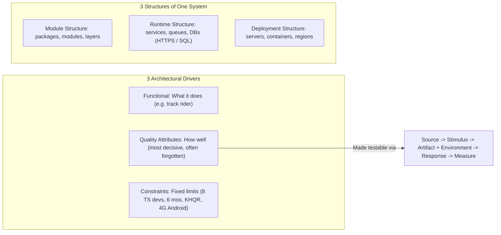

<details data-tag="theory">
<summary><strong>Question 2.1: Explain why deciding on event-based communication is an architectural decision while variable naming or a local sort is detailed design.</strong></summary>

**Key takeaway:** Architectural decisions span the whole system and are expensive to change later; detailed design is local and cheap to change.

- **Architecture:** Whole-system structure, takes weeks/months to change, driven by quality attributes & constraints (e.g., sync REST vs async events, SQL vs NoSQL).
- **Detailed Design:** Inside one component, takes hours/days to change, driven by features (e.g., class names, local sort algorithm, button color).

</details>

<details data-tag="theory">
<summary><strong>Question 2.2: Explain why one diagram or structure is not enough, and describe the three architectural structures.</strong></summary>

**Key takeaway:** A single diagram cannot show code organization, runtime communication, and server deployment at the same time.

- **Definition (Bass, Clements & Kazman):** Set of structures needed to reason about the system (elements, relations, and properties of both).
- **3 Structures:** **Module** (code split: packages, layers), **Runtime** (running services, queues, DBs talking via HTTPS/SQL), **Deployment** (servers, containers, cloud regions).
- **Why It Matters:** Structure decides quality attributes, shapes teams (Conway's Law), and gives a shared language across devs/QA/ops.

</details>

<details data-tag="practical">
<summary><strong>Question 2.3: Explain how to classify statements as Functional (F), Quality Attribute (Q), or Constraint (C), and list FoodHub's key constraints.</strong></summary>

**Key takeaway:** Functional = what the system does, Quality = how well it does it, Constraint = a fixed limit already decided for the architect.

- **Functional (F):** Features/behaviors with no "how well" (e.g., *"track rider on map"*).
- **Quality Attribute (Q):** Measurable system qualities (availability, latency, security, maintainability).
- **Constraints (C):** Fixed limits — **Business:** 6 months, fixed budget; **Team:** 8 TS devs (NestJS/Vue), no ops staff; **Technical:** KHQR/bank APIs, low-cost Android 4G; **Legal:** personal/payment data rules.

</details>

<details data-tag="theory">
<summary><strong>Question 2.4: Explain why "the app must be fast" fails as a requirement, and how to write a testable 6-part Quality Attribute Scenario (QAS).</strong></summary>

**Key takeaway:** Vague adjectives cannot be tested or guide design; a 6-part QAS pairs a concrete environment with a numeric measure.

- **6-Part QAS:** **Source** → **Stimulus** → **Artifact** → **Environment** → **Response** → **Measure** (always include a numeric threshold).

| ISO/IEC 25010 Focus Quality | Source & Stimulus | Artifact & Environment | Response & Numeric Measure |
| :--- | :--- | :--- | :--- |
| **Performance Efficiency** | 5,000 customers place orders | Order service · Lunch peak (normal op) | Orders accepted & confirmed · **99% within 2 s** (or 95% menu loads ≤ 1 s) |
| **Reliability (Availability)** | Hardware crashes 1 order server | Order service · Dinner peak | Traffic moves to healthy servers · **0 orders lost; &lt; 30 s errors** (99.9%/mo ≈ 43 min) |
| **Security** | Attacker tries 1,000 passwords on 1 account | Login endpoint · Normal operation | Account locked, owner notified · **Locked after 5 tries in 10 min** |
| **Maintainability** | Product owner asks for a new payment method | Payment module · Design time | Added without changing other modules · **At most 5 developer-days** |
| **Flexibility** | — | — | Scalability & adaptability (5× daily peaks, 10× 2-year growth without rewriting core) |

</details>

<details data-tag="theory">
<summary><strong>Question 2.5: Explain the three classic architectural trade-offs with FoodHub examples.</strong></summary>

**Key takeaway:** Every quality improvement trades off against another quality or cost—the architect chooses based on project context.

- **Security vs Usability:** Extra checkout verification stops fraud but slows honest customers.
- **Consistency vs Availability:** Rejecting orders when stock may be stale protects consistency; accepting & fixing later prioritizes availability.
- **Performance vs Cost:** Keeping peak-sized servers online cuts latency but wastes money at 3 a.m.

</details>

<details data-tag="theory">
<summary><strong>Question 2.6: Explain how the six software eras evolved and why companies still run monoliths alongside cloud services.</strong></summary>

**Key takeaway:** New architectural styles solved new scale/cloud problems without making simpler styles obsolete.

- **Six Eras:** 1990s LAMP Monolith → 2000s Multi-tier & SOA → 2006+ Cloud → 2013+ Docker/Microservices → 2014+ Serverless/CDNs → 2022+ LLM-powered systems.
- **Why Monoliths Remain:** For small teams and modest traffic, monoliths + managed cloud services avoid distributed complexity and ops overhead.

</details>

---

## Section 3 — Week 2: Designing and Documenting Architecture

Sources: Week 2 Slides (15 pages), Practice Handout, Quiz 2.

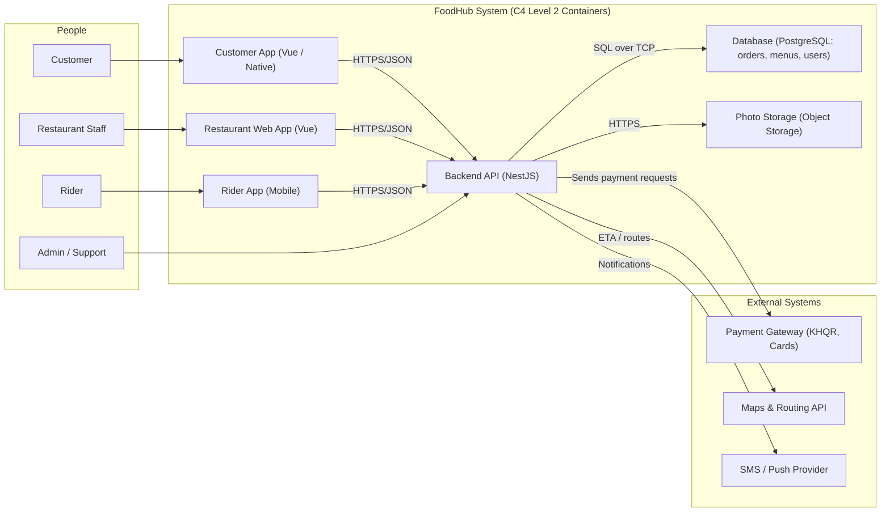

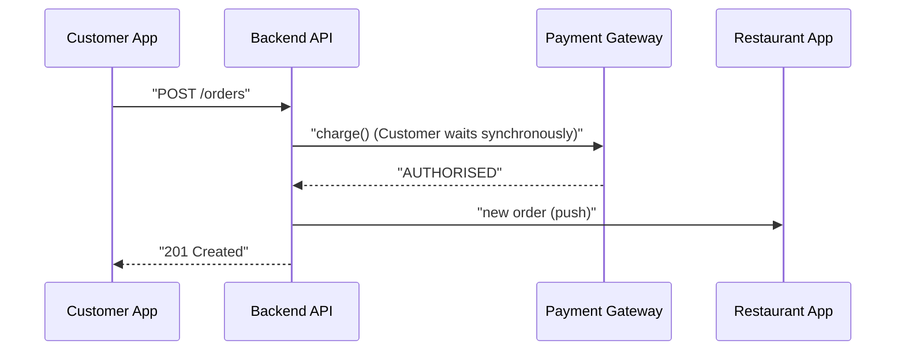

<details data-tag="theory">
<summary><strong>Question 3.1: Explain why architecture must be documented and what the four architectural views (including Sequence diagrams) show.</strong></summary>

**Key takeaway:** Undocumented architecture slows onboarding and causes code drift; four views keep docs concise, close to code, and clear.

- **Why Document:** Prevents tribal knowledge bottlenecks, repeated debates, and architecture drift. Keep docs *just enough*, in Git, written for a reader.
- **4 Views:** **Structure** (C4), **Behaviour** (Sequence diagram — shows **who waits for whom**, e.g., customer waits synchronously for payment), **Deployment** (machines/networks), **Decisions** (ADRs).

</details>

<details data-tag="theory">
<summary><strong>Question 3.2: Explain what C4 Level 1 vs Level 2 shows, and why a C4 "container" does not mean Docker.</strong></summary>

**Key takeaway:** C4 zooms from high-level context down to code; a C4 container is any separately runnable app or data store.

- **Level 1 (System Context):** FoodHub as 1 box + people + external systems (no databases or internal apps).
- **Level 2 (Containers):** Separately running apps/stores (e.g., Vue app, NestJS API, PostgreSQL)—not Docker containers. Label tech on boxes and protocols on arrows.
- **Level 3 & 4:** Components (modules inside one container, draw only if complex) and Code (classes, usually auto-generated).

</details>

<details data-tag="theory">
<summary><strong>Question 3.3: Explain the four parts of an ADR and why an accepted ADR is superseded rather than edited.</strong></summary>

**Key takeaway:** ADRs record why a decision was made at the time; superseding preserves history when forces change.

- **4 Parts:** **Status** (Proposed / Accepted / Superseded), **Context** (facts & forces), **Decision** (1–2 sentences), **Consequences** (both good **and** bad).
- **Never Edit Accepted ADRs:** Write a new ADR that supersedes the old one so future engineers understand why the original choice made sense.

</details>

<details data-tag="theory">
<summary><strong>Question 3.4: Explain the four system-level design principles and walk through the 6-Step Design Process.</strong></summary>

**Key takeaway:** Good designs separate concerns, keep related rules together, and follow a repeatable 6-step order from requirements to trade-offs.

- **4 Principles:** *Separation of concerns* (payment logic out of menu code), *High cohesion* (order rules together), *Loose coupling* (small stable interfaces), *Conway's law* (align teams & architecture).
- **6-Step Process:** `1. Clarify` (users, features, qualities, constraints) → `2. Estimate` (QPS, peak, storage, bandwidth) → `3. API` (endpoints/events) → `4. High-Level Design` (C4 containers) → `5. Deep Dive` (1–2 hardest parts) → `6. Trade-offs` (what changes at 10×).

</details>

<details data-tag="practical">
<summary><strong>Question 3.5: Explain how to calculate avg/peak QPS, storage, bandwidth, and why Rider GPS is a hidden write bottleneck.</strong></summary>

**Key takeaway:** Divide daily calls by 86,400 for average QPS, multiply by peak factor, and check background write loops like GPS pings.

- **Avg & Peak QPS:** `600k calls/day ÷ 86,400 ≈ 7 QPS` avg → `×5 = 35 QPS` peak → `×10 = 350 QPS` in 2 years.
- **Storage & Bandwidth:** `20k orders × 2 KB × 365 ≈ 15 GB/yr`; `Bandwidth = QPS × payload` (e.g., `35 × 10 KB ≈ 350 KB/s ≈ 2.8 Mbps`; photos go to Object Storage + CDN).
- **Hidden Load:** `400 active riders ÷ 5 s = 80 GPS writes/sec` — much higher than `0.23 orders/s`, making it the first candidate to extract.

</details>

---

## Section 4 — Week 3: Networking and Communication

Sources: Week 3 Slides (14 pages), Practice Handout, Quiz 3.

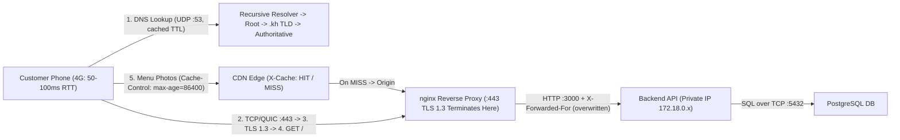

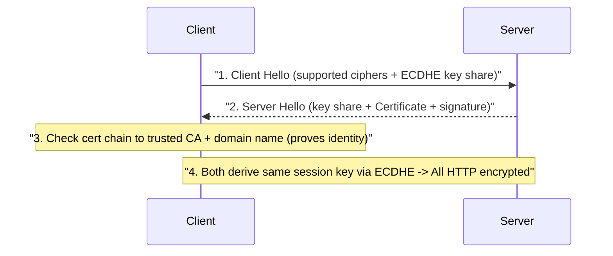

<details data-tag="theory">
<summary><strong>Question 4.1: Trace the five steps and protocols when a customer opens foodhub.com.kh in a browser.</strong></summary>

**Key takeaway:** Opening a URL resolves DNS first, establishes transport and TLS security, fetches HTML over HTTP, then loads assets.

- **5 Steps:** (1) **DNS** (`UDP :53`) finds server IP; (2) **TCP / QUIC** connects to IP `:443`; (3) **TLS 1.3** checks identity & derives session keys; (4) **HTTP** sends `GET /` and receives HTML; (5) **Additional requests** fetch CSS/JS/images (often from a **CDN**; ~300–500 ms total on 4G).

</details>

<details data-tag="theory">
<summary><strong>Question 4.2: Explain what the server certificate versus ECDHE does in TLS 1.3, and compare TCP vs UDP and private vs public IPv4.</strong></summary>

**Key takeaway:** The certificate proves server identity while ECDHE creates the shared encryption key; TCP guarantees delivery while UDP minimizes overhead.

- **TLS 1.3 (1-RTT):** **Certificate + signature** (verified against trusted CA + domain) proves *who* the server is; **ECDHE** key shares derive the shared symmetric session key for secrecy.
- **IPv4/IPv6 & Transport:** Private IPv4 (`10.x`, `172.16–31.x`, `192.168.x`) uses NAT; backend servers stay private behind a public proxy. **TCP** (reliable: HTTPS 443, Postgres 5432, Redis 6379) vs **UDP** (low overhead: DNS 53, QUIC 443).

</details>

<details data-tag="practical">
<summary><strong>Question 4.3: Explain why a DNS change with TTL 86,400 causes stale traffic during a server move and how to migrate safely.</strong></summary>

**Key takeaway:** Resolvers cache DNS answers for the full TTL (24 hours at 86,400 s), so lower the TTL well before moving servers.

- **DNS Chain (`dig +trace`):** Phone → Recursive resolver (`1.1.1.1`/ISP) → Root → `.kh` TLD → Authoritative.
- **Migration Procedure:** Shrink TTL (e.g., to 60–300 s) at least 1 old TTL (24 h) ahead, switch the `A` record while keeping the old server forwarding during overlap, then raise TTL after cutover.

</details>

<details data-tag="theory">
<summary><strong>Question 4.4: Explain why HTTP/3 (QUIC over UDP) outperforms HTTP/2 over TCP on 4G mobile networks.</strong></summary>

**Key takeaway:** HTTP/3 avoids TCP head-of-line blocking and survives Wi-Fi to 4G network switches via QUIC connection IDs.

| HTTP Version | Transport | Multiplexing & Loss Behaviour | Key Advantage / Trade-off |
| :--- | :--- | :--- | :--- |
| **HTTP/1.1 (1997)** | Text over TCP | 1 request at a time per connection; browsers open ~6 connections. | Simple, ubiquitous, high connection overhead. |
| **HTTP/2 (2015)** | Binary over TCP | Many streams on 1 connection + header compression. | **Weakness:** 1 lost TCP packet stalls *all* multiplexed streams (TCP HoL blocking). |
| **HTTP/3 (2022)** | Over **QUIC (UDP)** | Lost packet stalls *only its own stream*. | Transport + TLS in 1 RTT; connection survives **Wi-Fi → 4G switch**. |

</details>

<details data-tag="theory">
<summary><strong>Question 4.5: Explain why nginx logs 172.18.0.3 instead of the client IP (X-Forwarded-For) and why it returns 502 Bad Gateway.</strong></summary>

**Key takeaway:** The backend only sees the proxy's TCP IP unless nginx sets X-Forwarded-For, and returns 502 when the upstream backend is down.

- **Reverse Proxy & IP:** nginx terminates TLS and opens a new HTTP connection to `:3000`, so the app sees `172.18.0.3`. Fix by having nginx overwrite `X-Forwarded-For` (and trust only your own proxy).
- **502 Bad Gateway:** Returned when nginx cannot reach a healthy upstream backend process (e.g., crashed or stopped container).

</details>

<details data-tag="theory">
<summary><strong>Question 4.6: Explain why stateless servers scale easily and what should or should not be cached on a CDN.</strong></summary>

**Key takeaway:** Stateless servers let any replica handle any request, while CDNs cache only public static assets—never private or live user data.

- **Stateless Scaling:** Holding no local session memory means a load balancer can route requests to any server replica.
- **CDN Rules:** Cache public static files (menu photos, hashed `app.3f9a.js` with `Cache-Control: max-age=86400`; inspect `Age` & `X-Cache: HIT/MISS`)—never live order status or payment data.

</details>

---

## Section 5 — Week 4: Web Concepts and API Design

Sources: Week 4 Slides (13 pages), Practice Handout, Quiz 4.

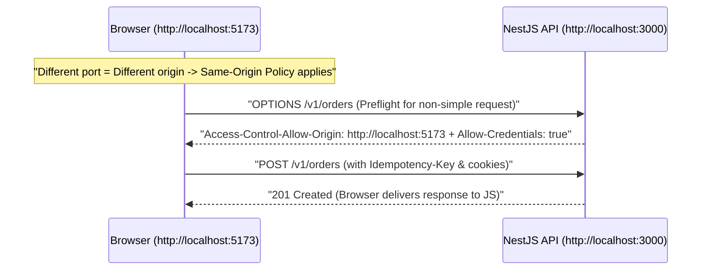

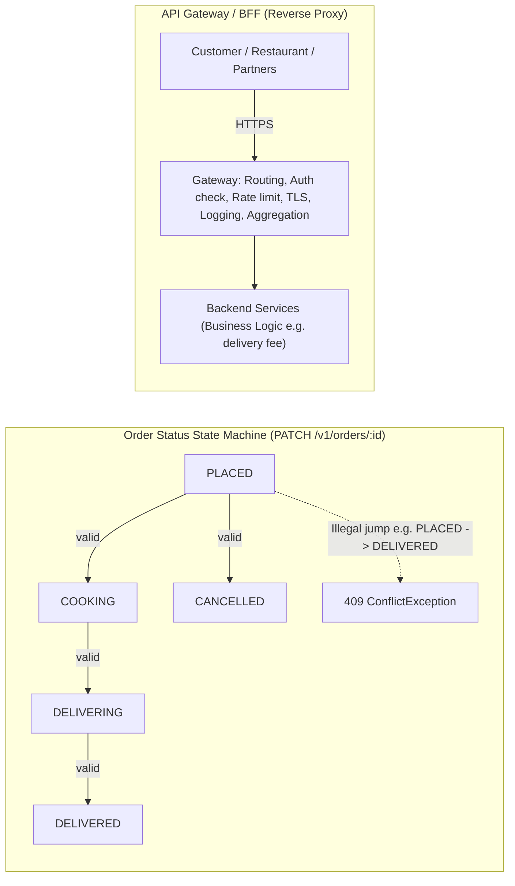

<details data-tag="theory">
<summary><strong>Question 5.1: Explain what happens to an in-memory SESSIONS Map on API restart or behind 3 load-balanced servers, and how Redis fixes it.</strong></summary>

**Key takeaway:** Process memory is wiped on restart and isn't shared across replicas, causing 401 errors unless moved to a shared Redis store.

- **Failure Modes:** Restarting the API clears the `Map` (all users logged out); behind 3 load-balanced servers, requests hitting a different server fail with `401`.
- **Fix:** Store ≥128-bit random session IDs (rotated on login) in a shared **Redis** or DB store for instant revocation at 1 lookup per request.

</details>

<details data-tag="theory">
<summary><strong>Question 5.2: Explain why self-contained JWTs are hard to revoke, why secrets must never go in the payload, and how to mitigate both.</strong></summary>

**Key takeaway:** JWTs are signed (not encrypted) and valid until expiry, so mitigate revocation with short TTLs and refresh tokens.

- **Confidentiality:** Base64 payload is readable by anyone—never store secrets/passwords inside.
- **Revocation & Security:** Zero DB lookup means stolen tokens work until `exp`. Mitigate with 5–15 min access tokens + server-revocable refresh tokens, pinned algorithm (reject `alg: none`), and `HttpOnly` cookies instead of `localStorage`.

</details>

<details data-tag="theory">
<summary><strong>Question 5.3: Explain which cookie flags (HttpOnly, Secure, SameSite, Max-Age, Domain/Path) mitigate XSS, sniffing, and CSRF.</strong></summary>

**Key takeaway:** HttpOnly blocks JS theft (XSS), Secure enforces HTTPS, and SameSite stops most cross-site request forgery (CSRF).

| Cookie Flag | Mechanism | Threat Mitigated |
| :--- | :--- | :--- |
| `HttpOnly` | Blocks `document.cookie` JS access | Token theft via XSS |
| `Secure` | Sent only over HTTPS | Sniffing on public Wi-Fi |
| `SameSite=Lax / Strict` | Withheld on most cross-site requests | CSRF (Cross-Site Request Forgery) |
| `Max-Age / Expires` | Caps cookie lifetime | Old sessions living forever |
| `Domain / Path` | Restricts host & path scope | Leaking to sibling subdomains |

</details>

<details data-tag="practical">
<summary><strong>Question 5.4: Explain REST design rules, idempotency (POST + Idempotency-Key retry), versioning, cursor pagination, and RFC 9457 errors.</strong></summary>

**Key takeaway:** Use noun URLs with HTTP verbs, protect POST retries with an Idempotency-Key, and standardize pagination and errors.

- **Methods & Idempotency:** `GET` is safe & idempotent; `PUT`/`DELETE` are idempotent; `POST` is not—accept `Idempotency-Key` to return `201` first time and `200` with stored order on retry.
- **Structure:** Version breaking changes (`/v1 → /v2`), use `cursor` pagination for changing lists, return **RFC 9457** errors (`status, code, message, details`), and `ValidationPipe({ whitelist: true })` (`400`).

</details>

<details data-tag="theory">
<summary><strong>Question 5.5: Explain why CORS blocks localhost:5173 calling localhost:3000, why origin: '*' with credentials fails, and why curl ignores CORS.</strong></summary>

**Key takeaway:** Different ports are different origins; browsers enforce CORS preflights and forbid wildcard origins when credentials are sent.

- **Why Blocked:** `5173` vs `3000` triggers Same-Origin Policy and an `OPTIONS` preflight. Fix on server with `origin: 'http://localhost:5173', credentials: true`.
- **Why `*` & `curl` Differ:** Browsers reject `origin: '*'` with `credentials: true` to block credential leaks; `curl` ignores CORS because only browsers enforce it.

</details>

<details data-tag="theory">
<summary><strong>Question 5.6: Explain when to use REST, gRPC, GraphQL, Webhooks, an API Gateway vs a BFF, and JSON vs Protobuf/Avro.</strong></summary>

**Key takeaway:** Use REST by default, gRPC/Protobuf for fast internal calls, GraphQL for varied UI queries, Webhooks for partner pushes, and BFFs per client.

- **4 API Styles:** **REST** (default public/mobile), **gRPC** (HTTP/2 + Protobuf, fast internal service calls), **GraphQL** (1 schema, exact fields for diverse UIs), **Webhooks** (partner pushes `POST` on event).
- **Gateway vs BFF & Formats:** Gateway centralizes TLS/auth/rate-limiting (no business logic); **BFF** tailors one gateway per client type. **Protobuf & Avro** beat JSON for compact binary + **schema evolution**.

</details>

---

## Section 6 — Week 5: Monolith, Layered, and Modular Styles

Sources: Week 5 Slides (13 pages), Practice Handout, Quiz 5.

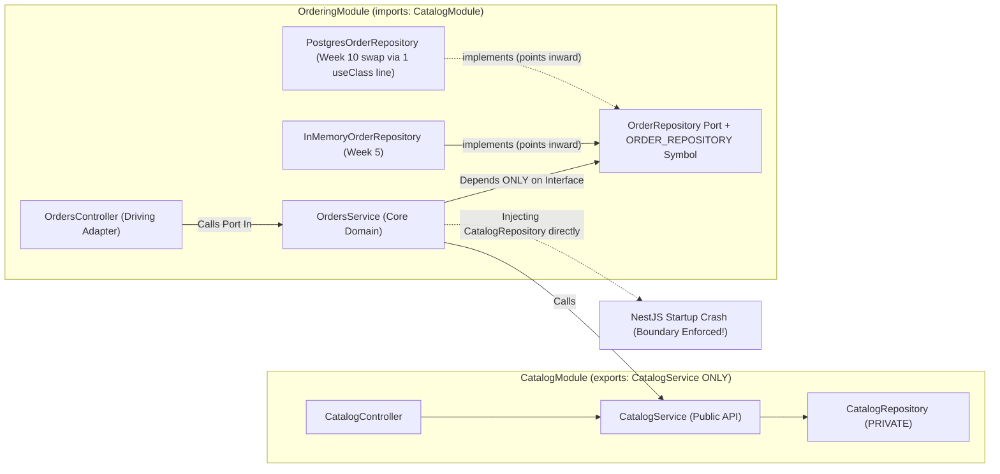

<details data-tag="theory">
<summary><strong>Question 6.1: Explain the difference between logical layers and physical tiers with FoodHub examples.</strong></summary>

**Key takeaway:** Layers organize code inside one program; tiers are separate running processes or machines.

- **Logical Layers:** Controllers → Services → Repositories inside the NestJS backend.
- **Physical Tiers:** Vue frontend ↔ NestJS API ↔ PostgreSQL database (a 3-tier deployment).

</details>

<details data-tag="theory">
<summary><strong>Question 6.2: Compare Simple Monolith, Layered, Modular Monolith, and Hexagonal architectures, and when to recommend each.</strong></summary>

**Key takeaway:** Start with a Modular Monolith for small teams and add Hexagonal Ports & Adapters when domain rules and external integrations grow.

| Style | Good When | Watch Out For |
| :--- | :--- | :--- |
| **Monolith (Simple)** | Small team, early product, simple domain; fast in-process calls & 1-DB ACID transactions. | Turning into a "big ball of mud"; every change redeploys all; scales as a whole. |
| **Layered** | Business apps with clear CRUD flows (Presentation → Business → Data access → DB). | Business logic depends directly on DB layer; each feature cuts across all layers. |
| **Modular Monolith** | 1–3 teams, growing domain, clear ownership; microservice structure without network/ops costs. | Boundaries must be enforced by framework (`exports`) or tests; zero module cycles. |
| **Hexagonal (Ports & Adapters)** | Rich business rules, many integrations (KHQR, DBs), strong unit testing with fake adapters (*Clean & Onion* are the same idea). | Extra interfaces/boilerplate for simple CRUD features. |

</details>

<details data-tag="theory">
<summary><strong>Question 6.3: Explain Pipe-and-Filter, Microkernel, and SOA styles with common examples.</strong></summary>

**Key takeaway:** Pipe-and-filter chains data transforms, Microkernel extends a small core via plugins, and SOA shares enterprise services over an ESB.

- **Pipe-and-Filter:** Sequential stages (e.g., scan → resize → compress → store; Unix pipes, ETL); watch pipeline latency.
- **Microkernel:** Small core + plug-ins (e.g., VS Code, payment plug-ins).
- **SOA:** Shared enterprise services connected via an ESB (watch central ESB bottlenecks).

</details>

<details data-tag="theory">
<summary><strong>Question 6.4: Explain why NestJS refuses to start if OrdersService injects CatalogRepository directly.</strong></summary>

**Key takeaway:** Keeping CatalogRepository unexported makes the boundary mechanical—NestJS throws a DI startup error instead of relying on discipline.

- **Boundary Enforcement:** `CatalogModule` puts only `CatalogService` in `exports`, keeping `CatalogRepository` private.
- **Result:** Any direct cross-module repository injection fails fast at boot instead of silently coupling databases/tables.

</details>

<details data-tag="practical">
<summary><strong>Question 6.5: Explain how Ports & Adapters (Hexagonal) lets FoodHub swap In-Memory for PostgreSQL with one useClass line.</strong></summary>

**Key takeaway:** The domain core depends only on a TypeScript Port interface and token, so swapping adapters only changes one line in the module.

- **Inward Dependencies:** `OrdersService` imports only the `OrderRepository` interface (`import type`) and `@Inject(ORDER_REPOSITORY)`; `ordering.module.ts` binds the concrete adapter via `useClass`.

```typescript
export interface OrderRepository {
  save(order: Order): Promise<void>;
  get(id: string): Promise<Order | undefined>;
}
export const ORDER_REPOSITORY = Symbol('ORDER_REPOSITORY');

constructor(@Inject(ORDER_REPOSITORY) private readonly orders: OrderRepository) {}

// ordering.module.ts — swap InMemoryOrderRepository -> PostgresOrderRepository in Week 10:
providers: [OrdersService, { provide: ORDER_REPOSITORY, useClass: InMemoryOrderRepository }]
```

</details>

---

## Section 7 — Week 6: Microservices, DDD, and Event Storming

Sources: Week 6 Slides (14 pages), Practice Handout, Quiz 6, `TeachersNode.md`.

### FoodHub Event Storming Workshop Board (40% Practical Highlight)

```event-storming
context: 1. Catalog Context
actor: Restaurant Staff
command: UpdateMenu
event: MenuUpdated

context: 2. Ordering Context
actor: Customer
command: PlaceOrder
event: OrderPlaced
event: OrderAccepted / OrderCancelled
hotspot: "What if restaurant never accepts?"

context: 3. Payment Context
actor: KHQR / Bank System
command: AuthorisePayment / IssueRefund
event: PaymentAuthorised / RefundIssued
hotspot: "Payment settles after order timeout?"

context: 4. Delivery Context
actor: Rider & Kitchen
command: MarkFoodReady / AssignRider
event: FoodReady -> RiderAssigned -> OrderPickedUp -> OrderDelivered
hotspot: "Rider cancels after pickup?"

context: 5. Notification / Reviews
actor: SMS Provider / Customer
command: SendAlert / RateOrder
event: CustomerNotified / OrderRated
```

### FoodHub Context Map (Sync vs Async + DDD Relationships)

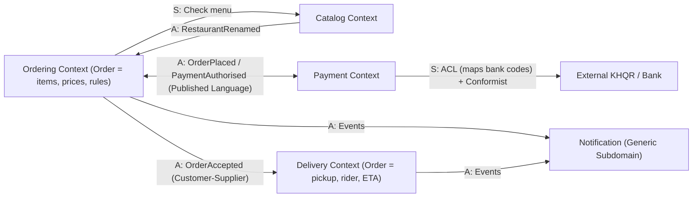

<details data-tag="theory">
<summary><strong>Question 7.1: Explain DDD Core vs Supporting vs Generic Subdomains, Ubiquitous Language, and Bounded Contexts ("one word, two meanings").</strong></summary>

**Key takeaway:** Invest top engineers in Core subdomains, buy/integrate Generic ones, and isolate model meanings inside Bounded Contexts.

- **Subdomains:** *Core* (competitive edge: rider matching, ETA) · *Supporting* (menus) · *Generic* (buy/reuse: payments, SMS).
- **Ubiquitous Language & Bounded Context:** Business and devs share terms within a boundary where each word has one meaning (e.g., `"Order"` in Ordering = items/prices; in Delivery = pickup/drop-off/ETA).

</details>

<details data-tag="practical">
<summary><strong>Question 7.2: Explain how to run an Event Storming workshop (4 sticky colors, 5 steps) and draw a Sync (S) vs Async (A) Context Map.</strong></summary>

**Key takeaway:** Map past-tense events on a timeline, add commands/actors and hot spots, group into Bounded Contexts, and label S/A links.

- **4 Colors & 5 Steps:** (1) **Orange** = past-tense Domain Event (`OrderPlaced`), (2) Left-to-right **Timeline**, (3) **Blue** = Command (`PlaceOrder`) + **Yellow** = Actor (`Customer`), (4) **Pink** = Hot Spots (risks/conflicts), (5) Group into Bounded Contexts & draw Context Map marking **S** (sync) vs **A** (async).

</details>

<details data-tag="theory">
<summary><strong>Question 7.3: Explain the five DDD Context Map relationships with FoodHub examples.</strong></summary>

**Key takeaway:** Context Map patterns define how teams and models integrate across Bounded Contexts.

- **Customer-Supplier:** Delivery depends on Ordering's `OrderAccepted`.
- **Conformist:** Accept external KHQR API model as-is.
- **Anti-Corruption Layer (ACL):** Translator maps messy bank codes cleanly.
- **Published Language:** Documented shared event schemas.
- **Shared Kernel:** Small shared model (like `Money`) used rarely to avoid tight coupling.

</details>

<details data-tag="theory">
<summary><strong>Question 7.4: Explain the 6 traits of microservices, why a "distributed monolith" fails, and why serial sync calls (0.999³) lower availability.</strong></summary>

**Key takeaway:** Microservices require independent deploys and separate databases; sharing a DB or chaining sync calls destroys reliability.

- **6 Traits:** Business capability · Independent deploy · Own DB · Smart endpoints/dumb pipes · Owned by 1 team (5–9 people) · Designed for failure.
- **Failure Modes:** **Distributed Monolith** (deployed together or sharing 1 DB) has all network costs with zero independence; 3 serial 99.9% sync calls drop availability to `0.999³ ≈ 99.7%`.

</details>

<details data-tag="theory">
<summary><strong>Question 7.5: Explain Database-per-Service and three ways Ordering can display restaurant names without cross-DB joins.</strong></summary>

**Key takeaway:** Each service owns its private tables; share needed display data via APIs, snapshots, or async events instead of DB joins.

- **3 Valid Patterns:** (1) API composition at read time, (2) copying/denormalising the restaurant name at order creation, or (3) maintaining a local read model updated by `RestaurantRenamed` events.

</details>

<details data-tag="theory">
<summary><strong>Question 7.6: Explain Serverless (FaaS), Cell-Based Architecture, real-world case studies, and the FoodHub Decision Framework.</strong></summary>

**Key takeaway:** FoodHub fits a Modular Monolith today (8 devs, 35 QPS, no ops); extract high-write Rider Tracking (80/s) first if needed.

- **Serverless & Cells:** **FaaS** scales to zero for spiky tasks (image resizing; watch cold starts, time limits, lock-in). **Cell-Based** isolates user slices (e.g., by city) for blast-radius control.
- **Case Studies:** Uber DOMA (too many tiny services hurt); Prime Video (~90% cheaper merging serverless back into one service); Shopify (modular monolith scales far).

| Decision Factor (Slide 13) | Points to Modular Monolith | Points to Microservices | FoodHub Today (8 devs, 35 QPS, 6 mos) |
| :--- | :--- | :--- | :--- |
| **Team size** | 1–3 teams | Many teams blocking each other | 1–2 teams → **Modular Monolith** |
| **Domain** | Still being discovered | Well understood, stable boundaries | Still evolving → **Modular Monolith** |
| **Scale** | Even load, modest QPS | Parts with very different load | Extract **Rider Tracking (80 writes/s)** first if needed |
| **Time to market** | Must launch fast | Platform & tooling already exist | 6 months → **Modular Monolith** |
| **Operations skill** | Limited DevOps | Strong CI/CD, containers, observability | No dedicated ops → **Modular Monolith** |
| **Release needs** | One release cadence is fine | Parts must release independently | Single cadence fine → **Modular Monolith** |

</details>

---

## Section 8 — Week 7: Event-Driven Architecture and Messaging

Sources: Week 7 Slides (13 pages), Practice Handout, Quiz 7, `TeachersNode.md`.

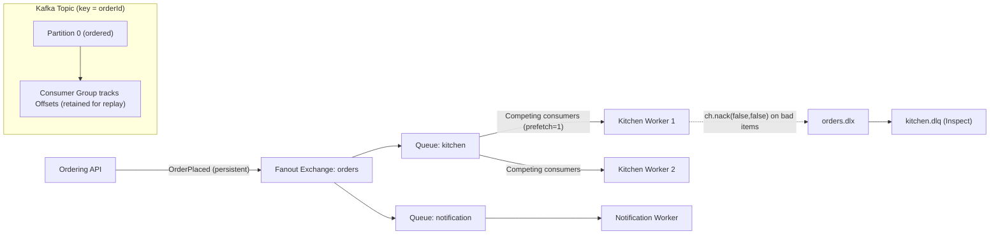

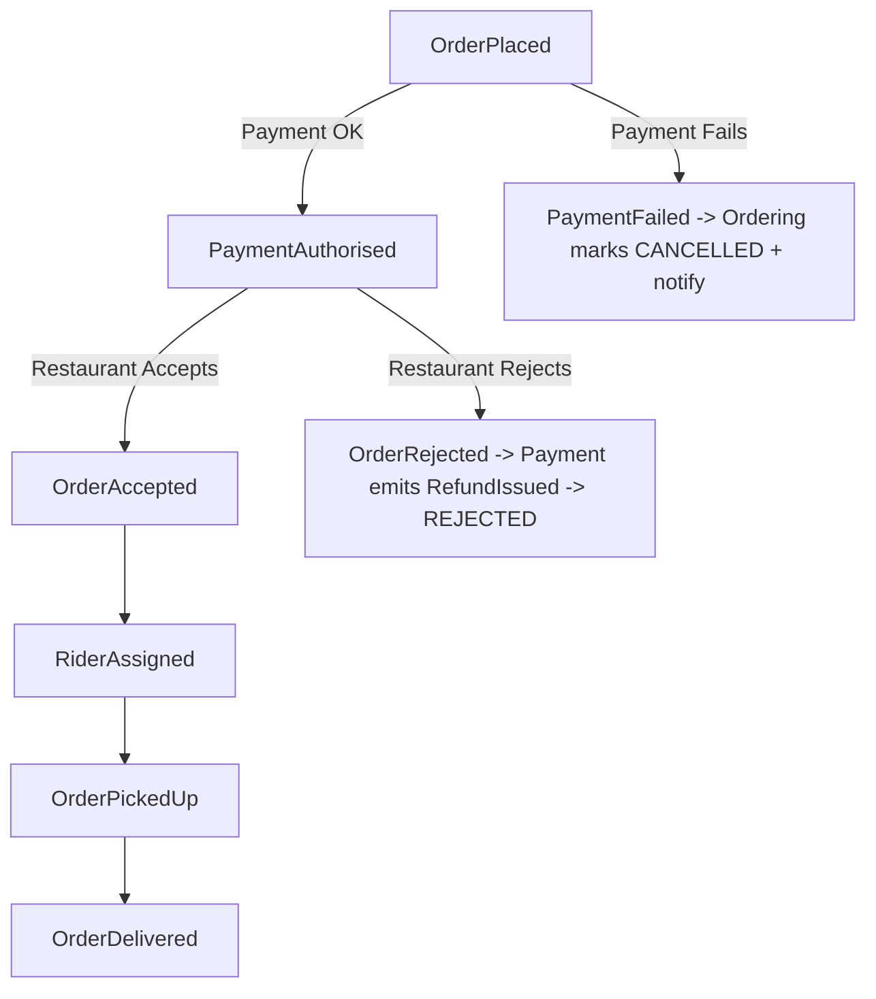

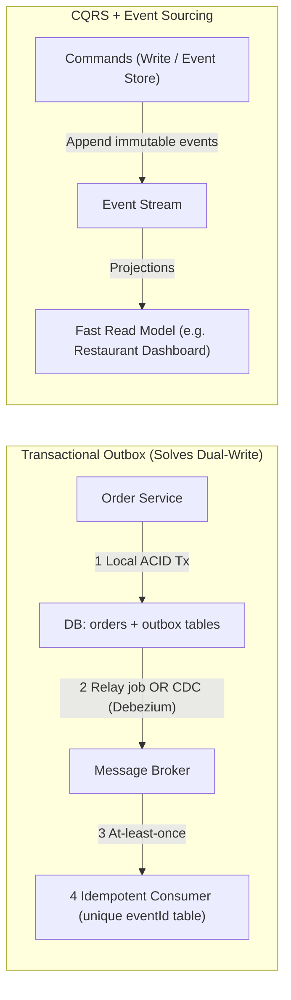

<details data-tag="theory">
<summary><strong>Question 8.1: Explain the difference between Commands and Events and the three messaging models.</strong></summary>

**Key takeaway:** Commands tell one receiver what to do; events announce facts to 0..N listeners across queues, pub/sub, or retained logs.

- **Commands vs Events:** Command = imperative (*"Do this"*: `ChargePayment`, 1 receiver, rejectable). Event = past tense (*"This happened"*: `OrderPlaced`, immutable fact, 0..N unknown listeners).
- **3 Models:** *Point-to-point Queue* (1 consumer gets each msg; competing consumers share work), *Pub/Sub* (fanout to each subscriber), *Event Stream Log* (append-only retained log; consumers track offsets & replay).

</details>

<details data-tag="theory">
<summary><strong>Question 8.2: Explain why prefetch=1 protects workers and why ch.nack(false, true) is dangerous compared with a Dead-Letter Exchange (DLX/DLQ).</strong></summary>

**Key takeaway:** prefetch=1 stops one slow worker from hoarding messages, while routing poison messages to a DLQ prevents infinite requeue loops.

- **Backpressure:** `prefetch=1` caps unacked messages per worker so work distributes fairly.
- **Poison Messages:** `ch.nack(msg, false, true)` requeues bad messages in an endless crash loop; `ch.nack(msg, false, false)` routes them to `orders.dlx → kitchen.dlq` for inspection.

</details>

<details data-tag="theory">
<summary><strong>Question 8.3: Compare RabbitMQ and Kafka on message model, retention, ordering, replay, and typical use.</strong></summary>

**Key takeaway:** RabbitMQ deletes messages after ack with flexible queue routing; Kafka retains an ordered partitioned log for replay and high throughput.

| Broker Comparison (Slide 6) | RabbitMQ | Kafka |
| :--- | :--- | :--- |
| **Model** | Exchanges route to queues | Distributed append-only log: topics + partitions |
| **After consumption** | Deleted when acked | Kept until retention expires; consumers commit offsets |
| **Ordering** | Per queue (with 1 consumer) | Only **within a partition** (use key e.g. `orderId`) |
| **Replay** | Not by design | Yes — reset consumer offset |
| **Strengths & Use** | Flexible routing, per-msg acks, simple ops; task queues, moderate events | Very high throughput, history, streaming, analytics, CDC, logs |

</details>

<details data-tag="theory">
<summary><strong>Question 8.4: Explain delivery guarantees (at-most-once, at-least-once, effectively-once) and safe event schema evolution.</strong></summary>

**Key takeaway:** Networks provide at-least-once delivery; combine it with a durable eventId table for effectively-once processing and add only optional fields.

- **Delivery Guarantees:** *At-most-once* (ack before work, OK for GPS/metrics), *At-least-once* (ack after work, duplicates possible), *Effectively-once* (at-least-once + idempotent consumer using a durable DB `eventId` table, never an in-memory `Set`).
- **Schema Evolution:** Include `eventId, type, version, occurredAt, orderId`. Add only optional fields; never rename/remove in place; use a **schema registry** for shared events.

</details>

<details data-tag="theory">
<summary><strong>Question 8.5: Explain why 2PC is avoided across microservices and compare Choreography vs Orchestration Sagas.</strong></summary>

**Key takeaway:** 2PC locks rows across services and blocks on coordinator failure; Sagas use local transactions plus compensating actions.

- **Why Avoid 2PC:** Slow distributed locks, blocks if coordinator dies, and message brokers don't participate.
- **Sagas:** *Choreography* = services react to events (loose coupling, hard to trace); *Orchestration* = central coordinator like Temporal/Step Functions (explicit flow, extra orchestrator).

</details>

<details data-tag="theory">
<summary><strong>Question 8.6: Explain the dual-write problem, Transactional Outbox (+ Relay/CDC), and how CQRS + Event Sourcing work together.</strong></summary>

**Key takeaway:** Save domain rows and outbox events in one local DB transaction, publish via Relay or CDC, and optionally project events into CQRS read models.

- **Dual-Write & Transactional Outbox:** Saving to DB + publishing to broker cannot share 1 ACID tx. **Outbox:** (1) INSERT domain row + outbox row in 1 local DB tx; (2) Relay job or **CDC (Debezium)** reads new rows; (3) Publish & mark sent; (4) Consumer deduplicates via `eventId`.
- **CQRS & Event Sourcing:** **CQRS** separates write models from tailored read models (e.g., fast restaurant dashboard). **Event Sourcing** appends immutable events instead of overwriting rows (full audit, needs **snapshots**).

</details>

---

## Practical Exam Paper Templates (40%)

- **Template 1 — 6-Part QAS (Week 1):** Always list all 6 explicitly: **Source** (who/what) · **Stimulus** (event) · **Artifact** (which service/endpoint) · **Environment** (peak/normal/deploy) · **Response** (system action) · **Measure** (number + unit, e.g., `99% ≤ 2 s`, `0 orders lost`).
- **Template 2 — Sizing & 4-Part ADR (Week 2):** Show formula + units (`÷ 86,400` for /s, `× peak`, `× 365` for /yr). **ADR:** Title + Status + **Context** (team/deadline/QPS/qualities) + **Decision** (1–2 sentences) + **Consequences** (at least 1 good `+` and 1 bad `-`).
- **Template 3 — C4 & Request Flow (Weeks 2–3):** **C4 Context:** System = 1 box + People + External systems (NO DBs!). **C4 Container:** Tech on every box + Protocol on every arrow (`HTTPS/JSON`, `SQL/TCP`). **Request Flow:** Mark where TLS terminates and where caching happens.
- **Template 4 — REST + Hexagonal (Weeks 4–5):** **REST:** Noun paths (`/v1/...`), pagination, success code (`200/201/204`) + error codes (`400/401/403/404/409`). **Hexagonal:** Arrows point *inward*; core imports only Port interface; Module `useClass` binds Adapter.
- **Template 5 — Event Storming + Context Map (40% Practical Highlight):** (1) State 4 colors (`Orange`=past-tense Event, `Blue`=Command, `Yellow`=Actor, `Pink`=Hot Spot); (2) Order left-to-right timeline; (3) Group into 4–6 Bounded Contexts + name *"one word, two meanings"*; (4) Draw Context Map marking every arrow **S** (sync API) or **A** (async event) + DDD type (`Customer-Supplier`, `ACL`, `Conformist`, `Published Language`); (5) If asked to score for extraction: rate 1–3 on Change Frequency, Scaling Need, Team Ownership, Data Sensitivity.

---

## Section 9 — Mock Midterm Paper (60% Theory / 40% Practical)

### Part I — Theory & Concepts: 60% ("Explain…" Only — 6 × 10 pts)

<details data-tag="theory" data-meta="10 pts · W1–2">
<summary><strong>Question 9.1:</strong> Explain why software architects focus on quality attributes rather than features, and explain why an outdated accepted ADR should be superseded rather than edited.</summary>

Many different structures can deliver the same functional features, whereas qualities (latency, availability, security, modifiability) depend directly on structural choices that are expensive to change later. An accepted ADR is immutable because teams need the historical record of what forces existed at that time to prevent repeating old debates; writing a new ADR that supersedes the old one updates the decision while preserving context.

**Rubric (10 pts):** 5 pts quality attributes vs structure/cost-of-change; 5 pts ADR immutability + supersede mechanism.

</details>

<details data-tag="theory" data-meta="10 pts · W3">
<summary><strong>Question 9.2:</strong> Explain why HTTP/3 (QUIC over UDP) reduces page load and stall problems on 4G mobile networks compared with HTTP/2 over TCP, and explain why nginx returns <code>502 Bad Gateway</code> if the backend process crashes.</summary>

HTTP/2 multiplexes streams inside one TCP connection, so losing a single packet stalls all streams (TCP head-of-line blocking) and switching Wi-Fi → 4G breaks the TCP socket. HTTP/3 uses QUIC over UDP: packet loss stalls only the affected stream, transport + TLS 1.3 finish in 1 round trip, and connection IDs survive network switches. In nginx, the proxy itself remains up on port 80/443, fails to connect to the stopped upstream backend, and returns `502 Bad Gateway`.

**Rubric (10 pts):** 6 pts HTTP/2 TCP HoL + HTTP/3 QUIC 1-RTT & migration; 4 pts nginx upstream failure → 502.

</details>

<details data-tag="theory" data-meta="10 pts · W4">
<summary><strong>Question 9.3:</strong> Explain the trade-off between server-side sessions and self-contained JWTs (including revocation, payload confidentiality, and browser storage), and explain what happens to an in-memory session store behind 3 load-balanced servers.</summary>

Server-side sessions allow instant logout/revocation by deleting the server record, but require a shared store (Redis/DB) lookup per request. Self-contained JWTs need no lookup across servers, but are *signed, not encrypted* (no secrets inside) and cannot be revoked until expiry—mitigated by short TTLs (5–15 min) + revocable refresh tokens, pinning the signing algorithm, and storing tokens in `HttpOnly; Secure; SameSite` cookies instead of XSS-readable `localStorage`. An in-memory `Map` behind 3 servers fails whenever a user's next request hits a different server that lacks their session.

**Rubric (10 pts):** 4 pts revocation vs lookup; 3 pts signed-not-encrypted + HttpOnly/short TTL; 3 pts 3-server state mismatch.

</details>

<details data-tag="theory" data-meta="10 pts · W5">
<summary><strong>Question 9.4:</strong> Explain how a modular monolith combined with Hexagonal Architecture (Ports &amp; Adapters) keeps NestJS modules decoupled, and explain why injecting an unexported repository fails at startup.</summary>

A modular monolith splits code by business capability with owned data and public interfaces, avoiding network/distributed costs. Hexagonal architecture ensures the domain core depends only on abstract interfaces (ports like `OrderRepository`), while adapters implement them at the edges and are wired via one `useClass` line in the module. In NestJS, omitting `CatalogRepository` from `CatalogModule.exports` hides it from DI, so injecting it into `OrdersService` crashes at startup—enforcing architectural boundaries mechanically.

**Rubric (10 pts):** 4 pts modular monolith + data ownership; 4 pts inward dependency + port/adapter; 2 pts NestJS `exports` enforcement.

</details>

<details data-tag="theory" data-meta="10 pts · W6">
<summary><strong>Question 9.5:</strong> Explain why calling three 99.9%-available microservices synchronously lowers chain availability and increases coupling, and explain three ways Ordering can display restaurant names without querying Catalog's database directly.</summary>

Serial sync calls create temporal coupling and multiply failure: `0.999³ ≈ 99.7%` availability, and latency accumulates across hops. Microservices must own private databases to avoid hidden schema coupling. Ordering can obtain restaurant names by: (1) calling Catalog's API at read time, (2) copying/denormalising the restaurant name onto the order when placed, or (3) maintaining a local read model updated asynchronously by `RestaurantRenamed` events.

**Rubric (10 pts):** 4 pts serial availability math + temporal coupling; 2 pts DB-per-service rationale; 4 pts three valid read patterns.

</details>

<details data-tag="theory" data-meta="10 pts · Teacher Note">
<summary><strong>Question 9.6:</strong> Explain the dual-write problem, explain how the Transactional Outbox (with Relay or CDC) solves it, and explain why consumers still require idempotency.</summary>

Saving a domain record to a DB and publishing an event to a broker cannot share a single ACID transaction, so a crash or network error can leave one committed without the other (dual-write inconsistency). The Transactional Outbox writes the domain row and an outbox event row inside *one local DB transaction*. A background relay or CDC tool (e.g., Debezium reading the DB log) publishes outbox rows to the broker and marks them sent. If the relay crashes after publishing before marking sent, it replays the row—producing at-least-once delivery—so consumers must deduplicate using a durable `eventId` table with a unique constraint.

**Rubric (10 pts):** 3 pts dual-write problem; 4 pts single local tx + relay/CDC; 3 pts at-least-once replay → durable `eventId` idempotency.

</details>

### Part II — Practical Design & Workshops: 40% (4 × 10 pts)

<details data-tag="practical" data-meta="10 pts · W1–2">
<summary><strong>Question 9.7:</strong> A telemedicine app has 300,000 appointments/day (each 2 KB record, 20 API calls/appointment, 5× peak) and 2,000 doctors sending online-status heartbeats every 10 s (50% active at peak). Calculate avg/peak API QPS, annual storage, and peak heartbeat writes/s (with units). Then write a 6-part QAS for: "Doctors' booking API must survive a server crash during morning peak."</summary>

- **Math:** API calls/day = `300,000 × 20 = 6,000,000 calls/day`. Avg QPS = `6,000,000 ÷ 86,400 ≈ 69.4 QPS`. Peak QPS = `69.4 × 5 ≈ 347 QPS`. Storage = `300,000 × 2 KB = 600 MB/day × 365 ≈ 219 GB/yr`. Heartbeats = `1,000 active doctors ÷ 10 s = 100 writes/s`.
- **6-Part QAS:** Source: Infrastructure/hardware; Stimulus: 1 booking API server crashes; Artifact: Booking service; Environment: Morning peak; Response: LB routes traffic to healthy instances without dropping confirmed bookings; Measure: &lt; 1% failed requests, recovery ≤ 30 s, 0 lost bookings.

**Rubric (10 pts):** 5 pts calculations with units & working; 5 pts all 6 QAS parts with numeric measure.

</details>

<details data-tag="practical" data-meta="10 pts · W3–4">
<summary><strong>Question 9.8:</strong> Trace the 4 steps + protocols from a browser typing <code>app.clinic.kh</code> to receiving HTML behind nginx, then fix a Vue app on <code>http://localhost:5173</code> getting CORS-blocked by <code>http://localhost:3000</code> and design <code>POST /v1/appointments</code> with retry protection.</summary>

- **4 Steps:** (1) DNS lookup (UDP :53) → IP; (2) TCP :443 (or QUIC/UDP for HTTP/3); (3) TLS 1.3 handshake (cert + ECDHE) terminating at nginx; (4) HTTP GET/response forwarded to internal backend (with `X-Forwarded-For`).
- **CORS Fix:** Different ports = different origins; enable `Access-Control-Allow-Origin: http://localhost:5173` and `credentials: true` (never `*` with cookies).
- **Idempotent POST:** `POST /v1/appointments` returns `201 Created` (or `400`/`409` on invalid/slot conflict); client sends `Idempotency-Key: <uuid>`, server stores key→result and returns `200` with the original appointment on retry.

**Rubric (10 pts):** 4 pts 4-step trace + protocols; 3 pts CORS cause & server fix; 3 pts REST endpoint + Idempotency-Key flow.

</details>

<details data-tag="practical" data-meta="10 pts · Teacher Note">
<summary><strong>Question 9.9:</strong> Conduct a mini Event Storming &amp; Context Mapping on FoodHub (from customer checkout through delivery &amp; cancellation/refund): list events, commands, actors, and 2 hot spots using the 4 sticky colors; group into 4 Bounded Contexts; give 1 word with 2 meanings; and draw a Context Map with <code>S</code>/<code>A</code> arrows.</summary>

- **Timeline (Orange Events ← Blue Commands ← Yellow Actors):** Customer → `PlaceOrder` → `OrderPlaced`; Payment → `AuthorisePayment` → `PaymentAuthorised`; Restaurant → `AcceptOrder/RejectOrder` → `OrderAccepted` / (`OrderRejected` → `IssueRefund` → `RefundIssued`); Rider → `AssignRider/PickUp/Deliver` → `RiderAssigned → OrderPickedUp → OrderDelivered`.
- **2 Hot Spots (Pink):** "What if restaurant never accepts within 5 min?" and "What if rider cancels after food pickup?"
- **4 Contexts & 1 Word:** *Catalog, Ordering, Payment, Delivery*. "Order" in Ordering = items/prices/discounts; in Delivery = pickup/drop-off/rider/ETA.
- **Context Map:** Ordering → Catalog (**S**), Ordering ↔ Payment (**A**), Payment → KHQR (**S**, ACL), Ordering → Delivery (**A**).

**Rubric (10 pts):** 3 pts 4-color timeline + past-tense events; 2 pts 2 valid hot spots; 2 pts bounded contexts + 1 word/2 meanings; 3 pts Context Map with S/A + ACL.

</details>

<details data-tag="practical" data-meta="10 pts · W6–7">
<summary><strong>Question 9.10:</strong> Write an ADR deciding Modular Monolith vs Microservices for a 6-developer logistics startup launching in 4 months (modest 20 QPS, strong ACID needs on billing), and sketch the choreographed Saga events for order happy path + two failure compensations.</summary>

- **ADR:** *Decision:* Start with a Modular Monolith (with clean module boundaries and repository ports). *Context:* 6 devs, 4-month deadline, 20 QPS, billing needs ACID, no dedicated ops. *Consequences:* (+) Single deployment, in-process calls, single-DB ACID, ready to split later; (−) Single failure domain and shared scaling until modules are extracted.
- **Saga Events:** Happy path: `OrderPlaced → PaymentAuthorised → OrderAccepted → RiderAssigned → OrderPickedUp → OrderDelivered`. Failure 1: `PaymentFailed → OrderCancelled` + notify. Failure 2: `OrderRejected → RefundIssued → OrderRejected/Cancelled` + notify.

**Rubric (10 pts):** 5 pts ADR (all 4 parts + context forces + good/bad consequences); 5 pts Saga happy path + both failure compensations.

</details>
